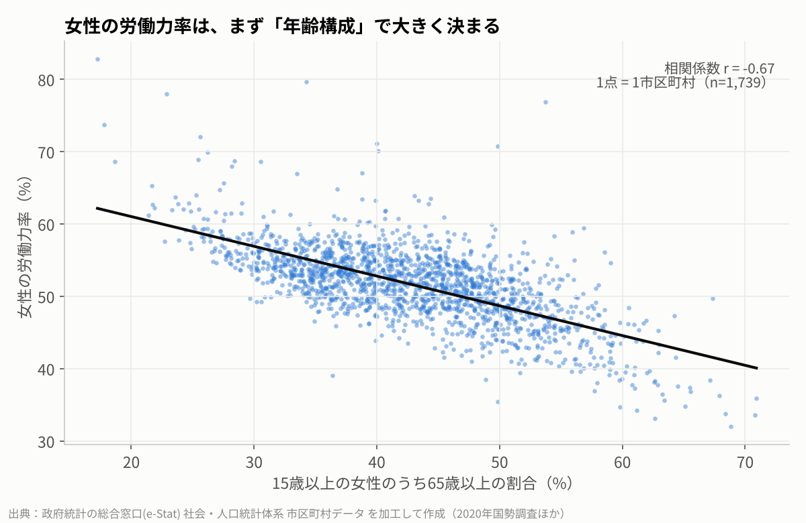
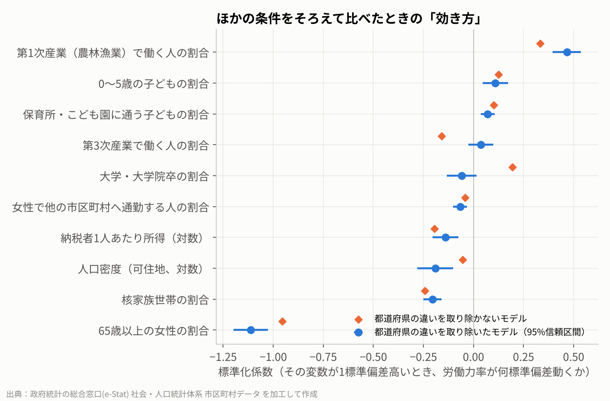

# 000 女性の労働力率は何で決まる？ 全国1,739市区町村の公開データで調べてみた

note の記事「女性の労働力率は何で決まる？ 全国1,739市区町村の公開データで調べてみた」の分析コード・データ・図です。

- もとは個別リポジトリ `estat-women-labor` に置いていた分析です

## 動かし方

```bash
pip install -r requirements.txt
cd src
python analysis.py
```

## 図

- `figures/fig1_age_vs_flfp.png`
- `figures/fig2_coefficients.png`
- `figures/fig3_pref_residual.png`
- `figures/fig4_partial_nuclear_childcare.png`

## もとのリポジトリの説明

以下は、もとのリポジトリ `estat-women-labor` の README です（同じリポジトリにあったほかの記事の分も含みます）。

### 何が市区町村の女性の労働力率を左右しているか（e-Stat 公開データ）

- **何を**：全国1,739市区町村で、女性の労働力率（低い所で3割台、高い所で7〜8割）の差が何と関係しているかを調べた
- **どう**：e-Stat の国勢調査などの公開データを市区町村単位で結合し、標準化した重回帰（HC3）に都道府県の固定効果を入れて推定。頑健性チェックを5通り
- **結果**：いちばん大きいのは年齢構成（65歳以上の女性の割合だけで差の約44%）。年齢と都道府県をそろえても、第1次産業（＋）・核家族（−）の向きは変わらない。因果ではなく関連

解説記事（note）：https://note.com/takayukimatsuura/n/n683afeafc893

#### 1. 問い

全国1,739市区町村（東京23区を含む。政令市は市単位）で、女性の労働力率には大きな差がある（低い所で3割台、高い所で7〜8割）。**その差は何と関係しているのか**を、重回帰で調べた。

- 目的変数：女性の労働力率＝労働力人口（女）÷（労働力人口（女）＋非労働力人口（女））。2020年国勢調査
- 主に見る説明変数：核家族世帯の割合、保育所・こども園に通う子どもの割合、第1次産業で働く人の割合
- 調整する変数（交絡しそうなもの）：年齢構成（65歳以上の女性の割合）、人口密度、所得、大卒の割合、通勤、子どもの割合、産業構成、都道府県
- 仮説：核家族世帯の割合が高い市区町村ほど女性の労働力率が低い。ただし年齢構成をそろえると、地域の差の多くは年齢で説明され、残る差は小さくなる

#### 2. データ

出典はすべて **政府統計の総合窓口(e-Stat)「社会・人口統計体系」**（総務省統計局）。2026年10月21日に取得。

| 表名 | 表ID | 使った項目 | 置き場所 |
|---|---|---|---|
| 統計でみる市区町村のすがた2026 基礎データ（A 人口・世帯／B 自然環境／C 経済基盤／E 教育／F 労働／J 福祉・社会保障） | ファイル statInfId 000040463584（A）・000040463585（B）・000040463586（C）・000040463588（E）・000040463589（F）・000040463593（J） | 総人口、65歳以上人口、一般世帯数、核家族世帯数、単独世帯数、人口集中地区人口、可住地面積、課税対象所得、納税義務者数、就業者数、産業別就業者数、保育所等数 など | `data/raw/2026-*.xls` |
| 社会・人口統計体系 市区町村データ 基礎データ（A 人口・世帯） | statsDataId 0000020201 | A130202・A130302・A1405・A141402（2020年度） | `data/raw/estat_ssds_municipal_women_2020.csv` |
| 同（E 教育） | statsDataId 0000020205 | E9101・E9106（2020年度） | 同上 |
| 同（F 労働） | statsDataId 0000020206 | F110102・F110802・F270502（2020年度） | 同上 |
| 同（J 福祉・社会保障） | statsDataId 0000020210 | J2506・J2545・J2546（2017年度。市区町村の詳細票はこの年が最新） | `data/raw/estat_ssds_municipal_childcare_2017.csv` |

変数の作り方（項目コード）：

| 変数 | 定義 | 年 |
|---|---|---|
| 女性の労働力率（目的変数） | F110102 ÷（F110102 ＋ F110802）※労働力状態「不詳」を除く | 2020 |
| 65歳以上の女性の割合 | A130302 ÷ A141402 | 2020 |
| 0〜5歳の子どもの割合 | A1405 ÷ A1101 | 2020 |
| 保育所・こども園に通う子どもの割合 | （J2506＋J2545＋J2546）÷ A1405 | 2017年度 ÷ 2020 |
| 核家族世帯の割合 | A810102 ÷ A710101 | 2020 |
| 大学・大学院卒の割合 | E9106 ÷ E9101 | 2020 |
| 女性で他の市区町村へ通勤する人の割合 | F270502 ÷ F110102 | 2020 |
| 納税者1人あたり所得（対数） | log（C120110 ÷ C120120） | 2024 |
| 人口密度（可住地、対数） | log（A1101 ÷ B1103） | 2020 / 2024 |
| 第1次産業・第3次産業で働く人の割合 | F2201 ÷ F1102、F2221 ÷ F1102 | 2020 |

**出典の書き方**：出典：政府統計の総合窓口(e-Stat)（https://www.e-stat.go.jp/）「社会・人口統計体系 市区町村データ」「統計でみる市区町村のすがた2026」（総務省統計局）を加工して作成

- 本リポジトリのデータ・図は、上記を**加工して作成**したもの（比率の計算・対数変換・標準化・回帰分析）。国が作成したものではない
- e-Stat のコンテンツは「政府統計の総合窓口(e-Stat)利用規約」に基づいて利用している。この規約は CC BY 4.0 と互換で、出典を書けば加工・再配布・商用利用ができる（https://www.e-stat.go.jp/terms-of-use）
- 分析コード（`src/`・`notebooks/`）は MIT License

##### データの取り直し方
1. 基礎データ：e-Stat「統計でみる市区町村のすがた2026」のファイル一覧（https://www.e-stat.go.jp/stat-search/files?page=1&layout=datalist&toukei=00200502&tstat=000001244297&cycle=0&year=20260&month=0&tclass1=000001244298 ）から、A・B・C・E・F・J の Excel を `data/raw/` に置く
2. 市区町村データ：https://www.e-stat.go.jp/regional-statistics/ssdsview/municipality で、地域＝全国の市区町村（政令市の区を除く）を全て選択、項目＝上の表のコード、調査年＝2020年度（J の3項目は2017年度）で表示し、CSV で保存する

#### 3. 再現の手順

```bash
pip install -r requirements.txt
jupyter nbconvert --to notebook --execute notebooks/analysis.ipynb   # または notebooks/analysis.ipynb を上から実行
```
- ノートブックは `src/build_dataset.py`（data/raw → data/processed/municipal_women_labor.csv）と `src/analysis.py`（回帰・頑健性チェック・図4枚）を順に呼ぶ。スクリプト単体でも `python src/build_dataset.py` → `python src/analysis.py` で同じ
- **再現の確認（2026-10-21）**：新しい仮想環境（Python 3.13、pandas 3.0・statsmodels 0.15・matplotlib 3.11・xlrd 2.0）でノートブックを上から実行し直し、回帰結果（`data/processed/regression_main.csv`）が元の結果と小数点以下まで一致することを確かめた
- 図の日本語は Noto Sans CJK JP を使う。入っていない環境では文字化けするので、フォントを入れるか `src/analysis.py` の `font.family` を書き換える

#### 4. 結果



**いちばん大きいのは年齢構成**。65歳以上の女性の割合だけで、市区町村の差の約44%を説明できる（相関 −0.67）。



年齢構成と都道府県の違いをそろえたモデル（標準化係数・HC3 頑健標準誤差）：

| 変数 | 係数 | 元の単位に直すと |
|---|---:|---|
| 65歳以上の女性の割合 | −1.11 | 10ポイント高いと、労働力率は約6.9ポイント低い |
| 第1次産業で働く人の割合 | +0.47 | 10ポイント高いと、約2.5ポイント高い |
| 核家族世帯の割合 | −0.21 | 10ポイント高いと、約1.7ポイント低い |
| 人口密度（対数） | −0.19 | 人口で重みづけすると消える |
| 納税者1人あたり所得（対数） | −0.14 | 人口で重みづけすると消える |
| 0〜5歳の子どもの割合 | +0.11 | |
| 保育所・こども園に通う子どもの割合 | +0.07 | 10ポイント高いと、約0.1ポイント高い（小さい） |

- 決定係数：年齢だけ 0.44 → 10変数 0.72 → ＋都道府県 0.80
- 頑健性チェック（都道府県クラスター標準誤差／人口で重みづけ／人口5,000人以上に限定／東京23区を除外／保育の指標を保育所等数（2023年）に置き換え）でも、年齢（−）・第1次産業（＋）・核家族（−）の向きは変わらない。詳細は `data/processed/regression_robustness.csv`
- ほかの図：`figures/fig3_pref_residual.png`（年齢をそろえたあとの都道府県差）、`figures/fig4_partial_nuclear_childcare.png`（核家族・保育の利用の部分的な関係）

#### 5. この回帰で言えないこと

1. **因果は言えない**：観察データの横断分析なので、「保育所を増やせば働く女性が増える」のか「働く女性が多いから保育所が増えた」のかを区別できない
2. **個人には当てはめられない**：市区町村単位の関係が、一人ひとりの女性にもそのまま当てはまるとは限らない（生態学的誤謬）

ほかの限界：保育は2017年度・所得は2024年で年がずれている／年齢別の女性労働力率を使えていないので、年齢は「65歳以上の割合」で粗くそろえている／通勤時間・職場の制度・賃金・地域の慣習は入っていない

#### 6. 記事

- note：「女性の労働力率は何で決まる？ 全国1,739市区町村の公開データで調べてみた」 https://note.com/takayukimatsuura/n/n683afeafc893
