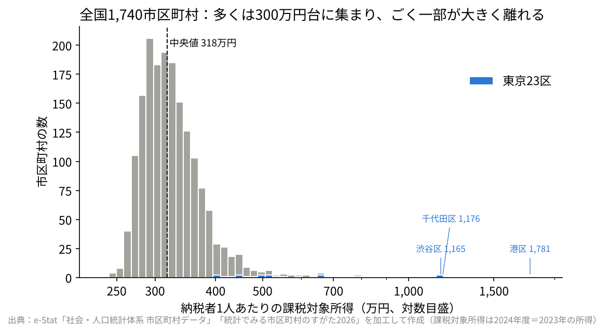
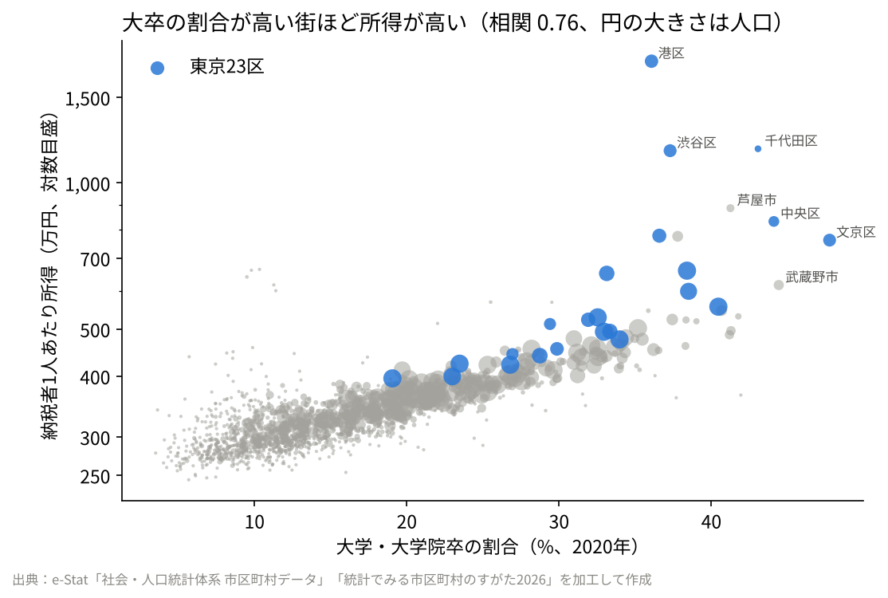
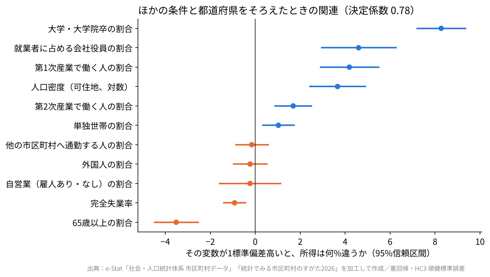
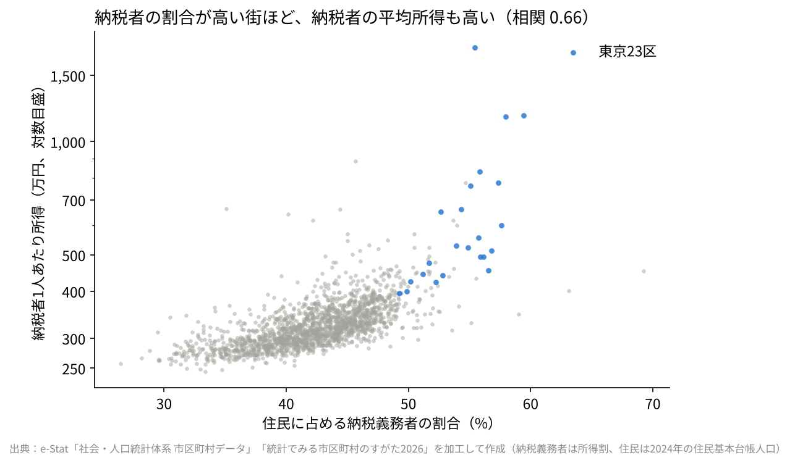

# 001 納税者1人あたりの所得は、なぜ街によって違うのか？ 全国1,740市区町村の公開データで調べてみた

note の記事「納税者1人あたりの所得は、なぜ街によって違うのか？ 全国1,740市区町村の公開データで調べてみた」の分析コード・データ・図です。

- もとは個別リポジトリ `estat-income-municipal` に置いていた分析です

## 動かし方

```bash
pip install -r requirements.txt
cd src
python analysis.py
```

## 図

- `figures/fig1_distribution.png`
- `figures/fig2_univ_income.png`
- `figures/fig3_coefficients.png`
- `figures/fig4_taxpayer_rate.png`

## もとのリポジトリの説明

以下は、もとのリポジトリ `estat-income-municipal` の README です（同じリポジトリにあったほかの記事の分も含みます）。

### 納税者1人あたりの所得は、なぜ市区町村によって違うのか（e-Stat 公開データ）

- **何を**：全国1,740市区町村の「納税者1人あたりの所得」（課税対象所得 ÷ 納税義務者数、2024年度＝2023年の所得）が、どれくらい違い、何と関係しているかを調べた
- **どう**：e-Stat の市区町村データ（所得・国勢調査）を結合し、分布を見たうえで、11の条件と都道府県の固定効果を入れた重回帰（HC3）。確かめ方を5通り
- **結果**：約8割の市区町村は280万〜390万円（上位10%と下位10%の差は1.4倍）。差の57%は大卒の割合だけで説明でき、ほかの条件をそろえても大卒の割合が約7ポイント高いと所得は約8%高い。因果ではなく関連

解説記事（note）：https://note.com/takayukimatsuura/n/n31c0e30f7025

#### データ
出典はすべて **政府統計の総合窓口(e-Stat)「社会・人口統計体系 市区町村データ」「統計でみる市区町村のすがた2026」**（総務省統計局）。`data/processed/municipal_base.csv` は [estat-women-labor](https://github.com/takayuki-0127/japan-open-data-notes/tree/main/projects/estat-women-labor) の `src/build_dataset.py` で作ったもの（取得方法・表IDはそちらの README）。

| 変数 | 定義（項目コード） | 年 |
|---|---|---|
| 納税者1人あたり所得（目的変数、対数） | 課税対象所得 C120110（百万円）÷ 納税義務者数（所得割）C120120 | 2024年度（2023年の所得） |
| 大学・大学院卒の割合 | E9106 ÷ E9101 | 2020 |
| 会社役員の割合 | 役員数 F2402 ÷ 就業者数 F1102 | 2020 |
| 自営業の割合 | （F2403＋F2404）÷ F1102 | 2020 |
| 65歳以上の割合 | A1303 ÷ A1101 | 2020 |
| 第1次・第2次産業で働く人の割合 | F2201・F2211 ÷ F1102 | 2020 |
| 完全失業率 | F1107 ÷ F1101 | 2020 |
| 人口密度（可住地、対数） | log（A1101 ÷ B1103） | 2020 / 2024 |
| 他の市区町村へ通勤する人の割合 | F2705 ÷ F1102 | 2020 |
| 単独世帯の割合 | A810105 ÷ A710101 | 2020 |
| 外国人の割合 | A1700 ÷ A1101 | 2020 |
| 納税義務者の割合（図4） | C120120 ÷ 住民基本台帳人口 A2301 | 2024 |

**出典の書き方**：出典：政府統計の総合窓口(e-Stat)（https://www.e-stat.go.jp/）「社会・人口統計体系 市区町村データ」「統計でみる市区町村のすがた2026」（総務省統計局）を加工して作成。e-Stat の利用規約（CC BY 4.0 互換）に基づいて利用。分析コードは MIT License。

#### 再現
```bash
pip install -r requirements.txt
python src/analysis.py   # data/processed/*.csv と figures/*.png を作る
```

#### 結果


| 項目 | 値 |
|---|---|
| 市区町村の数 | 1,740（2020年の人口0の町を除く） |
| 中央値 | 318万円 |
| 下位10%／上位10% | 278万円／387万円（1.39倍） |
| 最高／最低 | 港区 1,781万円／西目屋村 245万円（7.3倍） |
| 全国（納税者全体の平均） | 393万円 |



決定係数：大卒割合だけ 0.57 → 11変数 0.74 → ＋都道府県 0.78



| 変数（1標準偏差あたり） | 主モデル | 確かめ方5通りの幅 |
|---|---:|---|
| 大学・大学院卒の割合（約7ポイント） | +8.3% | +7.5〜+9.1% |
| 会社役員の割合（約1.2ポイント） | +4.6% | +1.9〜+10.3%（23区や重みで大きく動く） |
| 第1次産業の割合（約10ポイント） | +4.2% | +3.8〜+7.9% |
| 65歳以上の割合（約8ポイント） | −3.5% | −2.9〜−5.6% |
| 人口密度（対数） | +3.7% | −1.4〜+3.8%（向きが変わる＝言えない） |

全結果：`data/processed/regression_income.csv`（モデル別）、`vif.csv`（最大 5.1）、`income_top_bottom.csv`



納税義務者の割合と納税者1人あたり所得の相関は 0.66。所得の低い街は「納める人が少なく、納める人の平均も低い」。

#### この分析で言えないこと
1. **因果は言えない**：所得の高い人が街を選んで住む（逆の向き）可能性があり、「大卒を増やせば所得が上がる」とは言えない
2. **個人には当てはめられない**（生態学的誤謬）
3. **税を納めている人だけの平均**で、中央値ではない。第1次産業がプラスになるのは、低所得で非課税の人が多い街ほど納税者の平均が高く出る「選ばれ方」の影響かもしれない
4. 1年分のデータ。人口の少ない町は、土地の売却など一時的な所得で大きく跳ねることがある（今回は確かめていない）
5. 所得は2023年、国勢調査の変数は2020年で、年がずれている
