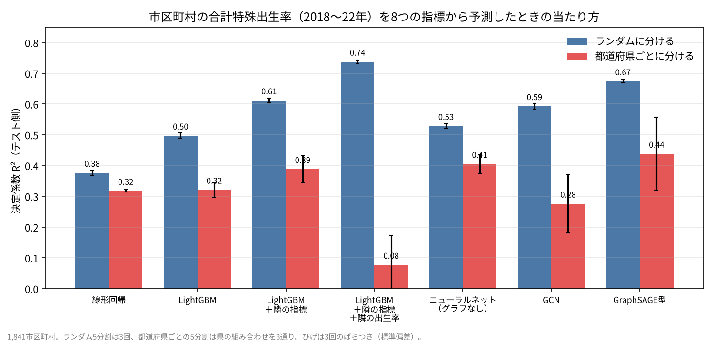
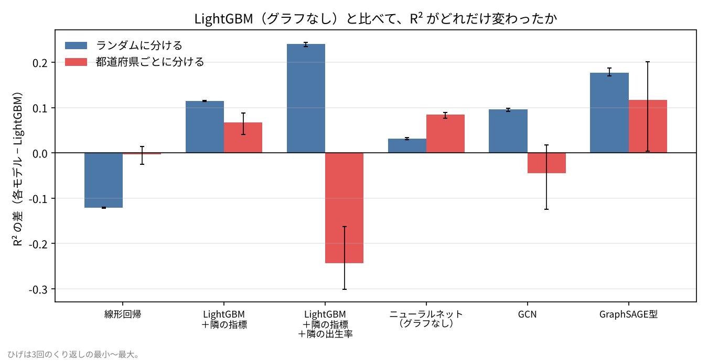
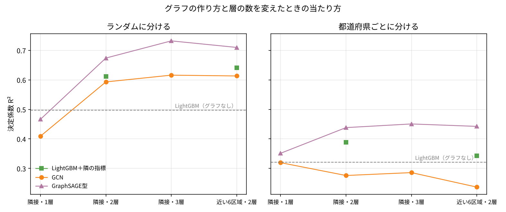
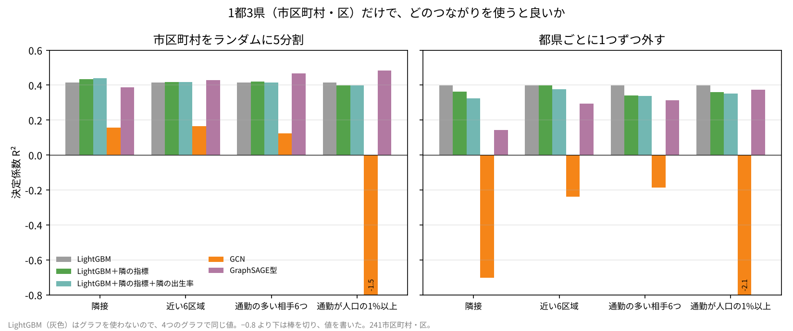
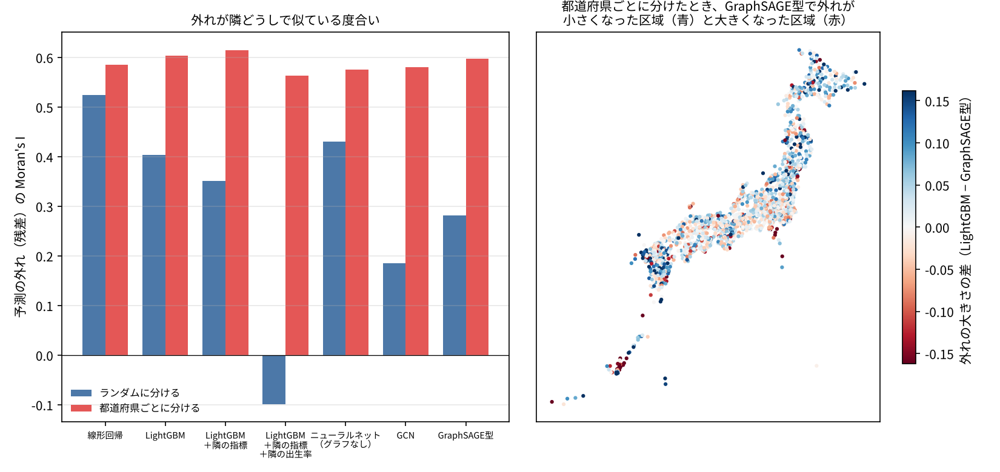

# F107 市区町村のつながり（隣接・通勤）を使うと、予測は良くなるか？ グラフニューラルネットワークとふつうの機械学習の比較

看板記事 F107。note の記事：（公開後に記入）

## 問い

市区町村の合計特殊出生率は、隣どうしで似ています（F20 の空間回帰で、Moran's I が大きく出ました）。それなら、「どの市区町村とどの市区町村がつながっているか」というグラフをモデルに入れると、予測は良くなるのでしょうか。グラフニューラルネットワーク（GCN・GraphSAGE）と、隣の平均を特徴量に足した LightGBM などを、同じデータ・同じ検証の分け方で比べます。

## データ

新しい取得はなく、これまでの記事のデータを使います（`src/01_取得.md`）。

| 中身 | 出どころ |
|---|---|
| 合計特殊出生率（ベイズ推定値、2018〜22年）と8つの指標（15〜39歳女性の割合、納税者1人あたり所得、市区町村外への通勤・通学の割合、0〜5歳千人あたり保育所数、第3次産業の割合、可住地の人口密度、未婚者の割合、高齢者の割合） | F20（人口動態統計特殊報告、社会・人口統計体系） |
| 市区町村の境界（隣接の判定、重心） | F20（国土数値情報 行政区域 2021 の簡略版 TopoJSON） |
| 1都3県の市区町村間の通勤者数（2020年） | F10（国勢調査 従業地・通学地集計） |

対象は 1,841 市区町村（政令市は区。出生率と8指標がそろい、境界と対応がつくもの）。1都3県は 241 市区町村・区。

## 手法

- **グラフ**（`src/02_整形.py`）
  - 隣接：境界を共有する組（4,632 辺）。接する区域がない50の島などは、重心がいちばん近い1区域とつなぐ
  - 近い6区域：重心の距離で近い6つ（6,702 辺）
  - 通勤（1都3県だけ）：各区域の通勤の多い相手6つ／小さいほうの人口の1%以上が行き来する組
- **モデル**（`src/03_分析.py`）。入力はどれも同じ8指標（標準化）
  - 線形回帰（リッジ）、LightGBM
  - LightGBM ＋ 隣の区域の指標の平均
  - LightGBM ＋ 隣の区域の指標の平均 ＋ 隣の「学習側の区域」の出生率の平均（テスト側の答えは使わない）
  - ニューラルネット（2層、グラフなし。GCN と同じ設定でグラフだけを外したもの）
  - GCN（Kipf & Welling 2017、2層、隠れ32、dropout 0.3 を隠れ層に、Adam lr 0.01、weight decay 5e-4、400回。学習側の1割で一番良い回を選ぶ）
  - GraphSAGE 型（自分の値と隣の平均に別々の重み、ほかは GCN と同じ）
  - グラフを使うモデルは、テスト側の区域の「指標」は見るが「出生率」は見ない（transductive の設定）
- **検証の分け方**
  - ランダム5分割（3回くり返し）
  - 都道府県ごとにまとめた5分割（県の組み合わせを3通り）。テスト側の区域の隣の多くもテスト側になる
- **評価**：テスト側の決定係数 R² と RMSE。残差の Moran's I（隣接グラフ、999回の並べ替え）

## 結果



| モデル | ランダム5分割 R² | 都道府県ごと R² |
|---|---|---|
| 線形回帰 | 0.376 | 0.318 |
| LightGBM | 0.497 | 0.321 |
| LightGBM＋隣の指標 | 0.612 | 0.388 |
| LightGBM＋隣の指標＋隣の出生率 | **0.738** | 0.077 |
| ニューラルネット（グラフなし） | 0.529 | 0.405 |
| GCN | 0.593 | 0.276 |
| GraphSAGE 型 | 0.674 | **0.438** |

- **ランダムに分けると、グラフを使うものはどれも LightGBM より良い**。GCN +0.10、GraphSAGE 型 +0.18、隣の指標を足した LightGBM +0.11、隣の出生率まで足した LightGBM +0.24（いちばん良い）。
- **都道府県ごとに分けると、差は縮むか逆になる**。
  - 隣の出生率を足した LightGBM は 0.738 → 0.077 と崩れる。テスト側の区域の隣も多くがテスト側で、学習側の隣の出生率がほとんど使えないため。
  - GCN（0.276）は LightGBM（0.321）にも、グラフなしのニューラルネット（0.405）にも負ける。
  - GraphSAGE 型（0.438）がいちばん良いが、グラフなしのニューラルネットとの差は +0.03 で、LightGBM との差は県の組み合わせで +0.003〜+0.20 と大きくぶれる。
- **ランダムな分け方での「グラフの効き目」の多くは、隣の答え（またはそれと似たもの）を間接的に使えることから来ている**と考えられる（推測）。残差の Moran's I はランダムでは GCN 0.19、GraphSAGE 型 0.28、LightGBM 0.40 と、グラフを使うと残差の隣どうしの似かたが減るが、都道府県ごとではどのモデルも 0.56〜0.62 で差がない。



## 頑健性



1. **グラフの作り方（隣接 → 近い6区域）**：ランダムでは GraphSAGE 型 0.710、GCN 0.613。都道府県ごとでは GraphSAGE 型 0.442、GCN 0.237、隣の指標を足した LightGBM 0.343。並びは同じ。
2. **層の数（1・2・3層）**：1層では GCN・GraphSAGE 型とも LightGBM 以下（ランダム 0.409・0.466）。3層の GraphSAGE 型はランダム 0.732、都道府県ごと 0.451。GCN は都道府県ごとで層を増やしても 0.28〜0.32 のまま。
3. **対象を変える（高齢者の割合を、残り7指標から予測）**：指標だけで R² 0.89〜0.91 出るので、グラフを足しても +0.01 未満。GCN は 0.66〜0.69 と大きく下がる。GCN は自分の値と隣の値を最初から混ぜてしまうので、自分の指標で決まる対象では不利になる。
4. **1都3県だけ・通勤のグラフ**（ランダム5分割4回、都県ごとに1つずつ外す4分割）：



   - LightGBM はランダム 0.413、都県ごと 0.399。LightGBM に隣の指標・隣の出生率を足しても、どのグラフでも大きくは変わらない（−0.08〜+0.03）。
   - 通勤のグラフで良くなったのは GraphSAGE 型のランダムだけ（隣接 0.387 → 通勤の多い相手6つ 0.467、1%以上 0.484）。都県ごとでは 0.31〜0.37 で LightGBM（0.399）に届かない。
   - GCN は 241 区域では学習が安定せず、R² がマイナス（通勤1%以上で −1.5〜−2.1）。
5. **くり返し**：本体は3回、頑健性は2回、1都3県は4回。乱数の種を変えても、ランダムな分け方でのばらつき（標準偏差）は R² で0.01以下。都道府県ごとでは、県の組み合わせで標準偏差0.004〜0.12（GraphSAGE 型 0.12、GCN 0.10）。



## 言えないこと

- 「グラフを使うと予測が良くなる」かどうかは、検証の分け方で答えが変わる。ランダムに分けた結果だけで「GNN が有効」とは言えない。どちらの分け方が正しいかは、何に使うか（同じ県の中の欠けた値を埋めるのか、まだデータのない地域を当てるのか）で決まる
- ハイパーパラメータはほぼ決め打ちで、モデルごとに細かく調整していない。調整すれば順位は入れ替わりうる
- 出生率はベイズ推定値で、小さい町ほど県や周りの値に引き寄せられている。隣どうしが似て見える分の一部は、推定の方法から来ている可能性がある
- 通勤のグラフは1都3県だけで、全国では試していない
- 予測の当たり方を比べただけで、どの指標が出生率を上げる・下げるという因果は言えない。特定の市区町村の良し悪しを示すものでもない

## 再現手順

```
pip install -r requirements.txt
cd src
python 02_整形.py      # nodes.csv と 3種類のグラフの辺
python 03_分析.py      # results/stages に段階ごとに保存（CPU 2コアで2時間ほど）。quick を付けると1回だけ
python 04_図.py        # figures/ と results/results.json
```

- 乱数の種は 107（くり返し・分割ごとに足していく）。torch のスレッドは2。
- `results/stages/` は段階ごとの結果で、途中で止まっても保存済みの段階は飛ばして続きから計算します。テスト側の予測値は `results/predictions_main.csv` にまとめています（段階ごとの予測値のファイルは GitHub には置いていません）。

## 出典

- 厚生労働省「人口動態統計特殊報告 平成30年〜令和4年 人口動態保健所・市区町村別統計」（e-Stat）を加工して作成
- 総務省統計局「統計でみる市区町村のすがた（社会・人口統計体系）」（e-Stat）を加工して作成
- 総務省「令和2年国勢調査 従業地・通学地集計」（e-Stat）を加工して作成
- 国土数値情報 行政区域データ（国土交通省）をもとにした簡略版 TopoJSON（smartnews-smri/japan-topography、CC BY 4.0）を加工して作成
