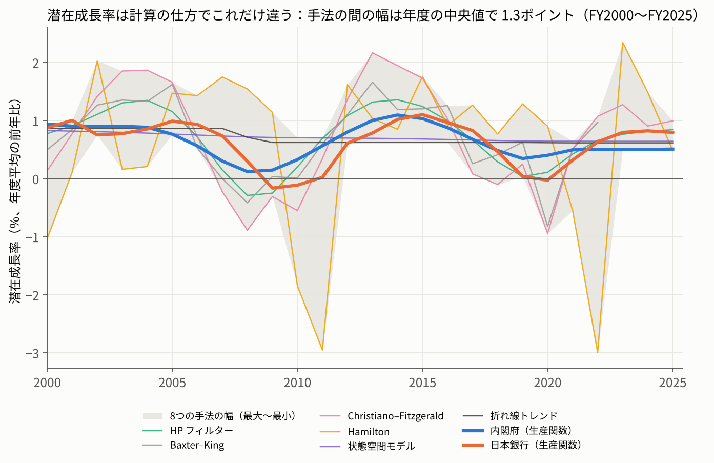
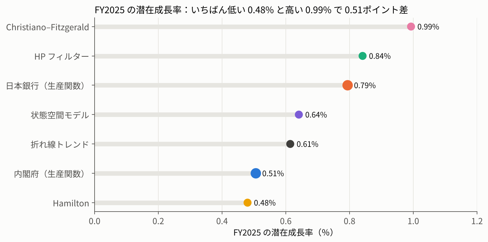
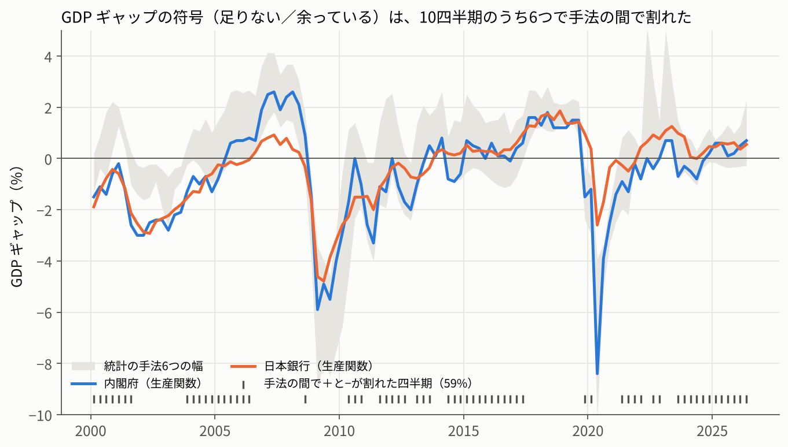
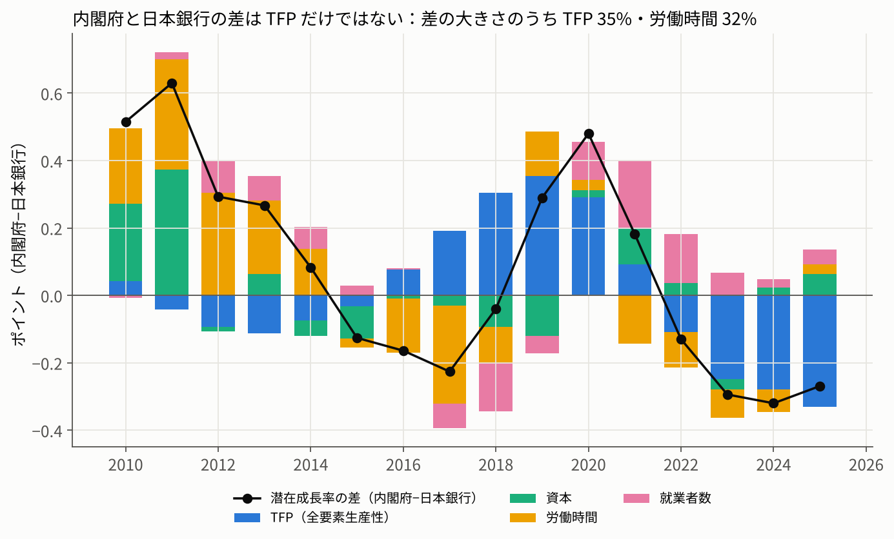
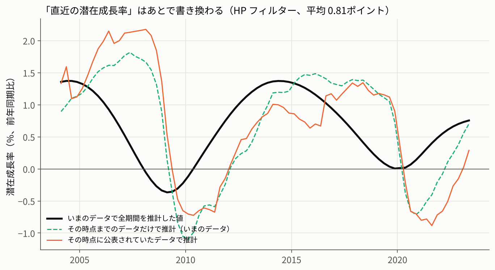
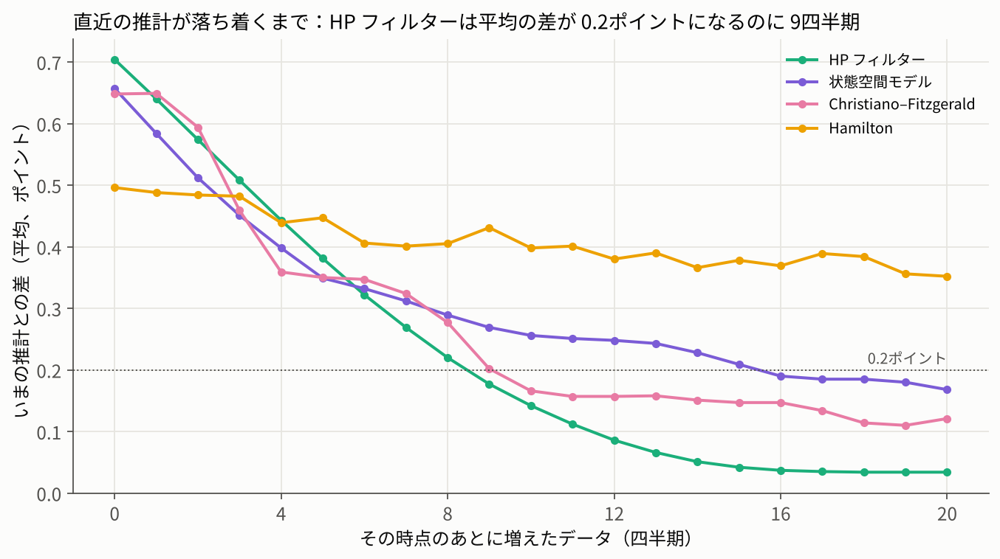

# F261 潜在成長率は、計算の仕方でどれだけ変わるのか（内閣府・日本銀行の公表値と、統計の手法6つ）

精選モードの記事（B. 白書・審議会）。経済財政白書の「潜在成長率」が、計算の仕方とデータの増え方でどれだけ動くかを確かめた。計画は結果の前にコミットした（[PLAN.md](PLAN.md)、コミット 2af4bb7）。

## 問い

- 内閣府と日本銀行は、どちらも生産関数アプローチで潜在成長率を推計しているが、値は同じではない。統計の手法（HP フィルター、バンドパス、Hamilton フィルター、状態空間モデル）で実質 GDP からトレンドを取り出すと、どれだけ違うか
- GDP ギャップの符号（足りない／余っている）は、手法の間でどのくらい割れるか
- 内閣府と日本銀行の差は、どの要素（TFP・資本・労働時間・就業者数）から来るか
- 「直近の潜在成長率」は、あとでどれだけ書き換わるか（端点の問題と、GDP 速報の改定）

## 結論

- 2025年度の潜在成長率は、やり方しだいで 0.48〜0.99%（内閣府 0.51、日本銀行 0.79、HP 0.84、CF 0.99、Hamilton 0.48、状態空間モデル 0.64、折れ線 0.61。統計の手法6つのうち BK は両端が出ないので FY2025 は5つ）。幅 0.51ポイントで H1 は支持だが、条件を変えると 0.46〜0.99 で境目
- 2000〜2025年度の26年度で、年度ごとの幅は中央値 1.30（最大は2022年度 4.07）。FY2025 の 0.51 は、そのまま並べるといちばん狭いが、BK が FY2023 以降出ないため比べる手法の数が違う。BK を全年度で除くと2番目（最小は FY2016 の 0.41）、BK と Hamilton を除くと6番目（中央値 0.76）。FY2025 は端点の値なので暫定
- GDP ギャップの符号は、2000〜2026年の106四半期の 59% で手法の間で割れる（H2 支持）。内閣府と日本銀行だけでも 22%
- 内閣府と日本銀行の差（2010〜2025年度）は、年度ごとの絶対値の平均で 0.27ポイント（向きを含めた平均は +0.07）。要素ごとの差の絶対値の合計のうち TFP は 35%、労働時間 32%、資本 18%、就業者数 15%。「半分以上は TFP」の H3 は外れ
- 直近の値は、あとで平均 0.81ポイント書き換わる（HP、77四半期）。端点だけで 0.68、GDP 速報の改定込みで 0.81（H4 支持）
- 問い直し：直近の値が落ち着く（平均の差 0.2ポイント以内）まで、GDP 速報の改定を除いた疑似リアルタイムで HP 9四半期（約2年）、CF 10、状態空間モデル 16、Hamilton は20四半期でも落ち着かない。書き換わる向きとその後2年の成長の相関 0.73 は、周期のないドリフトつきランダムウォークでも中央値 0.71（90% 0.49〜0.83）出るので、両側のフィルターの仕組みどおりの結果

## データ

| データ | 内容 | ファイル |
|---|---|---|
| 内閣府「GDP ギャップ、潜在成長率」（月例経済報告 関係資料、2026年4-6月期2次速報ベース、[2622gap.xlsx](https://www5.cao.go.jp/keizai3/getsurei/2622gap.xlsx)） | 1994Q1〜2026Q2 の GDP ギャップ、潜在成長率（前期比年率）、寄与度（TFP・資本投入量・労働時間・就業者数）。公表どおり小数1桁 | `data/raw/cao_gap_2026Q2_2nd.csv` |
| 日本銀行「需給ギャップと潜在成長率」（2026年10月5日公表、[gap.xlsx](https://www.boj.or.jp/research/research_data/gap/gap.xlsx)） | 1983Q1〜2026Q2 の需給ギャップ（資本・労働の内訳つき）、年度半期の潜在成長率（前年比）と寄与度。小数3桁に丸め | `data/raw/boj_gap_2026Oct.csv`、`data/raw/boj_potential_growth_2026Oct.csv` |
| 内閣府 経済社会総合研究所「四半期別GDP速報」2026年4-6月期2次速報、実質季節調整系列（2020暦年連鎖価格） | 1994Q1〜2026Q2 の国内総生産（支出側、10億円） | `data/raw/real_gdp_sa_2026Q2_2nd.csv` |
| F50（[articles/F50_gdp_revisions](../F50_gdp_revisions)）で集めた、GDP 速報の公表回ごとの実質季節調整系列の前期比 | 2001〜2026年の195回。小数1桁 | `data/raw/f50_vintages_real_sa_qoq.csv`、`data/raw/f50_releases.csv` |

- 公表元のサイトはこの環境から直接は取れないため、ブラウザのページ内で xlsx・CSV を読み、必要な列だけを CSV にした（`src/01_取得.py` に取得元と確認の手順）。
- 日本銀行の潜在成長率は年度半期（H1 = 4-9月、H2 = 10-3月）の値なので、その半期の四半期に同じ値を割り当てた。

## 手法

| 名前 | 中身 |
|---|---|
| CAO | 内閣府の公表値。前期比年率を4四半期平均して前年比にそろえた |
| BOJ | 日本銀行の公表値 |
| HP1600 | HP フィルター（λ=1600） |
| BK | Baxter–King バンドパス（6〜32四半期、K=12）。両端12四半期は出ない |
| CF | Christiano–Fitzgerald バンドパス（6〜32四半期、非対称、ドリフトあり） |
| HAM | Hamilton フィルター（h=8、p=4）。8四半期先を、いまの4四半期分で回帰した当てはめ値をトレンドとする |
| UC | 状態空間モデル（smooth trend＋AR(2)、statsmodels UnobservedComponents の平滑化した値）。計画ではローカル線形トレンドと書いていた（計画からのずれ参照）。推定されたトレンドのゆれはほぼ0で、ほぼ直線になった |
| LIN | 景気の山（2008Q1・2020Q1）で区切った折れ線トレンド（区切りは事前に固定） |

- 統計の手法はすべて実質 GDP の対数にかけ、潜在成長率はトレンドの前年同期比（％）、GDP ギャップは 100×(対数GDP−トレンド)。年度の値は4四半期そろった年度の平均。
- H2 の「割れ」は、3つ以上の手法の値がある四半期で、プラスとマイナスの手法が両方あること。
- H3 は年度（FY2010〜FY2025）の平均で、内閣府−日本銀行の差を寄与度ごとに出し、差の絶対値の合計に占める割合を求めた。
- H4 は2次速報の公表回（対象四半期 2004Q1〜2023Q2、77回）ごとに、その時点の GDP で直近の潜在成長率を出し（リアルタイム）、いまのデータをその時点で切った値（疑似リアルタイム）と、いまのデータで全期間を推計した値と比べた。丸めをそろえるため、「いまのデータ」も最新の公表回の前期比（小数1桁）から作った（本来の水準から出した値との差は平均 0.008ポイント）。

| スクリプト | 内容 |
|---|---|
| `src/01_取得.py` | 取得元の記録と、置いたファイルの確認 |
| `src/02_整形.py` | 四半期のパネル、公表回ごとの水準 |
| `src/zz_f261_methods.py` | トレンドの出し方（03・05 で共通） |
| `src/03_分析.py` | H1〜H4、頑健性 |
| `src/05_問い直し.py` | 問いの立て直し（データが何四半期増えると落ち着くか） |
| `src/04_図.py` | 図6枚（図6は 05 のあと） |
| `src/06_レビュー検算.py` | 独立レビューを受けて足した検算（手法をそろえた幅、ランダムウォークでの相関、ローカル線形トレンド、FY2025 の差の2つの数え方、公表回の数）。`results/review_checks.json` |

## 結果

### 仮説の判定（PLAN の基準どおり）

| 仮説 | 基準 | 結果 | 判定 |
|---|---|---|---|
| H1 FY2025 の手法の間の幅 | 0.5以上で支持、0.3未満で外れ | 0.513ポイント（0.480〜0.993） | 支持（境目） |
| H2 GDP ギャップの符号が割れる四半期 | 20%以上で支持、10%未満で外れ | 59.4%（106四半期） | 支持 |
| H3 CAO と BOJ の差の半分以上は TFP | TFP の割合が半分以上 | 35.3% | 外れ |
| H4 直近の値のずれ（HP） | 疑似リアルタイムの平均絶対差 0.3以上、かつリアルタイムの方が大きい | 疑似 0.680、リアルタイム 0.809 | 支持 |

### 2025年度の潜在成長率（％、年度平均の前年比）

| CAO | BOJ | HP1600 | CF | HAM | UC | LIN |
|---|---|---|---|---|---|---|
| 0.506 | 0.794 | 0.841 | 0.993 | 0.480 | 0.641 | 0.614 |

### 直近の値のずれ（77四半期、ポイント）

| 手法 | 端点だけ（疑似−最終） | 改定込み（リアルタイム−最終） | 改定だけ | 0.5超の割合（改定込み） |
|---|---|---|---|---|
| HP1600 | 0.680 | 0.809 | 0.289 | 67.5% |
| UC | 0.595 | 0.675 | 0.478 | 35.1% |
| CF | 0.575 | 0.733 | 0.387 | 59.7% |
| HAM | 0.514 | 0.571 | 0.564 | 42.9% |

UC の改定込みの最大は 8.1ポイント（コロナ期の公表回で推計が不安定になった）。

### 図

| 図 | 内容 |
|---|---|
|  | 年度の潜在成長率、手法ごと |
|  | FY2025 の値 |
|  | GDP ギャップと符号の割れ |
|  | 内閣府−日本銀行の差の内訳 |
|  | 直近の値の書き換わり（HP） |
|  | 問い直し：何四半期で落ち着くか |

## 頑健性

| 条件 | FY2025 の幅 | 符号が割れる割合 | 備考 |
|---|---|---|---|
| 基準 | 0.513 | 59.4% | |
| HP の λ=400 | 0.513 | 60.4% | HP 0.85、端点のずれ 0.72 |
| HP の λ=6400 | 0.513 | 59.4% | HP 0.67、端点のずれ 0.49 |
| コロナ期（2020Q2〜Q4）を線でならす | 0.457 | 59.4% | 基準0.5を下回る |
| 潜在成長率＝前期比年率の4期平均 | 0.496 | 59.4% | |
| 推計の開始を2000Q1に | 0.617 | 58.5% | |
| Hamilton h=12 | 0.992 | 62.3% | HAM が 1.50 に |
| UC をローカル線形トレンドに（レビュー後に追加） | 0.513 | — | UC が 0.87 に（基準の smooth trend は各年度 0.64〜0.83 のほぼ直線） |

直近の値のずれ（端点だけ、HP）は λ を変えると 0.49〜0.72。他の条件では計算していない。

結果を見てから足した確認（計画になし）：Hamilton を除いた FY2025 の幅 0.486。符号の割れは Hamilton を除くと 58.5%、Hamilton と CF を除くと 45.3%。「＋0.5%超と−0.5%未満が両方ある」はっきりした割れは 34.9%（Hamilton を除くと 29.2%）。

## 問いの立て直し（結果を見てから追加）

H4 で直近の値が平均 0.8ポイント書き換わったので、「直近の値は、データが何四半期増えると落ち着くのか」を追加で調べた。2004Q1〜2021Q2 の70四半期で、その後のデータを0〜20四半期足して推計し直し、全期間の推計との差を測った（「0.2ポイント以内で落ち着いた」の線は結果を見る前に決めた）。

| 手法 | h=0 | h=4 | h=8 | h=12 | h=20 | 平均の差が0.2以内になる h | 8割が0.2以内になる h |
|---|---|---|---|---|---|---|---|
| HP1600 | 0.70 | 0.44 | 0.22 | 0.09 | 0.03 | 9 | 11 |
| CF | 0.65 | 0.36 | 0.28 | 0.16 | 0.12 | 10 | 18 |
| UC | 0.66 | 0.40 | 0.29 | 0.25 | 0.17 | 16 | 17 |
| HAM | 0.50 | 0.44 | 0.41 | 0.38 | 0.35 | なし | なし |

HP で、あとでの書き換わり（最終−当初）は、その後8四半期の実際の成長率（年率）と相関 0.727、傾き 0.34。ただしこれは両側のフィルターの仕組みどおりの結果で、周期のないドリフトつきランダムウォーク（ドリフト＝実際の平均成長、ばらつき＝コロナ期を除いた実際の標準偏差、同じ長さと時点）で200回計算すると、相関の中央値 0.709、90% 0.49〜0.83（`06_レビュー検算.py`）。

「落ち着くまで」は、いまのデータをその時点で切った疑似リアルタイムの値で、GDP 速報の改定は入っていない。UC の16四半期と H4 の最大 8.1 は、分散の推定が不安定な回を含む（推測）。

## 計画からのずれ

- UC は、計画ではローカル線形トレンドと書いていたが、コードでは smooth trend を使っていた（独立レビューで判明）。計画どおりの形の値を頑健性に加えた（FY2025 0.87、全体の幅は変わらない）。
- H4 の対象の78四半期のうち、2020Q1 は2次速報が訂正版（qe201_2r）しかなく、訂正版を除く条件で外れたので77回になった。
- H3 の内訳は、計画では「暦年 2010〜2025」としていたが、日本銀行の公表が年度半期なので、年度（FY2010〜FY2025）で計算した。
- H4 に、計画の HP・UC・HAM に加えて CF も入れた。対象は2次速報の公表回（対象四半期 2004Q1〜2023Q2）とし、「いまのデータ」も公表回の前期比から作って丸めをそろえた。
- 結果を見てから足したもの：H1 の Hamilton を除いた幅、H2 のはっきりした割れと手法を除いた割合、問いの立て直し。

## 自己点検（独立レビューの前に作成者が行ったもの）

- data/raw と src だけの別フォルダで 01→02→03→05→04 を流し直し、data/processed・results・figures の15ファイルがバイト単位で一致した（レビュー後、06 を加えて16ファイルで再確認）。
- 内閣府の寄与度の合計と潜在成長率の差は年度平均で最大 0.1（公表値の丸め）、日本銀行は 0.001。

## レビューで直したこと

別のエージェントによる独立レビュー（作業を見ていないエージェントに、記事・README・src だけを渡した）で12点の指摘があり、すべて直した。再実行はバイト単位で一致し、数字もすべて一致していた。数字は `src/06_レビュー検算.py` で作成者が計算し直した。

| # | 指摘 | 直し方 |
|---|---|---|
| 1 | 「FY2025 の幅は過去26年でいちばん狭い」は、BK が FY2023 以降出ないため比べる手法の数が違うことによる | タイトルと結論から外した。手法をそろえると2番目（BK を除く）、6番目（BK・Hamilton を除く）、端点なので暫定、と書いた |
| 2 | 書き換わりとその後の成長の相関 0.73 は、両側のフィルターの仕組みでほぼ出る | ランダムウォークで確かめ（中央値 0.71、90% 0.49〜0.83）、発見ではなく仕組みの大きさの確認と書き直した |
| 3 | UC の形が計画（ローカル線形トレンド）と違い、ほぼ直線になっている | 計画からのずれに書き、ローカル線形トレンドの値（FY2025 0.87）を頑健性に加えた。UC の最大 8.1 と16四半期に（推測）の注意 |
| 4 | 「どの条件でも直近の値のずれは 0.5〜0.7」は λ の2条件でしか計算していない | 「λ を変えると 0.49〜0.72（他の条件では計算していない）」に直した |
| 5 | 「落ち着くまで2年ほど」は HP だけ、改定を除いた値 | タイトル・結論・本文を「HP フィルターでは約2年（改定を除いた疑似リアルタイム）」にし、CF 2.5年・UC 4年・Hamilton は落ち着かないことを並べた |
| 6 | H3 の 0.27 は絶対値の平均で、向きを含めた平均は 0.07。割合は要素ごとの絶対値の合計に対するもの | そう書き分け、内閣府の小数1桁の丸めの影響（推測）を足した |
| 7 | 手法の数の書き方がばらばら | 「統計の手法6つ（FY2025 は BK を除く5つ）」にそろえた |
| 8 | 幅に、使う情報の違いと標準的でない手法の両方が入る | 言えないことに足した |
| 9 | 「0.50」は 0.496 | 直した |
| 10 | 77回の理由 | 2020Q1 は2次速報が訂正版しかないことを書いた |
| 11 | FY2025 の差が 0.28 と 0.27 の2通り | 数え方の違い（4期平均でならす／前期比年率の年度平均）を書いた |
| 12 | 細かい点（26年度、2011年度は東日本大震災も、白書・日銀の「0%台」の出典） | 直した。白書・日銀の言い回しの引用はやめ、2026年4-6月期の公表値（内閣府 0.6%、日銀 0.8%前後）に置き換えた |

## 再現手順

```bash
pip install -r requirements.txt
python src/01_取得.py      # data/raw の確認
python src/02_整形.py
python src/03_分析.py      # 約20秒
python src/05_問い直し.py  # 約3分
python src/04_図.py
python src/06_レビュー検算.py  # 約10秒
```

## 言えないこと

- 手法の間の幅には、使う情報の違い（公表値は資本・労働のデータを使い、統計の手法は GDP だけ）と、潜在成長率の推計としては標準的でない手法（Hamilton のあてはめ値など）の両方が入っている
- どの手法が正しいかは言えない。潜在成長率は観測できず、示したのは「やり方でどれだけ違うか」だけ
- 政策の評価や提言ではない
- 内閣府・日本銀行の推計は再現していない（公表値と公表の内訳を使っただけ）
- 統計の手法は GDP しか見ていない（物価や雇用を入れる多変量のフィルターは試していない）
- 比べの基準にした「全期間の推計」も、直近の数年は端点の問題を抱えている
- 公表回の GDP は前期比の小数1桁から作った。2001Q2〜2002Q1 の速報は入っていない
- 日本銀行の潜在成長率は年度半期の値を四半期に割り当てた

## 外に出すなら

- Zenn か Qiita に「HP フィルターの端点問題を、GDP 速報の公表回で確かめる（Python・statsmodels）」として、手法の部分（02・03・05）を短くまとめる。
- 統計・経済の勉強会（Tokyo.R や PyData の LT など）で、「同じ GDP から潜在成長率を7通り出すと」の5分の話にする。

## 出典

内閣府「GDP ギャップ、潜在成長率」（月例経済報告 関係資料）、日本銀行「需給ギャップと潜在成長率」、内閣府 経済社会総合研究所「四半期別GDP速報」をもとに作成者が加工して作成。
