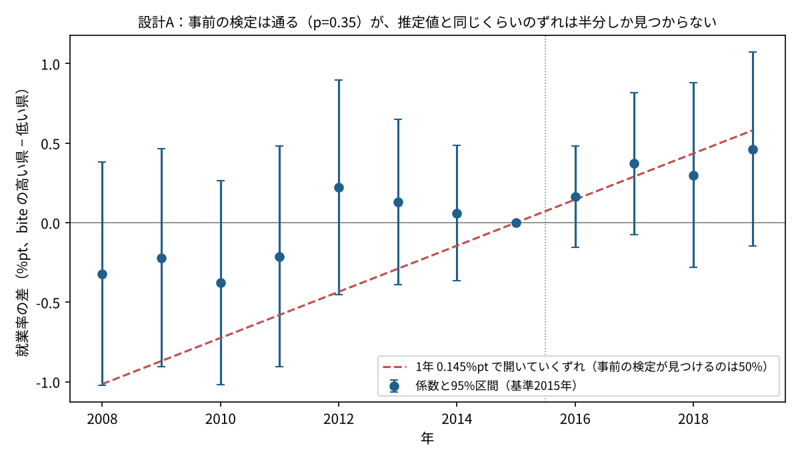
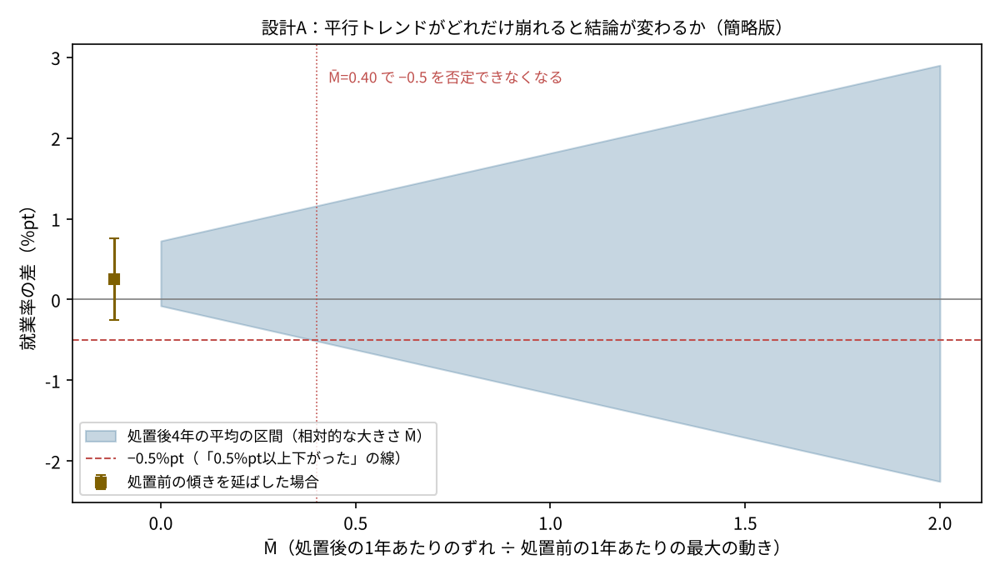
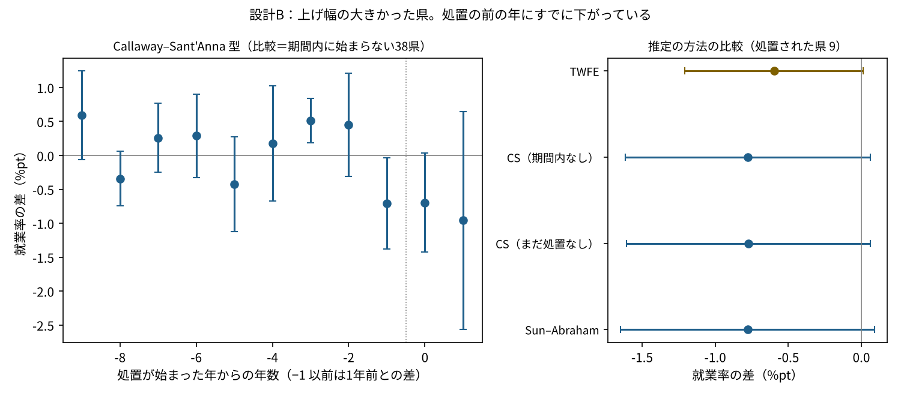

# F296 最低賃金の差の差は、前提をどこまで確かめられるのか？ 事前の検定は通っても、推定値と同じ大きさのずれは半分しか見つからない

F01 の差の差（最低賃金が平均の時給に近い県と遠い県を、2016年の前後で比べる）を、前提の確かめまでやり直しました。あわせて、上げ幅の大きかった県が年によってずれて出てくる設計（ずれて始まる差の差）も作り、二方向固定効果（TWFE）と、ずれに強い推定を並べました。

最低賃金をどう決めるべきかは扱いません。分かるのは「このデータと設計で、何が言えて何が言えないか」です。

## 結論（先に）

1. **事前トレンドの検定は通るが、それだけでは安心できない。** 設計Aでは、処置前（2008〜14年）の係数の同時検定は p=0.35 で、ずれは見つかりませんでした。ところが、処置前から1年0.145%pt ずつ開いていくずれがあっても、この検定が見つけるのは50%です。そのずれが処置後4年に生む偏りは平均0.36%pt で、推定値（+0.41%pt）とほぼ同じ大きさです。開始を2012年にずらしたプラセボでも +0.39%pt が出ました。
2. **平行トレンドが少し崩れるだけで、言えることが変わる。** 処置後の1年あたりのずれを、処置前の1年あたりの最大の動き（0.435%pt）の0.4倍まで許すと、「就業率が0.5%pt 以上下がった」を否定できなくなります。処置前の傾きをそのまま延ばすと、推定値は +0.25%pt（95%区間 −0.26〜+0.76）です。時給は処置群で +1.2%（p=0.02）速く上がっていて、設計そのものは「効く県」を選べています。
3. **ずれて始まる設計では、TWFE の重みは問題にならなかったが、前提が崩れていた。** 上げ幅が中央値より5円以上大きかった9県（2024年・2025年から処置）で、TWFE は −0.60%pt、Callaway–Sant'Anna 型と Sun–Abraham 型は −0.78%pt でした。Goodman-Bacon の分解では「すでに処置された県を比較に使う」組み合わせの重みは0.4%、負の重みは0個で、差はおもに「基準をどの年に置くか」から来ています。ただし処置の前の年にすでに −0.70%pt 下がっていて（事前の同時検定 p<0.01）、時給の上がり方の差も見えません（+0.45%、標準誤差2.6）。この −0.78 は、最低賃金の効果としては読めません。



## 問い

- F01 の差の差（就業率 +0.41%pt、p=0.07）は、どの前提に乗っていて、その前提はデータでどこまで確かめられるのか。
- 前提が少し崩れたら、結論はどこまで動くのか。
- 処置の始まりがずれる設計では、TWFE と、ずれに強い推定で答えは変わるのか。

## データ（出典）

| データ | 中身 | 期間 | ファイル |
|---|---|---|---|
| 総務省「労働力調査 都道府県別結果（モデル推計値）」 | 15歳以上人口・就業者・完全失業率（年平均） | 2008〜2025年 | data/raw/f01_panel.csv（F01 のパネル） |
| 厚生労働省「地域別最低賃金の全国一覧」 | 47都道府県×年度の時間額 | 2002〜2026年度 | data/raw/minimum_wage_2002_2026.csv |
| 厚生労働省「賃金構造基本統計調査」短時間労働者・都道府県別 | 1時間あたり所定内給与（F156 で集めたもの） | 2009〜2025年 | data/raw/f156_panel_wage.csv |
| 厚生労働省「平成27年賃金構造基本統計調査」 | bite（2014年度の最低賃金 ÷ 2015年の短時間労働者の平均時給）の分母 | 2015年 | f01_panel.csv の bite 列 |

URL は F01 の `data/raw/SOURCES.md` と F201 の README にあります。県×年のパネルは `data/panel.csv`（47県×18年）です。賃金構造基本統計調査は2020年に調べ方が変わっていて、時給の系列に段差があります（全国共通の段差は年効果で除けますが、県ごとの違いは残ります）。

## 事前の計画

結果を見る前に `src/plan.md` に書きました。要点は次のとおりです。

- **設計A（一斉に始まる）**：bite が中央値より高い23県 vs 残り24県。2008〜2019年、処置後は2016年以降。主の指標は就業率、副は完全失業率
  - 確かめること：①時給でも差の差（効いているか）②事前トレンドの同時検定 ③その検定の力 ④平行トレンドが崩れたときの感度 ⑤プラセボ（時期・効かないはずの指標）⑥少ないクラスターでの推論（wild cluster bootstrap）⑦最小検出効果
- **設計B（ずれて始まる）**：2016年度以降で初めて、上げ幅（円）がその年度の中央値より5円以上大きかった年度。改定は10月なので、暦年では翌年から処置後。期間は2015〜2025年
  - 並べる推定：TWFE、Callaway–Sant'Anna 型（比較＝期間内に始まらない県／まだ始まっていない県）、Sun–Abraham 型。TWFE の中身として Goodman-Bacon の分解と de Chaisemartin–D'Haultfœuille の重み
- 判定：「雇用が減った」と言うのは、95%区間の上限が0未満で、かつ事前トレンドとプラセボに問題がないときだけ

## やったこと

| 確かめること | 方法 | ファイル |
|---|---|---|
| 主の推定 | 就業率 = 県効果 + 年効果 + δ×（処置群×2016年以降）。標準誤差は県でクラスター（47） | results/a_did.csv |
| 効いているか | 同じ式で、短時間労働者の時給（100×log） | results/a_did.csv |
| 効かないはずの指標 | 15歳以上人口（100×log） | results/a_did.csv |
| 事前トレンド | イベントスタディ（基準2015年）と、2008〜14年の7係数の同時検定 | results/a_event_study.csv、a_pretrend_test.csv |
| 検定の力 | 処置前から直線で開いていくずれ（傾き s）を置き、推定した分散で2万回の乱数。検定が見つける割合を s ごとに出す（Roth 2022 の考え方） | results/a_pretest_power.csv |
| 崩れたときの感度 | 処置後 k 年目のずれを「k × M̄ × 処置前の1年あたりの最大の動き」まで許し、処置後4年の平均の区間を広げる（Rambachan–Roth の相対的な大きさを簡略化したもの。区間は推定の誤差に偏りの最大を足しただけで、元の方法より広め）。処置前の傾きを延ばした推定も | results/a_sensitivity_rm.csv |
| プラセボの時期 | 2012年に始まったとみなす（2008〜15年） | results/a_main.json |
| 少ないクラスター | 帰無仮説で制約した wild cluster bootstrap（Rademacher と Webb の6点、9,999回） | results/a_wild_bootstrap.csv |
| 最小検出効果 | 2.8 × 標準誤差（両側5%・検出力80%） | results/a_did.csv |
| 設計B：推定の比較 | TWFE、Callaway–Sant'Anna 型（平均の差。処置前は1年前との差、処置後は処置の前年との差）、Sun–Abraham 型（処置の年×相対年のダミー、比較＝期間内に始まらない県）。標準誤差は県の再標本化（999回） | results/b_callaway_santanna.csv、b_cs_event.csv、b_sun_abraham.csv |
| 設計B：TWFE の中身 | Goodman-Bacon の分解（重みの合計が1、重み付き平均が TWFE と一致することを確かめた）、de Chaisemartin–D'Haultfœuille の重み | results/b_bacon.csv、b_dcdh_weights.csv |

## 分かったこと

### 1. 設計A：検定は通るが、検定の力が足りない（図1）

| 指標 | 推定値 | 95%区間 | p（クラスター） | p（wild、Webb） | 最小検出効果 |
|---|---|---|---|---|---|
| 就業率（%pt） | +0.41 | −0.05〜+0.88 | 0.077 | 0.064 | 0.64 |
| 完全失業率（%pt） | −0.19 | −0.40〜+0.02 | 0.072 | 0.057 | 0.29 |
| 短時間の時給（%） | +1.19 | +0.17〜+2.22 | 0.023 | 0.020 | 1.42 |
| 15歳以上人口（%） | +0.03 | −1.42〜+1.48 | 0.96 | — | 2.02 |

- 処置群の時給は比較群より速く上がっていて、bite で「効く県」を分けるという設計の前提は、データと矛盾しません。効かないはずの人口には差がありません。
- 事前トレンドの同時検定は就業率 p=0.35、失業率 p=0.33 で、どちらも通ります。
- ところが、検定の力を測ると、1年0.145%pt で開いていくずれを見つける確率は50%、0.185%pt でも80%でした。それぞれ処置後4年の平均に 0.36・0.46%pt の偏りを生みます。推定値 +0.41 と同じ大きさのずれを、検定は半分しか見つけられません。
- 図1の赤い破線（見つかる確率50%のずれ）は、処置後の係数（2016〜19年：+0.16〜+0.46）とよく重なります。「処置前から開いていた流れが続いただけ」でも、同じ形になります。
- 開始を2012年にずらしたプラセボでも就業率 +0.39%pt（標準誤差0.24）と、本番とほぼ同じ大きさです。失業率は −0.03 でほぼ0でした。
- 47県・各群23〜24県なので、wild cluster bootstrap の p 値は県でクラスターした p 値とほぼ同じでした。この設計では、クラスターの少なさは大きな問題ではありません。

### 2. 平行トレンドが崩れたときの感度（図2）

- 処置前の係数は1年で最大0.435%pt 動いています（2011→12年）。処置後の1年あたりのずれをこの0.4倍（約0.17%pt）まで許すだけで、区間の下限が −0.5%pt を下回り、「0.5%pt 以上下がった」を否定できなくなります。
- もともと区間は0をまたいでいるので（M̄=0 で −0.08〜+0.73）、「上がった」とも言えません。
- 処置前の傾き（1年 +0.029%pt）をそのまま延ばして引くと +0.25%pt（−0.26〜+0.76）です。
- F01 の「2016〜19年の引き上げで、就業率が0.5%pt 以上下がった結果は出ていない」は、平行トレンドがほぼ成り立つ（M̄ が0.4より小さい）という前提つきの言い方になります。



### 3. 設計B：ずれて始まる設計（図3）

処置された県は9県です（2023年度に初めて上げ幅が大きかった山形・鳥取・島根・佐賀は2024年から、2024年度の岩手・徳島・愛媛・鹿児島・沖縄は2025年から）。期間内に処置が始まらない38県と比べます。

| 推定 | 就業率（%pt） | 95%区間 |
|---|---|---|
| TWFE | −0.60 | −1.21〜+0.01（wild p=0.08） |
| Callaway–Sant'Anna 型（比較＝期間内なし） | −0.78 | −1.61〜+0.06 |
| Callaway–Sant'Anna 型（比較＝まだ始まっていない県） | −0.77 | −1.61〜+0.06 |
| Sun–Abraham 型 | −0.78 | −1.65〜+0.09 |

- **TWFE の中身**：Goodman-Bacon の分解では、重みの96%が「処置された県 vs 期間内に始まらない県」の比較でした。「先に処置された県を比較に使う」組み合わせの重みは0.4%です。処置された県×年13個の重みはすべて正（0.07〜0.08）で、負の重みはありません。
- TWFE と、ずれに強い推定の差（−0.60 と −0.78）は、主に基準の置き方の違いです。TWFE は処置前の全期間の平均と比べ、Callaway–Sant'Anna 型は処置の前年と比べます。処置の前年がすでに低かったため、基準の置き方で値が変わりました。
- **しかし前提が崩れています。** 処置が始まる前の年（1年前との差）にすでに −0.70%pt 下がっていて、処置前の差の同時検定は p=0.0001 でした。処置前年の10〜12月はすでに改定後なので一部はその影響かもしれませんが、3か月分で −0.7%pt を説明するのは難しいと考えます（推測）。
- 時給の差は +0.45%（標準誤差2.6）で、上げ幅の大きかった県で時給が速く上がった様子は、このデータでは見分けられません（2020年の調べ方の変更で時給の系列が揺れていることも一因と考えます。推測）。
- 処置された県が9県・処置後の年が1〜2年しかないので、最小検出効果は1.2%pt と、設計Aの約2倍です。



## 言えないこと

1. 設計A・Bとも、平行トレンドは確かめきれません。設計Aは「検定で見つからない」だけで、見つけられる力が足りません。設計Bは処置前からずれていて、効果と読めません。
2. 感度の計算は Rambachan–Roth の方法を簡略化したものです。偏りの最大を区間に足しただけで、処置前の最大の動きの推定誤差も入れていません。元の方法（条件つきの区間）とは値が違います。
3. 設計Bの処置（上げ幅が中央値より5円以上大きい）は、その県の事情を見て決まっていると考えられ、景気や人口の流れと重なっている可能性があります（推測）。5円という線も1つの決め方です。
4. 就業率はモデル推計値で、標本調査からの推計です。県によっては誤差が大きいです。年齢や雇用形態別の就業率はなく、影響を受けやすい層だけを見ることはできていません。
5. 事前トレンドの同時検定（設計B）は、県の再標本化で作った分散を使っています。処置された県が9県と少ないので、p 値は小さめに出ている可能性があります（推測）。

## 頑健性

| 確かめたこと | 結果 |
|---|---|
| wild cluster bootstrap（設計A、Rademacher／Webb） | 就業率 p=0.063／0.064、失業率 0.057／0.057、時給 0.018／0.020 |
| プラセボの時期（2012年開始） | 就業率 +0.39（0.24）、失業率 −0.03（0.11） |
| 効かないはずの指標（人口） | +0.03%（−1.42〜+1.48） |
| 設計Bの比較の県（期間内なし／まだ始まっていない） | −0.78／−0.77 でほぼ同じ |
| 設計Bの失業率 | Callaway–Sant'Anna 型 +0.09（−0.06〜+0.24）、TWFE +0.03 |
| Goodman-Bacon の分解の検算 | 重みの合計 1.000、重み付き平均 −0.5977 = TWFE −0.5977 |
| 再実行 | 別のフォルダに写して最初から動かし、results/ がすべて同じになることを確かめた |

## 仕事で使うなら

- 事前トレンドの検定の p 値だけを報告せず、「この検定はどれくらいのずれなら見つけられるか」を一緒に出す。推定値と同じ大きさのずれを見つけられないなら、検定が通っても安心材料にはならない。
- 「平行トレンドがどれだけ崩れたら結論が変わるか」を1つの数字（ここでは M̄=0.4）で示し、それがありそうかどうかを、業務を知る人と話す。
- 処置の始まりがずれるときは、TWFE とずれに強い推定を並べ、差があれば分解で理由を確かめる。負の重みがなくても、基準の置き方で値は変わる。
- 効いているか（時給などの first stage）と、効かないはずの指標を、主の結果と同じ表に並べる。

## 計画からの変更

- 設計Bにも、処置前の差の同時検定と時給の差の差（効いているか）を足しました。計画では設計Aだけに書いていました。
- 設計Bの wild cluster bootstrap は、Webb の6点だけを使いました（処置された県が9県と少ないため）。

## 再現のしかた

```sh
pip install -r requirements.txt
sh src/run_all.sh        # 01_data → 02_design_a → 03_design_b → 04_figures
```

| ファイル | 中身 |
|---|---|
| src/plan.md | 事前の計画 |
| src/common.py | 固定効果つき回帰、県でクラスターした分散、wild cluster bootstrap |
| src/01_data.py | data/panel.csv と、年度ごとの上げ幅（data/mw_increase_by_fy.csv）を作る |
| src/02_design_a.py | 設計A：差の差、イベントスタディ、検定の力、感度、プラセボ、wild bootstrap（results/a_*.csv、a_main.json） |
| src/03_design_b.py | 設計B：TWFE、Callaway–Sant'Anna 型、Sun–Abraham 型、Goodman-Bacon の分解、de Chaisemartin–D'Haultfœuille の重み（results/b_*.csv、b_main.json） |
| src/04_figures.py | 図3枚 |

乱数の種は 20261114 に固定しています。

## 出典

総務省「労働力調査（都道府県別結果・モデル推計値）」、厚生労働省「地域別最低賃金の全国一覧」「賃金構造基本統計調査」（いずれも e-Stat ほか）をもとに作成者が加工して作成。
