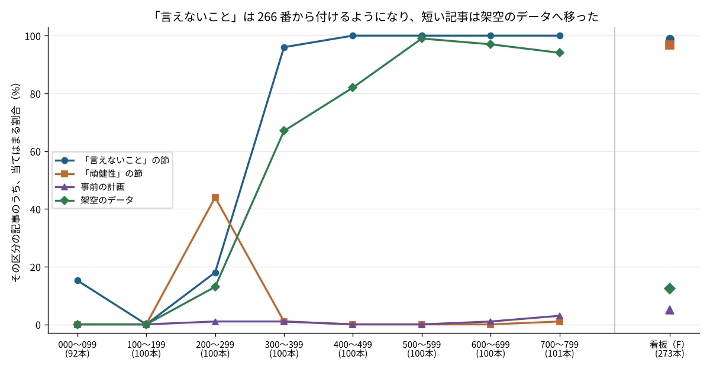
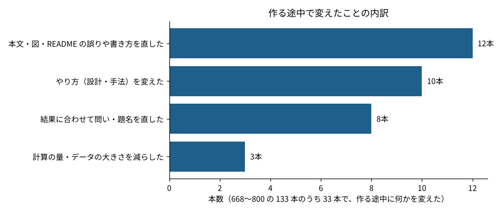
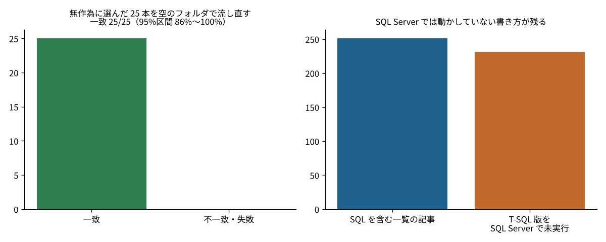

# F297 自分の分析記事1,066本は、決めた書き方をどこまで守っていたのか？ 「言えないこと」は266番から95%の記事に付いたが、事前の計画を書いた記事は5%だった

看板記事 F297。F165（記事フォルダ40本の再実行）の続きで、今度はこのリポジトリの全記事を数えた。

## 問い
このリポジトリの記事には、途中から「言えないことを書く」「頑健性を確かめる」「架空のデータは架空と書く」「推測は推測と書く」などの書き方の決まりを足してきた。1,066本の README で、決まりはいつから、どこまで守られているのか。作る途中で何を変え、何を確かめていないのか。

## データ
- このリポジトリ自身の `articles/` の README 1,066本（記事の一覧 793本・看板記事 273本。2026-11-14 時点。同じ日に作った F296 とこの F297 は除いた）
- `CORRECTIONS.md` の「作る途中で設計や問いを変えた記事（668〜800）」33行と、`UNVERIFIED.md` の未検証の一覧（T-SQL 231本・Excel 13本）
- 流し直しの結果：記事の一覧 551〜800 のうち、コードが1本だけの250本から、種297で無作為に25本を選び、`tools/repro_check.py` で空のフォルダから流し直した結果（2026-11-14）
- 上の3つを `src/build_data.py` で `data/` の CSV と JSON にした。`src/a297_audit.py` は `data/` だけで動く

## 事前の計画
数える前に決めたこと：
1. 決まりは README の見出しと言葉で機械的に判定する（「言えない」を含む見出し、「頑健」を含む見出し、「確かめたこと／再現」を含む見出し、本文の「架空」「シミュレーション」「事前の計画／結果を見る前／先に決め」「推測」）
2. 記事の一覧は100番ごと、看板記事は1つの区分にまとめて比べる
3. 「言えないこと」が付き始めた番号は、「それ以降の割合が95%を超える最初の番号」と決める
4. 流し直しは25本。全部一致でも、95%区間（Clopper–Pearson）で下限を示す

計画からの変更：設計の変更（33行）の区分は、はじめ言葉で機械的に分けたが、「重みの上限が効いていなかった」などが「設計を変えた」に入ってしまったので、文を読んで手で付け直した（`data/design_changes_labels.csv`）。

## 分かったこと

### 1. 「言えないこと」は266番から95%の記事に付き、短い記事は架空のデータに移った


| 区分 | 本数 | 言えないこと | 頑健性 | 架空のデータ | 事前の計画 |
|---|---|---|---|---|---|
| 000〜099 | 92 | 15% | 0% | 0% | 0% |
| 100〜199 | 100 | 0% | 0% | 0% | 0% |
| 200〜299 | 100 | 18% | 44% | 13% | 1% |
| 300〜399 | 100 | 96% | 1% | 67% | 1% |
| 400〜699 | 300 | 100% | 0% | 82〜99% | 0〜1% |
| 700〜799 | 101 | 100% | 1% | 94% | 3% |
| 看板（F） | 273 | 99% | 97% | 13% | 5% |

- 記事の一覧では、266番より前は7.8%、266番以降は95.1%の記事に「言えないこと」の節がある
- 300番以降の記事の一覧は87.8%が架空のデータ。看板記事は12.5%で、ほとんどが公的統計
- 「頑健性」の節は看板記事の96.7%にあり、記事の一覧では5.8%。短い記事では、頑健性の代わりに「確かめたこと」の節を置く形になっている

### 2. 668〜800 の133本のうち33本（25%）で、作る途中に何かを変えた


| 変えたこと | 本数 | 133本に対する割合 |
|---|---|---|
| 本文・図・README の誤りや書き方を直した | 12 | 9.0% |
| やり方（設計・手法）を変えた | 10 | 7.5% |
| 結果に合わせて問い・題名を直した | 8 | 6.0% |
| 計算の量・データの大きさを減らした | 3 | 2.3% |

- 「結果に合わせて問い・題名を直した」8本は、予定した差が出なかった（717）、物差しが使えなかった（729）などで、問いを結果に合う形に直し、いきさつを本文に書いたもの
- 本文の数字が図やデータと合っていなかったものが4本（721・784・791・796）。どれも作る途中で直した

### 3. 無作為の25本は全部一致したが、SQL Server では動かしていない書き方が231本残る


- 25本すべてで、results/ と data/ が元のファイルと一致した。一致の割合の95%区間は86〜100%。流し直しの時間は中央値2.8秒、最長73.8秒
- 記事の一覧で SQL を扱う251本のうち、T-SQL 版を SQL Server で動かしていないものが228本（ほかに、SQL を扱うと判定できなかった記事に3本）。DuckDB と Python では答えが合うことを確かめているが、SQL Server の書き方としては未検証
- 事前の計画を書いた記事は、看板記事で5.1%、記事の一覧で0.8%だけだった。決まりの中で、いちばん守れていない

## 言えないこと
- 決まりの判定は見出しと言葉による機械的なもの。「言えないこと」を別の見出し（「注意」など）に書いた記事は数えられていない。事前の計画も、「計画」と書かずに設計を先に決めた記事は数えられない。割合は下限に近いとみている（推測）
- 自分の記事を自分で数えたもので、決まりの「中身」が適切か（言えないことが十分か）は見ていない
- 流し直しは同じ種類の環境（Linux・Python 3.13）で、25本だけ。看板記事は入っていない。看板記事の再現は F165 で別に調べ、20本中13本で数字が一致した
- 設計の変更の区分は手で付けたので、別の人が付けると数本動く

## 頑健性
- 「言えないこと」が付き始めた番号は、基準を95%から90%にすると229番、99%にすると299番になる。「200番台の後半から300番の前後で決まりが入った」という読み方は変わらない
- この記事の `results/` は、2回流して一致した

## 仕事で使うなら
- 書き方の決まりは、決めた日を境に守られ方がはっきり変わった。チームの分析レポートでも、テンプレートに「言えないこと」の欄を入れると定着しやすい（推測）
- いちばん守れていない「事前の計画」は、テンプレートの欄だけでは足りない。結果を出す前に、計画の md をコミットする手順にする
- 未検証の一覧（UNVERIFIED.md）のように「確かめていないこと」を一か所に集めておくと、あとで誰かが確かめる入口になる

## 再現のしかた
```
pip install -r requirements.txt
cd src
python build_data.py   # リポジトリの中でだけ動く。data/ を作り直す（なくても次は動く）
python a297_audit.py   # data/ から results/ と figures/ を作る
```

## ファイル
| ファイル | 中身 |
|---|---|
| src/build_data.py | README・CORRECTIONS.md・UNVERIFIED.md から data/ を作る |
| src/a297_audit.py | 集計と図 |
| data/articles.csv | 記事ごとの判定（1,066行） |
| data/design_changes.csv / design_changes_labels.csv | 作る途中で変えたこと（33行）と手で付けた区分 |
| data/unverified.csv | 未検証の一覧（244行） |
| data/repro_sample.json | 流し直した25本の結果 |
| results/main.json | 本文の数字 |

## 出典
このリポジトリ自身（2026-11-14 時点）。外部のデータは使っていない。

コード：MIT License
