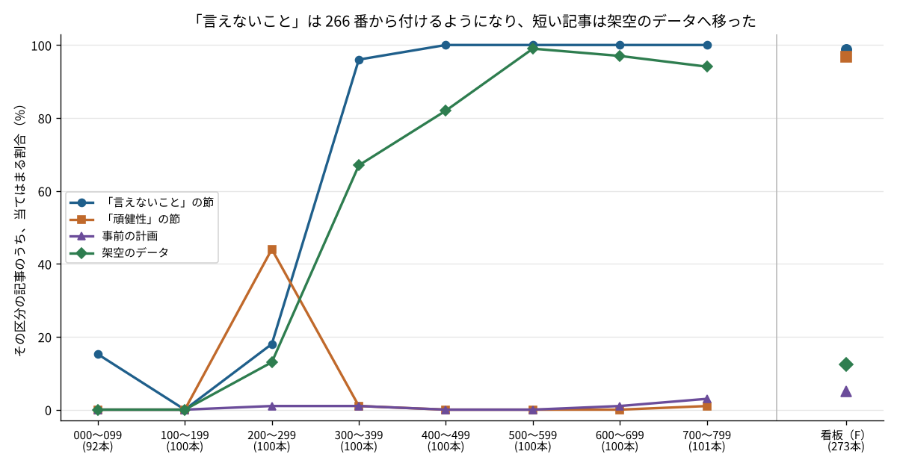
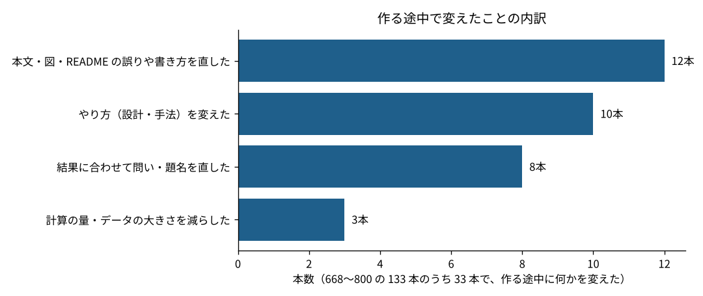
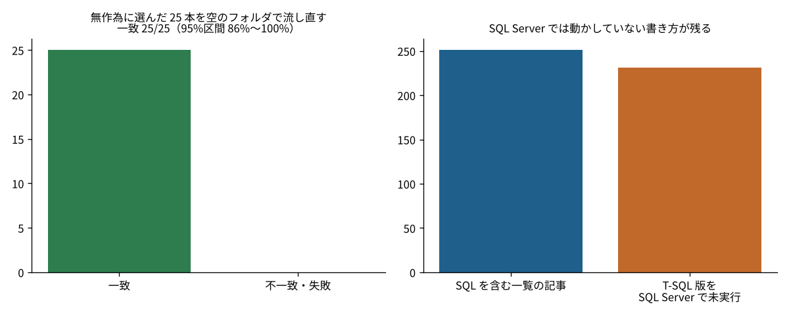

# F297 How well did my 1,066 analysis articles follow the writing rules I set? "What this does not show" appears in 95% from article 266 on, but only 5% wrote a plan in advance

Japanese version: [README.md](README.md).

A feature article following [F165](../F165_reproducibility_audit/README_EN.md) (re-running 40 article folders). This time it counts every article in the repository.

## Question

Over time, writing rules were added to the articles in this repository: "write what this does not show", "check robustness", "say when data is fictional", "mark interpretations as such". Across 1,066 READMEs, from when and how well were the rules followed? What was changed while the articles were being made, and what has not been verified?

## Data

- The repository's own `articles/` READMEs: 1,066 (793 regular articles and 273 feature articles, as of 14 Nov 2026, excluding F296 and this F297, made the same day).
- The 33 rows of "articles whose design or question changed while being made (668–800)" in `CORRECTIONS.md`, and the list of unverified items in `UNVERIFIED.md` (231 T-SQL, 13 Excel).
- Re-run results: from the 250 regular articles 551–800 with a single script, 25 chosen at random with seed 297 were re-run from an empty folder with `tools/repro_check.py` (14 Nov 2026).
- `src/build_data.py` turns these three into CSV and JSON in `data/`; `src/a297_audit.py` runs from `data/` alone.

## The plan made before counting

1. Rules are judged mechanically from README headings and words (a heading containing "cannot say", "robust" or "checked / reproduce"; body words for "fictional", "simulation", "plan in advance / before seeing results / decided first", "my interpretation").
2. Compare regular articles in blocks of 100 and feature articles as one group.
3. The article number from which "what this does not show" took hold = the first number after which the share exceeds 95%.
4. Re-run 25 articles; even if all match, show the lower bound of the 95% interval (Clopper–Pearson).

Change from the plan: the 33 design changes were first classified by keywords, but items such as "the weight cap was not working" ended up as "changed the design", so they were relabeled by hand after reading each sentence (`data/design_changes_labels.csv`).

## Findings

### 1. "What this does not show" appears in 95% of articles from number 266; short articles moved to fictional data



| Block | Articles | What this does not show | Robustness | Fictional data | Plan in advance |
|---|---|---|---|---|---|
| 000–099 | 92 | 15% | 0% | 0% | 0% |
| 100–199 | 100 | 0% | 0% | 0% | 0% |
| 200–299 | 100 | 18% | 44% | 13% | 1% |
| 300–399 | 100 | 96% | 1% | 67% | 1% |
| 400–699 | 300 | 100% | 0% | 82–99% | 0–1% |
| 700–799 | 101 | 100% | 1% | 94% | 3% |
| Feature (F) | 273 | 99% | 97% | 13% | 5% |

- Among regular articles, 7.8% before number 266 and 95.1% from 266 on have a "what this does not show" section.
- From number 300 on, 87.8% of regular articles use fictional data; feature articles 12.5%, mostly public statistics.
- A "robustness" section appears in 96.7% of feature articles and 5.8% of regular articles; short articles use a "what I checked" section instead.

### 2. 33 of the 133 articles numbered 668–800 (25%) changed something while being made



| What changed | Articles | Share of 133 |
|---|---|---|
| Fixed errors or wording in text, figures or README | 12 | 9.0% |
| Changed the method (design or technique) | 10 | 7.5% |
| Revised the question or title to fit the result | 8 | 6.0% |
| Reduced computation or data size | 3 | 2.3% |

- The 8 that "revised the question or title to fit the result" did so because the expected difference did not appear (717), a yardstick could not be used (729), etc.; each describes the history in its text.
- In 4 articles (721, 784, 791, 796) numbers in the text did not match the figures or data; all were fixed during production.

### 3. All 25 random re-runs matched, but 231 SQL Server versions have never been run



- In all 25, results/ and data/ matched the originals. The 95% interval for the match rate is 86–100%. Re-run time: median 2.8 seconds, longest 73.8 seconds.
- Of 251 regular articles that deal with SQL, 228 have a T-SQL version that was never run on SQL Server (plus 3 in articles not detected as SQL articles). Answers were checked to agree between DuckDB and Python, but the SQL Server versions are unverified.
- Only 5.1% of feature articles and 0.8% of regular articles wrote a plan in advance — the least-followed rule.

## Robustness

- The number from which "what this does not show" took hold becomes 229 with a 90% threshold instead of 95%, and 299 with 99%. The reading "the rule came in between the late 200s and around 300" does not change.
- This article's `results/` were identical across two runs.

## What this does not show

- Rules were judged mechanically from headings and words. Articles that wrote limitations under another heading (e.g. "notes") are not counted, nor are articles that settled the design first without writing "plan". The shares are probably close to lower bounds (my interpretation).
- I counted my own articles and did not judge whether the content of each rule was adequate (e.g. whether the limitations are sufficient).
- Re-runs used the same kind of environment (Linux, Python 3.13) and only 25 articles, with no feature articles. Reproducibility of feature articles was studied separately in F165, where numbers matched in 13 of 20.
- The design-change categories were assigned by hand; another person might move a few.

## How to use this at work

- Adherence to writing rules changed clearly from the day each rule was set. For team analysis reports, adding a "what this does not show" field to the template probably helps it stick (my interpretation).
- The least-followed rule, "plan in advance", needs more than a template field: make committing a plan file before producing results part of the procedure.
- Keeping "what has not been verified" in one place (like UNVERIFIED.md) gives someone an entry point to verify it later.

## Reproduce

```
pip install -r requirements.txt
cd src
python build_data.py   # works only inside the repository; rebuilds data/ (the next step runs without it)
python a297_audit.py   # builds results/ and figures/ from data/
```

## Files

| File | Contents |
|---|---|
| src/build_data.py | builds data/ from READMEs, CORRECTIONS.md and UNVERIFIED.md |
| src/a297_audit.py | counts and figures |
| data/articles.csv | verdicts per article (1,066 rows) |
| data/design_changes.csv / design_changes_labels.csv | changes made during production (33 rows) and hand-assigned categories |
| data/unverified.csv | list of unverified items (244 rows) |
| data/repro_sample.json | results of the 25 re-runs |
| results/main.json | numbers in the text |

## Sources

This repository itself (as of 14 Nov 2026). No external data.

Code: MIT License
