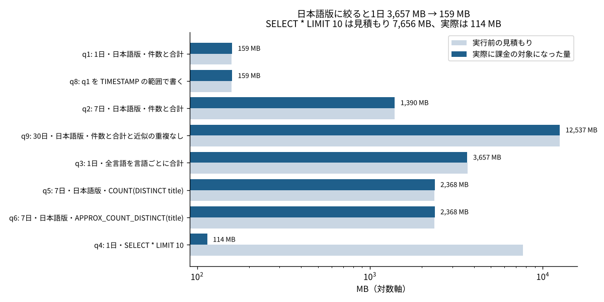
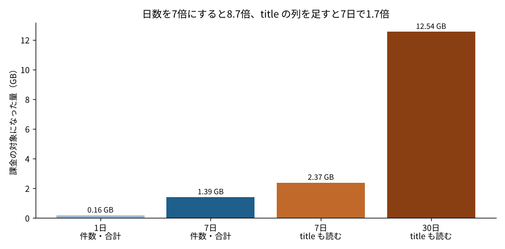
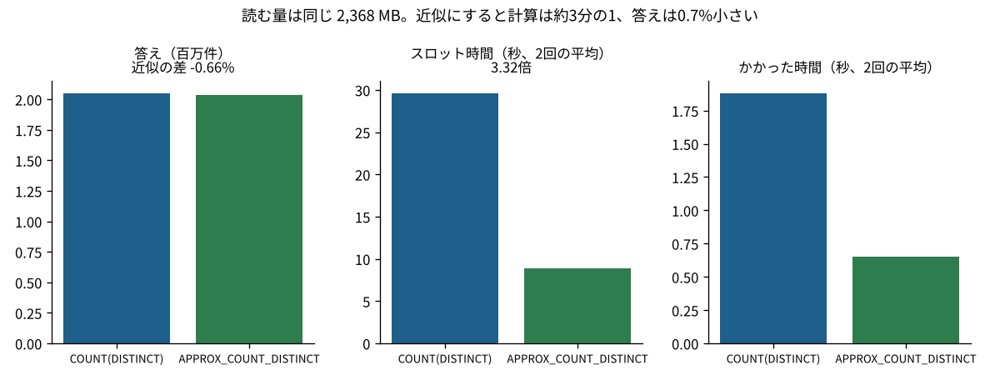

# F298 646億行の閲覧数を BigQuery で集計すると、書き方で読む量はどれだけ変わるのか？ 言語で絞ると23分の1、SELECT * LIMIT 10 は見積もりの67分の1だった

看板記事 F298。大きいデータを SQL で集計するとき、「どう書くと読む量（＝お金）と時間が変わるか」を、BigQuery の公開データで実際に測った。

## 問い
BigQuery は読んだデータの量で課金される。パーティション（日時）とクラスタ（言語・記事名）を持つ大きなテーブルで、絞り込み方・読む列・`LIMIT`・重複なし件数の数え方を変えると、読む量・時間・答えはどれだけ変わるか。実行前の見積もりは当てになるか。

## データ
- `bigquery-public-data.wikipedia.pageviews_2025`：Wikipedia の記事ごと・1時間ごとの閲覧数。2025年分で646億行・2,770 GiB。`datehour` で日ごとのパーティション、`wiki`・`title` でクラスタ。日時の絞り込みがないクエリは実行できない設定
- 出典：Wikimedia Foundation の Pageviews（CC0）を Google が BigQuery の公開データとして提供しているもの
- BigQuery サンドボックス（お支払い情報なし。毎月 1 TiB まで無料で読める）で、2026-11-14 に実行した
- 測った値は `region-us.INFORMATION_SCHEMA.JOBS_BY_USER` から写した（`data/jobs.csv`）。クエリは `sql/queries.sql`

## やったこと
2025-11-01〜 を対象に、次の9本のクエリを流した。うち5本は2回流した（キャッシュが効かないよう、末尾のコメントを変えた）。
| # | 中身 |
|---|---|
| q1 | 1日・日本語版（`wiki = 'ja'`）の行数と閲覧数の合計（日付は `DATE(datehour) = ...`） |
| q8 | q1 と同じ中身を `datehour >= TIMESTAMP ... AND datehour < ...` で書いたもの |
| q2 | 7日・日本語版の行数と合計 |
| q9 | 30日・日本語版の行数・合計・記事数（近似） |
| q3 | 1日・全言語を言語ごとに合計（言語のクラスタが効かない） |
| q4 | 1日・`SELECT * ... LIMIT 10` |
| q5 | 7日・日本語版の記事数（`COUNT(DISTINCT title)`） |
| q6 | 7日・日本語版の記事数（`APPROX_COUNT_DISTINCT(title)`） |
| q7 | 日時の絞り込みなし（`wiki = 'ja'` だけ）→ 実行前にエラーになったので流していない |

## 分かったこと

### 1. 言語で絞ると読む量は23分の1。日時の書き方では変わらなかった


- 1日分で、全言語（q3）は 3,657 MB、日本語版だけ（q1）は 159 MB で、22.9分の1だった。クラスタの列で絞ると、読むブロックそのものが減る
- `DATE(datehour) = '2025-11-01'` と `datehour >= TIMESTAMP '2025-11-01' AND < '2025-11-02'` は、どちらも 159 MB だった。この表では、日付を関数で包んでもパーティションの絞り込みは効いていた
- 日時の条件がない q7 は、「datehour でパーティションを絞る条件がないと実行できない」というエラーで止まった。全期間（2,770 GiB）をうっかり読む事故は、テーブルの設定で防がれている

### 2. `SELECT * LIMIT 10` は、見積もりは 7,656 MB、実際は 114 MB
- 実行前の見積もりは1日分の全列（7,656 MB）だったが、実際に課金の対象になったのは 114 MB で、67分の1だった
- 理由は、クラスタのある表では、`LIMIT` に必要な行がそろった時点で読むのをやめられるためとみている（推測）。ほかのクエリは見積もりと実際がほぼ同じ（実際が見積もりの1.00倍）だった
- 見積もりは「多くてもこれだけ」という上限として使える。ただし、クラスタのない表では `LIMIT` で読む量は減らない（BigQuery の文書の説明。この記事では確かめていない）

### 3. 日数と列で読む量が増え、近似の件数は計算を3分の1にした



- 日本語版の行数と合計で、7日（q2）は 1,390 MB で、1日の8.7倍だった。7倍より多いのは、11/01 が土曜で、平日より閲覧が少ない日だったためとみている（推測）
- 同じ7日でも、`title` の列を読む（q5）と 2,368 MB で、1.7倍になった。30日・`title` あり（q9）は 12,537 MB
- 7日分の日本語版の記事数は、正確に数えると 2,049,746件、近似では 2,036,162件で、差は −0.66%。読む量は同じ（2,368 MB）だが、スロット時間（計算の量）は 29.6秒 → 8.9秒で3.3分の1、かかった時間は 1.9秒 → 0.7秒だった（2回の平均）
- 30日分の日本語版は1億2,205万行、閲覧数の合計は2億7,904万回だった

## 言えないこと
- 1つのテーブル・1つの月・1回か2回の実行だけ。時間（秒）は BigQuery の混み具合で変わる。スロット時間も2回で 3,270〜6,174 ミリ秒のように揺れた（q3）
- 金額は出していない。サンドボックスで課金はされず、使ったのは無料枠（毎月 1 TiB）の約3%（合計 32.7 GB）だった
- `LIMIT` で読む量が減った理由は推測で、BigQuery の内部の動きは確かめていない
- 記事ごとの閲覧数の中身（どの記事が多く見られたか）は扱っていない

## 仕事で使うなら
- 大きな表は、パーティションの列で期間を絞り、クラスタの列（ここでは言語）で先に絞る。WHERE の書き方より「どの列で絞るか」が効く
- 必要な列だけを書く。`title` のような長い文字列の列は、1本足すだけで読む量が大きく増える
- 「何件くらいか」を知りたいだけなら、近似の関数で計算を減らす。誤差（ここでは1%未満）を報告に添える
- テーブルを作る側に回ったら、「パーティションの絞り込みを必須にする」設定を入れる

## 再現のしかた
```
pip install -r requirements.txt
cd src
python a298_scan.py   # data/ の測った値から results/ と figures/ を作る
```
BigQuery で測り直すときは、`sql/queries.sql` を BigQuery のコンソールで流し、`data/jobs.csv` を書き換える。

## ファイル
| ファイル | 中身 |
|---|---|
| sql/queries.sql | 流したクエリ（q1〜q9） |
| data/jobs.csv | ジョブごとの見積もり・処理した量・課金の対象になった量・スロット時間・かかった時間 |
| data/answers.csv | クエリの答え（行数・合計・記事数） |
| data/table_meta.csv | pageviews の年ごとの行数と大きさ（`__TABLES__` から） |
| src/a298_scan.py | 集計と図 |
| results/main.json | 本文の数字 |

## 出典
- Wikimedia Foundation「Pageviews」（CC0）。BigQuery の `bigquery-public-data.wikipedia` で提供されているもの（2026-11-14 に取得）

コード：MIT License
