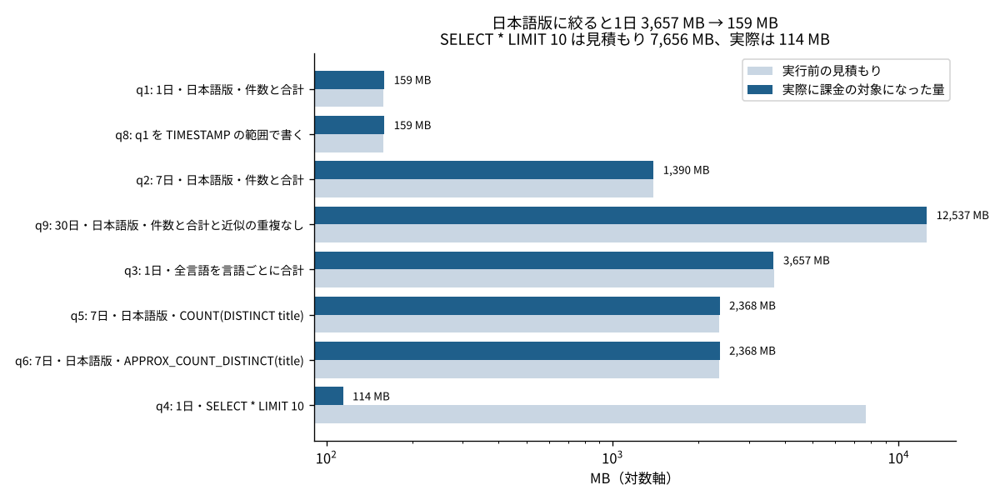
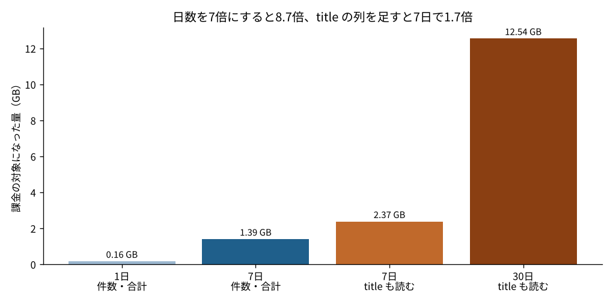
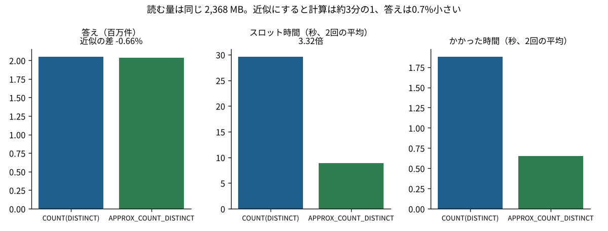

# F298 When aggregating 64.6 billion rows of pageviews in BigQuery, how much does the way you write a query change the bytes read? Filtering by language cut it to 1/23; SELECT * LIMIT 10 read 1/67 of the estimate

Japanese version: [README.md](README.md).

A feature article that measures, with real BigQuery runs on public data, how the way you write SQL changes the amount of data read (= cost) and the time taken when aggregating large data.

## Question

BigQuery charges by the amount of data read. On a large table with partitioning (by date-hour) and clustering (by language and article title), how much do the filters, the columns read, `LIMIT`, and the way of counting distinct values change the bytes read, the time and the answers? Can the pre-run estimate be trusted?

## Data

- `bigquery-public-data.wikipedia.pageviews_2025`: hourly pageviews per Wikipedia article. The 2025 table has 64.6 billion rows and 2,770 GiB. Partitioned daily by `datehour` and clustered by `wiki` and `title`; queries without a date-hour filter are not allowed to run.
- Source: Wikimedia Foundation Pageviews (CC0), provided by Google as a BigQuery public dataset.
- Run in the BigQuery sandbox (no billing information; up to 1 TiB read free per month) on 14 Nov 2026.
- Measured values were copied from `region-us.INFORMATION_SCHEMA.JOBS_BY_USER` (`data/jobs.csv`). The queries are in `sql/queries.sql`.

## What I did

Ran the following nine queries on data from 1 Nov 2025. Five were run twice (changing a trailing comment so the cache would not be used).

| # | Contents |
|---|---|
| q1 | 1 day, Japanese edition (`wiki = 'ja'`): rows and total views (date written as `DATE(datehour) = ...`) |
| q8 | same as q1, written as `datehour >= TIMESTAMP ... AND datehour < ...` |
| q2 | 7 days, Japanese edition: rows and total |
| q9 | 30 days, Japanese edition: rows, total and number of articles (approximate) |
| q3 | 1 day, all languages, totals by language (the language clustering cannot help) |
| q4 | 1 day, `SELECT * ... LIMIT 10` |
| q5 | 7 days, Japanese edition: number of articles (`COUNT(DISTINCT title)`) |
| q6 | 7 days, Japanese edition: number of articles (`APPROX_COUNT_DISTINCT(title)`) |
| q7 | no date-hour filter (only `wiki = 'ja'`) → failed before running, so not executed |

## Findings

### 1. Filtering by language cut the bytes read to 1/23; how the date was written made no difference



- For one day, all languages (q3) read 3,657 MB and the Japanese edition only (q1) 159 MB: 1/22.9. Filtering on a clustered column reduces the blocks read.
- `DATE(datehour) = '2025-11-01'` and `datehour >= TIMESTAMP '2025-11-01' AND < '2025-11-02'` both read 159 MB. On this table, partition pruning worked even with the date wrapped in a function.
- q7, without a date-hour condition, stopped with an error saying it cannot run without a filter on the datehour partition. Accidentally reading the whole table (2,770 GiB) is prevented by a table setting.

### 2. `SELECT * LIMIT 10`: estimated 7,656 MB, actually 114 MB

- The pre-run estimate was all columns for one day (7,656 MB), but the billed amount was 114 MB, 1/67 of it.
- The likely reason is that on a clustered table, reading can stop once enough rows for `LIMIT` are found (my interpretation). For the other queries, the estimate and the actual were almost the same (actual = 1.00× the estimate).
- The estimate works as an upper bound. On tables without clustering, `LIMIT` does not reduce the bytes read (according to BigQuery's documentation; not checked here).

### 3. Bytes read grow with days and columns; approximate counting cut computation to a third




- For rows and total of the Japanese edition, 7 days (q2) read 1,390 MB, 8.7× one day. More than 7× probably because 1 Nov was a Saturday with fewer views than weekdays (my interpretation).
- Over the same 7 days, reading the `title` column (q5) read 2,368 MB, 1.7×. 30 days with `title` (q9) read 12,537 MB.
- The number of Japanese articles over 7 days was 2,049,746 counted exactly and 2,036,162 approximately, a difference of −0.66%. Bytes read were the same (2,368 MB), but slot time (amount of computation) fell from 29.6 s to 8.9 s (1/3.3) and elapsed time from 1.9 s to 0.7 s (average of two runs).
- The Japanese edition over 30 days had 122.05 million rows and 279.04 million views in total.

## Viewing it on a dashboard

From the same public data, three small tables were built and shown as a two-page dashboard in Looker Studio.
- Page 1, "Japanese-edition pageviews": daily views in November 2025 (line) and views by language edition for 1–7 November (top 20, horizontal bars).
- Page 2, "Bytes read per query": the billed amount (MB, horizontal bars) for the queries run in this article.
- The SQL that builds the tables is `sql/dashboard_tables.sql`. Sandbox tables expire after 60 days; when they disappear, run this SQL again.
- The dashboard is private. Data source: Wikimedia Foundation Pageviews (CC0).
- `sql/dashboard_tables.sql` is a cleaned-up file of the SQL run in the console; the wording of the `query_cost` labels may differ slightly from what was run.

## What this does not show

- One table, one month, and one or two runs per query. Elapsed time varies with BigQuery's load, and slot time also varied between two runs (e.g. 3,270–6,174 ms for q3).
- No money amounts. The sandbox does not bill; the queries used about 3% of the free tier (1 TiB per month), 32.7 GB in total.
- Why `LIMIT` reduced the bytes read is an interpretation; BigQuery's internals were not checked.
- The content of the pageviews (which articles were viewed most) is not discussed.

## How to use this at work

- On large tables, limit the period with the partition column and filter first on clustered columns (here, language). Which column you filter on matters more than how you write the WHERE clause.
- Write only the columns you need. Adding a single long string column such as `title` greatly increases the bytes read.
- If you only need "about how many", use approximate functions to save computation, and report the error (here under 1%).
- If you create tables, turn on the setting that requires a partition filter.

## Reproduce

```
pip install -r requirements.txt
cd src
python a298_scan.py   # builds results/ and figures/ from the measured values in data/
```
To measure again in BigQuery, run `sql/queries.sql` in the BigQuery console and replace `data/jobs.csv`.

## Files

| File | Contents |
|---|---|
| sql/queries.sql | the queries run (q1–q9) |
| sql/dashboard_tables.sql | SQL that builds the dashboard tables (ja_daily, wiki_week, query_cost) |
| data/jobs.csv | per job: estimate, bytes processed, bytes billed, slot time, elapsed time |
| data/answers.csv | query answers (rows, totals, article counts) |
| data/table_meta.csv | rows and size of the pageviews tables by year (from `__TABLES__`) |
| src/a298_scan.py | summaries and figures |
| results/main.json | numbers in the text |
