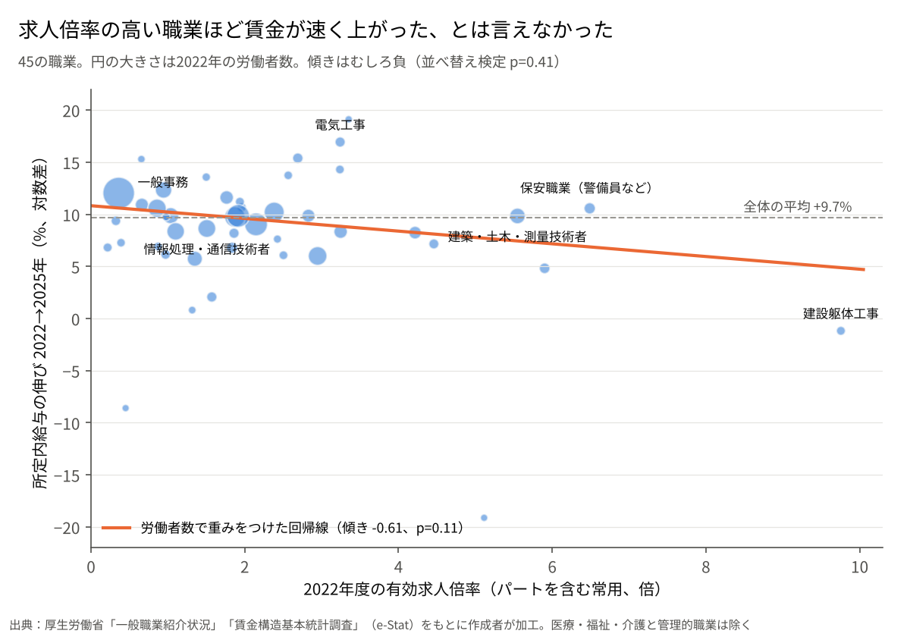
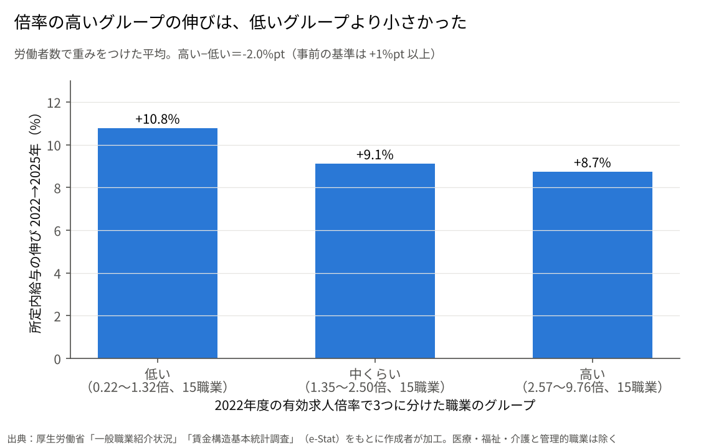
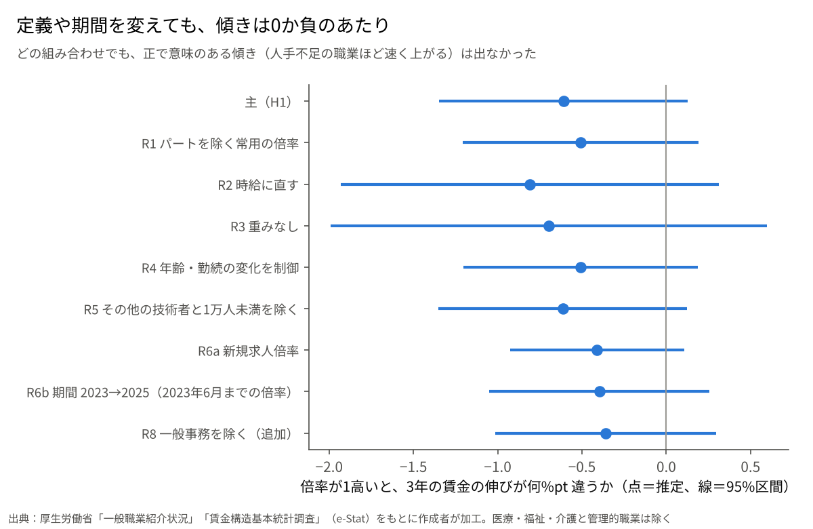
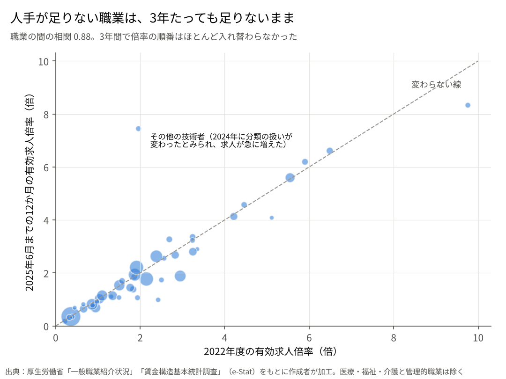

# F299 「人手不足の職業ほど賃金が上がった」は本当か？ 2022→2025年の45職業では、求人倍率の高い職業ほど速く上がったとは言えない

「人手不足が賃金を押し上げている」という話を、職業の間の比較で確かめました。ハローワークの職業別の有効求人倍率（求職者1人あたりの求人の数）と、賃金構造基本統計調査の職種別の所定内給与（残業代や賞与を除く毎月の給与）を、45の職業にそろえて突き合わせています。

## 結論（先に）

- **倍率の高い職業ほど賃金が速く上がった、という関係は見えませんでした。** 2022年度の有効求人倍率と、2022→2025年の所定内給与の伸びの傾きは −0.61%pt（倍率が1高いと3年の伸びが0.61%pt 小さい、95%区間 −1.35〜+0.13、p=0.11、並べ替え検定 p=0.41）でした。順位の相関はほぼ0（−0.02）です。
- **倍率で3つに分けると、高いグループの伸びは +8.7%、低いグループは +10.8% でした。** 事前に決めた「高い−低いが +1%pt 以上」に対して −2.0%pt で、仮説は外れです。
- **同じ職業の中で、倍率が高い年ほど伸びが大きい、という形も確かめられませんでした**（係数 +0.70、p=0.47）。3年の間に倍率がほとんど動かず（職業の間の相関 0.88）、比べる材料が少ないためです。
- 定義（パートを除く倍率・時給・新規求人倍率）、重み、期間、外れた職業の扱いを変えた9通りでも、傾きは −1.21〜−0.36 で、正で意味のある傾きは一度も出ませんでした。
- 2022→2025年の伸びは全体で +9.7%（労働者数の重みつき）。上がり方の職業の差は、求人倍率では説明できませんでした。



## 問い

採用・人事の担当、職業を選ぶ人、労働市場の記事を読む人が気にする話です。厚生労働省の令和6年版「労働経済の分析」（労働経済白書）は、欠員率（埋まっていない求人の割合）に対する賃金の反応が大きいことを示し、欠員率が高まれば賃金の伸びが高まる可能性に触れています（全国の時系列の分析です。要約は作成者による）。

では、職業の間で見るとどうか。「人が足りない職業ほど、賃金が速く上がった」は、公的な統計でどこまで確かめられるのか。これがこの記事の問いです。

## データ（出典）

| データ | 中身 | 期間 | ファイル |
|---|---|---|---|
| 厚生労働省「一般職業紹介状況（職業安定業務統計）」長期時系列表21 | 職業別の有効求人数・有効求職者数・新規求人数・新規求職申込件数（パートを含む常用／パートを除く常用、月） | 2022年4月〜2026年9月 | data/raw/hw_t21_occupation_2022apr_.xlsx |
| 厚生労働省「賃金構造基本統計調査」一般労働者・職種 第1表 | 職種（小分類、約145）ごとの所定内給与額・所定内実労働時間・労働者数・平均年齢・勤続年数（男女計・企業規模10人以上、各年6月分） | 2022〜2025年 | data/raw/wage_occ_t1_2022〜2025.xlsx |

- 職業の分け方が違うので、賃金の職種を求人の職業（中分類）に手で対応づけました（`data/occupation_map.csv`）。賃金は労働者数の重みつき平均、求人数・求職者数は合計です。求人の職業分類は2022年4月からの形で、それより前とはつなげていません。
- 医療・福祉・介護に当たる職業と、管理的職業、分類不能の職業は、事前に決めたとおり両方から除きました。残りは45の職業、2022年の労働者数は約2,228万人です。
- 「その他の技術者」は2024年度から求人が急に増えていて、分類の扱いが変わった可能性があります（推測。頑健性 R5 で除いた）。取得日と URL は `data/raw/SOURCES.md` にあります。

## 事前の計画

集計の前に [PLAN.md](PLAN.md) を書きました（2026-11-16 06:24）。計画を書く前に見たのは、求人の表の「職業計」と技術者のいくつかの行、賃金の表の上の方の行の値だけで、両者の関係は集計していません。

| 仮説 | 基準 | 結果 | 判定 |
|---|---|---|---|
| H1 2022年度の倍率が高い職業ほど、2022→2025年の伸びが大きい | 重みつき回帰の傾きが正で p<0.05 | −0.61（p=0.11） | **外れ** |
| H2 倍率の上の3分の1と下の3分の1の伸びの差が +1%pt 以上 | 差 ≥ +1%pt | −2.0%pt | **外れ** |
| H3 同じ職業の中で、倍率が高い年ほど伸びが大きい | 職業・年の固定効果つきの係数が正で p<0.05 | +0.70（p=0.47） | **外れ**（判定する力も弱い） |
| H4 賃金が速く上がった職業では、そのあと倍率が下がる | 傾きが負 | +0.89（p=0.61） | **外れ** |

## やったこと

1. 職業ごとに、2022年度と「各年6月までの12か月」の有効求人倍率を出しました（有効求人数の合計 ÷ 有効求職者数の合計）。賃金の調査月（6月）に合わせるためです。
2. 伸びは所定内給与の対数の差×100（%）です。
3. H1・H4 は労働者数で重みをつけた回帰（HC3 標準誤差）と並べ替え検定（2,000回、種 20261116）、H2 は15職業ずつの3グループの比較、H3 は3期間のパネルに職業と年の固定効果を入れた回帰（職業ごとのクラスター標準誤差）です。

## 分かったこと

### 倍率の高い職業ほど速く上がった、とは言えない（図1）

- 倍率は0.22倍（美術家・デザイナー・写真家）から9.76倍（建設躯体工事）まで違います。
- それでも伸びとの傾きは −0.61%pt（95%区間 −1.35〜+0.13）で、0と区別できません。重みつきの相関は −0.36、順位の相関は −0.02 です。
- 倍率が5倍を超える5つの職業（建設躯体工事・保安職業・土木作業・建築・土木・測量技術者・採掘）のうち、伸びが全体の平均（+9.7%）を上回ったのは、建築・土木・測量技術者（+9.8%）と保安職業（+10.6%）の2つでした。建設躯体工事は −1.2%、採掘は −19.1% です（採掘は労働者数が少なく、賃金の標本のぶれが大きいと考えられます。推測）。

### 3つに分けても、高いグループの伸びは小さい（図2）



- 倍率の低い15職業（0.22〜1.32倍）は +10.8%、中くらい（1.35〜2.50倍）は +9.1%、高い（2.57〜9.76倍）は +8.7% でした。
- 低いグループには、労働者数の多い一般事務（約352万人、+12.0%）が入っていて、重みつきの平均を引き上げています。中央値で比べると、低い +9.4%、高い +9.8% で、差はほとんどありません。どちらで見ても「高いグループほど大きく上がった」にはなりません。

### 定義を変えても、傾きは0か負のあたり（図3）



- 9通りの傾きはすべて負で、95%区間はどれも0をまたいでいます（下の「頑健性」の表）。
- 「負の関係がある」とも言い切れません。言えるのは「正の関係は見えない」までです。

## 問い直し（結果を見てから足した）

**倍率の高い職業は、もともと賃金が低かったのか。賃金の水準をそろえると、関係は変わるのか。**（`src/03b_requestion.py`、`results/requestion.json`）

- 2022年の賃金の水準（対数）と倍率には、目立った関係がありませんでした（係数 −0.015、p=0.51）。
- 水準を説明変数に足しても、倍率の傾きは −0.59（p=0.13）で、ほとんど変わりません。
- 2022年の賃金が中央値（28.6万円）以下の23職業でも −0.27（p=0.69）、上の22職業でも −0.60（p=0.20）でした。
- つまり「もとの水準の違い」では、正の関係が見えないことを説明できませんでした。

あわせて、倍率が3年でどれだけ動いたかも見ました（図4）。2022年度と2025年6月までの12か月の倍率の、職業の間の相関は 0.88 でした。同じ職業の中での年ごとの動き（標準偏差 0.39）は、職業の間の違い（1.90）よりずっと小さく、H3 が判定しにくかった理由の一つと考えられます。



## 頑健性

H1 の傾き（倍率が1高いと、伸びが何%pt 違うか）。10通りとも「正の関係は見えない」という結論は変わりませんでした（R7 は倍率の対数なので単位が違います）。

| 確かめ | 職業数 | 傾き | 95%区間 | p |
|---|---|---|---|---|
| 主（H1） | 45 | −0.61 | −1.35〜+0.13 | 0.11 |
| R1 パートを除く常用の倍率 | 45 | −0.51 | −1.21〜+0.19 | 0.16 |
| R2 時給に直す | 45 | −0.81 | −1.93〜+0.31 | 0.16 |
| R3 重みなし | 45 | −0.70 | −1.99〜+0.60 | 0.29 |
| R4 年齢・勤続の変化を制御 | 45 | −0.51 | −1.20〜+0.19 | 0.15 |
| R5 その他の技術者と1万人未満を除く | 43 | −0.61 | −1.35〜+0.12 | 0.10 |
| R6a 新規求人倍率 | 45 | −0.41 | −0.93〜+0.11 | 0.12 |
| R6b 期間 2023→2025（2023年6月までの倍率） | 45 | −0.40 | −1.05〜+0.26 | 0.23 |
| R7 倍率を対数に（追加） | 45 | −1.21 | −2.59〜+0.17 | 0.09 |
| R8 一般事務を除く（追加） | 44 | −0.36 | −1.01〜+0.30 | 0.28 |

H3 も、パートを除く倍率（+0.88、p=0.33）、重みなし（+1.07、p=0.24）で、どれも p≥0.05 でした。

## 言えないこと

- **因果は言えません。** 見ているのは相関です。最低賃金の引き上げ、春の賃上げ交渉、価格への転嫁、職業の中の顔ぶれの入れ替わりなど、ほかの理由が混ざっています。
- **期間は3年だけです。** 2022〜2025年は、物価が上がり賃金も広く上がった時期です。ほかの時期に同じ結果になるかは分かりません。
- **求人倍率はハローワーク経由だけです。** 民間の求人サイトや紹介会社の求人は入っていません。職業によって、ハローワークを使う割合は違うはずです（推測）。
- **賃金は一般労働者（フルタイム）の6月分の所定内給与です。** 賞与、残業代、パートの時給は見ていません。
- **職業の対応づけは作成者が手で行いました。** 分け方を変えると数字は動きます。小さな職業（採掘・船舶航空機運転など）は、賃金の標本が少なく伸びがぶれます。
- 医療・福祉・介護の職業は扱っていません。

## 仕事で使うなら

- 「人手不足の職種だから賃金が上がっているはず」という見方は、2022〜2025年の公的統計の職業の比較では裏づけられませんでした。職種ごとの賃金の動きを見るときは、倍率と賃金を別々に確かめる材料になります。
- 倍率は職業の間の差が大きく、年による動きは小さい指標です。前の年からの変化を見るときは、この性質を前提に読むことになります。

## 計画からの変更

- 頑健性を2つ足しました（R7 倍率の対数、R8 一般事務を除く）。図4は H3 を読むために足しました。
- 職業の対応づけ（45グループ）は、計画の直後、集計の前に決めました。

## 再現のしかた

```sh
pip install -r requirements.txt
python3 src/01_fetch.py      # 元データの取得（ネットが必要。同梱済みなので通常は不要）
sh src/run_all.sh            # オフラインで 02 から最後まで（約7秒）
```

| ファイル | 役割 |
|---|---|
| src/01_fetch.py | e-Stat から取得、SOURCES.md を書く |
| src/02_build.py | 分析用の表（data/*.csv）を作る |
| src/03_analysis.py | H1〜H4 と頑健性（results/main.json） |
| src/03b_requestion.py | 問い直し（results/requestion.json） |
| src/04_figures.py | 図1〜4 |
| data/occupation_map.csv | 職業の対応表（手で作成） |

- 再現の確かめ：`results/repro_check.txt`（2026-11-16 再実行：15 ファイル一致、所要 7 秒。/tmp に写して出力を消してから流し、cmp で比較）。スレッド1、乱数の種 20261116。

## レビューで直したこと

独立レビューで数字の照合・再実行・図を確かめ、直すところはなかった。

## 出典

- 厚生労働省「一般職業紹介状況（職業安定業務統計）」長期時系列表21 職業別労働市場関係指標（実数）：[e-Stat](https://www.e-stat.go.jp/stat-search/files?toukei=00450222&tstat=000001020327)
- 厚生労働省「賃金構造基本統計調査」令和4〜7年 一般労働者 職種 第1表：[e-Stat](https://www.e-stat.go.jp/stat-search/files?toukei=00450091&tstat=000001011429)
- 厚生労働省「令和6年版 労働経済の分析」（要約）：[厚生労働省](https://www.mhlw.go.jp/stf/wp/hakusyo/roudou/24/matome.html)

（いずれも 厚生労働省の公表データ をもとに作成者が加工して作成）
