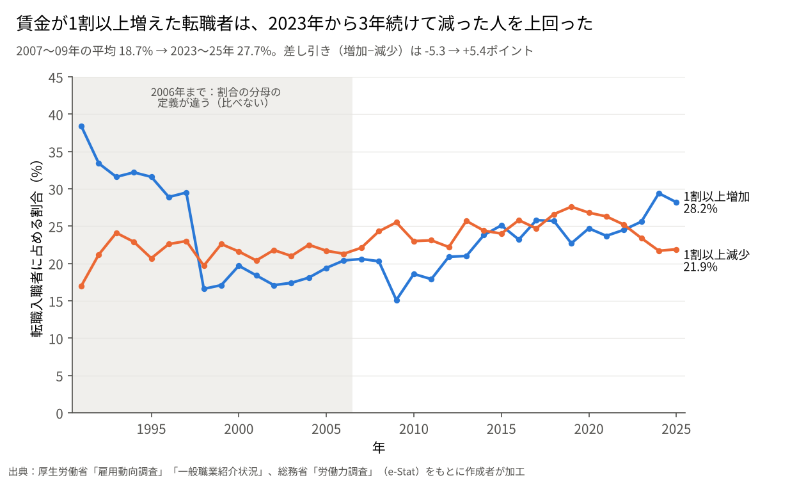
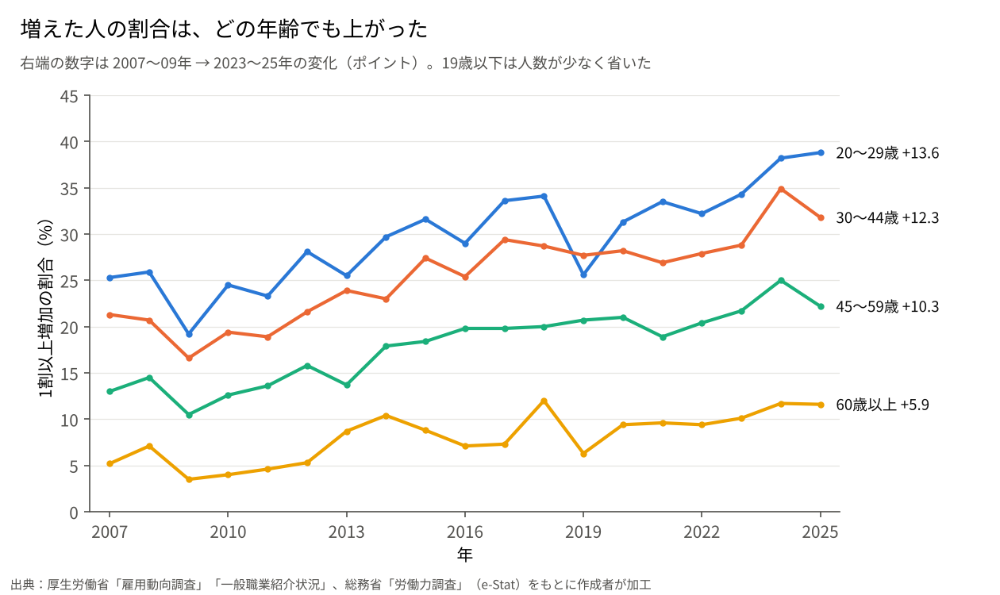
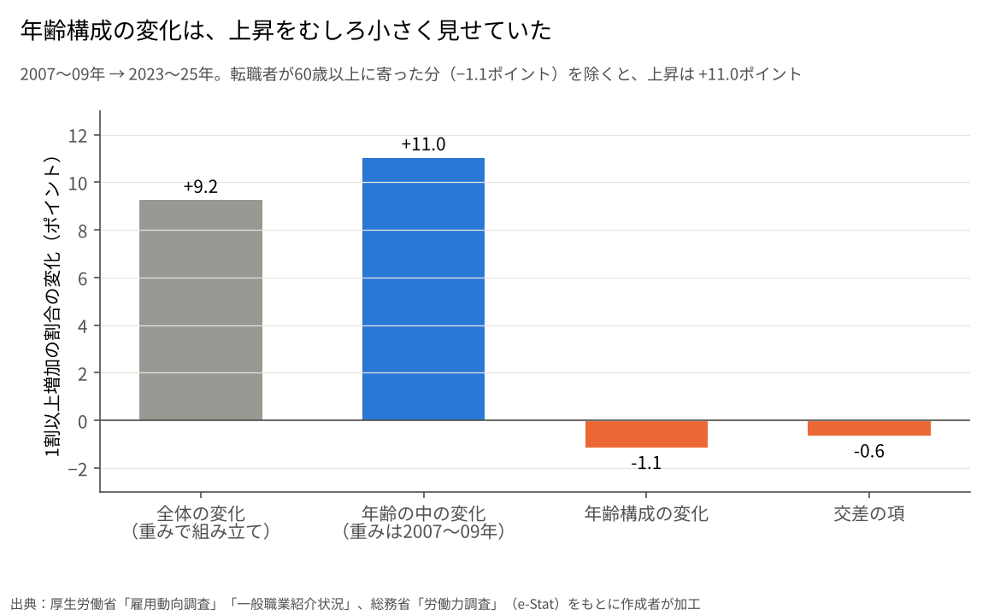
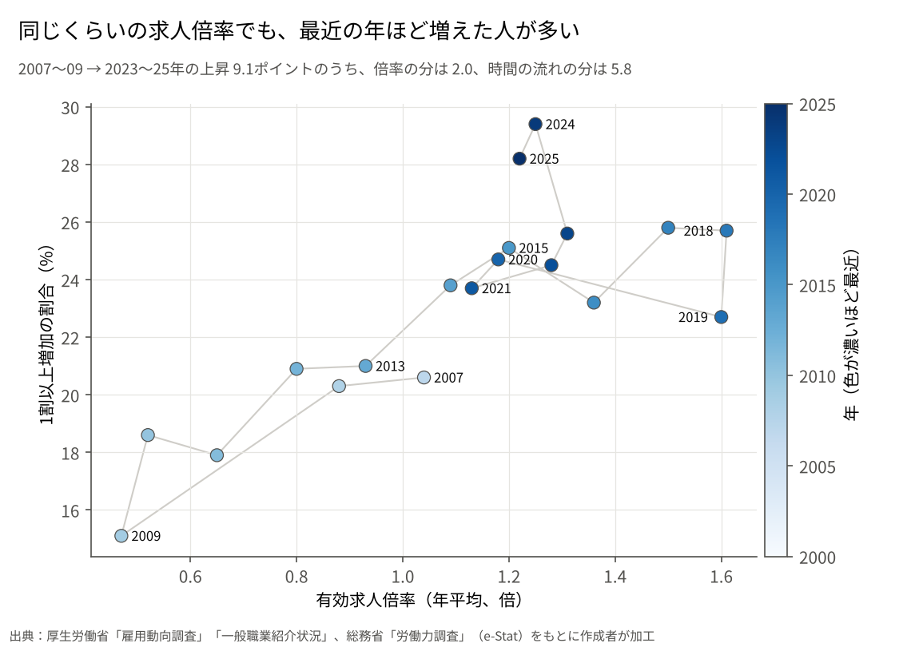

# F300 「転職すると賃金が上がる人が増えた」は、雇用動向調査でどこまで言えるか？ 年齢構成をそろえると上昇は+11.0ポイント、景気で説明できるのは2.0ポイント

雇用動向調査では、前の仕事より賃金が1割以上増えた転職者の割合が上がっています（この数字そのものは既存の記事 123 で紹介しました）。この記事では、その上がり方が「転職者の年齢が若くなったから」「景気が良くなったから」で説明できてしまわないかを確かめました。

## 結論（先に）

- **年齢構成のせいではありません。** 1割以上増えた人の割合は、2007〜09年の平均18.7%から2023〜25年の27.7%へ、9.1ポイント上がりました。転職者の年齢の重みを2007〜09年に固定すると、上昇は +11.0ポイントで、むしろ大きくなります。転職者が60歳以上の側に寄ったこと（60歳以上は増える人が少ない）が、全体の上昇を1.1ポイント小さく見せていました。
- **どの年齢でも上がりました。** 20〜29歳 +13.6、30〜44歳 +12.3、45〜59歳 +10.3、60歳以上 +5.9ポイントです。
- **減った人を差し引いても上がりました。** 「1割以上増加」−「1割以上減少」は −5.3 から +5.4ポイントへ、10.7ポイント上がりました。2023年からは3年続けて、増えた人が減った人を上回っています。「ほぼ変わらない（1割未満の増減）」は56.2%から48.0%に減っていて、その分の多くが「増えた」に回った形です。
- **景気だけでは説明できません。** 有効求人倍率と時間の流れ（直線）で説明すると、倍率の係数は正（倍率が1上がると +4.4ポイント、p=0.01）でした。ただし 2007〜09→2023〜25年の上昇9.1ポイントのうち、倍率の上がった分で説明できるのは2.0ポイントで、5.8ポイントは時間の流れの分です。同じくらいの倍率の年どうし（2015年と2025年）でも、3.1ポイント違います。



## 問い

「転職で賃金が上がる人が増えた」は、転職や採用の話でよく使われます。ただ、この割合は、①転職する人の年齢構成、②景気、③「減った人」の扱い、で見え方が変わります。人事・採用の担当や労働市場の記事を読む人が、この数字をどこまで信じてよいかを知りたい、というのがこの記事の出発点です。

## データ（出典）

| データ | 中身 | 期間 | ファイル |
|---|---|---|---|
| 厚生労働省「雇用動向調査」年次別推移 第11表 | 転職入職者の年齢階級別の賃金変動（1割以上増加／1割未満の増減／1割以上減少の割合） | 1991〜2025年 | data/raw/koyo_hyo11_wage_change_by_age.xls |
| 同 第4-2表 | 年齢階級（5歳）別の転職入職率 | 1991〜2025年 | data/raw/koyo_hyo04_2_job_change_rate_by_age.xls |
| 総務省「労働力調査」長期時系列 表3-3 | 年齢階級（5歳）別の就業者数 | 1968〜2025年 | data/raw/lfs_t3_3_employed_by_age5.xlsx |
| 厚生労働省「一般職業紹介状況」長期時系列表1 | 有効求人倍率（年平均） | 1963〜2025年 | data/raw/hw_t1_labor_market.xlsx |

- 主な期間は2007〜2025年です。2007年から割合の分母に「賃金変動不詳」を含めるように変わったため（第11表の注）、それ以前とは比べません。1998→1999年にも「増加」の割合に大きな段差があり、調べ方が変わった可能性があります（推測）。
- 転職者の年齢の重みは公表されていないので、「転職入職率 × 就業者数」で近似しました。この重みで組み立てた全体の割合と公表の「計」のずれは、2007〜2025年で平均1.3ポイント、最大1.6ポイントです（`results/weights_check.csv`）。
- 取得日と URL は `data/raw/SOURCES.md` にあります。

## 事前の計画

集計の前に [PLAN.md](PLAN.md) を書きました（2026-11-16 06:34）。第11表は形を確かめるときに全体を見ていて、年齢別の割合の動きはおおよそ知っていました（PLAN に記載）。年齢構成の調整・景気との回帰・差し引きの計算は、計画のあとに行いました。

| 仮説 | 基準 | 結果 | 判定 |
|---|---|---|---|
| H1 年齢の重みを固定しても上昇の70%以上が残る | 固定した上昇 ÷ 全体の上昇 ≥ 0.7 | 11.0 ÷ 9.25 ＝ 1.19 | **支持** |
| H2 4つの年齢すべてで +3ポイント以上 | どれも ≥ 3 | +5.9〜+13.6 | **支持** |
| H3 倍率の係数が正で p<0.05 | 倍率＋時間の流れの回帰 | +4.36（p=0.012） | **支持**（差分では弱い） |
| H4 差し引きが +5ポイント以上上がる | 変化 ≥ 5 | +10.7 | **支持** |

## やったこと

1. 年齢を第11表の5区分にそろえ、2007〜09年と2023〜25年の平均を比べました。
2. シフト・シェア分解：全体の変化を「年齢の中の変化（重み固定）」「年齢構成の変化」「交差の項」に分けました。
3. 2007〜2025年の19年で、「1割以上増加」の割合を有効求人倍率と時間の流れで説明する回帰（Newey–West 標準誤差、ラグ2）。

## 分かったこと

### どの年齢でも上がった（図2）



- 2007〜09年平均 → 2023〜25年平均で、20〜29歳は23.5%→37.1%、60歳以上は5.3%→11.1%です。
- 若いほど増える人の割合は高く、60歳以上は今も減る人（2025年41.6%）のほうがずっと多い年齢です。

### 年齢構成は、上昇をむしろ小さく見せていた（図3）



- 転職者に占める60歳以上の重みは、14.0%から20.9%に増えました（近似）。30〜44歳は34.2%から27.2%に減りました。
- 増える人の少ない年齢の重みが増えたので、年齢構成の変化だけで −1.1ポイント、交差の項で −0.6ポイントでした。年齢の中の変化は +11.0ポイントです。

## 問い直し（結果を見てから足した）

**H3 で倍率の係数は正だった。では、上昇のうち景気で説明できるのはどれくらいか。**（`src/03b_requestion.py`）



- 有効求人倍率は 2007〜09年の平均0.80倍から2023〜25年の1.26倍に上がりました。回帰の係数でいうと、この分は +2.0ポイントです。時間の流れの分が +5.8ポイント、残りが +1.2ポイントでした。
- 時間の流れを入れず倍率だけで説明しても、倍率の分は +3.9ポイントで、上昇の半分に届きません。
- 倍率が近く（差0.1倍以内）10年以上離れた年の組は2つありました。2007年（1.04倍、20.6%）と2021年（1.13倍、23.7%）、2015年（1.20倍、25.1%）と2025年（1.22倍、28.2%）で、どちらも後の年が3.1ポイント高い値でした。
- 2020年は倍率が1.60→1.18倍に下がったのに、割合は22.7→24.7%に上がりました。景気と同じ向きに動かない年もあります。
- 「時間の流れ」の中身（物価や賃金全体の上昇、転職のしかたの変化など）は、このデータでは分けられません（推測で書くと、名目の賃金が上がる時期には「1割以上増えた」と答えやすくなります）。

## 頑健性

H1 の分解（ポイント）。

| 確かめ | 全体の変化（公表） | 年齢の中の変化 | 年齢構成の変化 | 中÷全体（組み立て） |
|---|---|---|---|---|
| 主（2007-09 → 2023-25、重みは始め） | +9.07 | +11.03 | −1.14 | 1.19 |
| R1 期間を1999年から（1999-2001 → 2023-25。2007年の分母の定義変更をまたぐので参考） | +9.33 | +11.87 | −1.61 | 1.24 |
| R2 重みを終わりに固定 | +9.07 | +10.39 | −1.14 | 1.12 |
| R3 重みを就業者数だけに | +9.07 | +10.63 | −0.96 | 1.15 |
| R4 19歳以下を除く | +9.07 | +11.30 | −1.32 | 1.20 |
| R6 2010-12 → 2023-25 | +8.60 | +10.26 | −1.01 | 1.17 |
| R7 差し引き（増加−減少）で分解（追加） | +10.70 | +15.04 | −3.30 | 1.34 |

どれも「年齢構成の変化は負、年齢の中の変化が全体より大きい」で、結論は変わりませんでした。

H3（倍率の係数）。

| 確かめ | 係数 | p | 結論 |
|---|---|---|---|
| 主（2007〜2025、水準＋時間の流れ） | +4.36 | 0.012 | — |
| R5a 1年前の倍率 | +2.47 | 0.063 | 弱まる |
| R5b 前年からの変化どうし（差分） | +4.51 | 0.257 | 有意でない |
| R1 1999〜2025年 | +4.50 | 0.020 | 変わらない |
| 差し引きを被説明変数に（追加） | +1.53 | 0.641 | 有意でない |

H3 の「景気と一緒に動く」は、水準の回帰では支持されますが、差分にすると弱まります。景気の効きめの大きさは、はっきりしたことは言えません。

## 言えないこと

- **転職の効果は言えません。** 比べているのは前の仕事との差で、転職しなかった人と比べたものではありません。
- **金額は分かりません。** 3つの区分の割合だけで、平均でどれだけ上がったかは分かりません。本人の回答で、物価の上昇も含んだ名目の比較です。
- **年齢の重みは近似です。** 転職入職率の分母は常用労働者で、就業者数（自営業などを含む）とは違います。
- **対象は5人以上の事業所に入った人です。** 調査のときに在籍している人に限られます。
- **2006年以前とは直接比べられません。** 分母の定義の変更と、1998→1999年の段差があります。
- 「時間の流れ」が何によるものかは、このデータでは分けられません。

## 仕事で使うなら

- 「転職で賃金が上がる人が増えた」は、年齢構成をそろえても、減った人を差し引いても、2007年以降のデータで確かめられます。
- 一方で、この割合を景気（求人倍率）だけで読むと、上昇の多くが説明できずに残ります。年ごとの上下を景気の話として読むときは、この点が材料になります。

## 計画からの変更

- 計画になかった確かめを2つ足しました：R7（差し引きでの分解）と、H3 の「差し引きを被説明変数に」。問い直しと図4も足しました。

## 再現のしかた

```sh
pip install -r requirements.txt
python3 src/01_fetch.py      # 元データの取得（ネットが必要。同梱済み）
sh src/run_all.sh            # オフラインで 02 から最後まで（約5秒）
```

| ファイル | 役割 |
|---|---|
| src/02_build.py | Excel から data/*.csv と年齢の重みを作る |
| src/03_analysis.py | H1〜H4 と頑健性（results/main.json） |
| src/03b_requestion.py | 問い直し（results/requestion.json） |
| src/04_figures.py | 図1〜4 |

- 再現の確かめ：`results/repro_check.txt`（2026-11-16 再実行：17 ファイル一致、所要 5 秒。/tmp に写して出力を消してから流し、cmp で比較）。スレッド1。乱数は使っていません。

## レビューで直したこと

| # | 指摘 | 直し方 |
|---|---|---|
| 1 | 頑健性 R1 が2007年の割合の分母の定義変更をまたぐのに、注記がなかった | 表の R1 の行に「定義変更をまたぐので参考」と注記した |

## 出典

- 厚生労働省「雇用動向調査」年次別推移 第4-2表・第11表：[e-Stat](https://www.e-stat.go.jp/stat-search/files?toukei=00450073)
- 総務省「労働力調査」長期時系列データ 表3-3：[総務省統計局](https://www.stat.go.jp/data/roudou/longtime/03roudou.html)
- 厚生労働省「一般職業紹介状況」長期時系列表1：[e-Stat](https://www.e-stat.go.jp/stat-search/files?toukei=00450222&tstat=000001020327)

（いずれも 厚生労働省・総務省の公表データ をもとに作成者が加工して作成）
