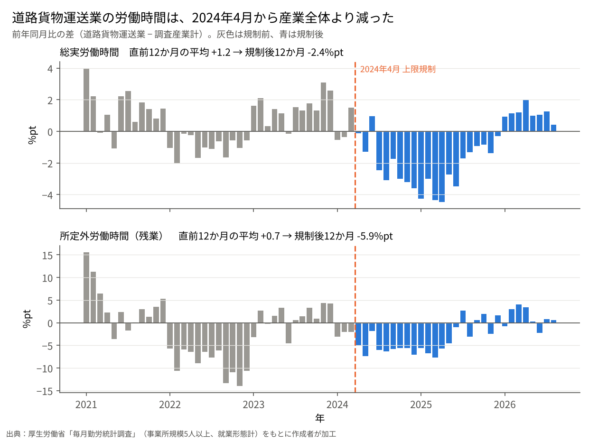
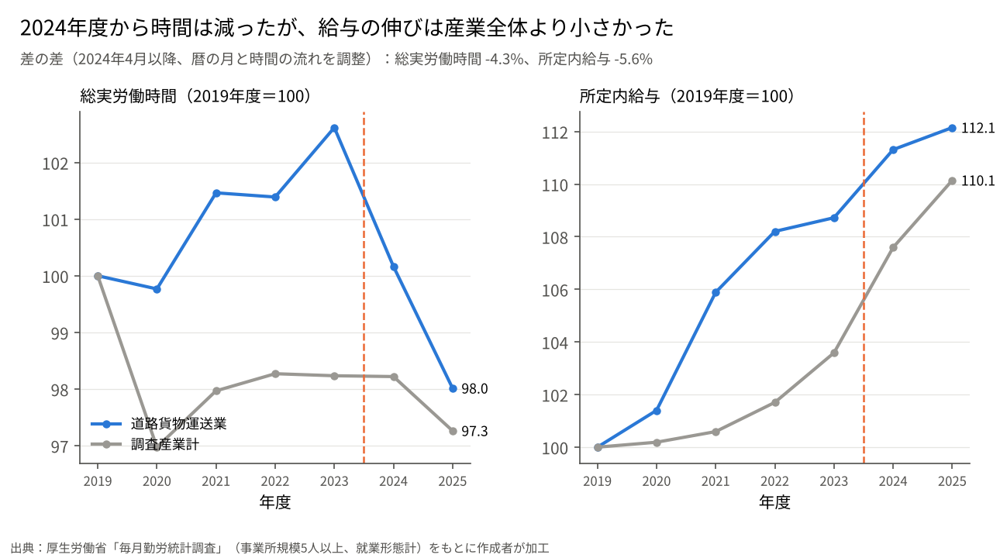
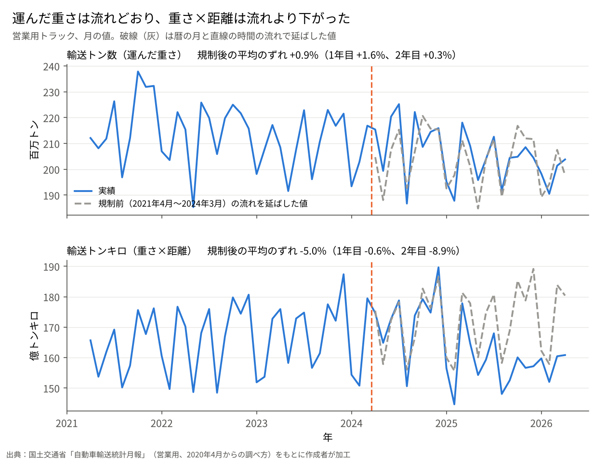
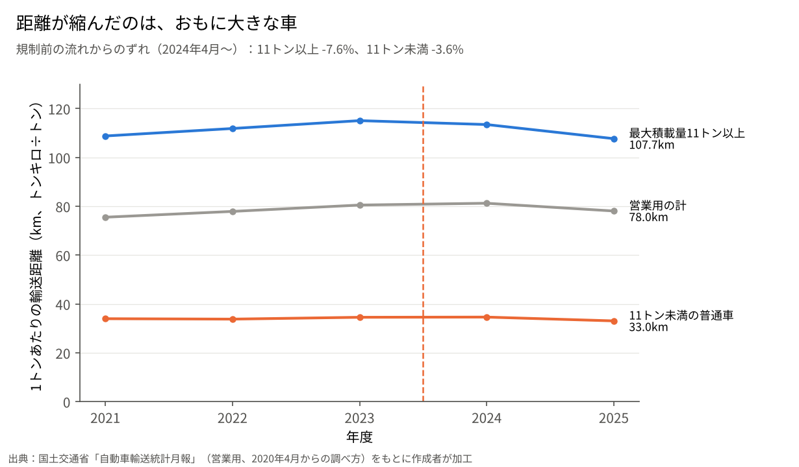

# F301 「物流2024年問題」で、トラックの運ぶ量と働く時間はどう変わったか？ 労働時間は産業全体より4.3%減り、運んだ重さは流れどおりで、運ぶ距離が縮んだ

2024年4月から、トラック運転者の時間外労働に年960時間の上限がかかりました。その前後で、道路貨物運送業の労働時間と給与、営業用トラックが運んだ量がどう変わったかを、公的な月の統計で確かめました。上限規制の良し悪しや、運賃・料金をどうすべきかは扱いません。

## 結論（先に）

- **労働時間は、産業全体と比べて減りました。** 道路貨物運送業の総実労働時間は、2024年4月以降、調査産業計との差で −4.3%（暦の月と時間の流れを調整した差の差、p<0.001）でした。対照・期間・規模を変えた6通りで −1.3%〜−4.3%、どれも p<0.05 です。
- **残業の減り方は1年目に集中しました。** 所定外労働時間の前年同月比の差（道路貨物運送業 − 産業計）は、直前12か月の平均 +0.7%pt から、規制後12か月は −5.9%pt、その次の12か月は −0.3%pt でした。差の差の推定は −9.5%ですが、期間や時間の流れの置き方で有意でなくなります。
- **給与で補われた形は見えませんでした。** 所定内給与は2023→2025年度に +3.2% で、産業計の +6.3% を下回りました（差の差は −5.6%。ただし時間の流れを入れないと −1.0% で有意でない）。
- **運んだ重さは、それまでの流れから外れて減ってはいません。** 営業用トラックの輸送トン数は、規制前の流れを延ばした値と比べて +0.9%（事前の基準「−2%より小さい」に届かず、仮説は外れ）。ところが重さ×距離の輸送トンキロは −5.0%、1トンあたりの距離は −5.9% でした。2年目（2025年4月〜）のずれが大きく、トンキロは −8.9% です。
- **距離が縮んだのは、おもに大きな車でした**（結果を見てから足した確かめ）。最大積載量11トン以上の車の1トンあたりの距離は −7.6%、11トン未満は −3.6% でした。



## 問い

経済産業省・国土交通省・農林水産省の「持続可能な物流の実現に向けた検討会」は、何も対策をしなければ、2024年度に輸送能力が14.2%不足するという試算を示していました（国土交通省の資料による。要約は作成者）。物流・調達の担当や、荷主として納期や運賃の変化を見ている人は、「実際に何が起きたのか」を知りたいはずです。

- 道路貨物運送業で働く人の労働時間は、ほかの産業と比べてどれだけ減ったのか
- 給与はどう動いたのか
- 運ぶ量は、それまでの流れから外れて減ったのか

## データ（出典）

| データ | 中身 | 期間 | ファイル |
|---|---|---|---|
| 厚生労働省「毎月勤労統計調査」全国調査 実数・指数累積データ | 産業（中分類）ごとの月の総実労働時間・所定外労働時間・所定内給与など（事業所規模5人以上・30人以上） | 2015年1月〜2026年8月を使用 | data/raw/maikin_jissu_cumulative.csv.gz |
| 国土交通省「自動車輸送統計月報」各年4月分の総括表 | 営業用・自家用の輸送トン数・輸送トンキロ（月）、営業用普通車の最大積載量別 | 2020年4月〜2026年4月 | data/raw/truck_ton_*.xlsx、truck_tonkm_*.xlsx |

- 毎月勤労統計の累積 CSV（21MB）は、取得したバイト列をそのまま gzip で圧縮して同梱しました。
- 自動車輸送統計は2020年4月に調べ方が変わったため、それ以降の月だけを使いました。同じ月が2つの表に出るときは、新しい方の値を使っています。
- 取得日と URL は `data/raw/SOURCES.md` にあります。

## 事前の計画

集計の前に [PLAN.md](PLAN.md) を書きました（2026-11-16 06:42）。データの形を確かめるときに、道路貨物運送業の2023〜2025年の年平均と、自動車輸送統計の2026年4月分の表を見ていました（PLAN に記載）。

| 仮説 | 基準 | 結果 | 判定 |
|---|---|---|---|
| H1 所定外労働時間が産業計より減る | 差の差の係数が負で p<0.05 | −9.5%（p=0.005） | **支持**（ただし頑健性で半分は有意でない） |
| H2 総実労働時間が産業計より減る | 同上 | −4.3%（p<0.001） | **支持** |
| H3 所定内給与が産業計より増える | 係数が正で p<0.05 | −5.6%（p=0.003） | **外れ** |
| H4 輸送トン数が流れより2%以上減る | 規制後の平均のずれ < −2% | +0.9% | **外れ** |

## やったこと

1. 差の差：D_t ＝ log（道路貨物運送業）− log（調査産業計）を、「2024年4月以降」、暦の月、直線の時間の流れで回帰しました（2019年1月〜2026年8月、Newey–West 標準誤差、ラグ12）。
2. 運ぶ量：2021年4月〜2024年3月の値で、暦の月と直線の時間の流れを推定し、2024年4月以降に延ばした値と実績を比べました（図3）。

## 分かったこと

### 労働時間は産業全体より減った（図1・図2）

- 総実労働時間の前年同月比の差は、直前12か月の平均 +1.2%pt から、規制後12か月は −2.4%pt になりました。
- 年度の平均で見ると、道路貨物運送業の総実労働時間は2023年度180.8時間から2025年度172.7時間（−4.5%）、産業計は −1.0% でした。所定外労働時間は −8.2%（産業計 −2.3%）です。
- 2026年に入ると、前年同月比の差はプラスに戻っています。下がった水準で落ち着いた、と読めます（推測）。



### 給与で補われた形は見えない（図2）

- 2019年度から見ると、道路貨物運送業の所定内給与は産業計より速く上がっていました（2023年度までに +8.7%、産業計 +3.6%）。
- 2024年度以降は逆で、2023→2025年度は +3.2%、産業計は +6.3% でした。
- 差の差の −5.6% は、規制前の速い伸びを延ばした値と比べた数字です。時間の流れを入れないと −1.0%（p=0.40）です。「相対的に上がった」はどの置き方でも出ませんでした。

### 運んだ重さは流れどおり、距離が縮んだ（図3）



- 営業用の輸送トン数は、規制前から年 −1.7% ほどの流れで減っていて、規制後もその流れの上にあります（ずれ +0.9%）。
- 年度で見ると、2023→2024年度は −0.1%、2024→2025年度は −3.3% でした。
- 輸送トンキロは 2023→2024年度 +0.8%、2024→2025年度 −7.1% で、規制前の流れ（年 +1.4%）からのずれは −5.0% でした。

## 問い直し（結果を見てから足した）

**重さは減らずに距離が縮んだ。縮んだのは、長い距離を走る大きな車か。**（`src/03b_requestion.py`）



- 最大積載量11トン以上の車の1トンあたりの距離は、2023年度115.0km、2024年度113.4km、2025年度107.7km でした。規制前の流れからのずれは −7.6%（2年目 −11.1%）です。
- 11トン未満の普通車は34.5km → 33.0km で、ずれは −3.6% でした。
- 大きな車の運んだ重さはずれ +1.2% で、減っていません。同じ重さを、より短い距離で運ぶ形に変わったと読めます。中継輸送や、鉄道・船への切り替えなどが考えられますが、このデータでは確かめられません（推測）。

## 頑健性

差の差（%、2024年4月以降）。

| 確かめ | 所定外労働時間 | 総実労働時間 | 所定内給与 |
|---|---|---|---|
| 主（産業計、2019年〜、直線） | −9.5（p=0.005） | −4.3（p<0.001） | −5.6（p=0.003） |
| R1 対照を中分類60の平均（H43・H44を除く） | −8.7（p=0.018） | −3.4（p<0.001） | −4.7（p=0.014） |
| R2 2021年1月から | −1.2（p=0.54） | −2.4（p<0.001） | −1.9（p=0.063） |
| R3a 時間の流れなし | −6.9（p<0.001） | −1.3（p=0.048） | −1.0（p=0.40） |
| R3b 2次の時間の流れ | −3.7（p=0.24） | −2.2（p<0.001） | −1.3（p=0.023） |
| R4 規模30人以上 | −4.6（p=0.15） | −3.1（p=0.013） | −5.9（p=0.017） |

総実労働時間は6通りすべてで有意に負、所定外労働時間は3通りで有意でなく、所定内給与は負か有意でない、でした。

運ぶ量（規制前の流れからのずれ、%）。

| 確かめ | 平均 | 1年目 | 2年目 |
|---|---|---|---|
| 主：輸送トン数 | +0.9 | +1.6 | +0.3 |
| R5a 輸送トンキロ | −5.0 | −0.6 | −8.9 |
| R5b 1トンあたりの距離 | −5.9 | −2.2 | −9.2 |
| R5c 自家用を含む合計のトン数 | −0.5 | 0.0 | −1.0 |
| R3 時間の流れなし（暦の月だけ） | −3.5 | −1.9 | −5.0 |
| R2' 2020年4月から推定 | −1.5 | −0.3 | −2.7 |

輸送トン数は、時間の流れを入れないと −3.5% になります。「重さは流れどおり」は、規制前の減る流れを延ばすかどうかに左右されます。

R6（2024年1月の標本の入れ替え）：総実労働時間の差の12月→1月の変化は、2024年が −2.9%pt、ほかの年の平均は −1.6%pt（標準偏差1.8）で、ふだんの幅に入っていました。

## 言えないこと

- **上限規制だけの効果は分けられません。** 同じ時期に、物価の上昇、運賃の交渉、荷待ちを減らす取り組みなどが重なっています。
- **毎月勤労統計は事業所の調査です。** 道路貨物運送業には運転者のほか事務職なども含まれます。
- **運んだ量の変化は、荷物の需要の変化も映します。** 運べなかったのか、運ぶものが減ったのかは区別できません。
- **距離が縮んだ理由は分かりません。** 中継輸送や鉄道・船への切り替えなどは、このデータでは見えません。
- 規制後のデータは2年ほどで、時間の流れの置き方で数字が動きます。
- **トンキロの段は確かめていません。** 輸送トンキロは2025年春から段のように下がり、そのまま低い水準が続いています（図3）。重さ（トン数）には同じ段がないため、調査の標本の入れ替えなど調べ方の変化が混ざっていないかは、このデータだけでは確かめられません。

## 仕事で使うなら

- 「輸送能力が足りなくなる」という見方を、トン数だけで確かめると変化が見えにくく、トンキロや1トンあたりの距離に変化が出ていました。見る指標によって読み方が変わる、という材料になります。
- 労働時間の統計は前年同月比の差で見ると、規制の1年目に動きが集中していました。

## 計画からの変更

- 問い直し（車の大きさ別の距離）と図4を足しました。そのために、総括表から最大積載量別の列も取り出しています。
- 年度の比較（2023→2025年度）も足しました。

## 再現のしかた

```sh
pip install -r requirements.txt
python3 src/01_fetch.py      # 元データの取得（ネットが必要。同梱済み）
sh src/run_all.sh            # オフラインで 02 から最後まで（約7秒）
```

| ファイル | 役割 |
|---|---|
| src/02_build.py | 毎勤の CSV（gz）と輸送統計の Excel から月の表を作る |
| src/03_analysis.py | H1〜H4 と頑健性（results/main.json） |
| src/03b_requestion.py | 問い直し（results/requestion.json） |
| src/04_figures.py | 図1〜4 |

- 再現の確かめ：`results/repro_check.txt`（2026-11-16 再実行：18 ファイル一致、所要 7 秒。/tmp に写して出力を消してから流し、cmp で比較）。スレッド1。乱数は使っていません。

- 大きなデータのファイル（`data/raw/maikin_jissu_cumulative.csv.gz`）は、GitHub の1ファイルの上限に合わせて `.part000` などに分けて置いています。`run_all.sh` が最初に `src/00_join_parts.py` でつなぎ直し、sha256 で元と同じことを確かめます。

## レビューで直したこと

| # | 指摘 | 直し方 |
|---|---|---|
| 1 | 輸送トンキロが2025年春から段のように下がっているが、調べ方の変化の可能性に触れていなかった | README と note の「言えないこと」に1点足した |

## 出典

- 厚生労働省「毎月勤労統計調査」全国調査 実数・指数累積データ：[e-Stat](https://www.e-stat.go.jp/stat-search/files?toukei=00450071&tstat=000001011791)
- 国土交通省「自動車輸送統計月報」：[e-Stat](https://www.e-stat.go.jp/stat-search/files?toukei=00600330&tstat=000001017236)
- 「持続可能な物流の実現に向けた検討会」の試算（国土交通省中部運輸局の資料に掲載）：[国土交通省](https://wwwtb.mlit.go.jp/chubu/jidosya/ouensaito/shiryou/20241031/20241031_02.pdf)

（いずれも 厚生労働省・国土交通省の公表データ をもとに作成者が加工して作成）
