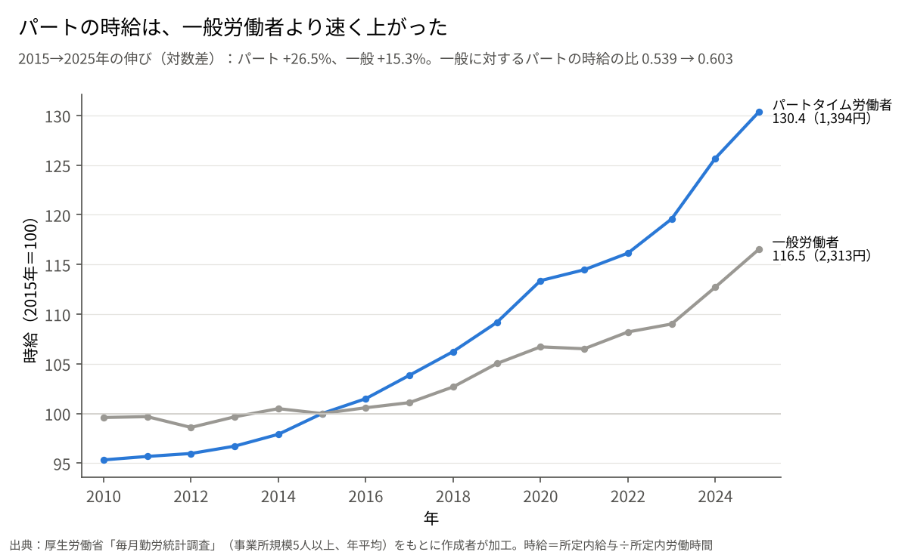
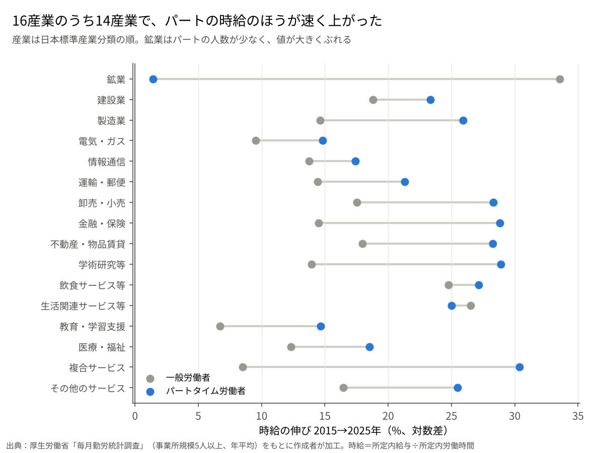
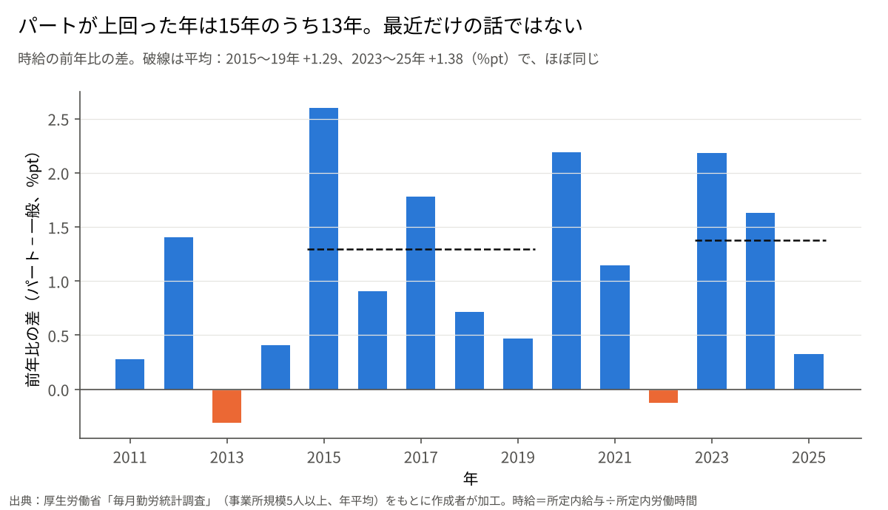
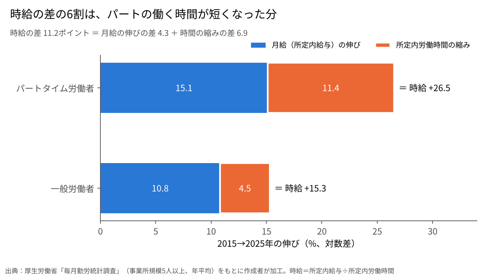

# F302 「パートの時給は正社員より速く上がった」は、どこまで本当か？ 2015→2025年でパート+26.5%、一般+15.3%。差の6割は働く時間が短くなった分

「パートの時給の伸びが、フルタイムの賃金の伸びを上回っている」という話を、毎月勤労統計の年平均で確かめました。比べ方（時給か月給か）、産業の構成、期間の取り方を変えて、どこまで言えるかを見ています。パートの時給と最低賃金の関係は、既存の看板記事 F257 で扱いました。この記事は「一般労働者と比べてどうか」を見ます。

## 結論（先に）

- **時給で比べると、パートのほうが速く上がりました。** 2015→2025年の時給（所定内給与÷所定内労働時間）の伸びは、パート +26.5%、一般労働者 +15.3%（どちらも対数差）で、差は11.2ポイントです。一般に対するパートの時給の比は 0.539 から 0.603 に上がりました。
- **産業の構成の変化では説明できません。** 産業ごとの時間の比重を2015年に固定しても、差の86%（9.7ポイント）が残ります。16産業のうち14産業で、パートの時給の伸びが一般を上回りました。
- **ただし月給で比べると、差は4.3ポイントに縮みます**（結果を見てから足した確かめ）。パートの所定内労働時間は月86.1時間から76.8時間に短くなっていて、時給の差11.2ポイントのうち6.9ポイント（62%）は、この「時間の縮み」の差です。
- **最近だけの話ではありません。** パートの時給の前年比が一般を上回った年は、2011〜2025年の15年のうち13年でした。差の平均は2015〜19年 +1.29、2023〜25年 +1.38ポイントで、ほぼ同じです。



## 問い

人事・労務で時給や給与の水準を見直す担当や、賃金の統計を読む人にとって、「パートの時給は正社員より速く上がっている」は判断の材料になる話です。ただ、①比べ方（月給か時給か）、②パートの多い産業の比重の変化、③期間の取り方で、見え方は変わるはずです。この記事では、それぞれを変えて、どこまで言えるかを確かめました。

なお、統計の「一般労働者」はフルタイムの人で、正社員だけでなくフルタイムの非正規の人も含みます。題名の「正社員」は、世の中の言い方に合わせたものです。

## データ（出典）

| データ | 中身 | 期間 | ファイル |
|---|---|---|---|
| 厚生労働省「毎月勤労統計調査」全国調査 実数・指数累積データ（実数） | 年平均の所定内給与・所定内労働時間・現金給与総額・総実労働時間・労働者数。一般労働者とパートタイム労働者、調査産業計と16の大分類、事業所規模5人以上・30人以上 | 2010〜2025年 | data/raw/maikin_jissu_cumulative.csv.gz |

- 累積 CSV（21MB）は、取得したバイト列をそのまま gzip で圧縮して同梱しました。取得日と URL は `data/raw/SOURCES.md` にあります。
- 時給は、一般もパートも「所定内給与 ÷ 所定内労働時間」で計算しました（残業代と賞与を含まない）。

## 事前の計画

集計の前に [PLAN.md](PLAN.md) を書きました（2026-11-16 06:48）。データの形を確かめるときに、調査産業計の2012・2025年などの行を目にしていました（PLAN に記載）。

| 仮説 | 基準 | 結果 | 判定 |
|---|---|---|---|
| H1 時給の伸びの差がパート＋3ポイント以上 | 差 ≥ 3 | 11.2 | **支持** |
| H2 産業の比重を固定しても差の70%以上が残る | 残る割合 ≥ 0.7 | 0.86 | **支持** |
| H3 16産業のうち11以上でパートが速い | 11以上 | 14 | **支持** |
| H4 年ごとの差の平均が 2023〜25年 ＞ 2015〜19年 | 大きい | 1.38 ＞ 1.29 | **形式上は支持**（差は0.09ポイントで、近年に開いたとは言えない） |

## やったこと

1. 一般とパートの時給を年ごとに計算し、2015→2025年の伸び（対数差×100）を比べました。
2. シフト・シェア分解：全体の時給 ＝ Σ（産業の時間の比重 × 産業の時給）。時間の比重は「労働者数 × 所定内労働時間」です。比重を2015年に固定した伸びと比べました。
3. 産業ごとの伸びと、年ごとの前年比の差を並べました。

## 分かったこと

### 時給の差は、産業の構成ではなく産業の中で生まれた（図3）



- 16産業のうち14産業で、パートの時給のほうが速く上がりました。逆だったのは鉱業（パートが少なく、値がぶれる）と生活関連サービス等（パート +25.0%、一般 +26.5%）です。
- 差が大きいのは、複合サービス（+21.9ポイント）、学術研究等（+15.0）、金融・保険（+14.3）、製造業（+11.3）、卸売・小売（+10.8）などでした。
- パートの時間の比重は産業の間で入れ替わりました（たとえば飲食サービス等は20.2%→17.7%に減りました）。こうした入れ替わりの影響は、全体の差のうち1.5ポイントほどです（比重を固定した差は9.7）。

### 最近だけの話ではない（図4）



- パートの時給の前年比が一般を上回った年は、2011〜2025年の15年のうち13年でした。
- 2015〜19年の平均の差は +1.29、2020〜22年は +1.07、2023〜25年は +1.38ポイントで、近年に特に開いたわけではありません。2024〜25年は一般の伸び（+3.3%）も大きく、差は小さめでした。

## 問い直し（結果を見てから足した）

**月給で比べると差は4.3ポイントしかない。時給の差のうち、どれだけが「働く時間が短くなった」分か。**（`src/03b_requestion.py`）



- log 時給 ＝ log 月給 − log 時間 なので、時給の伸び ＝ 月給の伸び ＋ 時間の縮み、に分けられます。
- パート：月給 +15.1 ＋ 時間の縮み 11.4 ＝ 時給 +26.5。一般：月給 +10.8 ＋ 時間の縮み 4.5 ＝ 時給 +15.3。
- 時給の差11.2ポイントのうち、月給の伸びの差は4.3、時間の縮みの差は6.9（62%）でした。
- ただし産業ごとに見ると、パートの時間が大きく縮んだ産業ほど時給が速く上がった、という関係は見えません（16産業の順位相関 −0.27、p=0.32。鉱業を除くと −0.11）。時間の縮みが、そのまま時給を押し上げた「見かけ」だとは言い切れません。

## 頑健性

| 確かめ | パート | 一般 | 差 | 比重固定の差 | 残る割合 | パートが速い産業 |
|---|---|---|---|---|---|---|
| 主（2015→2025、5人以上） | 26.5 | 15.3 | 11.2 | 9.7 | 0.86 | 14 |
| R1a 2012→2025 | 30.6 | 16.7 | 13.9 | 12.0 | 0.87 | 15 |
| R1b 2019→2025 | 17.7 | 10.4 | 7.3 | 6.9 | 0.93 | 14 |
| R2 規模30人以上 | 26.3 | 14.4 | 11.9 | 10.3 | 0.87 | 13 |
| R3 賞与・残業代を含む（現金給与総額÷総実労働時間） | 27.4 | 17.5 | 10.0 | 8.2 | 0.82 | 14 |
| R4 比重を2025年に固定 | 26.5 | 15.3 | 11.2 | 9.4 | 0.84 | 14 |
| R5 月給（所定内給与） | 15.1 | 10.8 | 4.3 | — | — | — |

時給で比べるかぎり、期間・規模・賞与の扱い・比重の年を変えても「パートが速い」は変わりませんでした。月給で比べたときだけ差が小さくなります。

## 言えないこと

- **一般労働者は正社員と同じではありません。** フルタイムの非正規の人を含みます。
- **個人を追った伸びではありません。** 平均の変化なので、パートに入る人・出る人の入れ替わり（たとえば短い時間で働く人が増える）でも動きます。
- **理由は分かりません。** 最低賃金の引き上げ、人手不足、働き方の変化などが考えられますが、このデータでは分けられません。
- **標本の入れ替えの段差があります。** 毎月勤労統計は2018年・2024年などに標本を入れ替えていて、年の値に段差が入りうるとされます（一般とパートの両方にかかるので、差への影響は小さいと推測します）。
- パートの時給の水準は、2025年でも一般の6割ほどです。伸びの差は、水準の差が縮んだことを示すだけです。

## 仕事で使うなら

- 「パートの時給が速く上がった」は、時給で比べると産業の構成をそろえても確かめられます。一方、月給で比べると差は小さく、どの指標で比べるかで印象が変わります。
- パートの時給の動きを見るときは、所定内労働時間の動き（2015年86.1時間→2025年76.8時間）を一緒に見ると、読み違えを減らせます。

## 計画からの変更

- 問い直し（時給の差を月給と時間に分ける）を足しました。R5 の結果を見て決めたものです。

## 再現のしかた

```sh
pip install -r requirements.txt
python3 src/01_fetch.py      # 元データの取得（ネットが必要。同梱済み）
sh src/run_all.sh            # オフラインで 02 から最後まで（約3秒）
```

| ファイル | 役割 |
|---|---|
| src/02_build.py | 累積 CSV（gz）から年平均の表（data/maikin_annual_by_type.csv）を作る |
| src/03_analysis.py | H1〜H4 と頑健性（results/main.json） |
| src/03b_requestion.py | 問い直し（results/requestion.json） |
| src/04_figures.py | 図1〜4 |

- 再現の確かめ：`results/repro_check.txt`（2026-11-16 再実行：12 ファイル一致、所要 3 秒。/tmp に写して出力を消してから流し、cmp で比較）。スレッド1。乱数は使っていません。

- 大きなデータのファイル（`data/raw/maikin_jissu_cumulative.csv.gz`）は、GitHub の1ファイルの上限に合わせて `.part000` などに分けて置いています。`run_all.sh` が最初に `src/00_join_parts.py` でつなぎ直し、sha256 で元と同じことを確かめます。

## レビューで直したこと

| # | 指摘 | 直し方 |
|---|---|---|
| 1 | H4 の差は0.09ポイントだけで、本文の「近年に特に開いたわけではない」と表の「支持」が食い違って見えた | 表の判定を「形式上は支持（近年に開いたとは言えない）」に直した |

## 出典

- 厚生労働省「毎月勤労統計調査」全国調査 実数・指数累積データ：[e-Stat](https://www.e-stat.go.jp/stat-search/files?toukei=00450071&tstat=000001011791)

（いずれも 厚生労働省の公表データ をもとに作成者が加工して作成）
