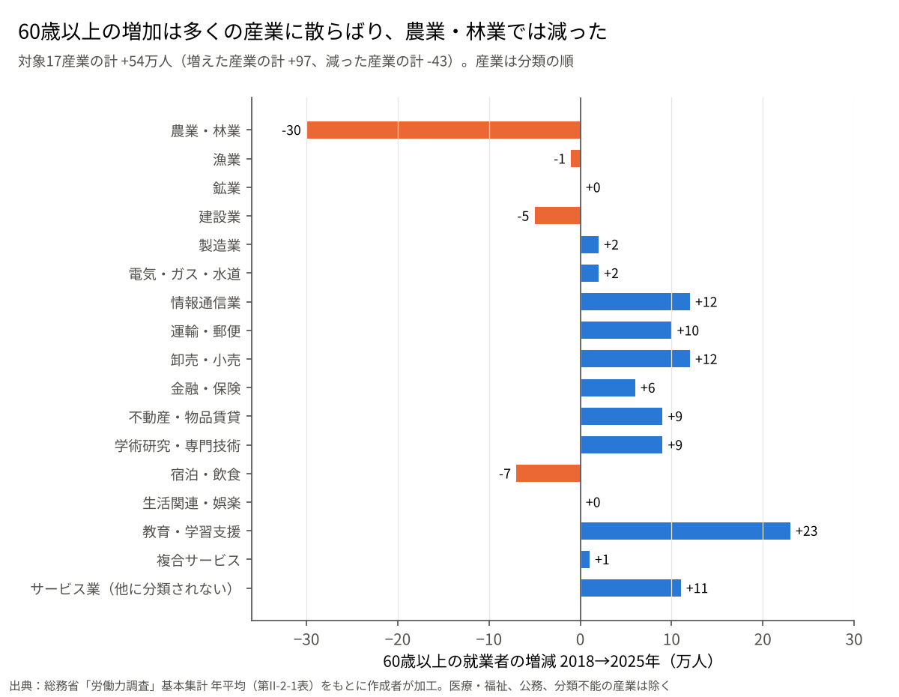
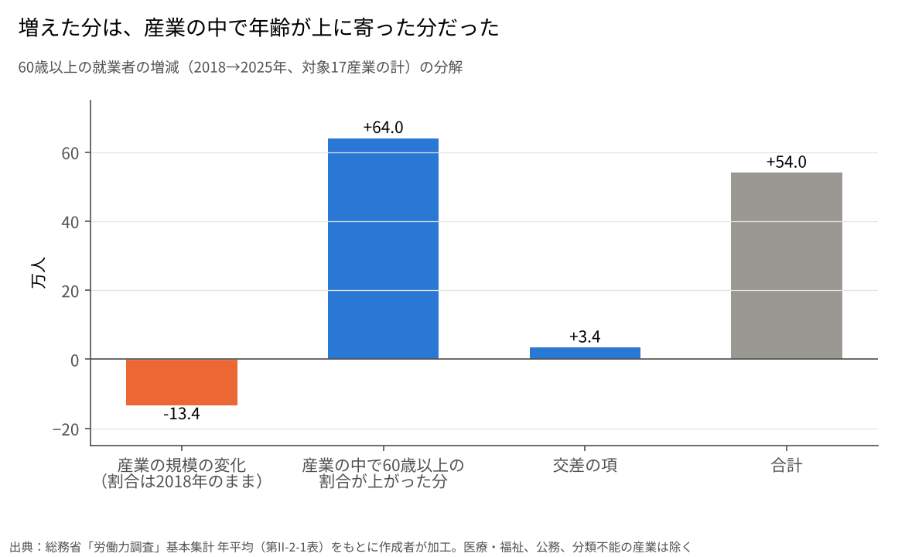
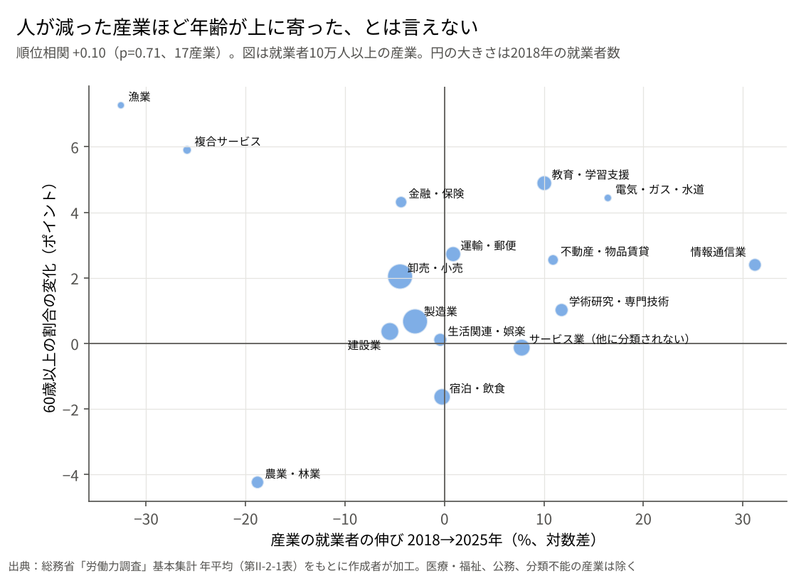
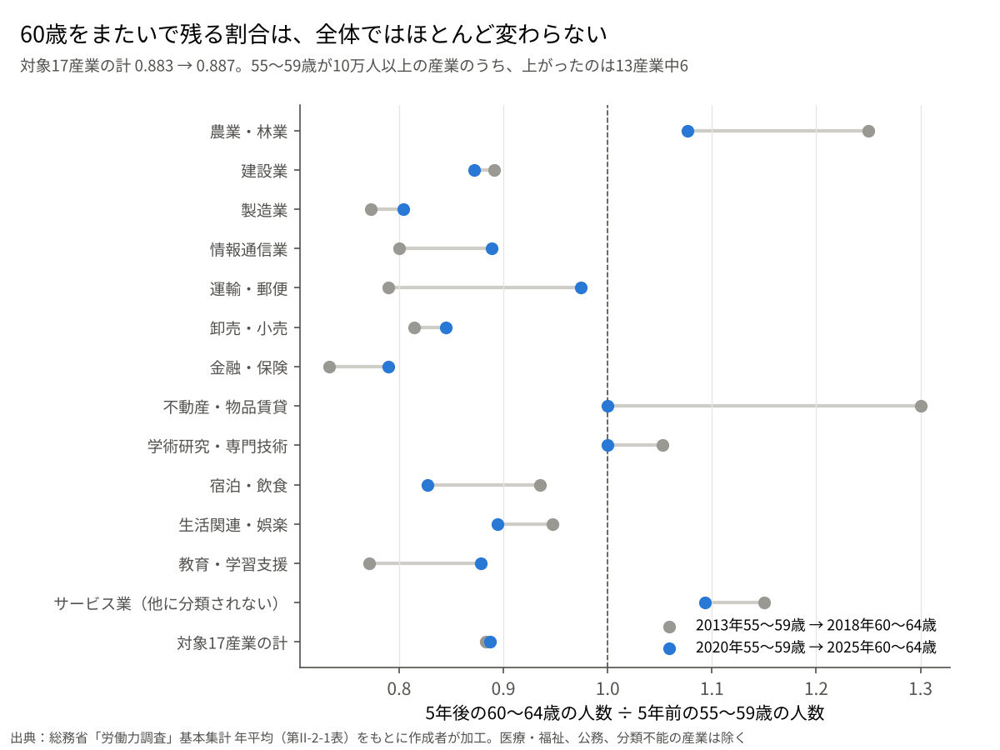

# F303 60歳以上の働く人が増えた分は、どの産業が受け止めたのか？ 17産業で+54万人、うち+64万人は産業の中で年齢が上に寄った分で、上位3産業は増えた分の48%

総務省「労働力調査」の年平均の表（年齢階級，産業別就業者数）で、2018→2025年に60歳以上の就業者がどの産業で増えたのかを分けて見ました。医療・福祉、公務、分類不能の産業は、事前に決めたとおり扱っていません（残りの17産業が対象）。

## 結論（先に）

- **対象の17産業で、60歳以上の就業者は+54万人でした**（1,194万人→1,248万人）。増えた産業の計は+97万人、減った産業の計は−43万人で、減った分のほとんどは農業・林業（−30万人）です。
- **増えた分は「産業の中で60歳以上の割合が上がった」分でした。** 産業の規模の変化（割合を2018年のまま）の分は−13.4万人、割合が上がった分は+64.0万人、交差の項は+3.4万人です。
- **受け止めたのは特定の産業ではなく、広く散らばっていました。** 増加の大きい3産業（教育・学習支援+23、情報通信業+12、卸売・小売+12）は、差し引きの増加の87%ですが、増えた産業の計（+97）に対しては48%です。17産業のうち11産業で増えました。
- **ただし、全産業の増加（+136万人）のうち+82万人（6割）は、扱っていない医療・福祉・公務・分類不能の産業の分です。** 「広く散らばっていた」は、対象の17産業の中での話です。
- **人が減った産業ほど年齢が上に寄った、という関係は見えませんでした**（産業の伸びと60歳以上の割合の変化の順位相関 +0.10、p=0.71）。
- **60歳をまたいで同じ産業に残る割合は、全体ではほとんど変わっていません**（結果を見てから足した確かめ）。5年前の55〜59歳の人数に対する5年後の60〜64歳の人数の比は、2013→2018年 0.883、2020→2025年 0.887 でした。



## 問い

働く60歳以上の人は増え続けています。人事・採用で年齢の高い人の受け入れを考える担当や、産業の人の構成を見る人にとって、「増えた分はどこで働いているのか」「それは産業が大きくなったからか、産業の中で年齢が上がったからか」「人手の足りない産業が年齢の高い人に頼るようになったのか」は、知りたい点です。この記事は、公表された年平均の表でそれを確かめます。

## データ（出典）

| データ | 中身 | 期間 | ファイル |
|---|---|---|---|
| 総務省「労働力調査」基本集計 年平均 第II-2-1表 | 年齢階級（5歳）×産業別の就業者数（万人） | 2013年、2018〜2025年 | data/raw/lfs_II-2-1_*.xls(x) |

- 2018〜2021年の表は、2022年に2020年国勢調査を基準として遡って改訂された値です。2013年は旧基準なので、頑健性の確かめにだけ使いました。
- 2013年の表は列の見出しの形が違うため、2018年以降の表と同じ順に99列が並ぶことを、大分類の位置で確かめてから使っています（`src/02_build.py`）。
- 就業者には、自営業主や家族従業者も含みます。取得日と URL は `data/raw/SOURCES.md` にあります。

## 事前の計画

集計の前に [PLAN.md](PLAN.md) を書きました（2026-11-16 06:54）。形を確かめるときに、2025年と2013年の「全産業」の年齢別の数を見ていました（PLAN に記載）。

| 仮説 | 基準 | 結果 | 判定 |
|---|---|---|---|
| H1 割合の上昇の分 ＞ 規模の分 | 産業の中の割合の分 ＞ 規模の分 | +64.0 ＞ −13.4 | **支持** |
| H2 上位3産業で増加の50%以上 | 増加（差し引き）に対する割合 ≥ 0.5 | 0.87 | **支持**（増えた産業の計に対しては0.48） |
| H3 伸びが小さい産業ほど割合が上がる | 順位相関が負で p<0.10 | +0.10（p=0.71） | **外れ** |
| H4 増加の80%以上が65歳以上 | ≥ 0.8 | 0.52（65歳以上+28、60〜64歳+26） | **外れ** |

H2 は「増加」を差し引きで読むか、増えた産業の計で読むかで判定が分かれます。計画の文言（対象の産業全体の増加）に従って差し引きで判定しましたが、増えた産業の計で見ると50%に届きません。

## やったこと

1. 17産業それぞれで、60歳以上の就業者 ＝ 産業の就業者 × 60歳以上の割合 とおき、2018→2025年の増減を「規模の変化」「割合の変化」「交差の項」に分けました（シフト・シェア分解）。
2. 産業の就業者の伸びと、60歳以上の割合の変化の順位相関を取りました。

## 分かったこと

### 増えた分は、産業の中で年齢が上に寄った分（図2）



- 対象の17産業の就業者は5,479万人→5,514万人とほぼ横ばいで、60歳以上の割合は21.8%→22.6%に上がりました。
- 割合が大きく上がったのは、教育・学習支援（16.5%→21.4%）、金融・保険（11.0%→15.3%）、運輸・郵便（20.2%→22.9%）、卸売・小売（19.1%→21.2%）などです。
- 卸売・小売は、産業の就業者が減った（−47万人）ので規模の分は−9.0万人ですが、割合の分が+22.0万人で、差し引き+12万人でした。

### 人が減った産業ほど、とは言えない（図3）



- 就業者が伸びた情報通信業（+31%）や教育・学習支援（+10%）でも、60歳以上の割合は上がっています。
- 就業者が減った農業・林業（−19%）では、60歳以上の割合はむしろ下がりました（62.9%→58.6%）。

## 問い直し（結果を見てから足した）

**割合が上がったのは、60歳をまたいで同じ産業で働き続ける人が増えたからか。**（`src/03b_requestion.py`）



- 5年前に55〜59歳だった人の数に対する、5年後の60〜64歳の人の数の比を、産業ごとに出しました（同じ生まれ年の集まりを追う近似。人が産業を移ってもこの比は動きます）。
- 対象17産業の計では、2013→2018年 0.883、2020→2025年 0.887 で、ほとんど変わっていません（2013年は旧基準の表なので、2013→2018年の比には基準の違いが混ざります）。
- 55〜59歳が10万人以上の13産業のうち、比が上がったのは6産業（運輸・郵便 0.79→0.97、教育・学習支援 0.77→0.88、情報通信業 0.80→0.89 など）、下がったのは7産業でした。
- 全体として「残る人の割合が上がった」とは言えず、割合の上昇には、50代後半の人の数そのものが多かったことなど、年齢の構成の動きが効いていると考えられます（推測）。

## 頑健性

| 確かめ | 60歳以上の増減 | 規模の分 | 割合の分 | 上位3産業（差し引きに対する割合 / 増えた産業の計に対する割合） | 順位相関（p） |
|---|---|---|---|---|---|
| 主 2018→2025 | +54 | −13.4 | +64.0 | 0.87 / 0.48 | +0.10（0.71） |
| R1 2013→2025（基準の違う年をまたぐ） | +168 | +24.5 | +132.8 | 0.59 / 0.49 | +0.15（0.55） |
| R2 2019→2025 | +34 | −17.6 | +48.8 | 1.15 / 0.50 | +0.04（0.87） |
| R3 65歳以上だけ | +28 | −12.7 | +39.4 | 1.18 / 0.57 | +0.06（0.81） |
| R4 割合を2025年に固定 | +54 | −10.0 | +67.4 | 0.87 / 0.48 | +0.10（0.71） |

- どの確かめでも「割合の分が規模の分より大きい」「伸びと割合の変化に関係はない」は変わりませんでした。上位3産業の割合は、減った産業があるため差し引きに対しては1を超えることがあります。
- R5（製造業の中分類24業種）：60歳以上の割合が上がったのは24業種のうち16業種で、製造業の中でも広く上に寄っていました。

## 言えないこと

- **産業は勤め先の産業で、仕事の中身（職種）ではありません。**
- **人を追ったデータではありません。** 同じ人が産業を移ったのか、新しく働き始めたのかは分かりません。問い直しの比も近似です。
- **就業者には自営業主や家族従業者を含みます。** 雇われている人だけの動きとは違います。
- **医療・福祉、公務、分類不能の産業は扱っていません。** 全産業では60歳以上の就業者は+136万人で、この記事の+54万人はその一部です。
- 万人単位の表なので、小さな産業の増減は丸めの影響を受けます。

## 仕事で使うなら

- 「60歳以上の働く人が増えた」は、特定の産業が受け止めたというより、多くの産業で年齢の構成が上に寄った結果として読むほうが、この表とは合っています。
- 自分の産業の60歳以上の割合を、産業の伸びと並べて見ると、規模の分と割合の分を分けて説明できます。

## 計画からの変更

- H2 の「増えた産業の計に対する割合」を、結果を見たあとに足しました（判定は計画どおり差し引きで行い、両方を書いています）。
- 問い直しと図4を足しました。

## 再現のしかた

```sh
pip install -r requirements.txt
python3 src/01_fetch.py      # 元データの取得（ネットが必要。同梱済み）
sh src/run_all.sh            # オフラインで 02 から最後まで（約3秒）
```

| ファイル | 役割 |
|---|---|
| src/02_build.py | 9年分の Excel から年×産業×年齢の表を作る |
| src/03_analysis.py | H1〜H4 と頑健性（results/main.json） |
| src/03b_requestion.py | 問い直し（results/requestion.json） |
| src/04_figures.py | 図1〜4 |

- 再現の確かめ：`results/repro_check.txt`（2026-11-16 再実行：12 ファイル一致、所要 3 秒。/tmp に写して出力を消してから流し、cmp で比較）。スレッド1。乱数は使っていません。

## レビューで直したこと

| # | 指摘 | 直し方 |
|---|---|---|
| 1 | 上位3産業が増えた産業の計に占める割合（0.485）を、表では0.49、本文では48%と書き分けていた | 表を0.48にそろえた |
| 2 | 「広く散らばっていた」が対象の17産業の中だけの話であることが、結論から読み取りにくかった | 全産業の増加+136万人のうち+82万人（6割）が対象外の産業の分であることを、結論と note に足した |
| 3 | 問い直しの比の2013→2018年が、旧基準の2013年の表をまたいでいた | 本文に注記した |

## 出典

- 総務省「労働力調査」基本集計 年平均 第II-2-1表 年齢階級，産業別就業者数：[e-Stat](https://www.e-stat.go.jp/stat-search/files?toukei=00200531&tstat=000001226583)

（いずれも 総務省の公表データ をもとに作成者が加工して作成）
