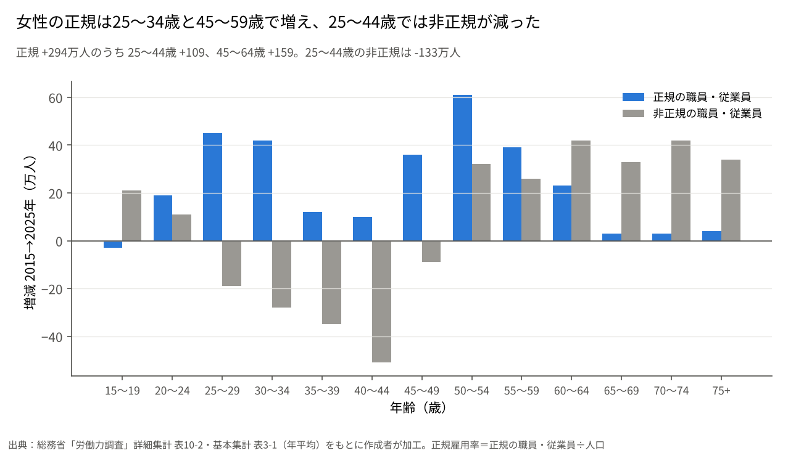
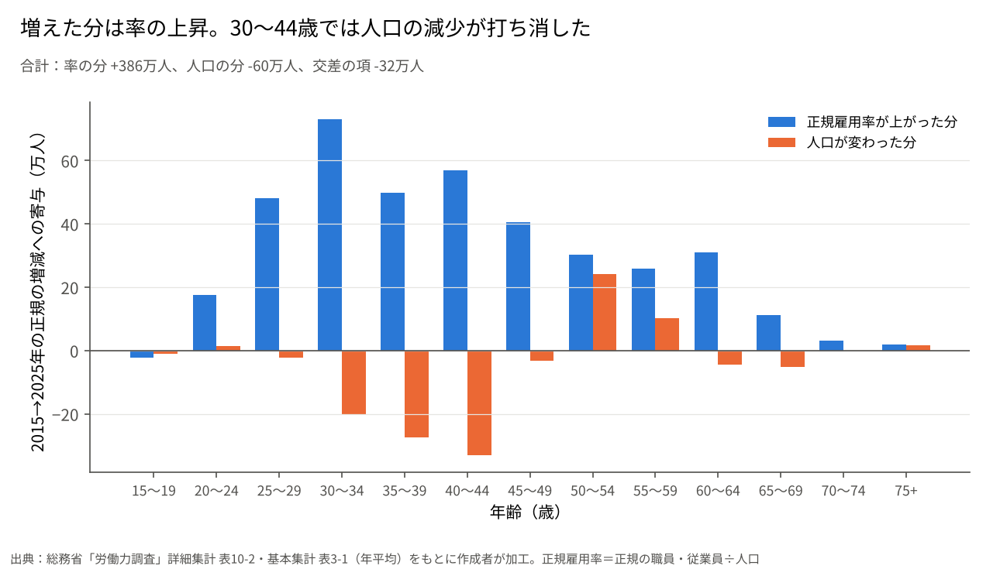
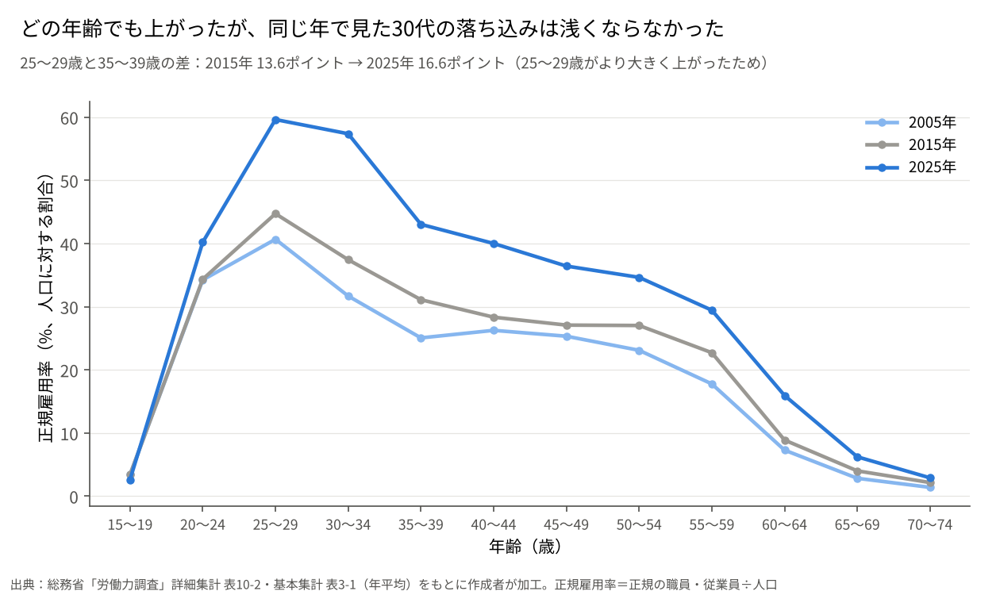
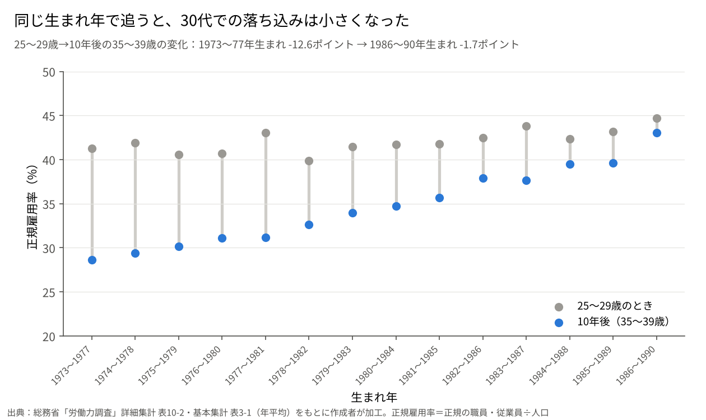

# F304 「女性の正社員が増えた」は、年齢のどこで起きたのか？ 2015→2025年の+294万人は45〜64歳が+159万人、25〜44歳が+109万人。同じ生まれ年で追うと30代の落ち込みは−12.6から−1.7ポイントに

総務省「労働力調査」の年平均の長期時系列で、女性の「正規の職員・従業員」（以下、正規）が年齢のどこで増えたのかを確かめました。人口の変化の分と、同じ年齢で正規として働く人の割合（正規雇用率）が上がった分を分け、30代の「落ち込み」が浅くなったかを、同じ年の比較と、同じ生まれ年の比較の両方で見ています。

## 結論（先に）

- **女性の正規は2015→2025年に+294万人**（1,046万人→1,341万人）。年齢別には、45〜64歳が+159万人、25〜44歳が+109万人、15〜24歳が+16万人、65歳以上が+10万人でした。
- **増えた分は、人口ではなく正規雇用率の上昇によるものです。** 率の分は+386万人、人口の分は−60万人、交差の項は−32万人でした。率の上がり方が最も大きかったのは30〜34歳（37.4%→57.4%、+19.9ポイント）です。
- **25〜44歳では、正規が+109万人、非正規が−133万人でした。** 同じ年齢の中で、非正規から正規への置き換わりと読める形です（人を追ったデータではないので推測）。
- **同じ年で見た「30代の落ち込み」は浅くなっていません。** 25〜29歳と35〜39歳の正規雇用率の差は、2015年13.6ポイント、2025年16.6ポイントでした。25〜29歳の率がより大きく上がったためです（仮説は外れ）。
- **同じ生まれ年で追うと、落ち込みは小さくなりました**（結果を見てから足した確かめ）。25〜29歳から10年後の35〜39歳への変化は、1973〜77年生まれ −12.6ポイント、1986〜90年生まれ −1.7ポイントでした。



## 問い

女性の正規の増加は、人事・採用の担当や、女性の働き方の統計を読む人がよく話題にします。ただ「増えた」と言っても、①出産・子育ての年齢で増えたのか、それより上の年齢なのか、②人口の多い年齢の集まりが移っただけなのか、同じ年齢で正規として働く人の割合が上がったのか、③「M字カーブ」と呼ばれた30代の落ち込みは正規で見ても浅くなったのか、で意味が変わります。この記事はこの3つを確かめます。

## データ（出典）

| データ | 中身 | 期間 | ファイル |
|---|---|---|---|
| 総務省「労働力調査」詳細集計 長期時系列 表10-2 | 年齢階級（5歳）別、雇用形態別の雇用者数（男女計・男・女、年平均） | 2002〜2025年 | data/raw/lfs_detail_10-2_emptype_by_age5.xlsx |
| 総務省「労働力調査」基本集計 長期時系列 表3-1 | 年齢階級（5歳）別15歳以上人口 | 1968〜2025年（2002年以降を使用） | data/raw/lfs_basic_3-1_population_by_age5.xlsx |

- 正規雇用率 ＝ 正規の職員・従業員 ÷ その年齢の人口 としました（働いていない人も分母に入る）。
- 取得日と URL は `data/raw/SOURCES.md` にあります。

## 事前の計画

集計の前に [PLAN.md](PLAN.md) を書きました（2026-11-16 06:58）。形を確かめるときに、女性の総数の列（2002〜2025年の正規・非正規）と人口を見ていました（PLAN に記載）。

| 仮説 | 基準 | 結果 | 判定 |
|---|---|---|---|
| H1 増加の80%以上が率の上昇の分 | 率の分 ÷ 増加 ≥ 0.8 | 386 ÷ 294 ＝ 1.31（人口の分が負） | **支持** |
| H2 率の上昇が最大なのは25〜29歳か30〜34歳 | 20〜64歳の中で最大 | 30〜34歳（+19.9ポイント） | **支持** |
| H3 25〜29歳と35〜39歳の差が3ポイント以上縮む | 縮み ≥ 3 | 13.6 → 16.6（広がった） | **外れ** |
| H4 25〜44歳の非正規が減った | 増減 < 0 | −133万人 | **支持** |

## やったこと

1. 年齢（5歳階級）ごとに、正規の増減を「人口の変化（率は2015年のまま）」「率の変化」「交差の項」に分けました。
2. 年齢別の正規雇用率を2005・2015・2025年で並べました。
3. 男性でも同じ計算をして比べました（頑健性）。

## 分かったこと

### 増えたのは25〜34歳と45〜59歳（図1・図4）



- 正規の増加が大きかったのは50〜54歳（+61万人）、25〜29歳（+45）、30〜34歳（+42）、55〜59歳（+39）、45〜49歳（+36）でした。
- 30〜44歳では、率の上昇の分が大きいのに、人口の減少の分（30〜34歳 −20、35〜39歳 −27、40〜44歳 −33万人）が打ち消して、増加は小さく見えます。
- 50〜54歳は、率の分（+30）に人口の増加の分（+24）が加わりました。人口の多い生まれ年の集まりがこの年齢に入ったためです。

### どの年齢でも率は上がったが、同じ年で見た落ち込みは深くなった（図2）



- 2025年の正規雇用率は、25〜29歳59.6%、30〜34歳57.4%、35〜39歳43.0%、40〜44歳40.0%でした。2015年はそれぞれ44.7%、37.4%、31.1%、28.3%です。
- 同じ年で比べた「25〜29歳と35〜39歳の差」は、25〜29歳が大きく上がったため、13.6から16.6ポイントに広がりました。

## 問い直し（結果を見てから足した）

**同じ年で比べると落ち込みは深くなった。では、同じ生まれ年の集まりを10年後まで追うと、30代での落ち込みは小さくなったのか。**（`src/03b_requestion.py`）



- 25〜29歳のときの正規雇用率と、10年後（35〜39歳）の率を、生まれ年の集まりごとに比べました（2002〜2015年に25〜29歳だった14の集まり）。
- 1973〜77年生まれは41.2%→28.6%（−12.6ポイント）、1986〜90年生まれは44.7%→43.0%（−1.7ポイント）でした。
- 最初の5つの集まりの平均は −11.4ポイント、最後の5つは −3.8ポイントです。
- 30〜34歳から10年後の40〜44歳でも、−3.0ポイント（1968〜72年生まれ）から+2.6ポイント（1981〜85年生まれ）に変わりました。
- 同じ年の比較では見えなかった「30代で正規を離れる人が減った」ように見える動きが、生まれ年で追うと見えます。ただし同じ人を追ったものではなく、この10年にどの年齢でも率が上がった時代の動きも含みます（「言えないこと」参照）。

## 頑健性

| 確かめ | 正規の増減 | 率の分 | 人口の分 | 率の上昇が最大の年齢 | 25〜29歳と35〜39歳の差（始め→終わり） | 25〜44歳の非正規 |
|---|---|---|---|---|---|---|
| 主 女性 2015→2025 | +294 | +386 | −60 | 30〜34歳（+19.9） | 13.6 → 16.6 | −133 |
| R1a 女性 2013→2025 | +309 | +431 | −77 | 30〜34歳（+20.4） | 12.9 → 16.6 | −138 |
| R1b 女性 2019→2025 | +172 | +224 | −42 | 30〜34歳（+12.6） | 15.9 → 16.6 | −91 |
| R3 男性 2015→2025 | +85 | +206 | −105 | 60〜64歳（+15.2） | −5.3 → −5.4 | −41 |
| R4 女性 基準を2025年 | +294 | +354 | −92 | 30〜34歳（+19.9） | 13.6 → 16.6 | −133 |

- R2（分母を役員を除く雇用者にした「正規の割合」）でも、上がり方が最大なのは30〜34歳（+13.1ポイント）、25〜29歳と35〜39歳の差は13.8→15.4ポイントで、同じ形でした。
- 男性は30代の落ち込みがなく、正規の増加は60〜64歳の率の上昇が中心でした。女性の動きは男性とは違う形です。

## 言えないこと

- **「正規」は勤め先での呼び方です。** 労働時間や契約期間、賃金とは一致しません。
- **人を追ったデータではありません。** 非正規から正規への置き換わりや、コホートの「離れる人が減った」は、年齢の集まりの比較からの推測です。
- **理由は分かりません。** 制度の変化、人手不足、本人の希望などは、このデータでは分けられません。
- **生まれ年の比較には「時代の動き」が混ざります。** 1986〜90年生まれを追った2015→2025年は、35〜39歳の率そのものが31.1%から43.0%に上がった時期です。落ち込みが小さくなったのが「30代で離れる人が減った」からか、どの年齢でも率が上がった時代の上げ潮のためかは、年齢・時代・生まれ年の3つを同時に分けられないため、このデータでは区別できません。
- **詳細集計は標本が小さめです。** 5歳階級の値には標本のぶれがあります。
- 人口は推計の基準の改訂で遡って変わることがあります（この記事は2026年の公表値）。

## 仕事で使うなら

- 「女性の正規が増えた」は、30代の率の上昇と、50代の人口の増加の両方を含んでいます。年齢別に分けると、どちらの話かを区別して説明できます。
- 30代の落ち込みは、同じ年の比較では深く見え、生まれ年の比較では浅く見えます。どちらの比べ方かを添えると、読み違えを減らせます。

## 計画からの変更

- 問い直し（コホートの比較、図3）を足しました。H3 が外れたのを見て決めたものです。

## 再現のしかた

```sh
pip install -r requirements.txt
python3 src/01_fetch.py      # 元データの取得（ネットが必要。同梱済み）
sh src/run_all.sh            # オフラインで 02 から最後まで（約3秒）
```

| ファイル | 役割 |
|---|---|
| src/02_build.py | 2つの表から年×性×年齢の表を作る |
| src/03_analysis.py | H1〜H4 と頑健性（results/main.json） |
| src/03b_requestion.py | 問い直し（results/requestion.json） |
| src/04_figures.py | 図1〜4 |

- 再現の確かめ：`results/repro_check.txt`（2026-11-16 再実行：11 ファイル一致、所要 3 秒。/tmp に写して出力を消してから流し、cmp で比較）。スレッド1。乱数は使っていません。

## レビューで直したこと

| # | 指摘 | 直し方 |
|---|---|---|
| 1 | 生まれ年で追った30代の落ち込みの縮小を「離れる人が減った」と読んでいたが、同じ10年にどの年齢でも率が上がった時代の動きと区別できない | 問い直しの本文と「言えないこと」に注記し、note にも同じ1点を足した |

## 出典

- 総務省「労働力調査」長期時系列データ（詳細集計 表10-2、基本集計 表3-1）：[総務省統計局](https://www.stat.go.jp/data/roudou/longtime/03roudou.html)

（いずれも 総務省の公表データ をもとに作成者が加工して作成）
