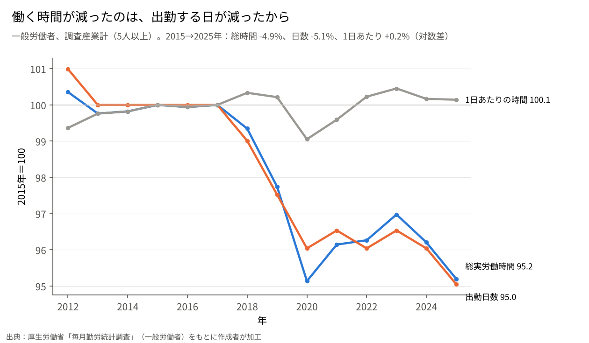
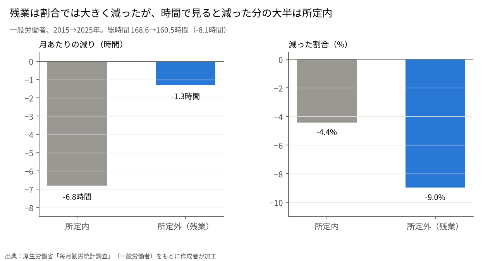
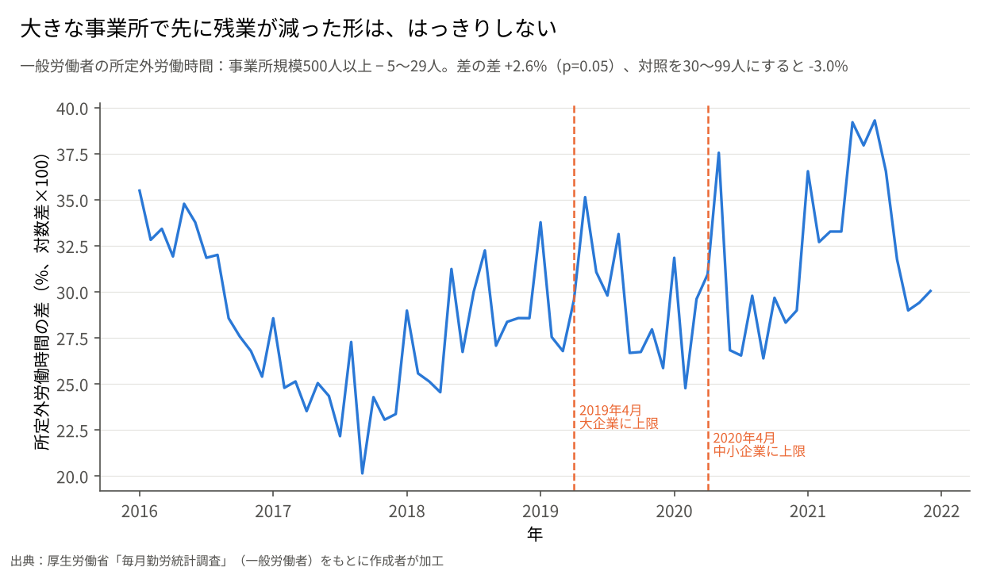
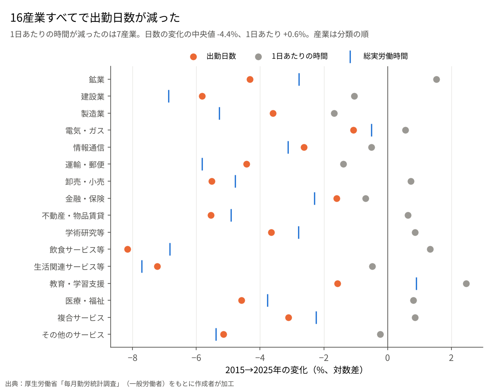

# F305 「残業が減った」は、働く時間のどこが減ったのか？ 10年で月8.1時間減ったうち、ほぼ全部が出勤日数の減り（1日あたりは+0.2%）。残業の減りは1.3時間だった

毎月勤労統計の一般労働者（フルタイム）で、働く時間の減り方を分けました。①残業（所定外）か所定内か、②1日あたりの時間か出勤日数か、③上限規制が先に始まった大きな事業所で先に減ったか、を確かめています。上限規制の良し悪しは扱いません。

## 結論（先に）

- **働く時間が減ったのは、出勤する日が減ったからでした。** 一般労働者の総実労働時間は2015年の月168.6時間から2025年の160.5時間へ、−4.9%（対数差）。出勤日数は20.2日から19.2日へ −5.1%、1日あたりの時間は8.35時間から8.36時間へ +0.2% でした。
- **残業は割合では大きく減りましたが、時間で見ると減った分の大半は所定内です。** 所定外は14.5→13.2時間（−9.0%、−1.3時間）、所定内は154.1→147.3時間（−4.4%、−6.8時間）でした。
- **16産業すべてで出勤日数が減りました。** 1日あたりの時間が減ったのは7産業だけで、日数の変化の中央値は −4.4%、1日あたりは +0.6% でした（結果を見てから足した確かめ）。
- **大きな事業所で先に残業が減った形は、はっきりしません。** 2019年4月（大企業への上限規制）の前後で、所定外労働時間の「500人以上 − 5〜29人」の差の差は +2.6%（p=0.054）、対照を30〜99人にすると −3.0%（p<0.001）で、対照の選び方で向きが変わりました。
- 2015→2025年に残業の多かった産業ほど大きく減った（順位相関 −0.52、p=0.04）一方、2018→2025年では −0.36（p=0.18）で、はっきりしませんでした。



## 問い

「残業が減った」は、働き方の話でよく出てきます。労務・人事で労働時間の推移を説明する担当や、働き方の統計を読む人にとっては、「何が減ったのか」が大事です。残業そのものが減ったのか、所定の時間が減ったのか。1日に働く時間が短くなったのか、休みが増えて出勤日が減ったのか。上限規制は2019年4月に大企業、2020年4月に中小企業に適用されましたが、規模による差は統計に出ているのか。この3つを確かめました。

## データ（出典）

| データ | 中身 | 期間 | ファイル |
|---|---|---|---|
| 厚生労働省「毎月勤労統計調査」全国調査 実数・指数累積データ（実数） | 総実労働時間・所定内労働時間・所定外労働時間・出勤日数。一般労働者・パート・就業形態計、調査産業計と16大分類、事業所規模別 | 年平均 2012〜2025年、月 2015年1月〜 | data/raw/maikin_jissu_cumulative.csv.gz |

- パートの比率の変化で平均が動くのを避けるため、主に一般労働者を使いました。
- 規模は「事業所」の規模で、上限規制の「企業」の規模とは一致しません。
- 累積 CSV（21MB）は、取得したバイト列をそのまま gzip で圧縮して同梱しました。取得日と URL は `data/raw/SOURCES.md` にあります。

## 事前の計画

集計の前に [PLAN.md](PLAN.md) を書きました（2026-11-16 07:02）。以前の作業で、調査産業計のいくつかの年平均の行を見ていました（PLAN に記載）。

| 仮説 | 基準 | 結果 | 判定 |
|---|---|---|---|
| H1 500人以上で2019年4月から残業が相対的に減る | 差の差が負で p<0.05 | +2.6%（p=0.054） | **外れ** |
| H2 総時間の減りの50%以上が日数の減り | 日数の分 ÷ 総時間の減り ≥ 0.5 | 1.03 | **支持** |
| H3 所定外の減り（%）＞ 所定内の減り（%） | 所定外の変化率 ＜ 所定内の変化率 | −9.0% ＜ −4.4% | **支持** |
| H4 2018年に残業が多い産業ほど減った | 順位相関が負で p<0.10 | −0.36（p=0.18） | **外れ** |

## やったこと

1. log 総時間 ＝ log 日数 ＋ log（1日あたりの時間）として、2015→2025年の変化を分けました。
2. 総時間の変化 ＝ 所定内の変化 ＋ 所定外の変化 として、時間と割合で比べました。
3. 所定外労働時間の「500人以上 − 5〜29人」（対数の差）を、2017年4月〜2020年2月の月の値で、「2019年4月以降」と暦の月で回帰しました（Newey–West 標準誤差）。2020年3月以降はコロナの影響を避けて使っていません。
4. 16産業で、2018年の所定外の長さと2018→2025年の変化の順位相関を取りました。

## 分かったこと

### 日数が減り、1日あたりは変わらない（図1）

- 出勤日数は2017年まで20.2日で横ばいでしたが、2018年20.0日、2019年19.7日、2020年19.4日と下がり、2025年は19.2日でした。
- 1日あたりの時間は、2020年に8.27時間に下がったほかは、8.3〜8.4時間でほぼ横ばいです。
- 日数が下がり始めた2018〜2019年は、働き方改革関連法で年5日の年次有給休暇の取得が義務になった時期（2019年4月）と重なります。ただし、この統計で理由は確かめられません（推測）。

### 残業は割合では大きく、時間では小さく減った（図2）



- 所定外は −9.0%、所定内は −4.4% で、割合では残業のほうが大きく減りました。
- ただ、もともと所定外は月14.5時間で所定内の1割ほどなので、時間にすると −1.3時間で、減った8.1時間のうち所定内が6.8時間を占めます。
- 所定外は2019年まで14.3〜14.6時間で、2020年に12.4時間まで下がり、2022〜2023年は13.8時間に戻りました。

### 規模の差は、はっきりしない（図3）



- 「500人以上 − 5〜29人」の所定外の差は、2017年に下がり、2018〜2019年は上がっていました。2019年4月の前後で、差が下がった形は見えません。
- 対照を30〜99人にすると −3.0%（p<0.001）、直前1年だけで比べると +0.4%（p=0.67）で、向きが定まりませんでした。

## 問い直し（結果を見てから足した）

**総時間の減りがほぼ全部日数の減りだったのは、産業をまたいで共通か。**（`src/03b_requestion.py`）



- 16産業すべてで、2015→2025年に出勤日数が減りました（中央値 −4.4%）。
- 1日あたりの時間が減ったのは7産業（製造業 −1.7%、運輸・郵便 −1.4%、建設業 −1.1% など）で、中央値は +0.6% でした。
- 総時間の変化の大きさは、16産業のうち15産業で、1日あたりより日数のほうが大きく効いていました。

## 頑健性

| 確かめ | 結果 | 結論は変わったか |
|---|---|---|
| H1 対照を30〜99人 | −3.0%（p<0.001） | 変わる（向きが逆） |
| H1 直前1年（2018年4月〜） | +0.4%（p=0.67） | 変わらない（減った形なし） |
| H1 100〜499人 − 5〜29人 | +0.5%（p=0.57） | 変わらない |
| H1 2020年4月の中小企業（5〜29人 − 500人以上） | −1.1%（p=0.27）、コロナと重なる | 判定できない |
| H2・H3 2018→2025年 | 総時間 −4.3%、日数 −4.1%、所定外 −8.3%、所定内 −3.8% | 変わらない |
| H2・H3 2019→2023年 | 総時間 −0.8%、日数 −1.0%、所定外 −3.5%、所定内 −0.5% | 変わらない |
| H2・H3 就業形態計（パートを含む） | 総時間 −6.7%、日数 −7.2%、所定外 −10.9%、所定内 −6.1% | 変わらない |
| H4 2015→2025年 | 順位相関 −0.52（p=0.04） | 変わる（期間しだい） |

## 言えないこと

- **上限規制だけの効果は分けられません。** 年次有給休暇の取得義務、コロナ、人手不足などが同じ時期に重なっています。
- **事業所の規模は企業の規模と違います。** 大企業の小さな事業所は「5〜29人」に入ります。
- **出勤日数は小数1けたの公表値です。** 細かい変化は丸めの影響を受けます。
- **標本の入れ替えの段差がありえます。** 毎月勤労統計は2018年1月などに標本を入れ替えていて、年の値に段差が入りうるとされます。
- 申告されていない時間は統計に入りません。

## 仕事で使うなら

- 「残業が減った」を説明するときは、残業の割合の減り（−9.0%）と、総時間の減りの中身（ほぼ出勤日数の減り）を分けて示すと、誤解を減らせます。
- 規模別の比較は対照の選び方で向きが変わったので、規模の差を根拠に規制の影響を語るのは、この統計では難しいと言えます。

## 計画からの変更

- 問い直し（産業ごとの日数と1日あたりの分解）を足しました。
- H1 の参考として、総実労働時間と100〜499人の比較も載せました。

## 再現のしかた

```sh
pip install -r requirements.txt
python3 src/01_fetch.py      # 元データの取得（ネットが必要。同梱済み）
sh src/run_all.sh            # オフラインで 02 から最後まで（約4秒）
```

| ファイル | 役割 |
|---|---|
| src/02_build.py | 累積 CSV（gz）から月・年の表を作る |
| src/03_analysis.py | H1〜H4 と頑健性（results/main.json） |
| src/03b_requestion.py | 問い直し（results/requestion.json） |
| src/04_figures.py | 図1〜4 |

- 再現の確かめ：`results/repro_check.txt`（2026-11-16 再実行：13 ファイル一致、所要 4 秒。/tmp に写して出力を消してから流し、cmp で比較）。スレッド1。乱数は使っていません。

- 大きなデータのファイル（`data/raw/maikin_jissu_cumulative.csv.gz`）は、GitHub の1ファイルの上限に合わせて `.part000` などに分けて置いています。`run_all.sh` が最初に `src/00_join_parts.py` でつなぎ直し、sha256 で元と同じことを確かめます。

## レビューで直したこと

独立レビューで数字の照合・再実行・図を確かめ、直すところはなかった。

## 出典

- 厚生労働省「毎月勤労統計調査」全国調査 実数・指数累積データ：[e-Stat](https://www.e-stat.go.jp/stat-search/files?toukei=00450071&tstat=000001011791)

（いずれも 厚生労働省の公表データ をもとに作成者が加工して作成）
