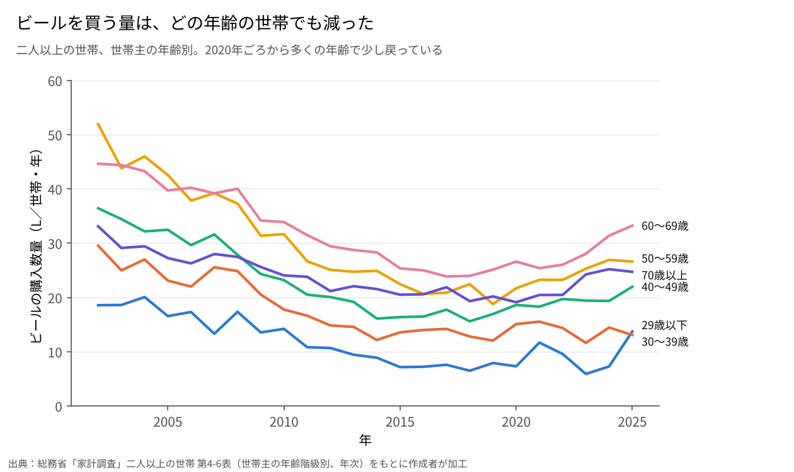
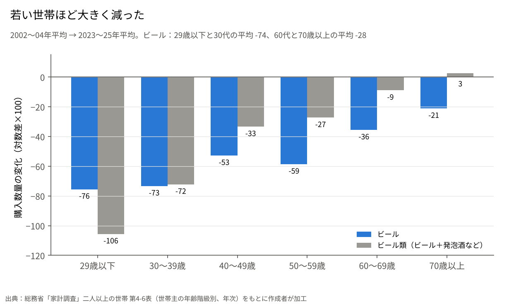
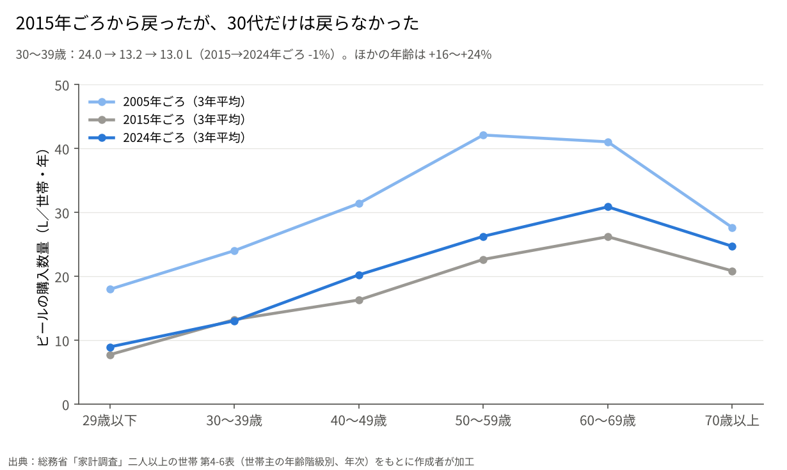

# F306 「若者のビール離れ」は、年齢のせいか、世代のせいか？ 20年で29歳以下は−76、70歳以上は−21（対数差）。世代と年齢のどちらが当てはまるかは、比べる年の組で入れ替わった

総務省「家計調査」の世帯主の年齢別の表（二人以上の世帯、2002〜2025年）で、ビールの購入数量がどの年齢でどれだけ減ったのか、それが「時代」「年齢」「世代（生まれ年）」のどれで説明しやすいのかを確かめました。お酒の健康への影響は扱いません。見ているのは、家で買う量の統計の読み方だけです。

## 結論（先に）

- **ビールを買う量は、どの年齢の世帯でも減りました。** 1世帯あたりの年間の購入数量は、2002〜04年平均37.5Lから2023〜25年平均24.1Lへ（対数差 −44）。6つの年齢すべてで減っています。
- **若い世帯ほど大きく減りました。** 29歳以下は19.1L→9.0L（−76）、30〜39歳は27.2L→13.0L（−73）、60〜69歳は −36、70歳以上は −21 でした。発泡酒などを含めた「ビール類」で見ると、差はもっと大きく、29歳以下 −106 に対し70歳以上は +3 でした。
- **「世代」と「年齢」のどちらで並べたほうが当てはまるかは、比べ方しだいでした。** 事前に決めた2組（2005・2015・2025年と2004・2014・2024年）では「年齢＋時代」のほうが当てはまりがよく（AIC −13.3 対 −4.7、−10.1 対 −8.0）、「世代のほうが当てはまる」という仮説は外れました。ただし2003・2013・2023年の組と、ビール類で比べた組では逆に「世代＋時代」のほうがよく、4通りのうち2通りずつです。
- **2015年ごろからはどの年齢でも戻りましたが、30代だけは戻りませんでした**（結果を見てから足した確かめ）。30〜39歳は2005年ごろ24.0L、2015年ごろ13.2L、2024年ごろ13.0L（−1%）。ほかの年齢は+16〜+24%でした。
- お酒の支出に占めるビールの割合は、どの年齢でも下がりました（平均40.7%→28.6%）。



## 問い

「若者のビール離れ」はよく聞く言葉です。飲料・小売の商品や販売の担当、消費の統計を読む人にとっては、それが①どの年齢でも同じように減った「時代」の動きなのか、②若い世帯ほど大きく減ったのか、③生まれ年ごとに買う量が低い水準で始まり、その差が年をとっても続く「世代」の動きなのか、で意味が変わります。この記事では、公表された年齢別の表でどこまで言えるかを確かめました。

## データ（出典）

| データ | 中身 | 期間 | ファイル |
|---|---|---|---|
| 総務省「家計調査」家計収支編 二人以上の世帯 年次 第4-6表「世帯主の年齢階級別」 | 品目ごとの1世帯当たり年間の支出金額・購入数量（ビール、発泡酒・ビール風アルコール飲料、チューハイ・カクテル、酒類の計）、世帯数分布 | 2002〜2025年（24年分） | data/raw/kakei_4-6_*.xls(x) |

- 2019年までと2020年からで表の形が違うため、それぞれの形に合わせて読み込みました（`src/02_build.py`）。
- 「発泡酒」の品目は、2010年ごろから「発泡酒・ビール風アルコール飲料」になっています（2025年の表では「発泡酒」）。ビール類の比較は、この定義の変化を含みます。
- 取得日と URL は `data/raw/SOURCES.md` にあります（24ファイル、計12MB）。

## 事前の計画

集計の前に [PLAN.md](PLAN.md) を書きました（2026-11-16 07:10）。形を確かめるときに、2000・2005・2015・2019年のビールの行（平均と若い2つの年齢）を見ていました（PLAN に記載）。

| 仮説 | 基準 | 結果 | 判定 |
|---|---|---|---|
| H1 6つの年齢すべてで減った | どれも減少 | すべて減少（−21〜−76） | **支持** |
| H2 若い世帯の減りが高齢の世帯より10ポイント以上大きい | 差 ≤ −10 | −74 対 −28（差 −46） | **支持** |
| H3 「世代＋時代」のほうが「年齢＋時代」より当てはまる（2組とも） | AIC が小さい | 2組とも「年齢＋時代」が小さい | **外れ** |
| H4 酒類に占めるビールの割合がすべての年齢で下がった | どれも低下 | −7.1〜−15.6ポイント | **支持** |

## やったこと

1. 年齢別の購入数量を、2002〜04年と2023〜25年の平均で比べました（対数差×100）。
2. 10年おきの3時点（2005・2015・2025年と、2004・2014・2024年）で、6つの年齢×3時点の18のマスを使い、「年齢＋時代」「世代＋時代」「年齢＋世代」の3つの回帰の当てはまり（AIC）を比べました。世代は「調査年 − 年齢の階級の下限」で、10年の幅になります。
3. 年齢・時代・世代の3つを同時には分けられないので（調査年 ＝ 生まれ年 ＋ 年齢）、2つずつの比較にとどめました。

## 分かったこと

### 若い世帯ほど大きく減った（図2）



- ビールの減り方は、29歳以下 −76、30〜39歳 −73、40〜49歳 −53、50〜59歳 −59、60〜69歳 −36、70歳以上 −21（対数差×100）でした。
- 発泡酒などを含めたビール類では、29歳以下 −106、30〜39歳 −72 に対して、60〜69歳 −9、70歳以上 +3 でした。高齢の世帯では、ビールから発泡酒などへの置き換えで、ビール類の量はあまり減っていません。

### 世代で並べるか年齢で並べるかは、組しだい

- 2005・2015・2025年の組では、AIC は「年齢＋時代」−13.3、「世代＋時代」−4.7、「年齢＋世代」15.4 でした。2004・2014・2024年の組でも −10.1、−8.0、16.2 です。
- 2003・2013・2023年の組では逆に「世代＋時代」のほうが小さく（−10.2 対 −7.7）、ビール類では「年齢＋世代」が最も小さくなりました。組や品目で順番が入れ替わるので、「世代のせい」とも「年齢のせい」とも言い切れません。

## 問い直し（結果を見てから足した）

**2015年ごろからの戻り方は、年齢によって違うのか。**（`src/03b_requestion.py`）



- 3年平均（2004〜06、2014〜16、2023〜25年）で年齢の形を比べると、2005年ごろから2015年ごろにかけて、どの年齢でも大きく下がりました。
- 2015年ごろから2024年ごろにかけては、29歳以下 +16%、40〜49歳 +24%、50〜59歳 +16%、60〜69歳 +18%、70歳以上 +18% と戻りましたが、30〜39歳だけは −1% でした。
- 2024年ごろの30〜39歳は、おおよそ1985〜94年生まれです。この世代だけが戻りに加わっていない形で、「世代」の動きの手がかりにはなりますが、1つの階級だけの話で、標本のぶれもありえます。
- 2020年ごろからの戻りは、酒税の改定でビールの税が下がった時期（2020年10月・2023年10月）と重なります（推測。この表では確かめていません）。

## 頑健性

| 確かめ | 若い2階級の平均 | 高齢の2階級の平均 | すべての年齢で減ったか |
|---|---|---|---|
| 主（数量、2002〜04 → 2023〜25） | −74 | −28 | はい |
| R1 支出金額で | −66 | −25 | はい |
| R2 ビール類（ビール＋発泡酒など）の数量 | −89 | −3 | いいえ（70歳以上 +3） |
| R4 2005〜07 → 2017〜19（コロナ・酒税改定の前） | −68 | −39 | はい |

| H3 の確かめ | 年齢＋時代 | 世代＋時代 | 年齢＋世代 |
|---|---|---|---|
| 主 2005・2015・2025年 | −13.3 | −4.7 | 15.4 |
| 2004・2014・2024年 | −10.1 | −8.0 | 16.2 |
| R3 2003・2013・2023年 | −7.7 | −10.2 | 0.8 |
| R3' ビール類（2005・2015・2025年） | 0.6 | −12.9 | −45.0 |

（AIC。小さいほど当てはまりがよい）

## 言えないこと

- **世帯主の年齢で、飲む人の年齢ではありません。** 二人以上の世帯の家での購入だけで、外で飲む分や単身世帯は入りません。若い単身者の動きは見えません。
- **29歳以下が世帯主の二人以上の世帯は標本が少なく**（2025年は99世帯）、年ごとの値が大きくぶれます。
- **年齢・時代・世代の3つは、仮定を置かないと分けられません。** この記事は2つずつの比較までです。
- **品目の定義が途中で変わっています。** 「発泡酒」に「ビール風アルコール飲料」が加わった時期があり、ビール類の比較はその影響を含みます。
- 酒税の改定や価格の変化の効果は分けていません。

## 仕事で使うなら

- 「若者のビール離れ」は、家計調査の年齢別の表では「若い世帯ほど大きく減った」までは言えます。それが世代によるものかは、比べ方によって答えが変わりました。
- 近年の戻りが30代の世帯でだけ見えない点は、年齢別の動きを追うときの見どころの一つです。

## 計画からの変更

- 問い直し（3つの時期の年齢の形）を足しました。
- H3 の頑健性として、ビール類での比較（R3'）を足しました。

## 再現のしかた

```sh
pip install -r requirements.txt
python3 src/01_fetch.py      # 元データの取得（ネットが必要。同梱済み）
sh src/run_all.sh            # オフラインで 02 から最後まで（約5秒）
```

| ファイル | 役割 |
|---|---|
| src/02_build.py | 24年分の表から年×年齢×品目の表を作る |
| src/03_analysis.py | H1〜H4 と頑健性（results/main.json） |
| src/03b_requestion.py | 問い直し（results/requestion.json） |
| src/04_figures.py | 図1〜4 |

- 再現の確かめ：`results/repro_check.txt`（2026-11-16 再実行：13 ファイル一致、所要 5 秒。/tmp に写して出力を消してから流し、cmp で比較）。スレッド1。乱数は使っていません。

## レビューで直したこと

| # | 指摘 | 直し方 |
|---|---|---|
| 1 | 題名と結論の「世代で並べても当てはまりはよくならなかった」が、頑健性の4通りのうち2通りで逆（世代＋時代のほうがよい）になる結果に対して言い過ぎだった | 題名の結果の部分を「世代と年齢のどちらが当てはまるかは、比べる年の組で入れ替わった」に、結論の1点と見出しを書き直した。status の title と note の1行目もそろえた |

## 出典

- 総務省「家計調査」家計収支編 二人以上の世帯 詳細結果表 第4-6表：[e-Stat](https://www.e-stat.go.jp/stat-search/files?toukei=00200561&tstat=000000330001)

（いずれも 総務省の公表データ をもとに作成者が加工して作成）
