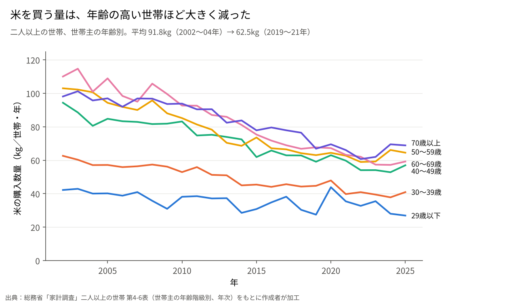
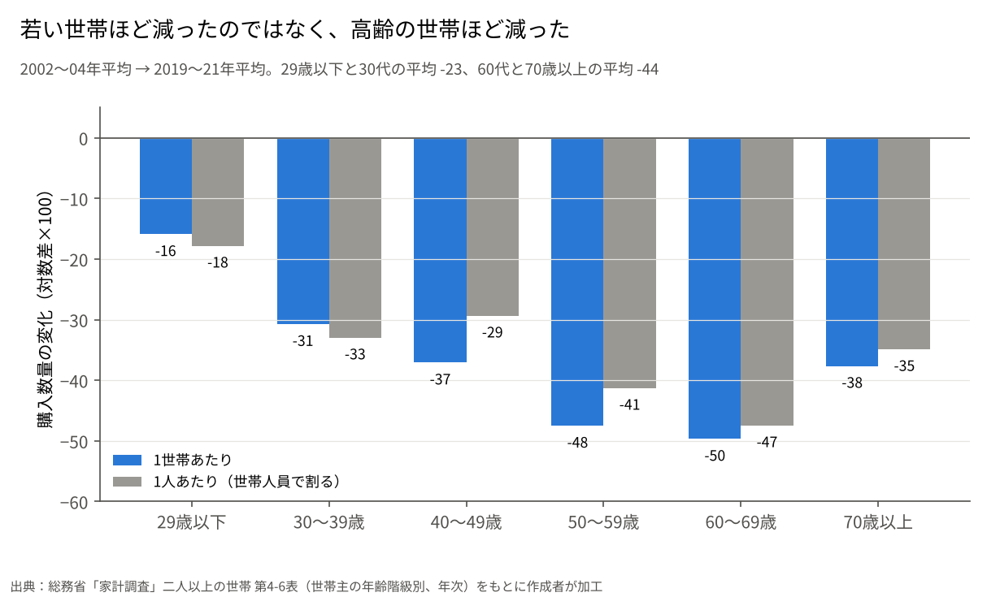
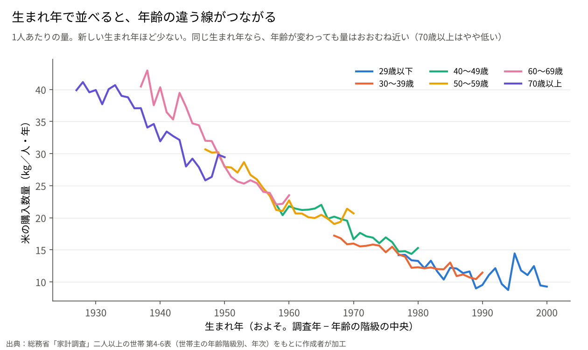
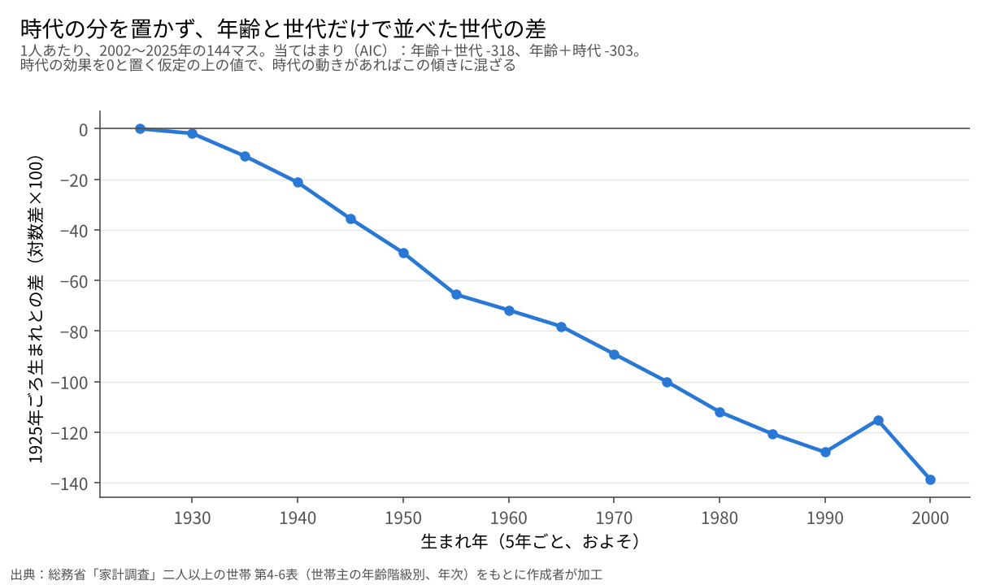

# F307 「米を食べなくなった」は、世代の違いでどこまで説明できるか？ 減ったのは高齢の世帯（−44）で若い世帯（−23）より大きい。生まれ年で並べると線がつながる

総務省「家計調査」の世帯主の年齢別の表（二人以上の世帯、2002〜2025年）で、家庭で買う米の量の減り方を、年齢・時代・世代（生まれ年）の見方で確かめました。食事や健康の良し悪しは扱いません。米の値段の動きは既存の記事 F266 で扱ったので、ここでは量を見ます。

## 結論（先に）

- **米を買う量は、どの年齢の世帯でも減りました。** 1世帯あたりの年間の購入数量は、2002〜04年平均91.8kgから2019〜21年平均62.5kg（対数差 −38）。2023年以降の米の値段の急な変化を避けて、2021年までで比べています。
- **世帯の人数が減った分を除いても、減りの77%が残ります。** 1人あたり（世帯人員で割った量）では −30 でした。
- **若い世帯ほど減ったのではなく、高齢の世帯ほど減りました。** 29歳以下と30代の平均は −23、60代と70歳以上の平均は −44 でした（仮説は外れ）。
- **事前に比べた「世代＋時代」は、「年齢＋時代」に勝ちませんでした**（3組とも、仮説は外れ）。ところが、時代の分を置かない「年齢＋世代」が最もよく当てはまる組が多く、年ごとの144のマスで1人あたりを見ると、AIC は「年齢＋世代」−318、「年齢＋時代」−303 でした（結果を見てから足した確かめ）。
- **生まれ年で並べると、年齢の違う線がおおむねつながります。** 新しい生まれ年ほど1人あたりの量が少なく、同じ生まれ年なら年齢が変わっても量が近い形です。「高齢の世帯ほど減った」は、米をあまり買わない生まれ年の人が高齢の階級に入ってきた、と読むと説明がつきます（ただし時代の効果を0と置いた上での読み方です）。



## 問い

「日本人は米を食べなくなった」とよく言われます。食品・小売の商品や販売の担当、食の消費の統計を読む人にとっては、それが①どの年齢でも減った「時代」の動きか、②若い世帯ほど米を買わない「年齢」の差か、③新しい世代ほど米を買わず、その差が年をとっても続く「世代」の動きかで、意味が変わります。世帯の人数が減った影響も除いて確かめました。

## データ（出典）

| データ | 中身 | 期間 | ファイル |
|---|---|---|---|
| 総務省「家計調査」家計収支編 二人以上の世帯 年次 第4-6表「世帯主の年齢階級別」 | 米の1世帯当たり年間の購入数量（kg）・支出金額、世帯人員 | 2002〜2025年（24年分） | data/raw/kakei_4-6_*.xls(x) |

- 元のファイルは F306（ビール）と同じものを、同じ URL から取得して同梱しました。取得日と URL は `data/raw/SOURCES.md` にあります。
- 2019年までと2020年からで表の形が違うため、それぞれの形に合わせて読み込みました。

## 事前の計画

集計の前に [PLAN.md](PLAN.md) を書きました（2026-11-16 07:13）。品目のコードを確かめるときに、2005年と2025年の米の平均と29歳以下の値を見ていました（PLAN に記載）。

| 仮説 | 基準 | 結果 | 判定 |
|---|---|---|---|
| H1 6つの年齢すべてで減った（2002〜04 → 2019〜21） | どれも減少 | すべて減少（−16〜−50） | **支持** |
| H2 1人あたりでも減りの70%以上が残る | 残る割合 ≥ 0.7 | 0.77（−38 → −30） | **支持** |
| H3 若い世帯の減りが高齢の世帯より10ポイント以上大きい | 差 ≤ −10 | −23 対 −44（逆） | **外れ** |
| H4 3組のうち2組以上で「世代＋時代」の AIC が「年齢＋時代」より小さい | 2組以上 | 0組 | **外れ** |

## やったこと

1. 年齢別の購入数量（1世帯あたり、1人あたり）を、2002〜04年と2019〜21年の平均で比べました（対数差×100）。
2. 10年おきの3時点（2005・2015・2025年など3組）で、6つの年齢×3時点の18のマスを使い、「年齢＋時代」「世代＋時代」「年齢＋世代」の当てはまり（AIC）を比べました。
3. 年齢・時代・世代の3つは同時には分けられないので（調査年 ＝ 生まれ年 ＋ 年齢）、2つずつの比較にとどめました。

## 分かったこと

### 高齢の世帯ほど大きく減った（図2）



- 1世帯あたりの減り方は、29歳以下 −16、30〜39歳 −31、40〜49歳 −37、50〜59歳 −48、60〜69歳 −50、70歳以上 −38 でした。
- 1人あたりでも、29歳以下 −18 に対して60〜69歳 −47 で、同じ形です。
- 平均の世帯人員は3.22人から2.95人に減りました。1世帯あたり −38 のうち、1人あたりの減り（−30）が大部分です。

### 3時点の比較では「年齢＋時代」が勝つが、「年齢＋世代」がもっとよい組が多い

- 2005・2015・2025年の組で、AIC は「年齢＋時代」−49.6、「世代＋時代」−6.2、「年齢＋世代」−36.0 でした。
- 2004・2014・2024年の組では −34.6、−6.7、−52.2、2003・2013・2023年の組では −29.6、−5.4、−62.2 で、3組のうち2組で「年齢＋世代」が最も小さくなりました。

## 問い直し（結果を見てから足した）

**時代の分を置かない「年齢＋世代」で、どこまで説明できるのか。**（`src/03b_requestion.py`）



- 年ごと（2002〜2025年）の144のマスで、生まれ年（調査年 − 年齢の階級の中央）を5年ごとにまとめて比べました。
- 1人あたりの量では、AIC は「年齢＋世代」−318.3、「世代＋時代」−315.1、「年齢＋時代」−303.5 で、「年齢＋世代」が最も小さくなりました。決定係数はどれも0.97〜0.98です。1世帯あたりでは「年齢＋世代」−311.1 と「年齢＋時代」−309.7 がほぼ同じでした。
- 図3のように生まれ年で並べると、年齢の違う線がおおむねつながります。たとえば60〜69歳の世帯の1人あたりの量は、2002年40.5kg、2012年32.0kg、2022年23.9kgと、生まれ年が新しくなるほど少なくなっていました。



- 「年齢＋世代」のモデルで、1925年ごろ生まれを0とすると、1950年ごろ生まれは −49、1970年ごろ生まれは −89、1990年ごろ生まれは −128（対数差×100）でした。
- ただしこれは「時代の効果は0」と置いたときの値です。どの年も一様に減る時代の動きがあれば、それは世代の傾きに混ざって見えます。この表だけでは、その2つを分けられません。

## 頑健性

| 確かめ | 平均 | 若い2階級 | 高齢の2階級 | すべての年齢で減ったか |
|---|---|---|---|---|
| 主（数量、2002〜04 → 2019〜21） | −38 | −23 | −44 | はい |
| R1 終点を2023〜25年 | −44 | −37 | −51 | はい |
| R2 支出金額で | −48 | −31 | −56 | はい |
| R3 1人あたりで | −30 | −25 | −41 | はい |
| R4 始点を2005〜07年 | −33 | −18 | −38 | はい |

- R3'（1人あたりで H4）：3組のうち2組で「世代＋時代」の AIC が「年齢＋時代」より小さくなりました（2004・2014・2024年、2003・2013・2023年）。1世帯あたりでは0組だったので、世帯の人数の扱いで判定が変わります。

## 言えないこと

- **家で買う米の量です。** 外食や弁当などで食べる米、もらう米、自分の家で作る米は入りません。
- **世帯主の年齢で、食べる人の年齢ではありません。** 二人以上の世帯だけで、単身世帯は入りません。
- **年齢・時代・世代の3つは、仮定を置かないと分けられません。** 「世代で説明できる」は「時代の効果を0と置けば」という条件つきです。
- **29歳以下の世帯主の二人以上の世帯は標本が少なく**、年ごとの値がぶれます。
- 2023年以降の米の値段の急な変化の影響は、主な比較からは外しましたが、R1 には入っています。

## 仕事で使うなら

- 「若い人ほど米を食べない」という見方は、家計調査の年齢別の表では「若い世帯ほど減った」形にはなっていませんでした。生まれ年で並べると、新しい世代ほど少ない形がはっきり見えます。
- 年齢別の量を年ごとに比べるときは、「同じ年齢でも中の世代が入れ替わる」ことを前提に読むと、高齢の世帯で減っている理由を説明しやすくなります。

## 計画からの変更

- 問い直し（年ごとのマスでの「年齢＋世代」の比較、図3・図4）を足しました。

## 再現のしかた

```sh
pip install -r requirements.txt
python3 src/01_fetch.py      # 元データの取得（ネットが必要。同梱済み）
sh src/run_all.sh            # オフラインで 02 から最後まで（約7秒）
```

| ファイル | 役割 |
|---|---|
| src/02_build.py | 24年分の表から年×年齢×品目の表を作る |
| src/03_analysis.py | H1〜H4 と頑健性（results/main.json） |
| src/03b_requestion.py | 問い直し（results/requestion.json） |
| src/04_figures.py | 図1〜4 |

- 再現の確かめ：`results/repro_check.txt`（2026-11-16 再実行：12 ファイル一致、所要 7 秒。/tmp に写して出力を消してから流し、cmp で比較）。スレッド1。乱数は使っていません。

## レビューで直したこと

独立レビューで数字の照合・再実行・図を確かめ、直すところはなかった。

## 出典

- 総務省「家計調査」家計収支編 二人以上の世帯 詳細結果表 第4-6表：[e-Stat](https://www.e-stat.go.jp/stat-search/files?toukei=00200561&tstat=000000330001)

（いずれも 総務省の公表データ をもとに作成者が加工して作成）
