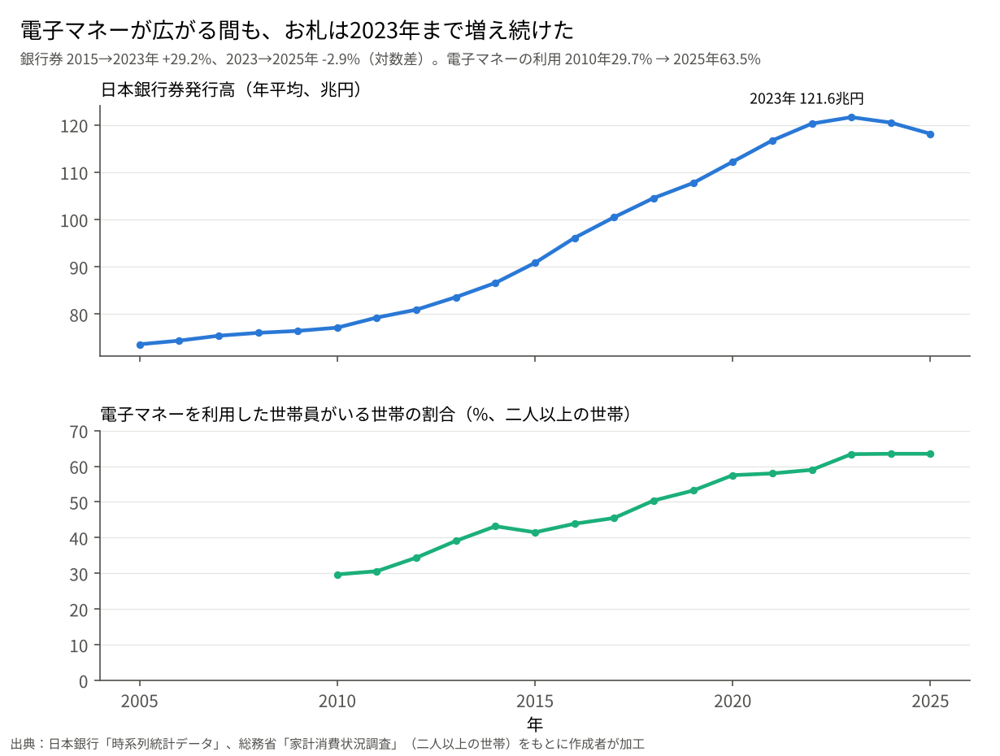
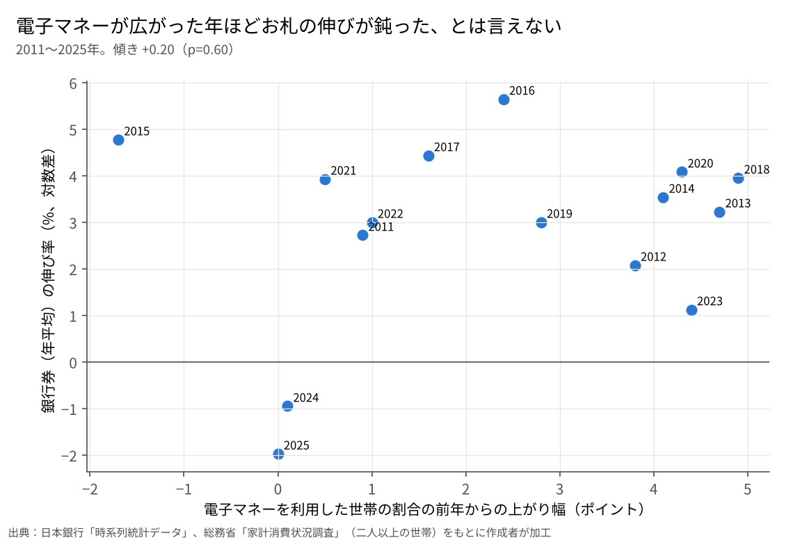
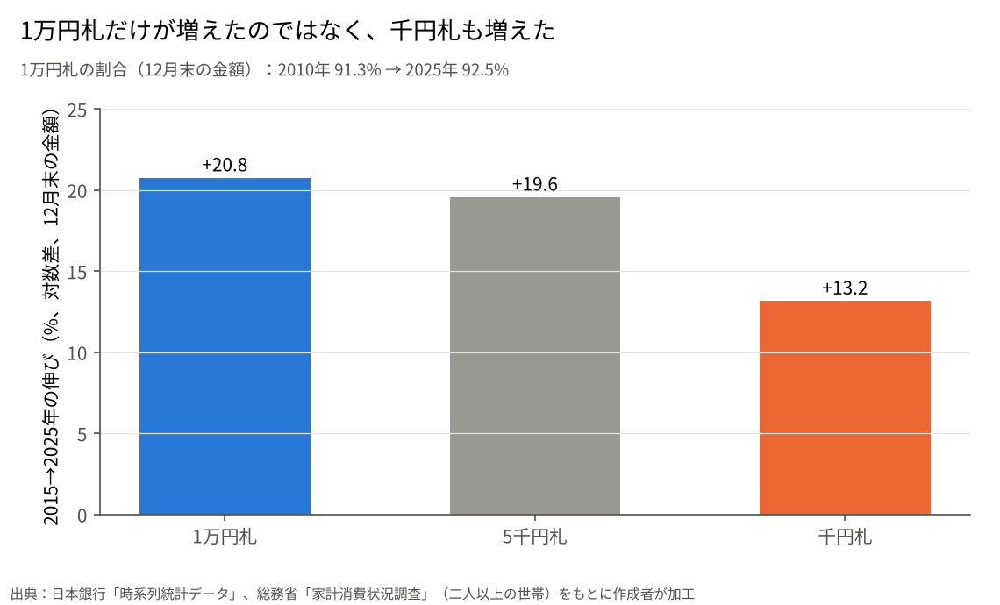
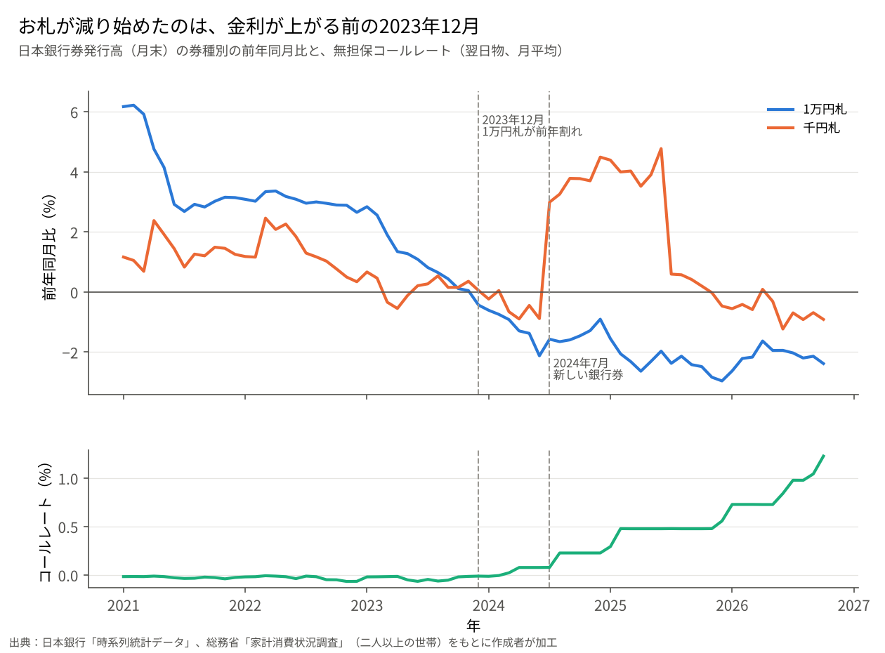

# F308 キャッシュレスが広がって、お札はいらなくなったのか？ 電子マネーが広がる間もお札は2023年まで+29%増え、減り始めたのは2023年12月から

日本銀行の銀行券の統計と、総務省「家計消費状況調査」の電子マネーの利用状況を並べて、キャッシュレスの広がりとお札の量の関係を確かめました。投資や家計の判断についての助言はしません。

## 結論（先に）

- **電子マネーが広がる間も、お札は増え続けました。** 日本銀行券発行高（年平均）は2015年の90.8兆円から2023年の121.6兆円へ（対数差 +29.2%）。同じ間に、電子マネーを利用した世帯員がいる世帯の割合（二人以上の世帯）は41.5%から63.4%に上がりました。
- **減り始めたのは2023年12月からです**（結果を見てから足した確かめ）。月末の1万円札の前年同月比は2023年12月に初めてマイナスになり、2026年10月まで続いています。2025年の年平均は118.1兆円で、2023年から −2.9% でした。
- **電子マネーが広がった年ほどお札の伸びが鈍った、という関係は見えません。** 2011〜2025年の年ごとの比較で、傾きは +0.20（p=0.60）でした。
- **1万円札だけが増えたのではありません。** 2015→2025年の伸びは1万円札 +20.8%、5千円札 +19.6%、千円札 +13.2% で、1万円札の割合は2010年91.3%から2025年92.5%（+1.3ポイント）でした。
- 年ごとの伸びはコールレート（短期の金利）とよく一緒に動きましたが、減り始めたのは金利が上がり始める前でした。



## 問い

電子マネーやスマートフォンでの支払いが広がれば、お札はいらなくなる、と考えたくなります。小売・決済の担当や、家計・金融の統計を読む人にとって、それは本当か。①お札の総額は減ったのか、②どの券種が増えたのか、③電子マネーの利用が広がった年に、お札の伸びは鈍ったのか、④金利の動きとはどう重なるのか、を確かめました。

## データ（出典）

| データ | 中身 | 期間 | ファイル |
|---|---|---|---|
| 日本銀行「時系列統計データ」（API） | 日本銀行券発行高（月平均残高）、券種別の日本銀行券発行高（月末）、無担保コールレート（翌日物、月平均） | 1970年〜2026年10月など | data/raw/boj_*.json |
| 総務省「家計消費状況調査」年次 第2-1表 | 電子マネーを持っている・利用した世帯員がいる世帯の割合、利用した世帯の1世帯当たり平均利用金額（二人以上の世帯、全国） | 2010〜2025年 | data/raw/kakei_shohi_emoney_*.xls(x) |

- 日本銀行の値は API の JSON をそのまま保存しました。取得日と URL は `data/raw/SOURCES.md` にあります。
- 電子マネーは調査の定義によるもので、クレジットカードやコード決済のすべてを含むものではありません。

## 事前の計画

集計の前に [PLAN.md](PLAN.md) を書きました（2026-11-16 07:20）。家計消費状況調査の2025年の総世帯の値を見ていました（PLAN に記載）。銀行券の値は見ていません。

| 仮説 | 基準 | 結果 | 判定 |
|---|---|---|---|
| H1 銀行券（年平均）は2015→2025年に増えた | 増減が正 | +26.2% | **支持** |
| H2 1万円札の割合が2010→2025年に2ポイント以上上がった | ≥ 2 | +1.3 | **外れ** |
| H3 電子マネーの利用が広がった年ほど銀行券の伸びが小さい | 傾きが負で p<0.10 | +0.20（p=0.60） | **外れ** |
| H4 千円札の伸びが1万円札より10ポイント以上小さい | 差 ≤ −10 | −7.6 | **外れ** |

## やったこと

1. 銀行券（月平均残高）を年平均に、券種別（月末）は12月末の値にしました。
2. 年ごとの銀行券の伸び率を、電子マネーを利用した世帯の割合の前年からの上がり幅で回帰しました（HC3 標準誤差）。
3. 券種別の伸びと、1万円札の割合を比べました。

## 分かったこと

### 電子マネーが広がっても、お札は2023年まで増えた（図1）

- 銀行券（年平均）は2010年77.2兆円、2015年90.8兆円、2019年107.7兆円、2023年121.6兆円でした。
- 電子マネーを利用した世帯の割合は2010年29.7%、2015年41.5%、2020年57.5%、2025年63.5%、利用した世帯の1世帯当たり平均利用金額は9,588円から33,933円になりました。

### 年ごとに見ても、関係は見えない（図2）



- 電子マネーの利用が大きく広がった年（2013・2018・2020年など）でも、銀行券は3〜4%伸びていました。
- 銀行券が減った2024・2025年は、電子マネーの割合がほとんど上がらなかった年です。

### 千円札も増えた（図4）



- 1万円札の割合はもともと9割を超えていて、2010年91.3%、2022年93.2%、2025年92.5%でした。上がり幅は計画の基準（2ポイント）に届きませんでした。
- 千円札も2015→2025年に +13.2% 増えていて、支払いに使うお札が大きく減った形ではありません。

## 問い直し（結果を見てから足した）

**お札が減り始めたのは、いつで、どの券種からか。**（`src/03b_requestion.py`）



- 月末の前年同月比で、銀行券の合計と1万円札がマイナスになったのは、どちらも2023年12月が最初でした。その後2026年10月まで34か月続けてマイナスで、2026年10月は合計 −2.3%、1万円札 −2.4% です。
- コールレート（月平均）は2023年まではほぼ0%で、2024年に上がり始めました（年平均 2023年 −0.03%、2024年 0.12%、2025年 0.47%）。お札の減少は、金利が上がり始める少し前から始まっていました。
- 千円札は2024年7月の新しい銀行券の発行のあと、1年ほど前年比 +3〜5% で増え、その後はマイナスに戻りました。

## 頑健性

| 確かめ | 結果 | 結論は変わったか |
|---|---|---|
| R1 始点を2010年に（年平均） | 2010→2025年 +42.6% | 変わらない（増えた） |
| R1 12月末の値で | 2015→2025年 +20.3% | 変わらない |
| R1 券種を2010→2025年で | 1万円札 +39.6%、千円札 +19.8%（差 −19.8） | H4 は2010年起点なら基準を満たす |
| R2 H3 にコールレートを加える | 電子マネー −0.10（p=0.71）、コールレート −12.0（p<0.001）、R² 0.54 | 変わらない（電子マネーは効かない） |
| R3 利用の広さ×金額の伸びで | +0.13（p=0.16） | 変わらない（負にならない） |
| R4 2023年まで（新しい銀行券の前） | −0.21（p=0.14） | 変わらない（有意でない） |

- R2 のコールレートの係数は大きく見えますが、金利が動いたのは2024年以降の2年だけで、その2年の減少がこの係数を作っています。お札の減少が金利の上昇より前に始まっていたことと合わせると、金利だけで説明するのは難しいと考えます（推測）。

## 言えないこと

- **銀行券発行高は、家や会社に置かれたお札と、支払いに使われるお札を分けられません。**
- **電子マネーはキャッシュレスの一部です。** クレジットカードやコード決済のすべては入らず、二人以上の世帯の調査です。
- **年ごとの相関で、因果は言えません。** 15年分しかなく、結果の幅は大きいままです。
- **2023年12月からの減少の理由は分かりません。** 新しい銀行券の発行の準備、金利の見通し、物価など、いくつもの説明が考えられます。
- 海外に持ち出されたお札などは分かりません。

## 仕事で使うなら

- 「キャッシュレスが広がったからお札が減った」は、この統計の動きとは合いませんでした。電子マネーが広がった時期にお札は増え、減ったのは広がりが落ち着いたあとでした。
- お札の量の動きを見るときは、券種別と月の前年同月比を並べると、新しい銀行券の発行のような一時的な動きを見分けやすくなります。

## 計画からの変更

- 問い直し（月の券種別の動き、図3）を足しました。

## 再現のしかた

```sh
pip install -r requirements.txt
python3 src/01_fetch.py      # 元データの取得（ネットが必要。同梱済み）
sh src/run_all.sh            # オフラインで 02 から最後まで（約3秒）
```

| ファイル | 役割 |
|---|---|
| src/02_build.py | JSON と Excel から月・年の表を作る |
| src/03_analysis.py | H1〜H4 と頑健性（results/main.json） |
| src/03b_requestion.py | 問い直し（results/requestion.json） |
| src/04_figures.py | 図1〜4 |

- 再現の確かめ：`results/repro_check.txt`（2026-11-16 再実行：11 ファイル一致、所要 3 秒。/tmp に写して出力を消してから流し、cmp で比較）。スレッド1。乱数は使っていません。

## レビューで直したこと

独立レビューで数字の照合・再実行・図を確かめ、直すところはなかった。

## 出典

- 日本銀行「時系列統計データ検索サイト」：[日本銀行](https://www.stat-search.boj.or.jp/)
- 総務省「家計消費状況調査」：[e-Stat](https://www.e-stat.go.jp/stat-search/files?toukei=00200565&tstat=000000660001)

（いずれも 日本銀行・総務省の公表データ をもとに作成者が加工して作成）
