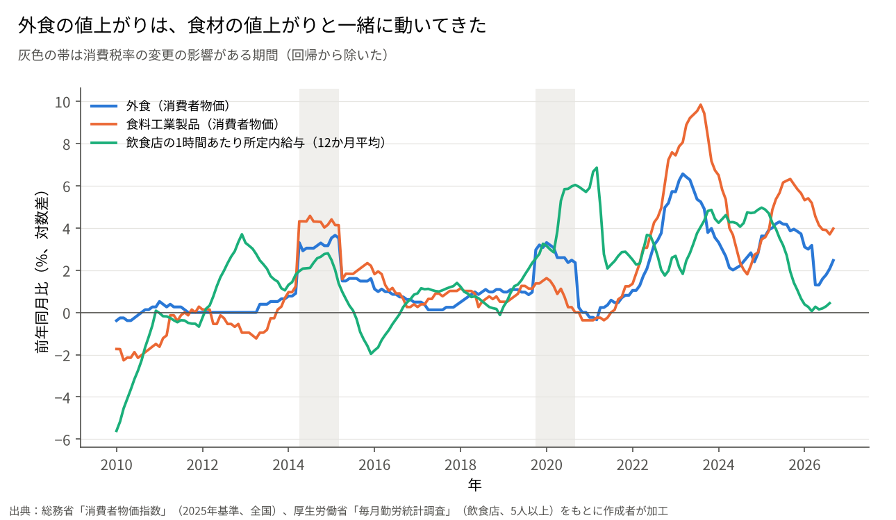
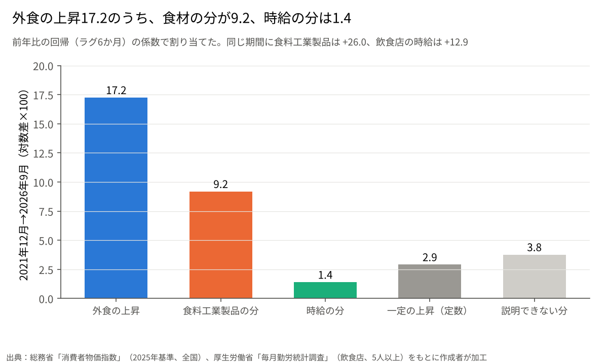
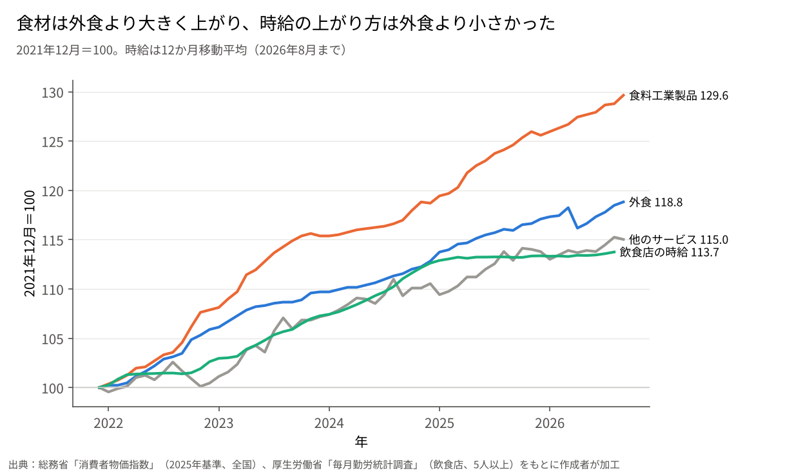
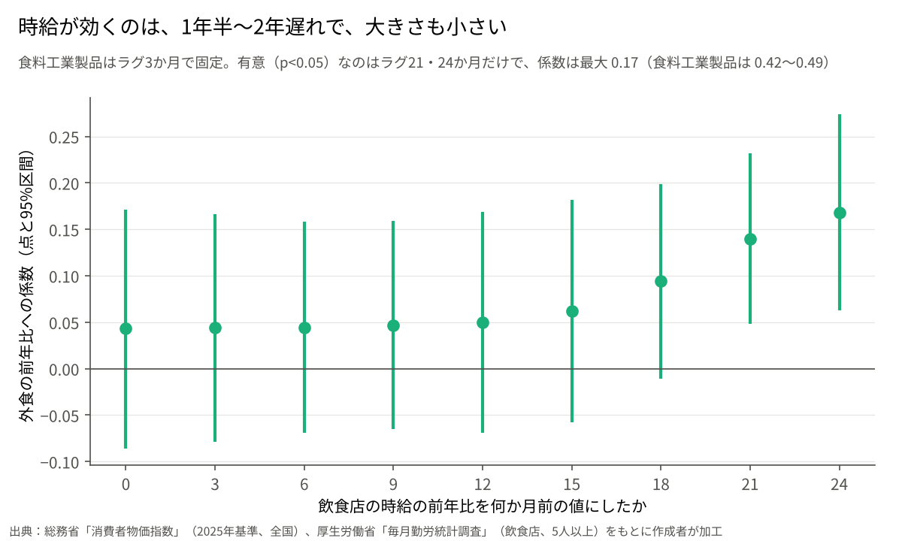

# F309 「外食の値上がりは人件費のせい」は、どこまで言えるか？ 2021年末からの外食の上昇17.2のうち、食材と一緒に動いた分が9.2、時給の分は1.4

消費者物価指数の外食と、食材の目安（食料工業製品）、飲食店の1時間あたりの給与を月ごとに並べ、外食の値上がりがどちらとより一緒に動いてきたかを確かめました。値段の付け方の助言はしません。

## 結論（先に）

- **外食の値上がりは、食材の値上がりと一緒に動いてきました。** 2010〜2026年の前年比どうしの回帰で、食料工業製品（6か月前）の係数は0.40（p<0.001）、飲食店の時給（6か月前）の係数は0.09（p=0.24）でした。
- **2021年12月→2026年9月の外食の上昇（対数差17.2）を割り当てると、食料工業製品の分が9.2、時給の分が1.4でした。** 同じ期間に食料工業製品は +26.0、飲食店の時給（12か月平均）は +12.9 上がっています。
- **時給が効くのは、1年半〜2年遅れで、大きさも小さいものでした**（結果を見てから足した確かめ）。時給のラグを0〜24か月で動かすと、有意（p<0.05）なのは21・24か月だけで、係数は最大0.17でした。
- **ほかのサービスでも、時給とは一緒に動いていませんでした。** 「他のサービス」の前年比に対する全産業のパートの時給の係数は −0.29（p=0.37）でした。
- 「人件費のせい」は、この統計の前年比の動きからは強くは言えません。言えるのは「食材の値段とよく一緒に動き、人件費は遅れて小さく効く形」までです。



## 問い

2022年ごろから外食の値段が上がり続けています。値上げの理由として「人件費の上昇」がよく挙げられますが、同じ時期に食材の値段も大きく上がりました。飲食店の経営や仕入れの担当、物価の統計を読む人にとって、外食の値上がりが人件費と食材のどちらとより一緒に動いてきたのかは、値上げの説明を読むときの手がかりになります。

## データ（出典）

| データ | 中身 | 期間 | ファイル |
|---|---|---|---|
| 総務省「消費者物価指数」2025年基準 全国 長期時系列 | 中分類指数（外食、生鮮食品を除く食料、総合）、財・サービス分類指数（食料工業製品、他のサービス） | 1970年1月〜2026年9月（2005年以降を使用） | data/raw/cpi_*.csv |
| 厚生労働省「毎月勤労統計調査」実数・指数累積データ | 飲食店（M76、5人以上、就業形態計）の所定内給与と所定内労働時間、宿泊業・飲食サービス業と調査産業計のパートの同じ値 | 2005年〜2026年8月 | data/raw/maikin_jissu_cumulative.csv.gz |

- 時給 ＝ 所定内給与 ÷ 所定内労働時間。月のぶれが大きいので、12か月の移動平均にしてから前年比をとりました。
- 消費税率の変更の影響を避けるため、2014年4月〜2015年3月と2019年10月〜2020年9月は回帰から除きました。
- 取得日と URL は `data/raw/SOURCES.md` にあります。

## 事前の計画

集計の前に [PLAN.md](PLAN.md) を書きました（2026-11-16 07:25）。CSV の形を確かめるときに、1970年の先頭の値と列の名前だけを見ました（PLAN に記載）。

| 仮説 | 基準 | 結果 | 判定 |
|---|---|---|---|
| H1 時給（ラグ6）の係数が正で p<0.05 | 正で p<0.05 | +0.09（p=0.24） | **外れ** |
| H2 食料工業製品の係数 ＞ 時給の係数 | 大きい | 0.40 ＞ 0.09 | **支持** |
| H3 2021年12月→2026年9月で、食材の分 ＞ 時給の分 | 大きい | 9.2 ＞ 1.4 | **支持** |
| H4 他のサービスでも時給の係数が正で p<0.05 | 正で p<0.05 | −0.29（p=0.37） | **外れ** |

## やったこと

1. 外食の前年比を、食料工業製品の前年比と飲食店の時給の前年比（どちらも6か月前）で回帰しました（2010年1月〜2026年9月、Newey–West 標準誤差、ラグ12）。
2. 回帰の係数 ×（期間中の説明変数の前年比の和 ÷ 12）を、その変数に割り当てた分としました。
3. 同じ式で「他のサービス」も説明しました。

## 分かったこと

### 外食は食材と一緒に動いた（図1）

- 外食の前年比は、2023年前半に6%台まで上がりました。食料工業製品の前年比は2023年半ばに9%台まで上がっていて、山の時期が近い形です。
- 飲食店の時給の前年比は、2021年前後と2024〜2025年に高く、外食の山とは時期がずれています。

### 上昇の割り当て（図2）



- 外食の上昇17.2のうち、食料工業製品の分9.2、時給の分1.4、回帰の定数（毎年の一定の上昇）の分2.9、説明できない分3.8でした。
- 同じ期間の総合（消費者物価全体）は +13.4、他のサービスは +14.0 でした。



## 問い直し（結果を見てから足した）

**人件費は、食材より遅れて効くのか。**（`src/03b_requestion.py`）



- 食料工業製品のラグを3か月に固定し、時給のラグを0・3・…・24か月で動かしました。
- 時給の係数は0〜15か月では0.04〜0.06で有意でなく、18か月 0.09（p=0.08）、21か月 0.14（p=0.003）、24か月 0.17（p=0.002）でした。
- 食料工業製品の係数はどの場合も0.42〜0.49で、時給より大きいままでした。
- 人件費の上昇は、1年半〜2年遅れて、小さく値段に出る形です。ただし、遅いラグほど他の長い流れ（物価全体の上昇など）と区別しにくくなります。

## 頑健性

| 確かめ | 食料の係数 | p | 時給の係数 | p | 結論は変わったか |
|---|---|---|---|---|---|
| 主（ラグ6） | 0.40 | <0.001 | 0.09 | 0.24 | — |
| R1 ラグ0 | 0.56 | <0.001 | 0.00 | 0.99 | 変わらない |
| R1 ラグ3 | 0.49 | <0.001 | 0.04 | 0.48 | 変わらない |
| R1 ラグ12 | 0.20 | 0.005 | 0.21 | 0.042 | 時給も有意になる |
| R2 食材を生鮮食品を除く食料に | 0.43 | <0.001 | 0.07 | 0.31 | 変わらない |
| R3 時給を宿泊・飲食のパートに（2011年〜） | 0.44 | <0.001 | −0.13 | 0.51 | 変わらない |
| R4 2015年〜 | 0.40 | <0.001 | 0.13 | 0.31 | 変わらない |

食材の係数はどの場合も有意に正で、時給はラグを長くしたときだけ有意になりました。

## 言えないこと

- **回帰の係数は「一緒に動く度合い」です。** 値上げの理由そのものではありません。食材の値段と外食の値段が、同じ別の理由（円安、エネルギー価格など）で動いた可能性もあります。
- **時給は事業所の平均です。** 店の人件費の総額（人数・時間の変化）や、人手不足で採用にかかる費用は入っていません。
- **家賃・光熱費・物流費などのほかのコストは入れていません。** 「説明できない分」や定数の分に混ざっています。
- **消費者物価指数の外食は、店の種類やメニューの入れ替えの扱いに約束ごとがあります。** 店ごとの値上げとは一致しません。
- 前年比の回帰は、遅いラグほど他の長い流れと区別しにくくなります。
- **割り当て（食材9.2・時給1.4）は、ラグ6か月の式での値です。** ラグを12か月にすると時給の係数（0.21）は食料（0.20）と同じ大きさになり、割り当ても変わります。題名の数字は、事前に決めた式での1つの見え方です。

## 仕事で使うなら

- 「外食の値上がりは人件費のせい」という説明を読むときは、同じ期間に食材の値段がどれだけ上がったかを並べると、どちらの説明と合うかを確かめられます。
- 人件費の影響を見るなら、1〜2年の遅れを置いて比べると、この統計では形が見えやすくなりました。

## 計画からの変更

- 問い直し（時給のラグを動かす、図3）を足しました。
- H4 で、全産業のパートの時給に加えて、飲食店の時給でも計算しました（−0.30、p=0.11）。

## 再現のしかた

```sh
pip install -r requirements.txt
python3 src/01_fetch.py      # 元データの取得（ネットが必要。同梱済み）
sh src/run_all.sh            # オフラインで 02 から最後まで（約4秒）
```

| ファイル | 役割 |
|---|---|
| src/02_build.py | CPI と毎勤から月の表を作る |
| src/03_analysis.py | H1〜H4 と頑健性（results/main.json） |
| src/03b_requestion.py | 問い直し（results/requestion.json） |
| src/04_figures.py | 図1〜4 |

- 再現の確かめ：`results/repro_check.txt`（2026-11-16 再実行：10 ファイル一致、所要 4 秒。/tmp に写して出力を消してから流し、cmp で比較）。スレッド1。乱数は使っていません。

- 大きなデータのファイル（`data/raw/maikin_jissu_cumulative.csv.gz`）は、GitHub の1ファイルの上限に合わせて `.part000` などに分けて置いています。`run_all.sh` が最初に `src/00_join_parts.py` でつなぎ直し、sha256 で元と同じことを確かめます。

## レビューで直したこと

| # | 指摘 | 直し方 |
|---|---|---|
| 1 | 題名と結論の割り当て（食材9.2・時給1.4）がラグ6か月の式だけの値で、ラグ12では時給の係数が食料と同じ大きさになることが書かれていなかった | README と note の「言えないこと」に1点足した |

## 出典

- 総務省「消費者物価指数」2025年基準 時系列データ：[e-Stat](https://www.e-stat.go.jp/stat-search/files?tstat=000001243876)
- 厚生労働省「毎月勤労統計調査」全国調査 実数・指数累積データ：[e-Stat](https://www.e-stat.go.jp/stat-search/files?toukei=00450071&tstat=000001011791)

（いずれも 総務省・厚生労働省の公表データ をもとに作成者が加工して作成）
