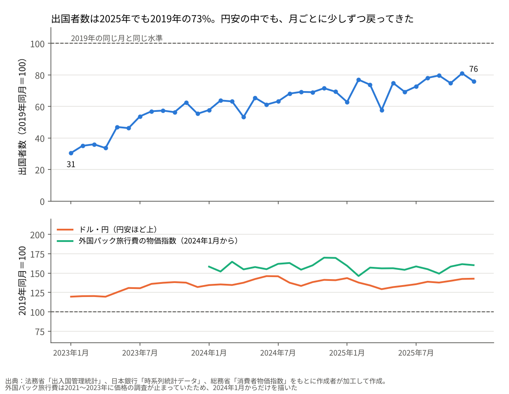
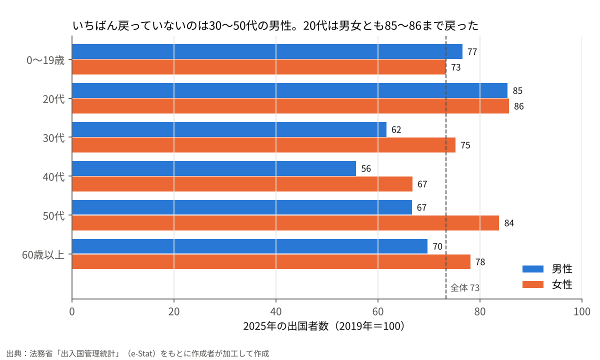
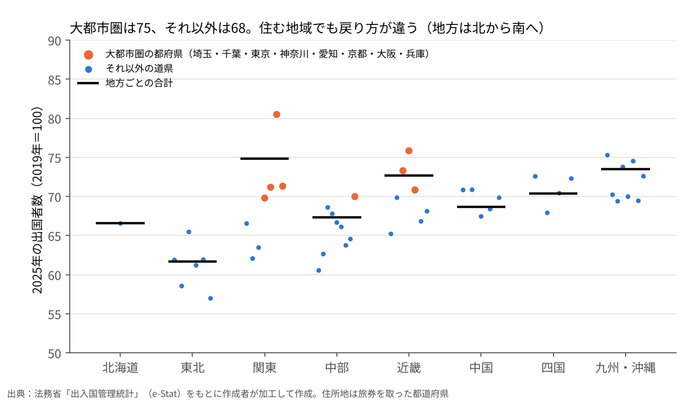
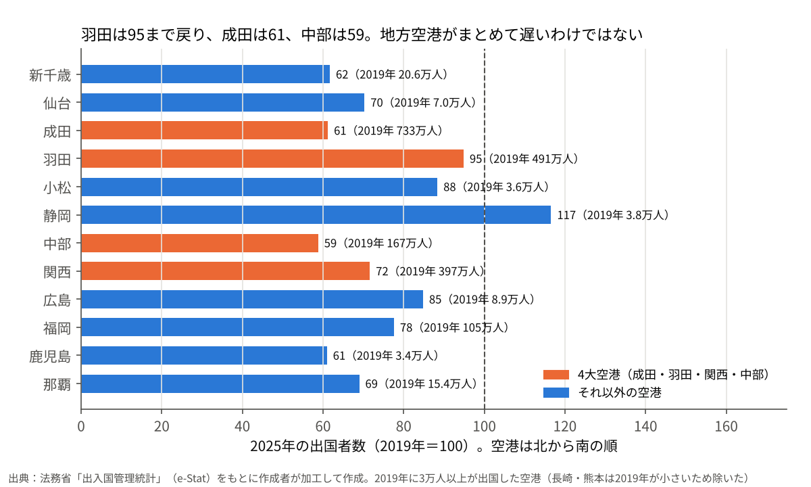

# F314 日本人の海外旅行は、コロナ前に戻ったのか？ 2025年は2019年の73%。30〜50代の男性は61%で、20代は86%。空港では羽田が95%まで戻り、成田は61%

## 結論（先に）

- 日本人の出国者数（のべ人数）は、2025年に1,473万人でした。2019年（2,008万人）の **73%** です。2024年は65%でした。月で見ると、2023年1月の31%から2025年12月の76%まで、1年あたり約14ポイントの速さで戻ってきました。
- 年齢と男女で戻り方が大きく違います。20代は男女とも85〜86%まで戻りました。いちばん戻っていないのは **30〜50代の男性で61%**（40代の男性は56%）。同じ年齢の女性は75%です。2019年から2025年に減った出国者の44%は、この30〜50代の男性の分でした。
- 60歳以上がいちばん戻っていない、という予想（H1）は外れました。60歳以上は75%で、20〜59歳の72%より少し高い値です。
- 住んでいる地域（旅券を取った都道府県）で見ると、大都市圏（埼玉・千葉・東京・神奈川・愛知・京都・大阪・兵庫）は75%、それ以外は68%です。コロナ前の2018→2019年には、この差は0.2ポイントしかありませんでした。
- 空港で見ると、羽田は95%まで戻り、成田は61%、中部は59%、関西は72%でした。「地方空港ほど戻りが鈍い」という予想（H4）は外れました。4大空港の外の空港の合計（79%）のほうが、4大空港（73%）より高い値でした。

## 問い

訪日外国人は過去最多を更新しています。一方で、日本人の海外旅行（アウトバウンド）は戻りが鈍いと言われます。たとえば三菱UFJリサーチ＆コンサルティングのレポートは、円安と物価高で海外旅行が割高になったことを、戻りの遅さの理由に挙げています（出典を参照）。

では、「誰の」海外旅行が戻っていないのでしょうか。旅行会社や航空会社で商品や路線を考える人、地方空港や観光の担当者、旅券の窓口の担当者は、全体の数字より、年齢・男女・地域・空港ごとの戻り方を知りたいはずです。この記事は、法務省の出入国管理統計でそれを確かめます。国内旅行を扱った F336 とは、使う統計も問いも違います。家計調査で外国パック旅行費の支出（物価を除いた量）を見た F325 とは、数えるものが違います（F325 はパックを使う旅行への支出だけで、この記事は人数）。訪日外国人を扱った既存の記事（025・F270・F68）は入国する外国人の統計で、日本人の出国は扱っていません。

## データ（出典）

- 法務省「出入国管理統計」年報（e-Stat）2012〜2025年
  - 月別 主要港の出国日本人（空港・海港ごと、月ごと）
  - 住所地別 年齢（5歳階級）・男女別 出国日本人。住所地は「旅券を取った都道府県」です（表の注による）。海外で旅券を取った人（「外国」）と公用旅券などの「不詳」は、地域の比較から除きました
- 総務省「人口推計」第10表（2019年・2024年10月1日）の都道府県・年齢・男女別の日本人人口（人口あたりの出国率に使う）
- 日本銀行「時系列統計データ」：ドル・円（東京市場 17時時点の月中平均）
- 総務省「消費者物価指数」（2025年基準）品目別：外国パック旅行費、総合（年の値は暦年の年平均。図1の月の値は月次の表）

出国者数は「のべ人数」です。1人が1年に3回出国すれば3と数えます。

## 事前の計画

計画は [PLAN.md](PLAN.md) に、結果を集計する前に書きました（2026-11-16）。表の形を確かめたときに、出国者の総数（2019年・2025年）と、いくつかの空港・都道府県の数字を見たことも、PLAN.md に書いています。

| 仮説 | 外れの基準 | 結果 | 判定 |
|---|---|---|---|
| H1 60歳以上の戻り率がいちばん低い | 20〜59歳との差が5ポイント未満なら外れ | 60歳以上 74.9%、20〜59歳 72.5%（差 −2.4） | 外れ |
| H2 20代女性の戻り率は全体より5ポイント以上高い | 届かなければ外れ | 20代女性 86.2%、全体 73.4%（差 +12.8） | 支持（ただし20代男性も86.0%で、女性に限った話ではない） |
| H3 地方に住む人の戻り率は大都市圏より5ポイント以上低い | 届かなければ外れ | 大都市圏 74.7%、それ以外 67.7%（差 7.0） | 支持 |
| H4 地方空港の合計は4大空港より10ポイント以上低い | 届かなければ外れ | 4大空港 72.5%、それ以外の空港 78.8%（差 −6.3） | 外れ（逆向き） |
| H5 2023〜2025年の月の戻り率は上がり続けた | 直線の傾きの95%区間が0をまたげば外れ | 1年あたり +13.6ポイント（95%区間 10.0〜17.3） | 支持 |

## やったこと

1. 出入国管理統計の Excel から、年×都道府県×年齢×男女の出国者数と、年×月×港の出国者数の表を作りました。年齢の合計が総数と一致すること、都道府県の合計が全国と一致すること、港の合計が空港・海港の小計と一致することを、プログラムの中で確かめています。
2. 「戻り率」＝2025年の出国者数÷2019年の出国者数、を年齢・男女・地域・空港ごとに出しました。出国者数はほぼ全数なので、標本の誤差の区間はつけていません。代わりに、コロナ前の1年（2018→2019年）の動きを「ふだんの揺れ」として並べました。
3. 人口推計で割って、人口千人あたりの出国者数（出国率）も出しました。人口の推計が2024年までなので、出国率の比較は2024年÷2019年です。
4. 月ごとの戻り率（2019年の同じ月との比）に直線を当て、傾きの95%区間を出しました（月の並びの自己相関を考えた HAC の標準誤差）。ドル・円と外国パック旅行費の物価指数を同じ図に並べました。

## 分かったこと

### 図1 円安の中でも、月ごとに少しずつ戻ってきた



- 2019年の同じ月と比べた出国者数は、2023年1月の31%から、2025年12月の76%まで上がりました。2025年でいちばん高い月は11月の81%です。
- 同じ期間、ドル・円は130〜158円の間にあり、2019年（平均109円）より大幅な円安が続きました。2025年の平均は150円です。
- 外国パック旅行費の物価指数（暦年の年平均）は、2025年が2019年の1.56倍でした。物価全体（総合）は1.12倍です。
- 戻り率とドル・円の相関は +0.73 でした。円安が進んだ時期にも戻り率は上がっていたことになります。ただし、どちらも時間とともに動いた1本ずつの系列なので、この相関から円安の影響の大きさは言えません。

### 図2 戻っていないのは30〜50代の男性



- 2025年の戻り率は、男性 68.0%、女性 79.4% でした（全国の総数による）。
- 図2と、この節の年齢×男女の数字は、住所地が国内の人（47都道府県の合計）に限った値です。海外で旅券を取った人を含む全国の総数とは、0〜3ポイントほど違います。
- 30〜50代の男性は61.1%（30代 61.6%、40代 55.7%、50代 66.6%）。同じ年齢の女性は75.1%です。
- 2019年から2025年に減った出国者は535万人。そのうち44%が30〜50代の男性の分でした。この人たちは2019年の出国者の31%なので、減った分に占める割合のほうがずっと大きいことになります。
- 60歳以上は74.9%で、全体（73.4%）と同じくらいでした。

### 図3 大都市圏の外に住む人の戻りが鈍い



- 大都市圏の都府県に住む人は74.7%、それ以外は67.7% でした。差は7.0ポイントです。コロナ前の2018→2019年の伸びは、大都市圏とそれ以外でほぼ同じ（差 0.2ポイント）でした。
- 地方ごとの合計（北から南へ）は、北海道 66.6%、東北 61.7%、関東 74.9%、中部 67.3%、近畿 72.7%、中国 68.6%、四国 70.4%、九州・沖縄 73.5% でした。
- 47都道府県の戻り率は57.0〜80.5%（中央値 68.6%）。2019年に人口あたりの出国が多かった県ほど、戻り率も高い傾向がありました（相関 +0.54）。

### 図4 羽田だけが大きく戻り、成田と中部は6割前後



- 羽田は94.9%、成田は61.2%、関西は71.6%、中部は58.8%、福岡は77.6% でした。
- 空港から出国した人に占める羽田の割合は、2019年の24.7%から2025年の32.0%に上がりました。成田と羽田を合わせると74.7%で、全体とほぼ同じです。首都圏の出国が、成田から羽田に移った形です。国土交通省は2020年3月29日から羽田の国際線の発着の枠を広げると発表していました（出典を参照）。その影響がある可能性があります（推測。便の数は確かめていません）。
- 4大空港の外の空港をまとめると78.8%で、4大空港（72.5%）より高い値でした。小松・広島・静岡などは8割以上、新千歳・鹿児島は6割前後と、空港によってばらばらです。

## 問い直し（結果を見てから足した）

結果を見て、「30〜50代の男性の戻りが鈍いのは、人口の変化のせいではないか」「女性の伸びがもともと速かっただけではないか」を確かめました（`src/03b_requestion.py`）。

- **人口あたりで見ても残る**：2024年の出国率（人口千人あたり）を2019年と比べると、30〜50代の男性は57.3%、女性は68.1%でした。人数で見たときと同じく、男性のほうが低い値です。
- **女性の伸びは、コロナ前から速かった**：2015→2019年の4年で、30〜50代の女性の出国者は29.5%増え、男性は8.8%増でした。男女の差の一部は、コロナ前からの流れの続きである可能性があります。
- **人口の変化で説明できる分は小さい**：2019年の年齢・男女・都道府県ごとの出国率のまま、2024年の人口に当てはめると、出国者は2.4%減るだけでした。2019→2024年に実際に減った分のうち、人口の変化（高齢化と人口減少）で説明できるのは6.5%です。

30〜50代の男性の戻りが鈍いのは、出張が減ったからかもしれません。しかし、この統計には旅行の目的がないので、確かめられません（推測）。

## 頑健性

差は「ポイント」（戻り率の差×100）です。

| 確かめ | 基本の値 | 変えたとき | 結論は変わったか |
|---|---|---|---|
| H1 年齢：20〜59歳−60歳以上 | −2.4 | 基準を2017〜19年平均：−1.0／2024年÷2019年：−0.2／出国率（2024年）：+2.3 | 変わらない（どれも5未満で外れ） |
| H3 地域：大都市圏−それ以外 | +7.0 | 基準を2017〜19年平均：+7.2／2024年÷2019年：+5.7／首都圏1都3県だけを大都市圏に：+5.8 | 変わらない（どれも5以上） |
| H4 空港：4大空港−それ以外 | −6.3 | 基準を2017〜19年平均：−10.6／2024年÷2019年：−0.8／福岡を大きな空港に：−7.4 | 外れは変わらない。ただし2024年では差がほぼ0で、「地方空港のほうが戻った」とまでは言い切れない |
| 全体の戻り率 | 73.4% | 基準を2017〜19年平均：77.6%／2024年：64.8% | 「2019年の7〜8割」は変わらない |

## 言えないこと

- **行き先の国**：出入国管理統計には行き先がありません。どの国への旅行が戻ったかは分かりません。
- **旅行の目的**：観光・出張・留学などの内訳はありません。30〜50代の男性の戻りの鈍さを出張と結びつけるのは推測です。
- **円安が原因かどうか**：為替と戻り率は1本ずつの時系列で、景気・運賃・便の数・休みの取り方などと分けられません。
- **人の数と回数**：のべ人数なので、海外に行く人が減ったのか、1人が行く回数が減ったのかは分けられません。
- **住所地のずれ**：住所地は旅券を取った都道府県です。取ったあとに引っ越した人は、元の県で数えられています。
- **2025年の出国率**：2025年10月の人口推計がまだないので、人口あたりの比較は2024年までです。

## 仕事で使うなら

- 海外旅行の需要を年齢や男女で見るときは、全体の「7割台」だけでなく、20代の8割台と30〜50代男性の6割前後を分けて見ると、数字の見え方が変わります。
- 空港ごとの数字は、羽田と成田の間の移り変わりを含んでいます。首都圏の需要は2空港を合わせて見るのが安全です。
- これは数字の読み方の説明で、商品や路線の判断の助言ではありません。

## 計画からの変更

- 出国率の比較は、人口推計が2024年までなので、2025年ではなく2024年で行いました（計画どおり）。
- 消費者物価指数の外国パック旅行費は、2021〜2023年は価格の調査が止まり、2020年の同じ月の値で代わりに埋められていました（第一生命経済研究所のレポートによる）。そのため図1では2024年1月からだけを描き、比較は2019年と2025年の暦年の年平均だけで行いました。計画には書いていなかった変更です。
- 航空運賃の物価指数は取得しましたが、国際線の運賃を表すかどうかを確かめられなかったので、本文では使っていません。

## 再現のしかた

```
pip install -r requirements.txt
sh src/run_all.sh        # オフライン。02 → 03 → 03b → 04
python3 src/01_fetch.py  # （元データを取り直すときだけ。ネットが必要）
```

| ファイル | 中身 |
|---|---|
| `src/01_fetch.py` | 元データの取得（run_all.sh からは呼ばない） |
| `src/02_build.py` | Excel・CSV から縦長の表を作る（合計の一致を確かめる） |
| `src/03_analysis.py` | 戻り率・仮説の判定・頑健性 → `results/main.json` と CSV |
| `src/03b_requestion.py` | 問い直し（男女×年齢、出国率、人口の影響）→ `results/requestion.json` |
| `src/04_figures.py` | 図4枚 |
| `data/raw/` | 元データ（SOURCES.md に URL と取得日） |

所要時間は約5秒（CPU 1つ）。/tmp に写して results・figures・data の中間ファイルを消してから流し直し、results と figures の15ファイルがバイト単位で一致しました（`results/repro_check.txt`）。2026-11-18 の訂正のあとも、同じ手順で流し直して一致しました。

## レビューで直したこと

別の目で見る気持ちで、数字の照合・計算の中身・元データ・図・書かないこと・重なり・再実行・文章を自分で確かめ、次を直しました。

| # | 指摘 | 直し方 |
|---|---|---|
| 1 | note の地方別の数字で、九州・沖縄（73.5%）を74%と丸めていた | 73%に直した |
| 2 | README の H2 の行で、20代男性の値に47都道府県の合計の値（85.4%）を使い、全国の総数の値（86.0%）とずれていた | 全国の総数の値にそろえ、図2と男女×年齢の節は47都道府県の合計の値であることを本文に書いた |
| 3 | 以前の題材の note 原稿（md）が md/ に残っていた | rejected/ に移した |
| 4 | （独立レビュー）羽田の割合（24.7%→32.0%）は空港から出国した人の中の割合なのに、「出国者に占める」と書いていた（海港を含む全体では24.4%） | README と note を「空港から出国した人に占める」に直した |
| 5 | （独立レビュー）同じ日に作った F325 の外国パック旅行費（物価を除いて39%）と、この記事の出国者数（73%）が読者に混同されうる | 「問い」に F325 との違いを1文足した |
| 6 | （公開後の点検、2026-11-18）消費者物価指数の年の表（statInfId=000040482959、品目別価格指数）は**年度平均**（4月〜翌3月）の表で（2025年の総合が100.4）、2019年と2025年の年平均として使っていた | 暦年の年平均の表（statInfId=000040482831、2025年の総合が100.0。行・列の並びは同じ）に取り直し、`01_fetch.py`・`SOURCES.md` を直して流し直した。外国パック旅行費の物価 1.58倍 → 1.56倍（2019年 63.3 → 64.1、2025年 100.2 → 100.0）。総合の 1.12倍、出国者数の数字・図・結論は変わらない |

## 出典

- 法務省「出入国管理統計」（e-Stat）：https://www.e-stat.go.jp/stat-search/files?toukei=00250011&tstat=000001012480
- 総務省「人口推計」（e-Stat）：https://www.e-stat.go.jp/stat-search/files?toukei=00200524&tstat=000000090001
- 日本銀行「時系列統計データ検索サイト」：https://www.stat-search.boj.or.jp/
- 総務省「消費者物価指数」（e-Stat。年の値は品目別価格指数の暦年の年平均 statInfId=000040482831）：https://www.e-stat.go.jp/stat-search/files?tstat=000001243876
- 三菱UFJリサーチ＆コンサルティング「経済レポート」（2025年12月、海外旅行の割高感についての記述）：https://www.murc.jp/wp-content/uploads/2025/12/watch_2512_01.pdf
- 国土交通省「羽田空港の国際線発着枠の配分について」（2019年）：https://www.mlit.go.jp/report/press/kouku04_hh_000196.html
- 第一生命経済研究所「外国パック旅行費の取り扱い」についてのレポート：https://www.dlri.co.jp/report/macro/321993.html

（いずれも 法務省・総務省・日本銀行の公表データ をもとに作成者が加工して作成）
