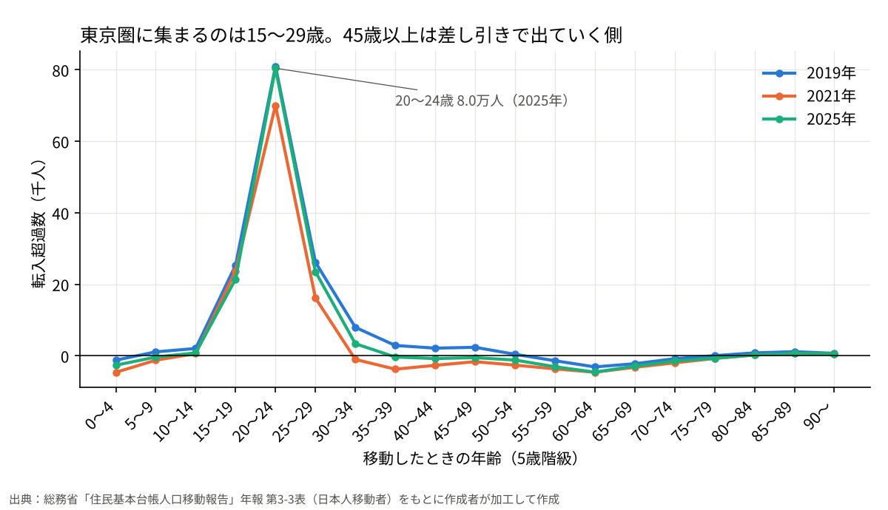
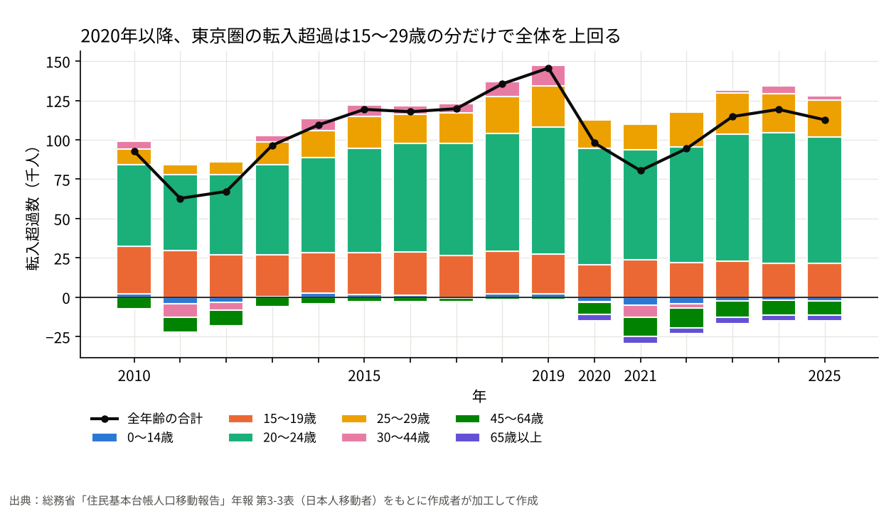
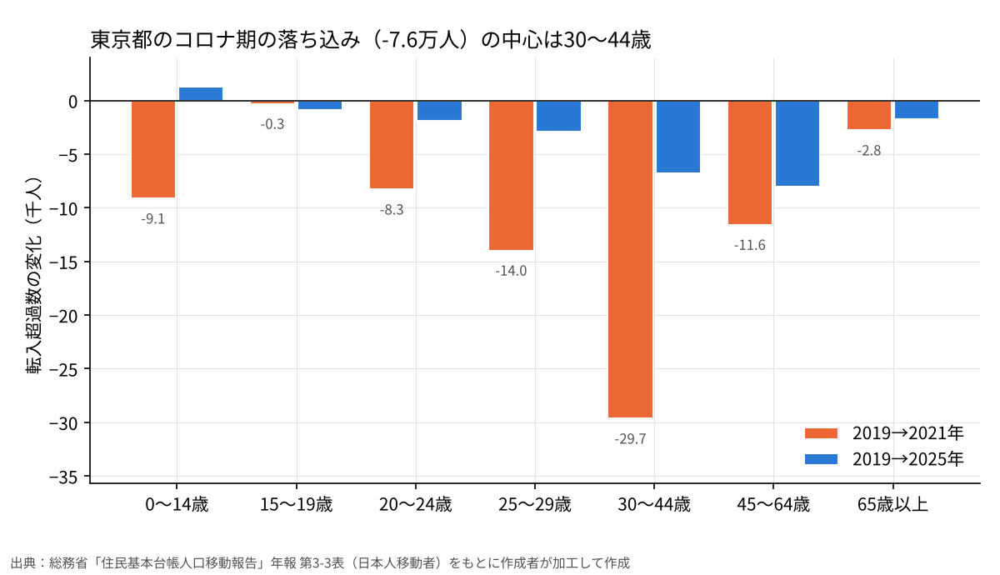
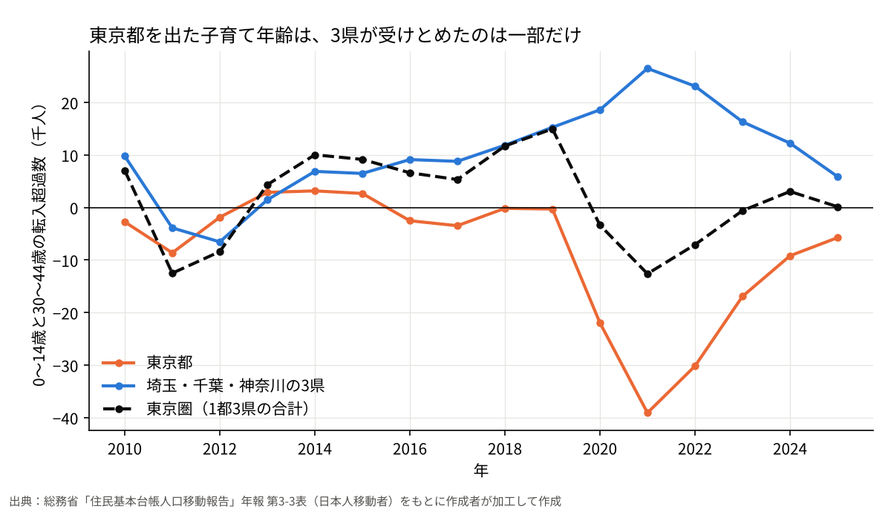

# F319 「東京一極集中」は、年齢のどこで起きているのか？ 東京圏の転入超過は15〜29歳だけで全体の111%、コロナ期の東京都の落ち込みは30〜44歳が39%

## 結論（先に）

- 2025年の東京圏（1都3県）の日本人の転入超過は112,738人。15〜29歳だけで125,458人（111.3%）で、ほかの年齢は合わせて −12,720人でした。
- これは2020年以降の形です。2010〜2019年は10年中7年で15〜29歳の比率が100%未満（2019年は91.1%）で、30〜44歳なども東京圏に入っていました。仮説 H1 は外れました。
- 東京都の転入超過は2019→2021年に75,760人減りました。15〜24歳の寄与は11.4%で、最大は30〜44歳（39.1%）でした。
- 2025年の東京都の20〜24歳は2019年の96.8%まで戻りました。0〜14歳と30〜44歳の合計は −5,739人で、2019年（−291人）に届いていません。
- 東京都で減った子育て年齢の転入超過のうち、3県の増加で埋まったのは28.9%でした（問い直し）。

## 問い

地方創生の資料は「東京圏への転出は15〜29歳が約5割」と説明します（[まち・ひと・しごと創生本部 参考資料 2019年](https://www.chisou.go.jp/sousei/meeting/senryaku2nd_sakutei/r01-05-17-sankou1.pdf)）。これは片道の数です。一極集中の大きさを決めるのは、転入から転出を引いた転入超過です。差し引きで見たとき、若い年齢はどれだけを占め、ほかの年齢は出ていく側なのか。コロナ期の落ち込みと戻りはどの年齢か。男女で違うのか。自治体の人口計画の担当や、不動産・採用などで「東京に来る人」の年齢層をつかみたい人に向けて確かめます。

関連する記事：029（コロナで東京への人の流れはどれだけ減ったか、合成コントロール法）。029 は全体の流れの減り方を推定し、この記事は年齢別の差し引き（転入超過）の内訳を見ます。

## データ（出典）

- 総務省「住民基本台帳人口移動報告」年報 第3-3表（年齢5歳階級・男女別の転入超過数）2010〜2025年。Excel 16ファイル（1.6MB）を `data/raw/` に同梱（取得日・URL は `data/raw/SOURCES.md`）。
- 東京都と東京圏（4都県の合計）、日本人移動者。外国人を含む値は頑健性に使いました。届出の全数なので標本誤差はありません。
- 2025年の東京圏 112,738人は[総務省の公表値](https://www.stat.go.jp/data/idou/2025np/jissu/pdf/2025youyaku.pdf)と一致しました。

## 事前の計画

[PLAN.md](PLAN.md)（2026-11-16 06:23、集計の前に作成）。

| 仮説 | 内容（外れの基準） | 結果 | 判定 |
|---|---|---|---|
| H1 | 東京圏で2010〜19年の毎年、15〜29歳が全体の100%以上 | 91.1〜133.8%、7年が100%未満 | 外れ |
| H2 | 東京都の2019→21年の減少で、15〜24歳の寄与が50%未満 | 11.4% | 支持 |
| H3 | 東京圏の15〜29歳で女性が50%超の年が過半数 | 16年中11年（49.1〜52.6%） | 支持（差は小さい） |
| H4 | 2025年の東京都で20〜24歳が2019年の90%以上、0〜14歳＋30〜44歳は2019年未満 | 96.8%、−5,739人 | 支持 |

## やったこと

Excel を縦長の表にし（`02_build.py`）、年齢を7つの帯にまとめて、15〜29歳の比率（15〜29歳 ÷ 全年齢。ほかが転出超過なら100%超）と、2019年を基準にした変化の年齢別の寄与を数えました（`03_analysis.py`）。

## 分かったこと

### 図1：集まるのは15〜29歳、45歳以上は出ていく側



- 山は20〜24歳で、2025年は80,443人でした。
- 16年間、15〜29歳の3区分は毎年転入超過、45〜64歳は毎年転出超過でした。30〜44歳は11年、0〜14歳は7年、65歳以上は3年だけ転入超過でした。

### 図2：2019年までは30〜44歳も足していた



- 2019年は全体145,576人のうち15〜29歳が132,548人で、残り13,028人をほかの年齢が足していました。
- 2020年以降は比率が毎年100%超（最小108.4%、2021年136.7%）。東京都だけなら2010〜19年も最小104.7%です。単位で結論が変わります。

### 図3：東京都の落ち込みの中心は30〜44歳



- 2019年86,575人 → 2021年10,815人。寄与は30〜44歳39.1%、25〜29歳18.5%、45〜64歳15.3%、0〜14歳12.1%、15〜24歳11.4%、65歳以上3.7%。
- 2025年は65,597人（2019年の75.8%）。45〜64歳は −3,518人 → −11,540人で、転出超過が大きいままです。

## 問い直し（結果を見てから足した）

東京都から出た子育て年齢（0〜14歳と30〜44歳）は、隣の3県に移っただけなのか。3県は「東京圏 − 東京都」で出しました。



- 東京都は2019年 −291人 → 2021年 −39,087人（38,796人減）。3県は15,260人 → 26,473人（11,213人増）で、埋まったのは28.9%でした。
- 東京圏全体では +14,969人 → −12,614人で、東京圏の外へ出る側に回りました。2025年は +147人です。

## 頑健性

| 仮説 | 変えたこと | 値 | 判定 |
|---|---|---|---|
| H1 | 東京都で数える | 最小104.7% | 支持 |
| H1 | 外国人を含む（2014〜19年） | 最小89.1% | 外れ |
| H1 | 若い年齢を15〜24歳／20〜29歳に | 最小73.1%／66.5% | 外れ |
| H1 | 2011年を除く | 最小91.1% | 外れ |
| H2 | 東京圏で／基準を2017〜19年平均に／外国人を含む | 19.3%／8.4%／10.1% | 支持 |
| H3 | 15〜24歳／20〜29歳に | 11年／15年（16年中） | 支持 |
| H3 | 2011年を除く | 15年中11年 | 支持 |
| H4 | 東京圏で／基準を2017〜19年平均に／外国人を含む | 99.3%／102.9%／100.1% | 支持 |

H3 は年齢で形が違います。2025年の東京圏で20〜24歳は女性が3,465人多く、25〜29歳は男性が2,622人多い。全年齢の女性の多さ（年齢別合計11,185人）のうち10,096人は30歳以上でした。

## 言えないこと

- 移動の理由は分かりません。30〜44歳の減少が在宅勤務によるかは推測です。
- 転入超過は差し引きで、転入と転出のどちらが動いたかは分かりません。
- 年齢は移動したときの年齢で、同じ人を追っていません。世代と年齢の違いは分けられません。
- 住民票を移さない学生などは数に入らず、若い年齢は少なめに出ている可能性があります（推測）。
- 3県の値には東京都との間の移動が入り、東京都から3県へ移った人数そのものではありません。

## 仕事で使うなら

- 「若い人が集まる」と書くときは、片道（転入）か差し引き（転入超過）か、東京都か東京圏かを一緒に示すと読み違いが減ります。
- 表は毎年更新されます。同じスクリプトに年を足せば、どの年齢が戻ったかを確かめられます。

## 計画からの変更

- H1 の外れを受け、東京都の単位の比率を結論にも示しました。
- 年齢帯ごとの転入超過の年数、東京都の45〜64歳、男女差の年齢別合計を `main.json` に足しました。
- 問い直しとして東京圏の中の子育て年齢を足しました。

## 再現のしかた

```sh
pip install -r requirements.txt
sh src/run_all.sh        # オフラインで 02→03→04（約3秒）
python3 src/01_fetch.py  # （任意）元データを取り直す
```

| ファイル | 中身 |
|---|---|
| `src/02_build.py` | Excel → `data/netmig_tokyo_age.csv` |
| `src/03_analysis.py` | 仮説・頑健性・問い直し → `results/` |
| `src/04_figures.py` | 図4枚 → `figures/` |
| `results/main.json` | 本文の数字の元 |

`results/repro_check.txt`：別の場所で生成物を消して流し直し、13ファイルがバイト単位で一致しました。

## レビューで直したこと

| # | 指摘 | 直し方 |
|---|---|---|
| 1 | 既存記事 029 との関係が書かれていない | 「関連する記事」として違いを1文で追記 |

## 出典

- 総務省統計局「住民基本台帳人口移動報告」年報 第3-3表 2010〜2025年：https://www.e-stat.go.jp/stat-search/files?toukei=00200523
- 総務省統計局「2025年結果の要約」：https://www.stat.go.jp/data/idou/2025np/jissu/pdf/2025youyaku.pdf
- まち・ひと・しごと創生本部「第2期総合戦略の策定に向けた参考資料」2019年：https://www.chisou.go.jp/sousei/meeting/senryaku2nd_sakutei/r01-05-17-sankou1.pdf

（いずれも総務省「住民基本台帳人口移動報告」をもとに作成者が加工して作成）
