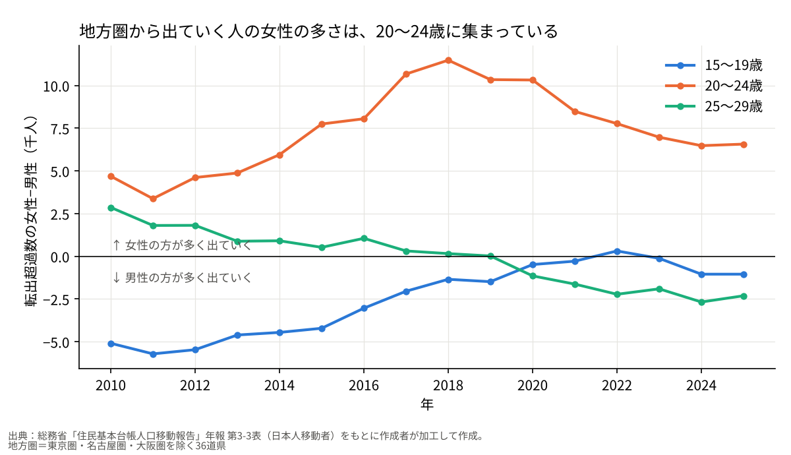
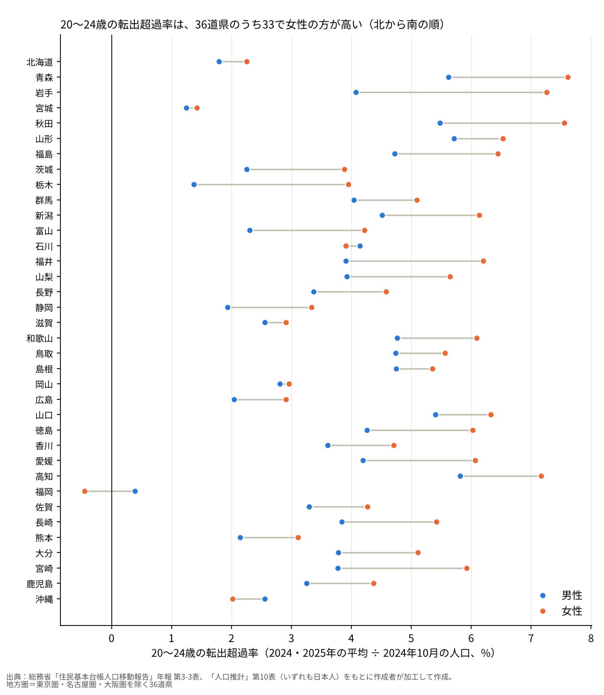
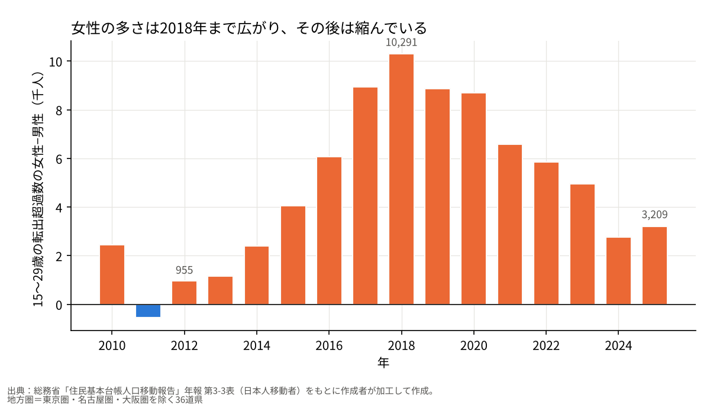
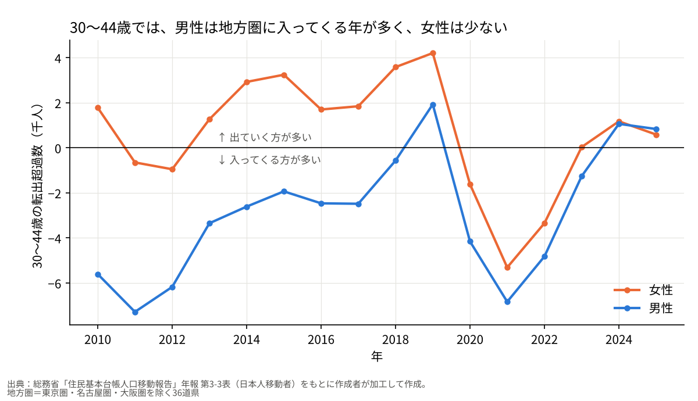

# F320 地方から出ていくのは、若い女性の方が多いのか？ 16年中15年で女性が多く、差は20〜24歳に集中、20〜24歳の率は36道県のうち33で女性が高い

## 結論（先に）

- 地方圏（三大都市圏を除く36道県）から出ていく15〜29歳の日本人（転出超過）は、2010〜2025年の16年中15年で女性の方が多くなりました。2025年は女性64,601人、男性61,392人です。
- 女性の多さは20〜24歳に集中しています。20〜24歳は16年すべてで女性が多く（平均7,398人差）、15〜19歳は16年中15年で男性の方が多く出ていきました（平均2,509人差）。
- 人口あたりの率でも、2024・2025年の20〜24歳で36道県のうち33で女性の方が高く、地方圏全体では女性3.70%、男性2.85%でした。
- 15〜29歳の女性−男性の差は2010〜2012年の平均959人から2023〜2025年の平均3,636人へ広がりました。ただし山は2018年（10,291人）で、その後は縮んでいます。
- 結果を見てから足した問いでは、30〜44歳で地方圏に入ってくる側（転入超過）だった年は、男性が16年中13年、女性は5年でした。

## 問い

「地方から若い女性が出ていく」「特に女性は進学で都市に出たあと、就職で地元に戻る人が少ない」と言われます（[内閣官房 地域働き方・職場改革の基本的な考え方の資料](https://www.cas.go.jp/jp/seisaku/chiikihatarakikata/doc/basicconcept.pdf)）。住民基本台帳の移動の数で見て、地方から出ていく若い人は本当に女性の方が多いのか。多いなら、進学の年齢（15〜19歳）か、就職の年齢（20〜24歳）か。人数ではなく人口あたりの率で見ても同じか。差は広がっているのか。地方の自治体で人口や雇用の計画を担当する人、地方で採用をする企業の人事に向けて確かめます。

## データ（出典）

- 総務省「住民基本台帳人口移動報告」年報 第3-3表（年齢5歳階級・男女別の転入超過数、都道府県）2010〜2025年。日本人移動者。
- 総務省「人口推計」第10表（都道府県・年齢5歳階級・男女別の日本人人口、千人単位）2019年・2024年の10月1日。率の分母に使いました。
- 元の Excel 18ファイル（1.8MB）を `data/raw/` に同梱（取得日・URL は `data/raw/SOURCES.md`）。
- 地方圏は移動報告の定義に合わせ、東京圏（埼玉・千葉・東京・神奈川）、名古屋圏（岐阜・愛知・三重）、大阪圏（京都・大阪・兵庫・奈良）を除く36道県です。転出超過は転入超過の符号を反対にしたもので、正なら出ていく人が多いことを表します。
- 47都道府県の転入超過の合計が、どの年・性・年齢でも0になることを確かめました。

## 事前の計画

[PLAN.md](PLAN.md)（2026-11-16 06:30、この記事の集計の前に作成）。

| 仮説 | 内容（外れの基準） | 結果 | 判定 |
|---|---|---|---|
| H1 | 15〜29歳で女性＞男性の年が16年中9年以上 | 15年 | 支持 |
| H2 | 20〜24歳は16年すべて女性＞男性、15〜19歳は過半数の年で女性≦男性 | 16年／15年 | 支持 |
| H3 | 20〜24歳の率（2024・25年）で女性＞男性の県が36のうち19以上 | 33 | 支持 |
| H4 | 女性−男性の差が2010〜12年平均より2023〜25年平均で大きい | 959人 → 3,636人 | 支持（山は2018年） |

## やったこと

36道県の転出超過を年×男女×年齢で足し、女性−男性の差と女性の割合を数えました。県ごとの率は、2024・2025年の平均の転出超過を2024年10月の同じ性・年齢の人口で割りました（`src/03_analysis.py`）。県は北から南の順に並べ、順位は作っていません。

## 分かったこと

### 図1：女性の多さは20〜24歳、15〜19歳は男性の方が多い



- 2025年の女性−男性は、15〜19歳 −1,047人、20〜24歳 +6,567人、25〜29歳 −2,311人でした。
- 15〜29歳全体の女性の割合は49.7〜54.2%の間で、2025年は51.3%です。差が大きいのは20〜24歳だけです。
- 25〜29歳は2019年までは女性が多い年が続き、2020年以降は男性の方が多く出ていきました（16年中10年で女性が多い）。

### 図2：率でも36道県のうち33で女性が高い



- 20〜24歳の転出超過率は、県の中央値で女性5.11%、男性3.81%でした。
- 女性の率が男性以下だったのは石川・福岡・沖縄の3県です。
- コロナ前（2018・2019年の平均と2019年の人口）で計算しても33県で女性が高く、地方圏全体では女性3.64%、男性2.49%でした。

### 図3：差は2018年まで広がり、その後は縮んでいる



- 15〜29歳の女性−男性は、2012年955人、2018年10,291人、2025年3,209人でした。
- 事前の基準（2010〜12年平均と2023〜25年平均の比較）では「広がった」になりますが、直近7年は縮む向きです。どの年を比べるかで言い方が変わります。

## 問い直し（結果を見てから足した）

「女性は戻る人が少ない」は、30代以降の動きで見えるのか。30〜44歳の転出超過を男女で比べました。



- 30〜44歳で地方圏に入ってくる側（転出超過が負）だった年は、男性が16年中13年、女性は5年でした。16年の平均は男性 −2,855人（入ってくる）、女性 +657人（出ていく）です。
- 2024・2025年は男女とも小さな転出超過で、差はほぼなくなっています。
- 15〜44歳を16年分足すと、地方圏から出ていった差し引きは女性943,102人、男性810,234人でした。

## 頑健性

| 仮説 | 変えたこと | 値 | 判定 |
|---|---|---|---|
| H1 | 15〜34歳に広げる／全年齢 | 16年／16年 | 支持 |
| H1 | 外国人を含む（2014〜25年） | 12年中12年 | 支持 |
| H1 | 東京圏以外の43道府県 | 16年中11年 | 支持 |
| H2 | 外国人を含む（20〜24歳 女＞男／15〜19歳 女≦男） | 12／11（12年中） | 支持 |
| H2 | 東京圏以外の43道府県 | 16／14 | 支持 |
| H3 | コロナ前（2018・19年、2019年人口） | 33県 | 支持 |
| H3 | 地方圏全体の率 | 女性3.70%、男性2.85% | 支持 |
| H3 | （参考）15〜19歳で同じ計算 | 20県 | ― |
| H4 | 外国人を含む（2014〜16年→2023〜25年） | 4,274人 → 8,103人 | 支持 |
| H4 | 東京圏以外の43道府県 | −225人 → −121人 | 判定できず（どちらの期間も男性が多い） |

- H1〜H3 の結論はどの確かめでも変わりませんでした。H4 は43道府県の定義では女性の方が多い期間がなく、判定できませんでした。43道府県の定義では15〜29歳の差は小さく、男性の方が多い年もあります。女性の多さは、主に名古屋圏・大阪圏を除いた地方からの流れで見えるものです（推測：大阪圏・名古屋圏から東京圏へ出る男性が多いことが効いている可能性）。
- 外国人を含めると2023〜25年の差が大きくなります。日本人だけの値とは分けて読む必要があります。

## 言えないこと

- 移動の理由（進学・就職・結婚・転勤）は分かりません。20〜24歳の差を「就職」と読むのは年齢からの推測です。
- 転出超過は差し引きで、「出ていく女性が多い」のか「戻る女性が少ない」のかは分けられません。
- 住民票を移さない進学は数に入りません。男女で移し方が違えば、15〜19歳の差がゆがみます（推測）。
- 率の分母は千人単位に丸めた10月1日の人口で、人口の少ない県では数%の丸めの幅があります。
- 県ごとの差の理由（産業・学校・賃金）は調べていません。

## 仕事で使うなら

- 「若い女性が出ていく」を示すときは、年齢を20〜24歳に絞ると差がはっきりし、15〜19歳では逆になることを一緒に示すと誤解が減ります。
- 人数と率の両方を並べると、人口の男女比の違いによる見かけの差を除けます。
- 差がいつから広がり、いつから縮んだかは、比べる年で言い方が変わります。年を明記して使うのが安全です。

## 計画からの変更

- H4 は基準どおり「支持」としましたが、2018年を山に縮んでいることを結論に足しました。
- 問い直しとして30〜44歳の男女を足しました。
- 図の出典の行を2行にしました（図の幅に収めるため）。

## 再現のしかた

```sh
pip install -r requirements.txt
sh src/run_all.sh        # オフラインで 02→03→04（約4秒）
python3 src/01_fetch.py  # （任意）元データを取り直す
```

| ファイル | 中身 |
|---|---|
| `src/02_build.py` | Excel → `data/netmig_pref_sex_age.csv`、`data/pop_pref_sex_age.csv` |
| `src/03_analysis.py` | 仮説・頑健性・問い直し → `results/` |
| `src/04_figures.py` | 図4枚 → `figures/` |
| `results/main.json` | 本文の数字の元 |

`results/repro_check.txt`：別の場所で生成物を消して流し直し、すべての生成物がバイト単位で一致しました。

## レビューで直したこと

| # | 指摘 | 直し方 |
|---|---|---|
| 1 | 頑健性の H4（43道府県）がどちらの期間も男性が多いのに「支持」になっていた | 判定を「判定できず」に直し、03_analysis.py の判定式と本文の説明も合わせた |

## 出典

- 総務省統計局「住民基本台帳人口移動報告」年報 第3-3表 2010〜2025年：https://www.e-stat.go.jp/stat-search/files?toukei=00200523
- 総務省統計局「人口推計」第10表 2019年・2024年：https://www.e-stat.go.jp/stat-search/files?toukei=00200524
- 内閣官房 地域働き方・職場改革「基本的な考え方」資料：https://www.cas.go.jp/jp/seisaku/chiikihatarakikata/doc/basicconcept.pdf

（いずれも総務省「住民基本台帳人口移動報告」「人口推計」をもとに作成者が加工して作成）
