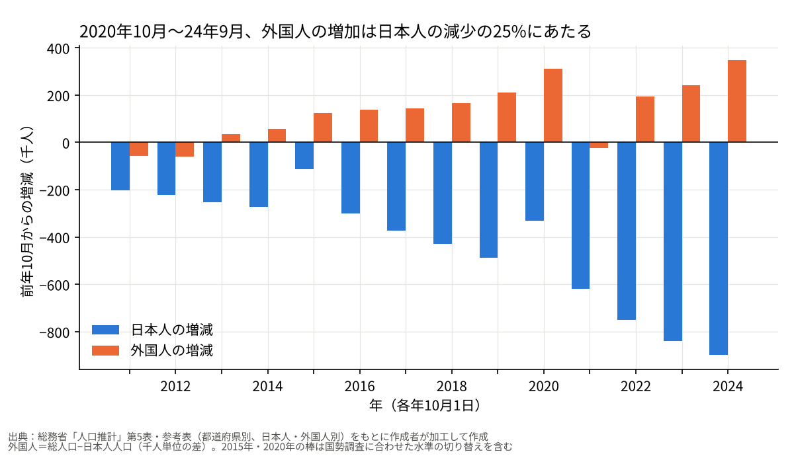
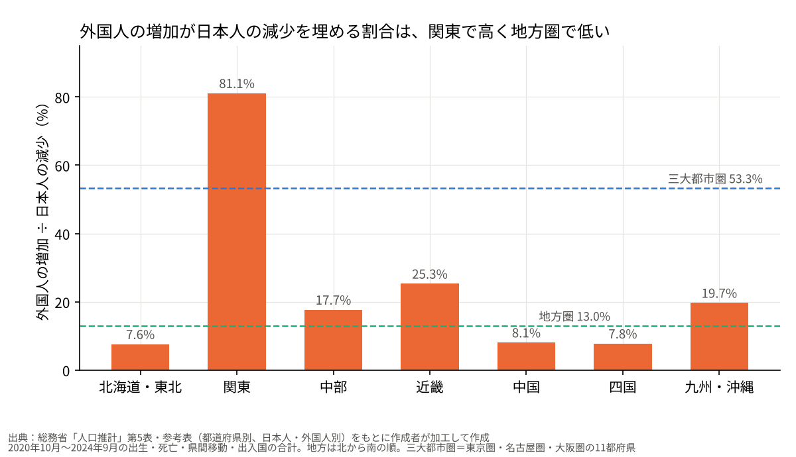
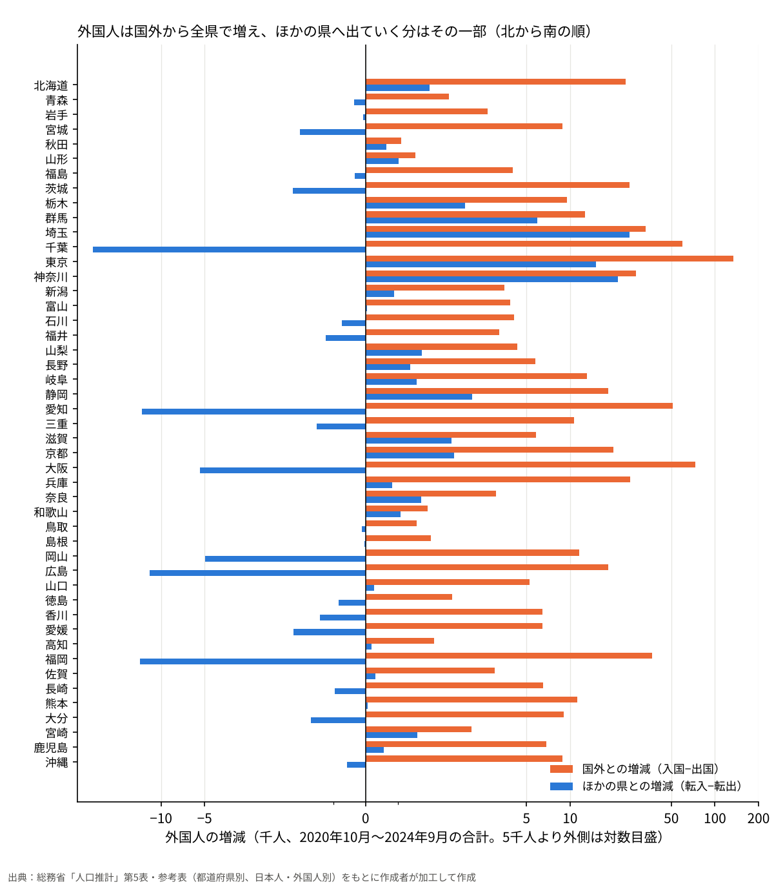
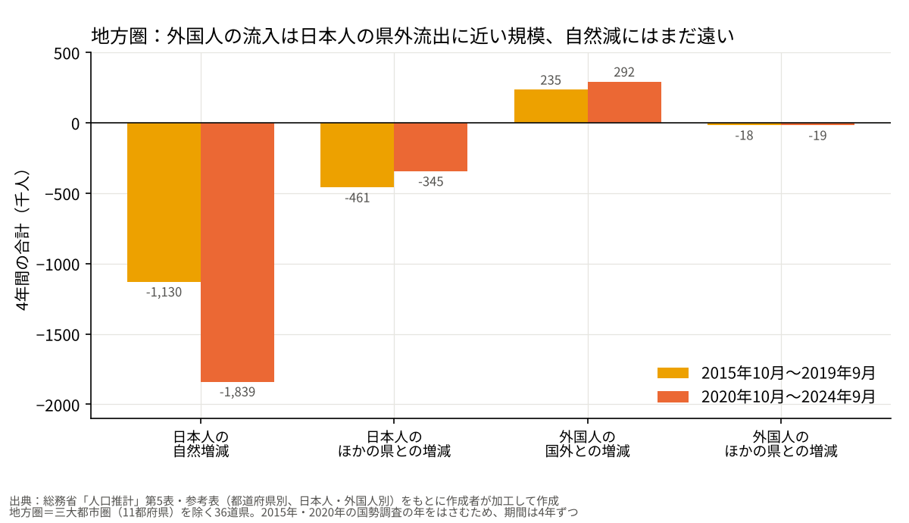

# F321 外国人が増えて、人口の減り方はどれだけ和らいだのか？ 2020〜24年で日本人の減少の25%、三大都市圏では53%、地方圏では13%、外国人の増加の95%は国外からの流入

## 結論（先に）

- 全国では、2020年10月〜2024年9月の出生・死亡・移動の合計で日本人が313.1万人減り、外国人が78.7万人増えました。外国人の増加は日本人の減少の25.1%にあたります（10月1日の人口の差で2019→2024年を比べると31.1%ですが、2020年の国勢調査に合わせた水準の切り替えが混ざります）。
- 2020年10月〜2024年9月の出生・死亡・移動の合計で見ると、埋め合わせ率は三大都市圏（11都府県）で53.3%、地方圏（36道県）で13.0%でした。
- 外国人の増加78.7万人のうち94.6%は国外との出入り（入国−出国）で、出生−死亡は4.2万人でした。
- 地方圏の外国人は、国外からは36道県すべてで増えました。ほかの県との出入りで減ったのは18道県で、地方圏全体の流出は国外からの流入の6.5%でした。「地方に来た外国人の多くが都市へ移る」とは言えません（H3 は1県差で外れ）。
- 結果を見てから足した問いでは、地方圏の外国人の国外からの流入は、日本人がほかの県へ出ていった分の84.5%にあたりました。一方、日本人の自然減（出生−死亡）と比べると15.5%でした。

## 問い

総務省の人口推計（2024年10月1日現在）の要約は、日本人人口が89万8千人減り、外国人は34万2千人の社会増加だったと伝えています（[総務省統計局](https://www.stat.go.jp/data/jinsui/2024np/index.html)）。外国人の増加は、日本人の減少をどれだけ埋めているのか。大都市と地方で違うのか。地方に来た外国人はとどまるのか、ほかの県へ移るのか。増加は出生ではなく入国によるものか。自治体で人口の見通しを担当する人、地域の労働力や消費の規模を見積もる人に向けて確かめます。外国人の受け入れの良し悪しは扱いません。

## データ（出典）

- 総務省「人口推計」第5表（都道府県別の総人口・日本人人口、各年10月1日、千人）2010〜2024年。外国人＝総人口−日本人人口。
- 同 参考表（都道府県別、日本人・外国人別の出生・死亡、県間の転入・転出、入国・出国、前年10月〜当年9月、人）2016〜2019年・2021〜2024年。
- 元の Excel 27ファイル（1.5MB）を `data/raw/` に同梱（取得日・URL は `data/raw/SOURCES.md`）。全国の値は47都道府県の合計と一致しました。
- 地方圏は三大都市圏（東京圏・名古屋圏・大阪圏の11都府県）を除く36道県です。

## 事前の計画

[PLAN.md](PLAN.md)（2026-11-16 06:40、都道府県別の集計の前に作成）。全国の人口の表はデータの形を確かめるときに見ていたため、H1 は参考扱いです。

| 仮説 | 内容（外れの基準） | 結果 | 判定 |
|---|---|---|---|
| H1（参考） | 全国で2019→24年の外国人の増加が日本人の減少の20%以上 | 31.1%（国勢調査の切り替えを除いた要素の合計では25.1%） | 支持（参考） |
| H2 | 埋め合わせ率が三大都市圏＞地方圏 | 53.3%＞13.0% | 支持 |
| H3 | 地方圏で外国人の国外との増減が全県で正、県間の増減が19県以上で負 | 36県／18県 | 外れ |
| H4 | 外国人の増加のうち国外との出入りが80%以上 | 94.6% | 支持 |

## やったこと

参考表から、国籍ごとに「自然増減（出生−死亡）」「県間の増減（転入−転出）」「国外との増減（入国−出国）」を4年分足しました。埋め合わせ率は「外国人の増加 ÷ 日本人の減少」です（`src/03_analysis.py`）。県と地方は北から南の順に並べ、順位は作っていません。

## 分かったこと

### 図1：日本人の減少は広がり、外国人の増加も大きくなった



- 外国人は2010年の167.5万人、2019年の243.6万人、2024年の350.6万人と増えました。
- 出生・死亡・移動の合計で見た埋め合わせ率は、2015年10月〜2019年9月が42.8%、2020年10月〜2024年9月が25.1%でした。外国人の増加は大きくなりましたが、日本人の減少がそれ以上に広がりました。
- 2015年・2020年の棒は、国勢調査に合わせて人口の水準を切り替えた分を含みます（2020年の埋め合わせ率は93.7%）。10月1日の人口の差で2019→2024年や2014→2019年を比べると31.1%・46.1%になりますが、この切り替えが混ざるため、本文では要素の合計を使いました。
- 2021年は外国人も減りました（入国の制限の時期）。

### 図2：埋め合わせ率は関東で高く、地方圏で低い



- 2020年10月〜2024年9月の地方別の埋め合わせ率は、北海道・東北7.6%、関東81.1%、中部17.7%、近畿25.3%、中国8.1%、四国7.8%、九州・沖縄19.7%でした。
- 47都道府県すべてで日本人は減り、外国人は増えました。総数が増えたのは東京都だけです。県の埋め合わせ率の中央値は12.7%（地方圏の中央値10.8%、三大都市圏の中央値34.5%）でした。

### 図3：外国人は国外から全県で増え、県間で出ていく分は一部



- 全国の外国人の増加78.7万人のうち、国外との出入りが74.5万人（94.6%）でした。
- 地方圏の外国人は、国外から29.2万人増え、ほかの県との出入りで1.9万人減りました。県間で減ったのは36道県のうち18です。
- 県間で外国人が増えたのは東京圏（+3.3万人）で、名古屋圏・大阪圏は −1.3万人でした。

## 問い直し（結果を見てから足した）

地方圏で外国人が埋めているのは、日本人の減少のうちどの部分に近い大きさなのか。日本人の減少を自然減と県外への流出に分けて比べました。



- 2020年10月〜2024年9月の地方圏の日本人は、自然増減が −183.9万人、ほかの県との増減が −34.5万人でした。
- 外国人の国外からの流入29.2万人は、日本人の県外への流出の84.5%にあたります（2015年10月〜2019年9月は51.0%）。
- 外国人の増加の合計は、日本人の自然減の15.5%でした（同20.2%）。人口の減り方を決めているのは自然減で、外国人の流入はその一部を埋めるにとどまります。

## 頑健性

| 仮説 | 変えたこと | 値 | 判定 |
|---|---|---|---|
| H2 | コロナ前（2016〜19年） | 三大都市圏1147.9%／地方圏14.4% | 支持 |
| H2 | 第5表の人口の変化（2020→24年） | 52.3%／12.8% | 支持 |
| H2 | 2024年だけ | 88.8%／18.7% | 支持 |
| H2 | 東京圏と、東京圏以外の43道府県 | 129.9%／16.4% | 支持 |
| H3 | コロナ前（2016〜19年） | 36県／15県 | 外れ |
| H3 | 2024年だけ | 36県／15県 | 外れ |
| H4 | コロナ前（2016〜19年） | 94.3% | 支持 |
| H4 | 2024年だけ | 96.3% | 支持 |

- コロナ前の三大都市圏の1147.9%は、日本人の減少が小さかった（東京都などで増えた）ため、分母が小さくなった値です。
- 要素の合計（2020年10月〜2024年9月）の外国人の増加78.7万人と、第5表の変化75.9万人には約2.8万人の差があります。帰化（国籍が変わる分）や千人単位の丸めによるものと考えられます（推測）。

## 言えないこと

- 外国人の増加が地域の働き手や消費にどう効いたかは分かりません。
- 在留資格（技能実習・留学・就労など）の内訳は、この表にはありません。
- 帰化の分は要素に出てこないため、要素の合計では外国人の増加も日本人の減少も、人口の変化よりやや大きめに出ます（全国で約2.8万人の差。理由は推測）。
- 2015年・2020年をはさむ期間（国勢調査の年）は、要素の分析から抜けています。
- 県間の移動の行き先の県は、この表からは分かりません。

## 仕事で使うなら

- 地域の人口の見通しを読むときは、日本人と外国人を分け、外国人の増加がどれだけ減少を埋めているかを一緒に示すと、総数だけより変化の中身が伝わります。
- 地方圏では埋め合わせ率が1割前後で、日本人の自然減の大きさが変わらない限り、総数の動きはほぼ日本人の減り方で決まります。
- 外国人の増加は入国の動きで大きく変わります（2021年は減少）。年ごとの値は幅をもって読むのが安全です。

## 計画からの変更

- H1 は全国の表を先に見ていたため、参考扱いにしました。
- 2014年の参考表は外国人の移動を含まないため、要素の分析から外しました（データの形を確かめた段階で判明）。
- 問い直しとして地方圏の日本人の減り方との比較を足しました。

## 再現のしかた

```sh
pip install -r requirements.txt
sh src/run_all.sh        # オフラインで 02→03→04（約4秒）
python3 src/01_fetch.py  # （任意）元データを取り直す
```

| ファイル | 中身 |
|---|---|
| `src/02_build.py` | Excel → `data/stock.csv`、`data/flows.csv` |
| `src/03_analysis.py` | 仮説・頑健性・問い直し → `results/` |
| `src/04_figures.py` | 図4枚 → `figures/` |
| `results/main.json` | 本文の数字の元 |

`results/repro_check.txt`：別の場所で生成物を消して流し直し、すべての生成物がバイト単位で一致しました。

## レビューで直したこと

| # | 指摘 | 直し方 |
|---|---|---|
| 1 | 題名・結論の全国の埋め合わせ率31.1%（2019→2024年の10月1日人口の差）は、2020年国勢調査に合わせた水準の切り替え（2020年の単年93.7%）を含んでいた | 地域の値と同じ要素の合計（2020年10月〜2024年9月）で全国25.1%を出し、題名・結論・図1・note・status を差し替えた。31.1%は参考として残した |

## 出典

- 総務省統計局「人口推計」第5表・参考表（2014・2016〜2019・2021〜2024年の各版）：https://www.e-stat.go.jp/stat-search/files?toukei=00200524
- 総務省統計局「人口推計（2024年10月1日現在）」結果の要約：https://www.stat.go.jp/data/jinsui/2024np/index.html

（いずれも総務省「人口推計」をもとに作成者が加工して作成）
