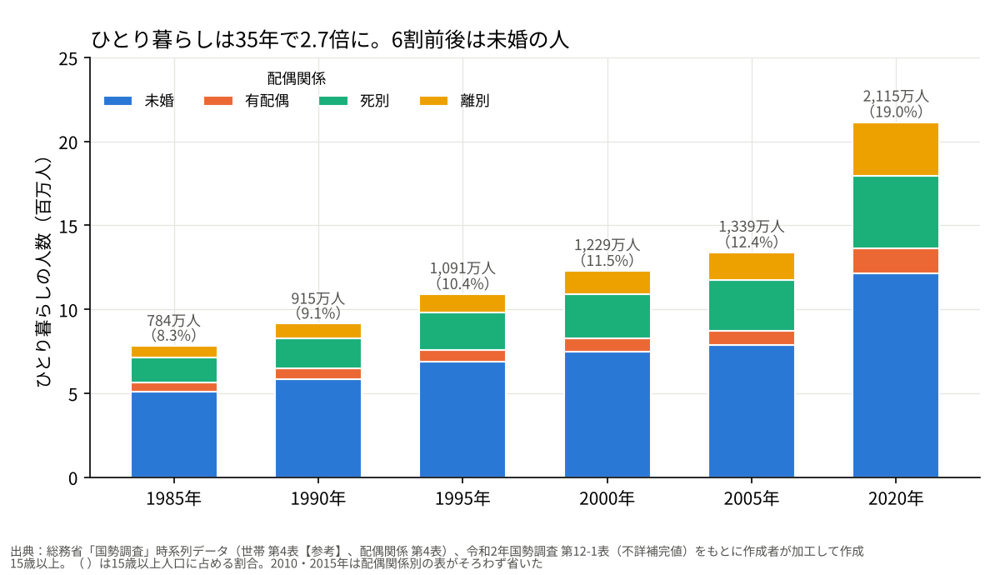
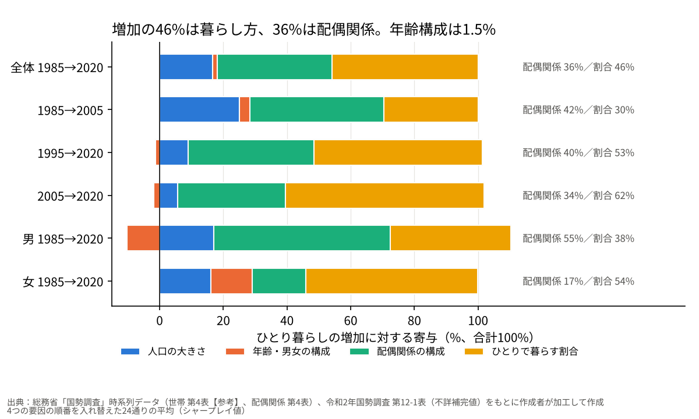
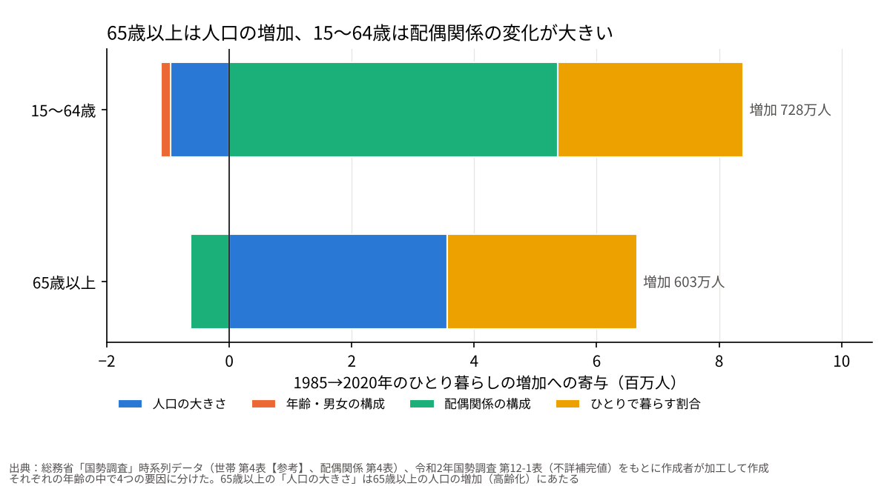
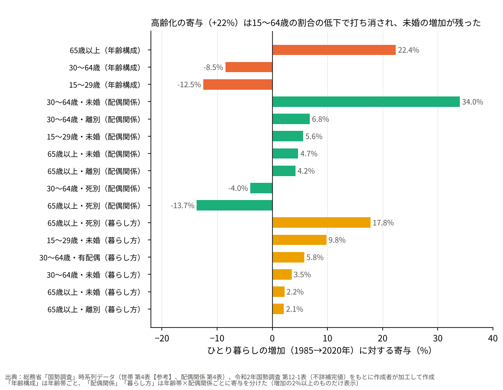

# F322 ひとり暮らしが増えたのは、高齢化と未婚化のどちらのせいか？ 35年の増加1,331万人のうち配偶関係の変化が36%、暮らし方の変化が46%、年齢構成は1.5%

## 結論（先に）

- 15歳以上のひとり暮らし（単独世帯の世帯主）は、1985年の784万人（15歳以上人口の8.3%）から2020年の2,115万人（19.0%）へ、1,331万人増えました。
- 増加を4つの要因に分けると、人口の大きさ16.7%、年齢・男女の構成1.5%、配偶関係の構成35.9%、同じ年齢・男女・配偶関係の中でひとりで暮らす割合46.0%でした。
- 高齢化そのもの（65歳以上の割合が増えた分）は +22.4% でしたが、15〜29歳（−12.5%）と30〜64歳（−8.5%）の割合が下がった分で打ち消され、年齢構成の合計はほぼゼロでした。
- 年齢帯×配偶関係でいちばん大きかったのは、30〜64歳の未婚の人の増加（+34.0%）で、次が65歳以上で配偶者と死別した人がひとりで暮らす割合の上昇（+17.8%）でした。
- 事前の仮説は、高齢化の寄与（H1）と、配偶関係が高齢化より小さい（H2）が外れ、暮らし方の寄与が4分の1以上（H3）は支持されました。

## 問い

ひとり暮らしの増加の背景として、白書などでは未婚率の上昇や核家族化が挙げられ、65歳以上のひとり暮らしの増加も強調されます（[総務省「情報通信白書」平成30年版](https://www.soumu.go.jp/johotsusintokei/whitepaper/ja/h30/html/nd141110.html)）。増加のうち、人口の大きさ、年齢・男女の構成（高齢化）、配偶関係の構成（未婚化・離別・死別）、同じ属性の中でひとりで暮らす割合（暮らし方）のどれがどれだけ効いたのかを、数で分けます。住宅・小売・サービスで世帯の数や形を見積もる人、自治体の住宅や地域の計画の担当に向けた問いです。

## データ（出典）

- 総務省「国勢調査」時系列データ 世帯 第4表【参考】（世帯主の配偶関係・年齢・男女別の単独世帯数、1985〜2005年）
- 総務省「令和2年国勢調査」人口等基本集計 第12-1表（同じ項目、2020年、不詳補完値）
- 総務省「国勢調査」時系列データ 第4表（配偶関係・年齢・男女別の15歳以上人口、1920〜2020年。2020年は不詳補完値）
- 元の Excel 3ファイル（6.0MB）を `data/raw/` に同梱（取得日・URL は `data/raw/SOURCES.md`）。2020年のひとり暮らしの合計2,115万人は、国勢調査の単独世帯数とほぼ一致しました（15歳未満と年齢不詳を除いた差のみ）。

## 事前の計画

[PLAN.md](PLAN.md)（2026-11-16 06:51、ひとり暮らしの数を集計する前に作成）。

| 仮説 | 内容（外れの基準） | 結果 | 判定 |
|---|---|---|---|
| H1 | 年齢・男女の構成（高齢化）の寄与が増加の3分の1以上 | 1.5% | 外れ |
| H2 | 配偶関係の構成の寄与は高齢化の寄与より小さい | 35.9%＞1.5% | 外れ |
| H3 | ひとりで暮らす割合の寄与が正で4分の1以上 | 46.0% | 支持 |
| H4 | 65歳以上では年齢構成の寄与が半分以上、15〜64歳では配偶関係が半分以上 | 0.1%／73.7% | 外れ（下を参照） |

H4 は、65歳以上の中の「年齢構成」で高齢化を測る定義にしていたため外れました。65歳以上の人口が増えた分（この年齢の中では「人口の大きさ」）は59.0%で、高齢化を「65歳以上の人口の増加」と読めば半分を超えます。定義を後から変えることはせず、判定は外れのままにします。

## やったこと

ひとり暮らしの数を「15歳以上人口 × 年齢・男女の構成 × 配偶関係の構成 × ひとりで暮らす割合」の掛け算で表し、1985→2020年の変化を4つの要因に分けました。要因を入れ替える順番で答えが変わらないよう、24通りの順番の平均（シャープレイ値）をとりました（`src/03_analysis.py`）。

## 分かったこと

### 図1：ひとり暮らしは35年で2.7倍、6割前後は未婚



- ひとり暮らしに占める未婚の人の割合は、1985年65.2%、2020年57.5%でした。離別は9.1%から15.0%に、死別は19.2%から20.6%になりました。

### 図2：増加の46%は暮らし方、36%は配偶関係



- 1985→2020年：人口の大きさ +222万人、年齢・男女の構成 +19万人、配偶関係の構成 +478万人、ひとりで暮らす割合 +612万人。
- 期間や男女を変えても、配偶関係（17.0〜55.4%）と暮らし方（29.5〜62.2%）が大きく、年齢構成は小さいままでした（下の頑健性）。

### 図3：65歳以上は人口の増加、15〜64歳は配偶関係



- 65歳以上のひとり暮らしは118万人から721万人へ603万人増えました。65歳以上の人口の増加が59.0%、暮らし方が51.3%、配偶関係は −10.4%（死別した人の割合が下がった）でした。
- 15〜64歳は666万人から1,395万人へ728万人増えました。配偶関係が73.7%、暮らし方が41.6%で、人口の大きさは −13.2% でした。

## 問い直し（結果を見てから足した）

年齢構成の寄与が1.5%と小さかったので、「高齢化の効果はどこへ消えたのか」と「配偶関係と暮らし方の寄与はどの年齢・配偶関係で生じたのか」を足しました。ひとり暮らしの数は各要因について1次式なので、寄与をセルごとに足し算で分けられます。



- 年齢構成の寄与は、65歳以上 +22.4%、30〜64歳 −8.5%、15〜29歳 −12.5% に分かれ、打ち消し合っていました。
- 配偶関係では30〜64歳の未婚 +34.0% が最大で、65歳以上の死別は −13.7%（死別した人の割合の低下）でした。
- 暮らし方では65歳以上の死別 +17.8% が最大でした。この層でひとりで暮らす割合は18.8%から43.3%に上がっています。15〜29歳の未婚（17.1%→27.1%）も +9.8% でした。

## 頑健性

| 分析 | 人口の大きさ | 年齢・男女の構成 | 配偶関係 | 暮らし方 | H1 | H2 | H3 |
|---|---|---|---|---|---|---|---|
| 主結果 1985→2020 | 16.7% | 1.5% | 35.9% | 46.0% | 外れ | 外れ | 支持 |
| 1985→2005（同じ旧分類の表だけ） | 25.1% | 3.2% | 42.2% | 29.5% | 外れ | 外れ | 支持 |
| 1995→2020 | 9.0% | −1.3% | 39.5% | 52.8% | 外れ | 外れ | 支持 |
| 2005→2020 | 5.7% | −1.8% | 33.9% | 62.2% | 外れ | 外れ | 支持 |
| 男 | 17.1% | −10.3% | 55.4% | 37.8% | 外れ | 外れ | 支持 |
| 女 | 16.1% | 12.9% | 17.0% | 53.9% | 外れ | 外れ | 支持 |
| 決まった順番（人口→年齢→配偶関係→割合） | 10.1% | −1.8% | 36.6% | 55.1% | 外れ | 外れ | 支持 |
| 3要因（人口の大きさと年齢をまとめる） | 18.0%（まとめて） | ― | 35.6% | 46.4% | ― | ― | 支持 |

- 結論は期間・男女・分け方で変わりませんでした。女性では年齢構成が12.9%とやや大きく、配偶関係は17.0%と男性（55.4%）より小さくなりました。

## 言えないこと

- ひとりで暮らす理由（選んだのか、そうなったのか）は分かりません。暮らし方の変化の中身（子と同居しなくなった、単身赴任など）は推測にとどまります。
- 2005年以前（旧分類）と2020年（新分類）で家族類型の分類が変わっています。単独世帯の定義は同じと考えていますが、2005→2020年の比較には分類の差が入る可能性があります。
- 2020年は不詳補完値、それ以前は配偶関係「不詳」を除いた値で、扱いが違います。
- 施設などに住む人は一般世帯に入らず、数えていません。
- 2025年国勢調査の値は、配偶関係別の人口の表をそろえられず使っていません。

## 仕事で使うなら

- 「高齢化でひとり暮らしが増えた」と書くときは、65歳以上では人口の増加が効いている一方、全体では若い年齢の減少と打ち消し合うことを一緒に示すと誤解が減ります。
- 世帯数を見積もるときは、年齢構成だけでなく、配偶関係の構成と、同じ属性の中の暮らし方の変化を別々に置くと、どの前提が効いているかが見えます。

## 計画からの変更

- H4 の判定は計画の定義のまま外れとし、別の読み方（65歳以上の人口の増加 59.0%）を併記しました。
- 問い直しで、年齢構成・配偶関係・暮らし方の寄与をセルごとに分けました。
- 2010年・2015年は配偶関係別の単独世帯の時系列の表をそろえられず、計画どおり1985〜2005年と2020年を使いました。

## 再現のしかた

```sh
pip install -r requirements.txt
sh src/run_all.sh        # オフラインで 02→03→04（約5秒）
python3 src/01_fetch.py  # （任意）元データを取り直す
```

| ファイル | 中身 |
|---|---|
| `src/02_build.py` | Excel → `data/alone_pop.csv` |
| `src/03_analysis.py` | 要因分解・頑健性・問い直し → `results/` |
| `src/04_figures.py` | 図4枚 → `figures/` |
| `results/main.json` | 本文の数字の元 |

`results/repro_check.txt`：別の場所で生成物を消して流し直し、すべての生成物がバイト単位で一致しました。

- 大きなデータのファイル（`data/raw/census_2020_t12-1_household_marital_000040317884.xlsx`）は、GitHub の1ファイルの上限に合わせて `.part000` などに分けて置いています。`run_all.sh` が最初に `src/00_join_parts.py` でつなぎ直し、sha256 で元と同じことを確かめます。

## レビューで直したこと

独立レビューで数字の照合・再実行・図を確かめ、直すところはなかった。

## 出典

- 総務省統計局「国勢調査」時系列データ（世帯 第4表【参考】、男女・年齢・配偶関係 第4表）：https://www.e-stat.go.jp/stat-search/files?toukei=00200521
- 総務省統計局「令和2年国勢調査」人口等基本集計 第12-1表：https://www.e-stat.go.jp/stat-search/files?toukei=00200521
- 総務省「情報通信白書」平成30年版「単独世帯の増加」：https://www.soumu.go.jp/johotsusintokei/whitepaper/ja/h30/html/nd141110.html

（いずれも総務省「国勢調査」をもとに作成者が加工して作成）
