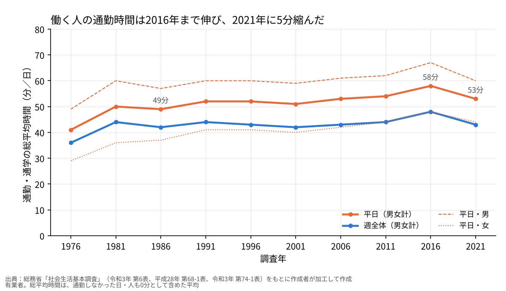
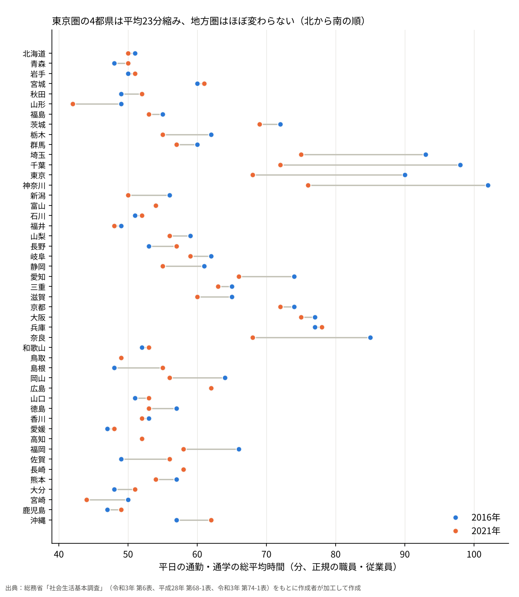
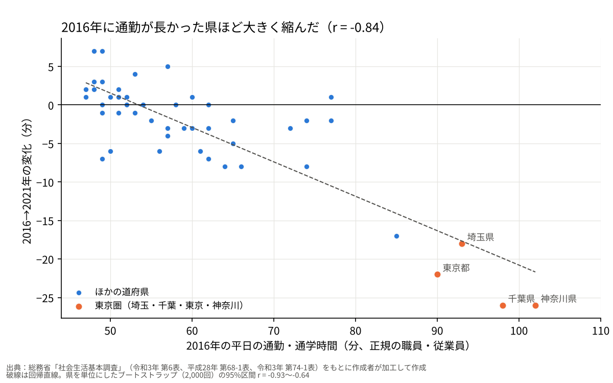
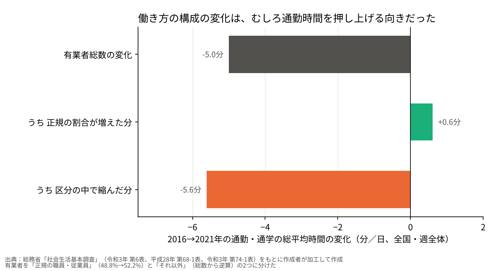

# F323 通勤時間は長くなったのか、短くなったのか？ 2016年まで伸び、2021年は東京圏で23分縮み、地方圏ではほぼ変わらず（0.9分）。もともと長い県ほど縮んだ（r=−0.84）

## 結論（先に）

- 働く人（有業者）の平日の通勤・通学時間（総平均）は、1986年の49分から2016年の58分へ伸び、2021年は53分に縮みました。
- 2016→2021年の縮み方は地域で大きく違いました。正規の職員・従業員の平日で、東京圏の4都県は平均23.0分（95.8分→72.8分）縮み、地方圏の36道県は平均0.9分（54.8分→53.8分）でした。
- 2016年に通勤が長かった県ほど大きく縮みました（47都道府県の相関 r = −0.84、ブートストラップの95%区間 −0.93〜−0.64）。
- 正規の職員・従業員の割合は48.8%から52.2%に上がっていて、構成の変化はむしろ通勤時間を +0.6分 押し上げる向きでした。縮んだのは同じ区分の中での変化（−5.6分）です。
- 東京圏と地方圏の差は、2016年の41.0分から2021年の18.9分へ半分以下になりました。ただし2021年は感染症の流行期の調査で、その後に戻ったかはこのデータでは分かりません。

## 問い

「テレワークで通勤時間が減った」と言われます。一方で、長い目で見ると通勤時間は伸びてきたとも言われます。総務省の社会生活基本調査を使い、働く人の1日あたりの通勤・通学時間が1976〜2021年にどう動いたか、2016→2021年の減り方は通勤の長い東京圏で大きかったのかを確かめます。住まいや職場の立地を考える実務の人、自治体の交通・住宅の計画の担当に向けた問いです。

関連する記事：398（家から職場までの時間は、住まいの種類でどれだけ違うのか、住宅・土地統計調査）。398 は住まいの種類ごとの通勤時間の水準を比べ、この記事は社会生活基本調査で2016→2021年の地域ごとの変化を見ます。

## データ（出典）

- 総務省「社会生活基本調査」令和3年 第6表（男女・就業状態・曜日別の総平均時間の推移、1976〜2021年、全国）
- 同 平成28年 第68-1表、令和3年 第74-1表（有業者の従業上の地位・雇用形態別、全国・都道府県）
- 元の Excel 3ファイル（1.6MB）を `data/raw/` に同梱（取得日・URL は `data/raw/SOURCES.md`）。2016・2021年の全国の値は、時系列表と県別表で一致しました。
- 総平均時間は、その区分の人全員で割った1日あたりの平均です。通勤しなかった日・人も0分として入ります。

## 事前の計画

[PLAN.md](PLAN.md)（2026-11-16 07:00、都道府県別の集計の前に作成）。全国の推移と全国の正規の値は先に見ていたため、H1・H4 は参考扱いです。

| 仮説 | 内容（外れの基準） | 結果 | 判定 |
|---|---|---|---|
| H1（参考） | 全国の有業者の週全体で、1986→2016年に3分以上伸びた | +6分 | 支持（参考） |
| H2 | 2016→21年の減り方（正規・平日）が東京圏で地方圏の2倍以上 | −23.0分 対 −0.9分 | 支持 |
| H3 | 2016年が長い県ほど大きく減った（r ≤ −0.5） | r = −0.84 | 支持 |
| H4（参考） | 全国の正規だけでも3分以上減った | 58分→51分（週全体） | 支持（参考） |

## やったこと

全国の推移を表から並べ、2016年と2021年の県別の値の差をとりました。東京圏（4都県）と地方圏（36道県）は県の単純平均です。相関は県を単位に2,000回のブートストラップで区間を出しました（乱数の種 20261116）。県は北から南の順に並べ、順位は作っていません（`src/03_analysis.py`）。

## 分かったこと

### 図1：2016年まで伸び、2021年に縮んだ



- 平日は1976年41分、1986年49分、2001年51分、2016年58分、2021年53分でした。週全体は48分から43分に縮みました。
- 男性は女性より長く、どちらも2016年が最も長くなっています。

### 図2：縮んだのは東京圏、地方圏はほぼ変わらない



- 東京圏の4都県は、埼玉 −18分、千葉 −26分、東京 −22分、神奈川 −26分でした。
- 47都道府県のうち、縮んだのは27、伸びたのは15、同じだったのは5でした。名古屋圏・大阪圏の7府県の平均は −4.7分でした。

### 図3：もともと長い県ほど大きく縮んだ



- 2016年の長さと変化の相関は r = −0.84（スピアマン −0.69）。回帰直線の傾きは、2016年が1分長いと変化が −0.45分でした。
- 東京圏を除いても、奈良県（85分→68分）など2016年に長かった県で縮みが大きい形は残ります。ただし相関の強さの多くは東京圏の4都県によるもので、4都県を除いた43道府県では r = −0.59（スピアマン −0.60）、地方圏の36道県だけでは r = −0.57 です。

## 問い直し（結果を見てから足した）

全国の減少（週全体 −5分）は、働き方の構成の変化で見かけが変わったのではないかを確かめました。有業者を「正規の職員・従業員」と「それ以外」（総数から逆算）に分けました。



- 正規の割合は48.8%から52.2%に上がりました。正規は通勤時間が長いので、この変化は +0.6分 の押し上げでした。
- 区分の中での変化が −5.6分 で、減少はすべて同じ働き方の中で起きていました。平日でも同じ形（構成 +0.9分、区分の中 −5.9分）でした。

## 頑健性

| 変えたこと | 東京圏の平均変化 | 地方圏の平均変化 | H2 | 相関 r（スピアマン） | H3 |
|---|---|---|---|---|---|
| 主の設定（正規・平日） | −23.0分 | −0.9分 | 支持 | −0.84（−0.69） | 支持 |
| 週全体で | −18.0分 | −1.8分 | 支持 | −0.83（−0.65） | 支持 |
| 有業者総数で | −13.8分 | −0.5分 | 支持 | −0.85（−0.71） | 支持 |
| 男 | −24.8分 | −1.3分 | 支持 | −0.84（−0.65） | 支持 |
| 女 | −18.8分 | +0.1分 | 支持 | −0.73（−0.63） | 支持 |
| 東京都を除く | −23.3分（3県） | −0.9分 | 支持 | −0.82（−0.67） | 支持 |

結論はどの設定でも変わりませんでした。

## 言えないこと

- 2016年の県の値には標本のぶれがあります。たまたま長く出た県は次の回に短く出やすい（平均への回帰）ため、「長い県ほど縮んだ」形の一部はこのぶれによる可能性があります。特に東京圏を除いた弱い相関（r = −0.59）は、この影響を分けられていません。
- 総平均時間は「通勤する日の長さ」と「通勤する人・日の割合」が混ざっています。この表だけではどちらが動いたかを分けられません。埼玉県の解説では、平日に通勤した人だけの平均は全国で2016年・2021年とも1時間19分と紹介されています（[埼玉県 統計ア・ラ・カルト第190号](https://www.pref.saitama.lg.jp/a0206/toukeialacarte/190.html)）。これに従えば、縮んだのは通勤する日・人の割合の方だと考えられます（推測。この記事のデータでは確かめていません）。
- 社会生活基本調査は標本調査で、県の値には標本のぶれがあります。表は分単位に丸められています。
- 2021年は感染症の流行期（10月）の調査で、その後に通勤時間が戻ったかは分かりません。
- 通勤の手段や距離は分かりません。

## 仕事で使うなら

- 「通勤時間」を引用するときは、総平均（通勤しない日を含む）か、通勤した人だけの平均かを確かめてから使うと、テレワークの影響を読み違えにくくなります。
- 東京圏と地方圏では2016→2021年の動きが大きく違います。全国の値だけで地域の通勤の変化を語らない方が安全です。

## 計画からの変更

- H1・H4 は全国の値を先に見ていたため、参考扱いにしました。
- 問い直しとして、働き方の構成の分解を足しました。
- 埼玉県の解説ページ（行動者平均）は、取得前に読んだ外部の情報として「言えないこと」でだけ使いました。

## 再現のしかた

```sh
pip install -r requirements.txt
sh src/run_all.sh        # オフラインで 02→03→04（約5秒）
python3 src/01_fetch.py  # （任意）元データを取り直す
```

| ファイル | 中身 |
|---|---|
| `src/02_build.py` | Excel → `data/national.csv`、`data/pref.csv` |
| `src/03_analysis.py` | 仮説・頑健性・問い直し → `results/` |
| `src/04_figures.py` | 図4枚 → `figures/` |
| `results/main.json` | 本文の数字の元 |

`results/repro_check.txt`：別の場所で生成物を消して流し直し、すべての生成物がバイト単位で一致しました。

## レビューで直したこと

| # | 指摘 | 直し方 |
|---|---|---|
| 1 | 県の相関 r=−0.84 の強さの多くが東京圏の4都県によることが書かれていない | 東京圏を除く43道府県（r=−0.59）と地方圏36道県（r=−0.57）の相関を main.json に足し、README・note に追記 |
| 2 | 2016年の値の標本のぶれによる平均への回帰に触れていない | 言えないことに1点追加 |
| 3 | 既存記事 398（住まいの種類別の通勤時間）との関係が書かれていない | 「関連する記事」として違いを1文で追記 |

## 出典

- 総務省統計局「社会生活基本調査」令和3年 第6表・第74-1表、平成28年 第68-1表（e-Stat）：https://www.e-stat.go.jp/stat-search/file-download?statInfId=000032229317&fileKind=0 ほか（`data/raw/SOURCES.md`）
- 埼玉県「統計ア・ラ・カルト第190号 テレワークと通勤・通学時間の状況」：https://www.pref.saitama.lg.jp/a0206/toukeialacarte/190.html

（いずれも総務省「社会生活基本調査」をもとに作成者が加工して作成）
