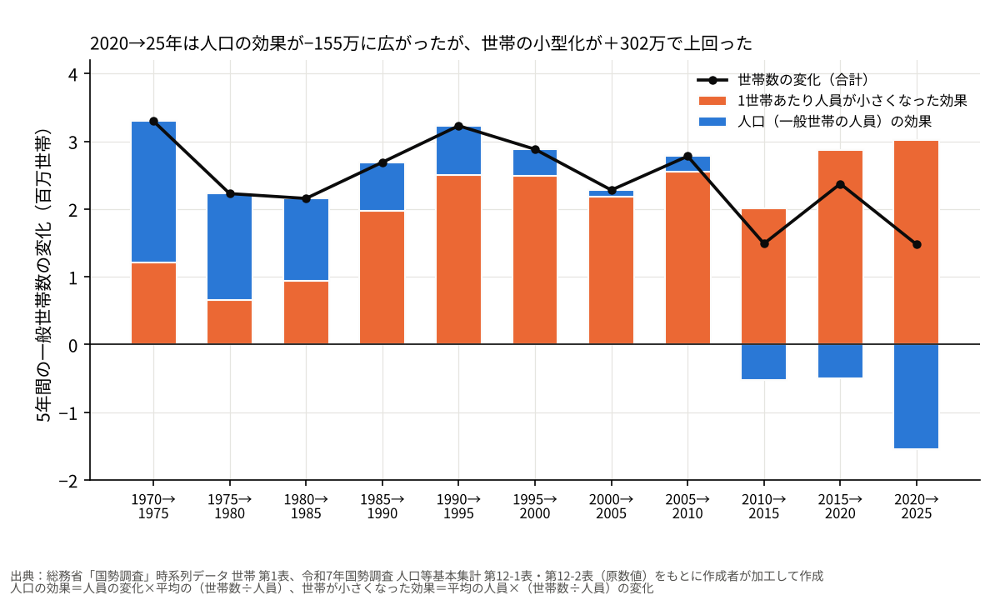
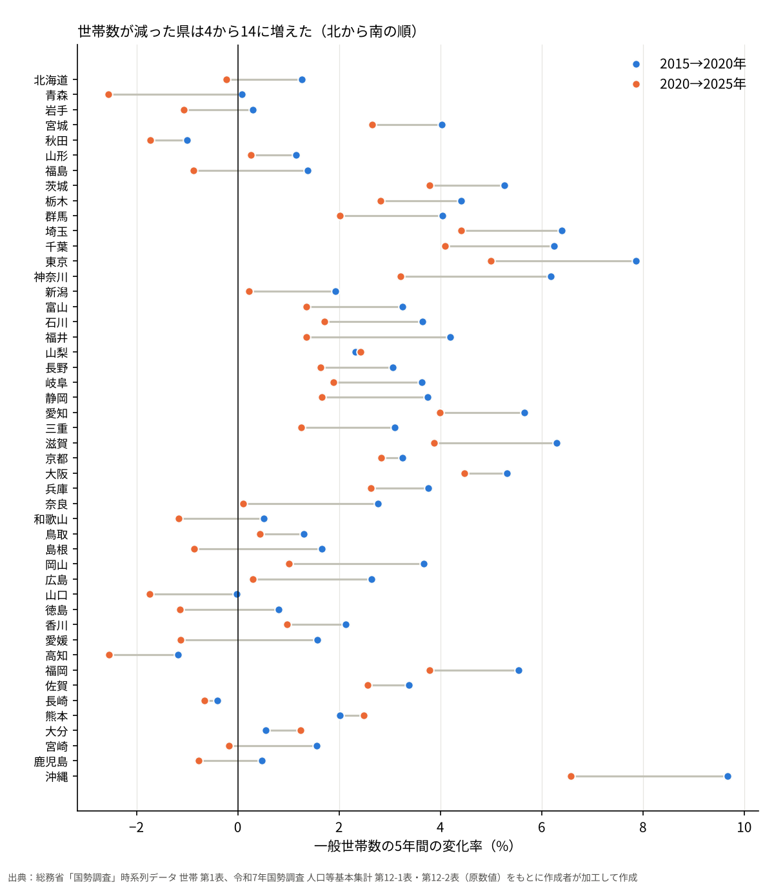
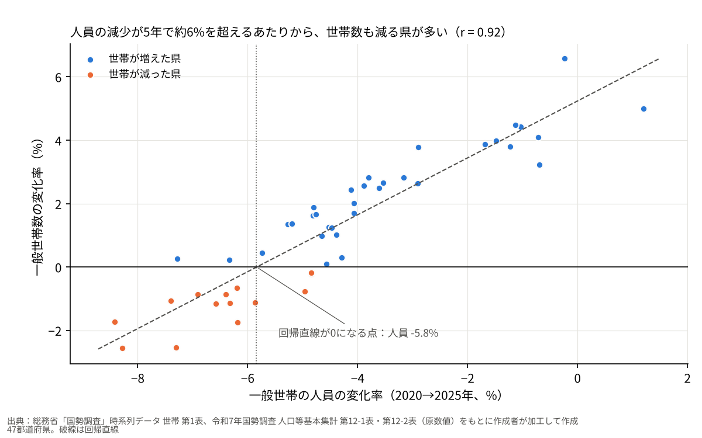
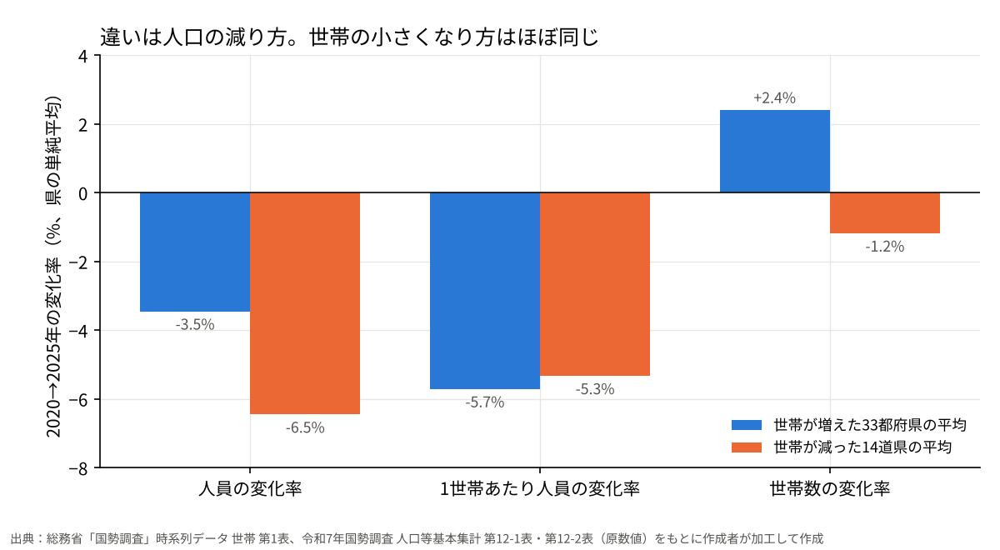

# F324 「人口が減っても世帯は増える」は、いつまで続くのか？ 2025年も全国で148万世帯増えたが、世帯が減った県は4から14に。違いは人口の減り方（−6.5%対−3.5%）

## 結論（先に）

- 2020→2025年に、一般世帯の人員は333万人減りましたが、一般世帯数は148万世帯増えました（5,570万→5,718万）。1世帯あたり人員は2.21人から2.10人になりました。
- 世帯数の変化を分けると、人口の効果は −155万世帯で、2015→2020年（−50万）の3倍に広がりました。一方、世帯が小さくなった効果は +302万世帯で、これも過去最大でした。
- 一般世帯数が減った都道府県は、2015→2020年の4から、2020→2025年は14に増えました。事前の基準（20以上）には届きませんでした。
- 47都道府県で、人員の変化率と世帯数の変化率の相関は r = 0.92 でした。回帰直線で見ると、5年で人員が約5.8%減るあたりで世帯数の増減がゼロになります。
- 結果を見てから足した問いでは、世帯が減った県と増えた県の違いは人口の減り方（平均 −6.5% 対 −3.5%）で、世帯の小さくなり方（−5.3% 対 −5.7%）はほぼ同じでした。

## 問い

日本の人口は減っていますが、世帯の数は増え続けてきました。ひとり暮らしや夫婦のみの世帯が増え、1世帯あたりの人数が小さくなっているためです。この「人口が減っても世帯は増える」状態はどこまで続いているのか。2025年国勢調査で、世帯が減り始めた都道府県はいくつあるのか。世帯数の変化を人口の効果と世帯の大きさの効果に分けると、どちらがどれだけ効いているのか。住宅・家具・家電・小売など世帯の数で需要を見る実務の人、自治体の住宅や地域の計画の担当に向けて確かめます。需要の見通しや、どうすべきかは扱いません。

## データ（出典）

- 総務省「国勢調査」時系列データ 世帯 第1表（一般世帯数・一般世帯人員、全国・都道府県、1960・1970〜2020年）
- 総務省「令和7年国勢調査」人口等基本集計 第12-1表（一般世帯数）・第12-2表（一般世帯人員）の総数の行（原数値）
- 元の Excel 3ファイル（12MB、1ファイル最大6.2MB）を `data/raw/` に同梱（取得日・URL は `data/raw/SOURCES.md`）。47都道府県の合計は全国と一致しました（1960年の境界紛争地域の分を除く）。

## 事前の計画

[PLAN.md](PLAN.md)（2026-11-16 07:06、都道府県別の集計の前に作成）。全国の2025年の一般世帯数はデータの形を確かめるときに見ていたため、H1 は参考扱いです。

| 仮説 | 内容（外れの基準） | 結果 | 判定 |
|---|---|---|---|
| H1（参考） | 全国の一般世帯数は2020→2025年も増えた | +1,476,670世帯 | 支持（参考） |
| H2 | 2020→25年に世帯が減った県が20以上で、2015→20年より多い | 14（2015→20年は4） | 外れ |
| H3 | 世帯が小さくなった効果は2020→25年の方が2010→15年より小さい | +302万 対 +202万 | 外れ |
| H4 | 人員の変化率と世帯数の変化率の相関が0.8以上（2020→25年） | r = 0.92 | 支持 |

## やったこと

世帯数 H を「人員 P × （H ÷ P）」と書き、5年間の変化を、人員の変化による分（人口の効果）と、H ÷ P の変化による分（世帯が小さくなった効果）に分けました。両方の年の平均を使う対称な分け方で、合計は世帯数の変化に一致します（`src/03_analysis.py`）。県は北から南の順に並べ、順位は作っていません。

## 分かったこと

### 図1：人口の効果は広がったが、世帯の小型化がそれを上回った



- 人口の効果は、2010→15年 −53万、2015→20年 −50万、2020→25年 −155万世帯でした。
- 世帯が小さくなった効果は、同じ期間に +202万、+287万、+302万世帯で、小さくなる速さは落ちていません（H3 は外れ）。
- 1世帯あたり人員は、2010年2.42人、2015年2.33人、2020年2.21人、2025年2.10人でした。

### 図2：世帯が減った県は4から14に



- 世帯が減った県の数は、2005→10年2、2010→15年5、2015→20年4、2020→25年14でした。人員が減った県は46でした。
- 地方別（2020→25年）では、北海道・東北の7道県のうち5、四国の4県のうち3で世帯が減りました。関東と中部では減った県はありませんでした。

### 図3：人員の減り方と世帯数の変化はよくそろう



- 相関は r = 0.92、傾きは0.90でした。人員の変化が0%の県の世帯数の変化は平均 +5.2% にあたります。
- 世帯の増減がゼロになる人員の変化率は、2010→15年 −4.9%、2015→20年 −5.5%、2020→25年 −5.8% でした。
- 全国の2020→25年の人員の変化は −2.7% で、この目安よりまだ小さい減り方です。

## 問い直し（結果を見てから足した）

世帯が減った14道県は、「人口の減りが速い」のか「世帯の小さくなり方が遅い」のかを比べました。



- 減った県の平均は、人員 −6.46%、1世帯あたり人員 −5.34%、世帯数 −1.19% でした。
- 増えた県の平均は、人員 −3.46%、1世帯あたり人員 −5.72%、世帯数 +2.40% でした。
- 違いはほぼ人口の減り方で、世帯の小さくなり方の差は0.4ポイントでした。県の1世帯あたり人員の変化率は −7.5%〜−3.6% の範囲です。

## 頑健性

| 仮説 | 変えたこと | 値 | 判定 |
|---|---|---|---|
| H2 | 施設等の世帯を含む総数（2015→2020年） | 減った県5 | （参考。2025年は総数の表を使っていない） |
| H3 | 始めの年の大きさを固定する分け方 | 2010→15年 +201万／2020→25年 +298万 | 外れ |
| H4 | 2015→2020年 | r = 0.94 | 支持 |
| H4 | 東京都を除く | r = 0.92 | 支持 |
| H4 | スピアマンの順位相関 | 0.94 | 支持 |

結論は分け方や期間で変わりませんでした。

## 言えないこと

- この先いつ全国の世帯数が減り始めるかは予測していません。国立社会保障・人口問題研究所の将来推計は、この作業の環境から取得できず、比べていません。
- 世帯の数と住宅の需要は同じではありません（空き家や二つの地域に住む人などは扱っていません）。
- 一般世帯だけを数えていて、施設等に住む人は入っていません。
- 外国人の世帯と日本人の世帯は分けていません。
- 2025年国勢調査は原数値で、のちの確定や補完で値が変わる可能性があります（推測）。

## 仕事で使うなら

- 世帯数の見通しを読むときは、「人口の効果」と「世帯が小さくなる効果」を分けて置くと、どちらの前提が効いているかが見えます。
- 都道府県ごとに見ると、世帯の小さくなり方はどこも似ていて、世帯が増えるか減るかはほぼ人口の減り方で決まっています。県の人口の見通しが、そのまま世帯数の見通しの主な前提になります。

## 計画からの変更

- H1 は全国の2025年の値を先に見ていたため、参考扱いにしました。
- 問い直しとして、世帯が減った県と増えた県の比較を足しました。
- 将来推計との比較は、取得できず計画どおり行っていません。

## 再現のしかた

```sh
pip install -r requirements.txt
sh src/run_all.sh        # オフラインで 02→03→04（約10秒）
python3 src/01_fetch.py  # （任意）元データを取り直す
```

| ファイル | 中身 |
|---|---|
| `src/02_build.py` | Excel → `data/households.csv` |
| `src/03_analysis.py` | 分解・県の増減・頑健性・問い直し → `results/` |
| `src/04_figures.py` | 図4枚 → `figures/` |
| `results/main.json` | 本文の数字の元 |

`results/repro_check.txt`：別の場所で生成物を消して流し直し、すべての生成物がバイト単位で一致しました。

- 大きなデータのファイル（`data/raw/census_2025_t12-1_households_000040506465.xlsx`、`data/raw/census_2025_t12-2_members_000040506466.xlsx`）は、GitHub の1ファイルの上限に合わせて `.part000` などに分けて置いています。`run_all.sh` が最初に `src/00_join_parts.py` でつなぎ直し、sha256 で元と同じことを確かめます。

## レビューで直したこと

| # | 指摘 | 直し方 |
|---|---|---|
| 1 | 図1の注記の「人数の効果」が本文の用語（世帯が小さくなった効果）と違う | 04_figures.py の注記を直して図を作り直した |

## 出典

- 総務省統計局「国勢調査」時系列データ 世帯 第1表：https://www.e-stat.go.jp/stat-search/files?toukei=00200521
- 総務省統計局「令和7年国勢調査」人口等基本集計 第12-1表・第12-2表（原数値）：https://www.e-stat.go.jp/stat-search/files?toukei=00200521

（いずれも総務省「国勢調査」をもとに作成者が加工して作成）
