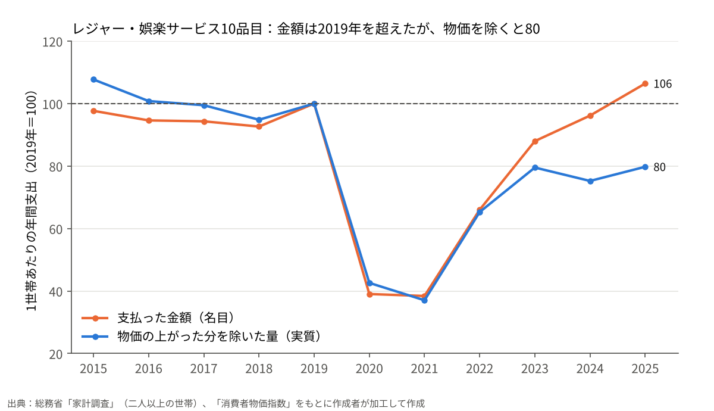
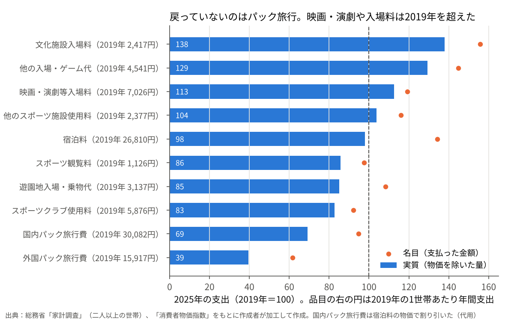
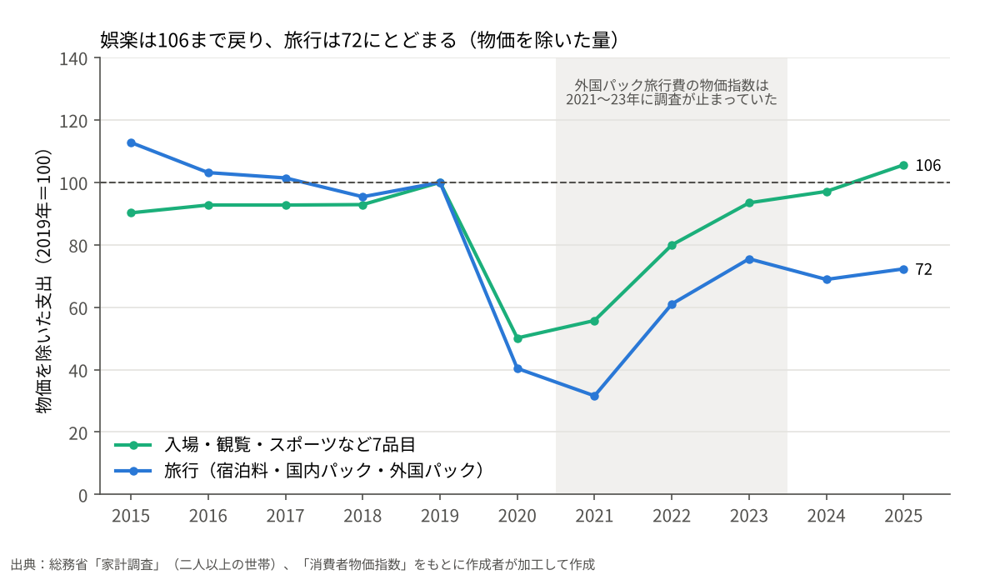
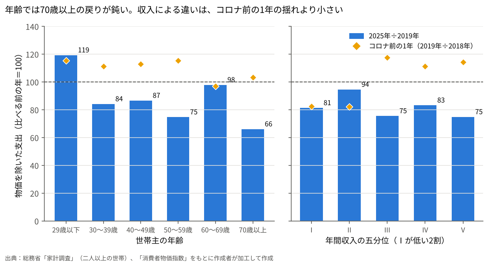

# F325 レジャー・娯楽への支出は、コロナ前に戻ったのか？ 金額は2019年の106%でも、物価を除くと80%。旅行は72%にとどまり、映画や入場料などの娯楽は106%まで戻った

## 結論（先に）

- 二人以上の世帯が、旅行・宿泊・映画・スポーツ・遊園地など、レジャー・娯楽のサービス10品目に払った金額は、2025年に1世帯あたり年105,687円でした。2019年（99,309円）の **106%** です。
- しかし物価の上がった分を品目ごとに除くと、2025年の量は2019年の **80%** でした。金額が増えたのは、値上がりの分が大きかったからです。
- 戻っていないのは旅行です。宿泊料・国内パック旅行費・外国パック旅行費の3品目は、物価を除くと **72%**。中でも外国パック旅行は39%、国内パック旅行は69%でした。一方、映画・演劇・入場料・スポーツ施設などの7品目は **106%** で、2019年を超えました。
- 世帯主が70歳以上の世帯は66%と戻りが鈍い一方、年間収入による違いは、コロナ前の1年（2018→2019年）の揺れより小さく、はっきりした差は言えませんでした。
- 国内パック旅行の割合（宿泊料と合わせた中の割合）は、コロナ前から1年に約1.7ポイントずつ下がっていました。2025年の割合（44%）は、その流れを延ばした値（43%）とほぼ同じです。

## 問い

総務省の「家計調査報告（2025年平均）」は、教養娯楽サービスへの支出が前の年より実質で3.6%増え、大阪・関西万博の影響などで文化施設入場料が増えたと説明しています。「レジャーへの支出は増えている」という見え方です。

では、コロナ前の2019年と比べるとどうでしょうか。観光・娯楽の事業者や、消費の動きを分析する人は、「金額」ではなく「量」が戻ったのか、どの品目と、どんな世帯で戻っていないのかを知りたいはずです。この記事は、家計調査の品目別の支出を、消費者物価指数で品目ごとに割り引いて確かめます。

**関連する記事との違い**：F336 は観光庁の調査で、国内旅行の消費額を回数と単価に分けました（旅行者の側）。F357 はサービス業の売上の実質の戻りを見ました（事業者の側）。この記事は家計の側で、旅行と旅行以外の娯楽を並べ、世帯の年齢・収入の違いを見ます。F314 は出入国管理統計で日本人の出国者数（人数）の戻りを見ました（2025年は2019年の73%）。この記事の外国パック旅行費（物価を除いて39%）はパック旅行への支出で、個人で手配した海外旅行の航空運賃などは別の品目に入ります。数えるものが違うので、2つの数字はそのまま比べられません。

## データ（出典）

- 総務省「家計調査」家計収支編 二人以上の世帯 詳細結果表（年）2015〜2025年
  - 第4-6表 世帯主の年齢階級別、第4-3表 年間収入五分位階級別（品目分類。1世帯あたり年間の支出金額）
- 総務省「消費者物価指数」2025年基準 全国 品目別価格指数（暦年の年平均。家計調査と同じ1〜12月の平均）

対象は、出かけて使うレジャー・娯楽のサービス10品目です：宿泊料、国内パック旅行費、外国パック旅行費、映画・演劇等入場料、スポーツ観覧料、スポーツクラブ使用料、他のスポーツ施設使用料、文化施設入場料、遊園地入場・乗物代、他の入場・ゲーム代。月謝や放送受信料は含めていません。

品目ごとに使った物価指数は PLAN.md の表のとおりです。消費者物価指数には国内パック旅行がないので、国内パック旅行費は宿泊料の物価指数で割り引きました（代用）。

## 事前の計画

計画は [PLAN.md](PLAN.md) に、支出の数字を見る前に書きました（2026-11-16）。

| 仮説 | 外れの基準 | 結果 | 判定 |
|---|---|---|---|
| H1 合計の実質の戻り率は0.95未満 | 0.95以上なら外れ | 0.798 | 支持 |
| H2 外国パック旅行は0.6未満、宿泊料と遊園地は0.9以上 | どれかが当てはまらなければ、その部分は外れ | 外国パック 0.39（○）、宿泊料 0.98（○）、遊園地 0.85（×） | 一部外れ（遊園地は戻りきっていない） |
| H3 60歳以上の世帯は40歳未満より10ポイント以上低い | 届かなければ外れ | 40歳未満 86.8%、60歳以上 78.3%（差 8.4） | 外れ（ただし確かめ方で5〜23と揺れる） |
| H4 収入の低い2割は高い2割より10ポイント以上低い | 届かなければ外れ | 第I五分位 81.3%、第V五分位 74.8%（差 −6.5） | 外れ |

## やったこと

1. 家計調査の第4-6表・第4-3表（2015〜2025年、22ファイル）から、10品目の支出金額、世帯人員、世帯数の分布を取り出しました。古い形式（2019年まで）と新しい形式（2020年から）の両方を読み、全体の平均の値が2つの表で一致することを確かめています。
2. 品目ごとに、支出金額を消費者物価指数で割り、「2025年の価格で数えた量」（実質）にしました。合計は、品目ごとの実質の値の足し算です。
3. 2025年÷2019年を「戻り率」として、品目・年齢・収入ごとに出しました。家計調査は標本調査で、細かい区分の値は年ごとに揺れます。そこで、コロナ前の1年（2019年÷2018年）の動きを「ふだんの揺れ」として並べました。

## 分かったこと

### 図1 金額は2019年を超えたが、量は80%



- 10品目の支出金額は、2019年の99,309円から2025年の105,687円になりました（106%）。
- 品目ごとに物価を除くと、2019年の量は2025年の価格で132,506円分、2025年は105,687円分で、戻り率は79.8%でした。2024年は75.2%でした。
- 名目と実質の比から計算すると、この10品目の値段は全体で約33%上がったことになります。宿泊料の物価指数は2019年の1.37倍、外国パック旅行費は1.56倍でした。
- 2019年は、前の年より実質で約5%多い年でした。2017〜2019年の平均を基準にすると、戻り率は81.3%です。

### 図2 戻っていないのはパック旅行



- 物価を除いた戻り率は、外国パック旅行費 39%、国内パック旅行費 69%、スポーツクラブ使用料 83%、遊園地入場・乗物代 85%、スポーツ観覧料 86%、宿泊料 98% でした。
- 2019年を超えたのは、他のスポーツ施設使用料 104%、映画・演劇等入場料 113%、他の入場・ゲーム代 129%、文化施設入場料 138% です。文化施設入場料は2024年には100%で、2025年の伸びには万博の影響があると総務省は説明しています。
- 2019年から2025年に減った量（2025年の価格で26,819円分）のうち、外国パック旅行が15,029円分、国内パック旅行が12,721円分でした。2つでほぼすべてです。
- 宿泊料は金額で134%、量で98%でした。宿は、値段が上がっても、量はほぼ戻っています。

### 図3 娯楽は戻り、旅行は7割



- 旅行3品目（宿泊料・国内パック・外国パック）の量は72%、それ以外の娯楽7品目は106%でした。
- 金額で見ると、旅行は102%、娯楽は119%です。旅行は「金額は戻ったが、量は7割」でした。
- すべての品目を同じ物価指数（教養娯楽サービス）で割り引くと、旅行は89%、娯楽は103%になりました。旅行の戻りの大きさは物価の割り引き方で変わりますが、「娯楽より旅行が戻っていない」ことは変わりません。

### 図4 年齢では70歳以上が鈍い。収入の違いははっきりしない



- 世帯主の年齢別の戻り率は、29歳以下 119%、30〜39歳 84%、40〜49歳 87%、50〜59歳 75%、60〜69歳 98%、70歳以上 66% でした。
- 70歳以上は、確かめ方を変えても66〜78%で、いつも低い側でした。29歳以下は世帯の数が少なく（全体の1〜2%）、値の揺れが大きい値です。
- 年間収入の五分位別は、第I 81%、第II 94%、第III 75%、第IV 83%、第V 75% でした。コロナ前の1年（2019÷2018年）で見ても、第I・第II は82%、第III〜V は111〜117%と、35ポイントの開きがありました。収入による違いは、この「ふだんの揺れ」より小さく、差があるとは言えません。

## 問い直し（結果を見てから足した）

結果を見て、2つを足しました（`src/03b_requestion.py`）。

1. **国内パック旅行の落ち込みは、コロナ前からの「パック離れ」の続きか**：宿泊料と国内パック旅行費を合わせた中で、パックの割合（金額）は、2015年の59.2%から2019年の52.9%まで、1年に約1.7ポイントずつ下がっていました。この直線を2025年まで延ばすと42.9%で、実際の2025年は44.2%でした。パックの割合の下がり方は、コロナ前の流れとほぼ同じです。ただし、宿泊料と国内パックを合わせた量も83%で、宿への移り替えだけでは説明しきれない減りがあります。
2. **世帯の年齢の構成の変化で、どれだけ説明できるか**：70歳以上の世帯の割合は、2019年の30.6%から2025年の34.5%に増えました。2025年の年齢別の額を2019年の世帯の構成で平均し直すと、戻り率は79.8%から81.9%になりました。構成の変化で説明できるのは約2ポイントです。

## 頑健性

| 確かめ | 基本 | 変えたとき | 結論は変わったか |
|---|---|---|---|
| H1 合計の実質の戻り率 | 79.8% | 教養娯楽サービスの物価で一括：92.8%／基準を2017〜19年平均：81.3%／2024年：75.2%／2年平均どうし：79.6%／外国パックを除く：89.0%／1人あたり：82.5% | 「2019年に戻っていない」は変わらない。ただし大きさは80〜93%と、物価の割り引き方で変わる |
| 旅行3品目 と 娯楽7品目 | 72% と 106% | 一括の物価：89% と 103%／2年平均どうし：72% と 105% | 「娯楽は戻り、旅行は戻っていない」は変わらない |
| H3 40歳未満−60歳以上 | +8.4 | 一括の物価：+5.9／基準を2017〜19年平均：+16.2／2024年：+22.8／外国パックを除く：+4.9 | 揺れる（10を超えるのは2通り）。判定は基本の値で「外れ」 |
| H4 第V−第I五分位 | −6.5 | 一括の物価：−5.6／基準を2017〜19年平均：+8.5／2024年：−19.0／外国パックを除く：−2.0／1人あたり：−7.7 | 向きまで揺れる。収入による差は言えない |

## 言えないこと

- **単身世帯**：二人以上の世帯だけを見ています。1人で暮らす人のレジャーは含みません。
- **回数と単価**：サービスの品目では購入の数量がなく、行く回数が減ったのか、1回に使う額を抑えたのかは分けられません。
- **国内パック旅行の物価**：消費者物価指数に国内パック旅行がないので、宿泊料で代用しました。本当の値上がりが違えば、国内パックの実質の値も変わります。
- **戻らない理由**：好みの変化、時間の使い方、値上がりへの反応のどれによるかは、この統計からは分けられません。
- **細かい区分の誤差**：家計調査は標本調査です。年齢・収入の区分ごとの値の誤差の幅は、公表の表からは分かりません。
- **2025年の特別な要因**：万博のあった年で、文化施設入場料などはその影響を受けています。

## 仕事で使うなら

- レジャー関連の支出を見るときは、金額（名目）と量（実質）を分けて見ると、「増えた」の中身が値上がりか量かが分かります。
- 旅行と旅行以外の娯楽は、戻り方がまったく違います。合計の数字だけで判断しないほうが、読み違いが少なくなります。
- これは数字の読み方の説明で、商品・価格の判断の助言ではありません。

## 計画からの変更

- 題材のたたき台にあった「ゲーム代」は、家計調査では入場料などと同じ品目「他の入場・ゲーム代」にまとまっているので、その形で扱いました。
- 結果を見てから、コロナ前の1年（2019÷2018年）の動きを「ふだんの揺れ」として並べました。年齢・収入の比較を読むのに必要だと考えたためです。
- 頑健性に「2年平均どうし（2024〜25年÷2018〜19年）」を足しました。単年の揺れを抑えるためです。
- 旅行3品目と娯楽7品目に分けた集計は、計画にはなく、品目の結果を見てから足しました。

## 再現のしかた

```
pip install -r requirements.txt
sh src/run_all.sh        # オフライン。02 → 03 → 03b → 04
python3 src/01_fetch.py  # （元データを取り直すときだけ。ネットが必要）
```

| ファイル | 中身 |
|---|---|
| `src/01_fetch.py` | 元データの取得（run_all.sh からは呼ばない） |
| `src/kakei_parse.py` | 家計調査の表（旧・新の形式）を読む関数 |
| `src/02_build.py` | 品目の行と物価指数を取り出し、縦長の CSV にする |
| `src/03_analysis.py` | 実質の戻り率・仮説の判定・頑健性 → `results/main.json` と CSV |
| `src/03b_requestion.py` | 問い直し（パックの割合、世帯の構成）→ `results/requestion.json` |
| `src/04_figures.py` | 図4枚 |
| `data/raw/` | 元データ（SOURCES.md に URL と取得日） |

所要時間は約12秒（CPU 1つ）。/tmp に写して results・figures・data の中間ファイルを消してから流し直し、results と figures の11ファイルがバイト単位で一致しました（`results/repro_check.txt`）。2026-11-18 の訂正のあとも、同じ手順で流し直して一致しました。

## レビューで直したこと

別の目で見る気持ちで、数字の照合・計算の中身・元データ・図・書かないこと・重なり・再実行・文章を自分で確かめ、次を直しました。

| # | 指摘 | 直し方 |
|---|---|---|
| 1 | 29歳以下の値の説明が「読みすぎないほうがよい」と、助言に近い書き方だった | 「値の揺れが大きい値」と事実だけにした |
| 2 | 以前の題材の note 原稿（md）が md/ に残っていた | rejected/ に移した |
| 3 | （独立レビュー）同じ日に作った F314（出国者数、2025年は2019年の73%）と、この記事の外国パック旅行費（39%）の違いの説明がなかった | 「関連する記事との違い」に、数えるものが違うことを足した |
| 4 | （公開後の点検、2026-11-18）消費者物価指数の表（statInfId=000040482959、品目別価格指数）は**年度平均**（4月〜翌3月）の表で（2025年の総合が100.4）、暦年の家計調査の支出を割り引くのに使っていた | 暦年の年平均の表（statInfId=000040482831、2025年の総合が100.0。行・列の並びは同じ）に取り直し、`01_fetch.py`・`SOURCES.md` を直して流し直した。実質の戻り率 79% → 80%（78.7% → 79.8%、題名も）、旅行3品目 71% → 72%（題名も）、国内パック 68% → 69%、宿泊料 96% → 98%、70歳以上 65% → 66%、値段の上がり 約35% → 約33%、減った量 28,372円 → 26,819円分 など、物価で割った数字をすべて直した。H1〜H4 の判定と結論（合計は戻っていない、旅行が戻らず娯楽は戻った、収入の差は言えない）は変わらない |

## 出典

- 総務省「家計調査」（e-Stat）：https://www.e-stat.go.jp/stat-search/files?toukei=00200561&tstat=000000330001
- 総務省「消費者物価指数」（e-Stat。品目別価格指数の暦年の年平均 statInfId=000040482831）：https://www.e-stat.go.jp/stat-search/files?tstat=000001243876
- 総務省統計局「家計調査報告（家計収支編）2025年平均結果の概要」：https://www.stat.go.jp/data/kakei/sokuhou/tsuki/pdf/fies_gaikyo2025.pdf
- 第一生命経済研究所「外国パック旅行費の取り扱い」についてのレポート：https://www.dlri.co.jp/report/macro/321993.html

（いずれも 総務省「家計調査」「消費者物価指数」 をもとに作成者が加工して作成）
