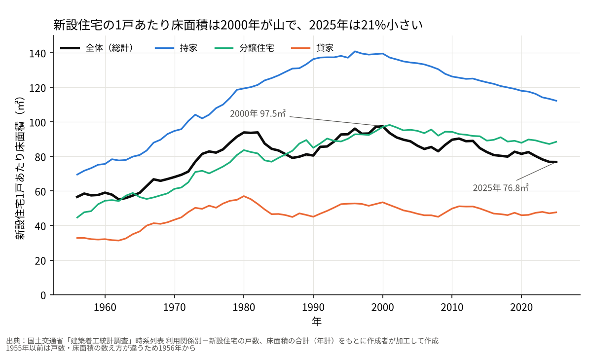
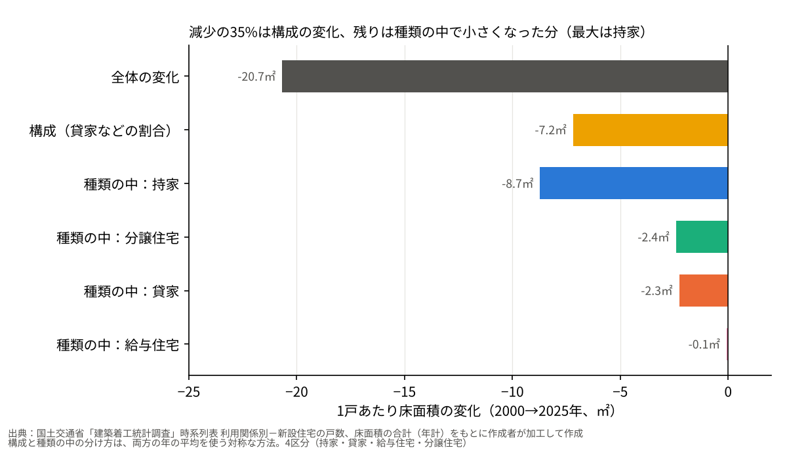
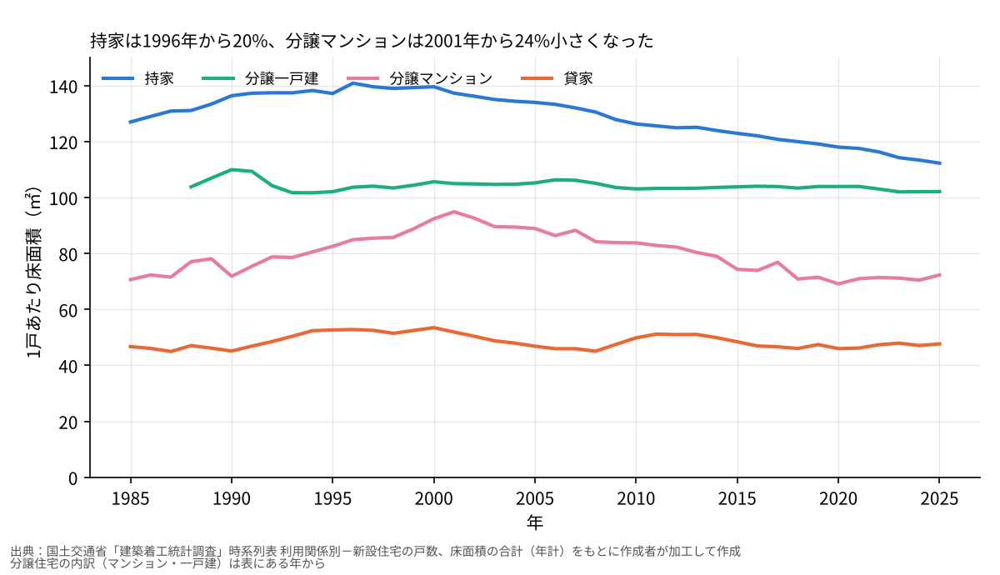
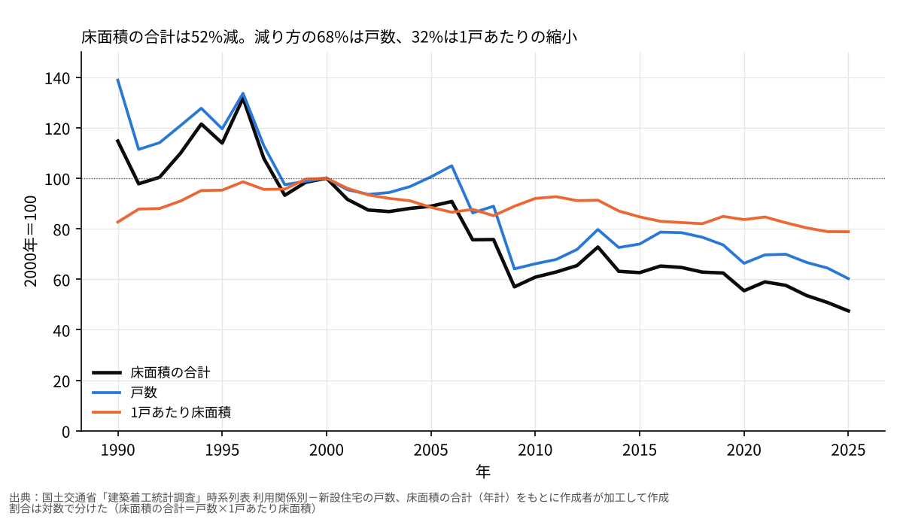

# F326 新築の家は狭くなったのか？ 1戸あたり床面積は2000年の97.5㎡から2025年の76.8㎡へ21%縮み、その65%は持家など種類の中の縮小

## 結論（先に）

- 新設住宅の1戸あたり床面積は、2000年の97.5㎡が山で、2025年は76.8㎡（−21.2%）でした。1956年は56.6㎡で、そこから伸びて2000年まで大きくなっていました。
- 2000→2025年の減少（−20.7㎡）のうち、貸家などの割合が変わった構成の効果は −7.2㎡（34.8%）で、残りの −13.5㎡ は種類の中で家が小さくなった分でした。最も大きいのは持家（−8.7㎡）です。
- 持家は1996年の140.8㎡から2025年の112.2㎡へ20.3%、分譲マンションは2001年の94.9㎡から72.3㎡へ23.8%小さくなりました。分譲一戸建ては1990年の109.9㎡から102.1㎡で、縮み方は小さめです。
- 新設住宅の床面積の合計は2000年から52.5%減りました。対数で分けると、その68%は戸数の減少、32%は1戸あたりの縮小によるものでした（問い直し）。
- 事前の仮説は、「山は2000年より前」（H1）と「減少の半分以上は構成の変化」（H2）が外れ、持家（H3）とマンション（H4）の縮小は支持されました。

## 問い

「新築の家は狭くなった」と言われます。国土交通省の建築着工統計で、新設住宅の1戸あたり床面積は長い目でどう動いたのか。狭くなったとすれば、それは持家・分譲などそれぞれの種類の中で家が小さくなったからか、床面積の小さい貸家の割合が増えたからか。住宅・建材・家具・不動産の実務の人、住まいの記事を読む人に向けて確かめます。価格や、どの家を選ぶべきかは扱いません。

関連する記事：F181（家が建つ数は、金利と人口のどちらで決まるのか）。F181 は着工の戸数を扱い、この記事は1戸あたりの床面積と、その縮み方の分解を扱います。

## データ（出典）

- 国土交通省「建築着工統計調査」時系列表「利用関係別－新設住宅の戸数、床面積の合計」（年計、1948〜2025年）。e-Stat の Excel 1ファイル（38KB）を `data/raw/` に同梱（取得日・URL は `data/raw/SOURCES.md`）。
- 利用関係：持家（自分で住むために建てる家）、貸家、給与住宅（社宅など）、分譲住宅（うちマンション、うち一戸建）。1戸あたり床面積＝床面積の合計÷戸数。
- 表の注で1955年以前は数え方が違うため、1956年からを使いました。4区分の合計は、どの年も総計と一致しました。

## 事前の計画

[PLAN.md](PLAN.md)（2026-11-16 07:18、1戸あたり床面積を集計する前に作成）。

| 仮説 | 内容（外れの基準） | 結果 | 判定 |
|---|---|---|---|
| H1 | 全体の山は2000年より前で、最新年は山より10%以上小さい | 山は2000年、−21.2% | 外れ（山の年が2000年） |
| H2 | 山から最新年までの減少の半分以上は構成の変化 | 34.8% | 外れ |
| H3 | 持家の最新年はそれ自身の山より5%以上小さい | −20.3%（山は1996年） | 支持 |
| H4 | 分譲マンションの最新年は2000年以降の山より5%以上小さい | −23.8%（山は2001年） | 支持 |

H1 は「2000年より前」と置いていたため、山がちょうど2000年で外れました。減少の大きさ（10%以上）は満たしています。

## やったこと

種類ごとの1戸あたり床面積を計算し、全体の平均の変化を、構成（種類ごとの戸数の割合）の変化と、種類の中の1戸あたり床面積の変化に分けました（シフト・シェア。両方の年の平均を使う対称な分け方）。種類は持家・貸家・給与住宅・分譲住宅の4つです（`src/03_analysis.py`）。

## 分かったこと

### 図1：2000年が山で、2025年は21%小さい



- 全体は1975年82.9㎡、1996年96.1㎡、2000年97.5㎡、2006年84.3㎡、2016年80.8㎡、2025年76.8㎡でした。
- 2025年の種類ごとの値は、持家112.2㎡、分譲住宅88.5㎡、給与住宅62.9㎡、貸家47.6㎡です。
- 1980年代にも一度小さくなっています。1982年の93.9㎡から1987年の79.2㎡へ下がり、同じ時期に貸家の割合が27.5%から51.3%に上がりました（この時期の分解はしていません）。

### 図2：減少の35%は構成、65%は種類の中の縮小



- 戸数の割合は、2000年に持家36.7%・貸家34.3%・分譲28.1%、2025年に持家27.2%・貸家43.9%・分譲28.1%でした。床面積の大きい持家が減り、小さい貸家が増えた分が −7.2㎡ です。
- 種類の中の縮小は、持家 −8.7㎡、分譲住宅 −2.4㎡、貸家 −2.3㎡、給与住宅 −0.1㎡ でした。

### 図3：持家とマンションが小さくなった



- 持家は1996年の140.8㎡が山で、2025年は112.2㎡です。
- 分譲マンションは2001年の94.9㎡が山で、2025年は72.3㎡です。
- 貸家の山は1980年の57.0㎡で、2025年は47.6㎡でした。

## 問い直し（結果を見てから足した）

1戸あたりの縮小が分かったので、「新しく建つ住宅の床面積の合計は、どれだけ減ったのか。それは戸数の減少と1戸あたりの縮小のどちらによるのか」を足しました。



- 床面積の合計は、2000年の1億1,988万㎡から2025年の5,688万㎡へ52.5%減りました。戸数は122.98万戸から74.07万戸（−39.8%）です。
- 対数で分けると、減り方の68%は戸数の減少、32%は1戸あたりの縮小でした。
- 2006年から比べると、戸数の減少が86%を占めました（1戸あたりは −8.9%）。

## 頑健性

| 変えたこと | 全体の変化 | 構成の寄与 | 種類の中の寄与 | 構成の割合 | H2 |
|---|---|---|---|---|---|
| 主の設定（2000→2025年、対称） | −20.7㎡ | −7.2㎡ | −13.5㎡ | 34.8% | 外れ |
| 1996→2025年 | −19.3㎡ | −6.5㎡ | −12.8㎡ | 33.8% | 外れ |
| 2006→2025年 | −7.5㎡ | −1.0㎡ | −6.5㎡ | 13.3% | 外れ |
| 始めの年の構成を固定 | −20.7㎡ | −8.2㎡ | −12.5㎡ | 39.7% | 外れ |
| 給与住宅を除く | −20.8㎡ | −7.3㎡ | −13.5㎡ | 35.0% | 外れ |
| 6区分（分譲をマンション・一戸建・その他に分ける） | −20.7㎡ | −6.1㎡ | −14.6㎡ | 29.3% | 外れ |

どの設定でも、構成の寄与は4割未満で、種類の中の縮小の方が大きいという結論は変わりませんでした。2006年以降に限ると、構成の寄与はさらに小さくなります。

## 言えないこと

- 床面積は延べ床面積で、使いやすさや部屋数は分かりません。
- 1戸あたりの面積が小さくなった理由（家族の人数、土地の値段、建築費、住宅の性能の基準など）は、この表からは分かりません。理由を述べる場合は推測になります。
- 増改築や中古住宅は入りません。
- 地域の差は扱っていません。

## 仕事で使うなら

- 「新築の家が狭くなった」を示すときは、構成の変化（貸家の増加）と種類の中の縮小（持家・マンション）を分けて示すと、どちらの話かがはっきりします。
- 新築の床面積の需要を見るときは、戸数と1戸あたりの面積を掛け合わせて見ると、2000年以降は戸数の減少の方が大きく効いていることが分かります。

## 計画からの変更

- H1 は山の年がちょうど2000年で外れたことを、表の下に書き足しました。
- 問い直しとして、床面積の合計の分解を足しました。

## 再現のしかた

```sh
pip install -r requirements.txt
sh src/run_all.sh        # オフラインで 02→03→04（約2秒）
python3 src/01_fetch.py  # （任意）元データを取り直す
```

| ファイル | 中身 |
|---|---|
| `src/02_build.py` | Excel → `data/starts_by_type.csv` |
| `src/03_analysis.py` | 推移・分解・頑健性・問い直し → `results/` |
| `src/04_figures.py` | 図4枚 → `figures/` |
| `results/main.json` | 本文の数字の元 |

`results/repro_check.txt`：別の場所で生成物を消して流し直し、すべての生成物がバイト単位で一致しました。

## レビューで直したこと

| # | 指摘 | 直し方 |
|---|---|---|
| 1 | 既存記事 F181（着工戸数）との関係が書かれていない | 「関連する記事」として違いを1文で追記 |

## 出典

- 国土交通省「建築着工統計調査」時系列表 利用関係別－新設住宅の戸数、床面積の合計（e-Stat）：https://www.e-stat.go.jp/stat-search/file-download?statInfId=000040405973&fileKind=0

（いずれも国土交通省「建築着工統計調査」をもとに作成者が加工して作成）
