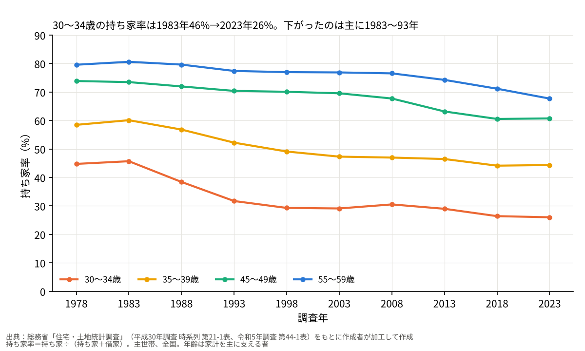
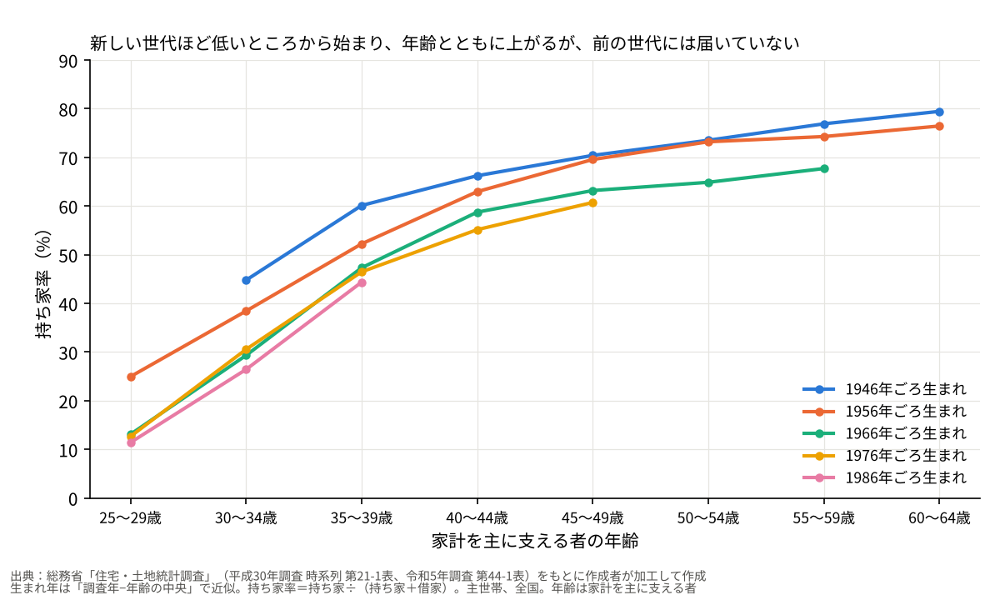
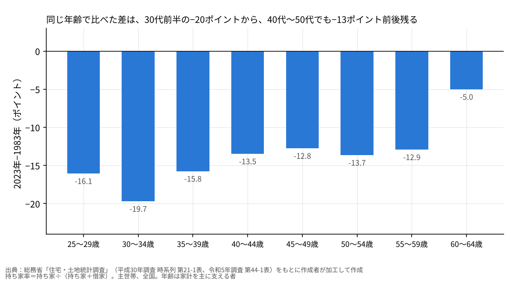
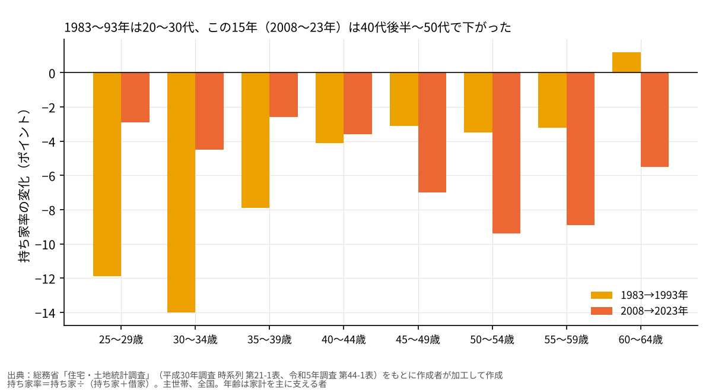

# F327 「若い世代の持ち家率が下がった」は、世代で追うとどう見えるか？ 30〜34歳は1983年46%→2023年26%。年齢とともに追い上げるが、50代前半でも30年前より10ポイント低い

## 結論（先に）

- 30〜34歳の持ち家率は、1983年の45.7%から2023年の26.0%へ19.7ポイント下がりました。ただし下がったのは主に1983〜1993年（−14.0ポイント）で、1993年以降の下がり幅は5.7ポイントです。
- 世代で追うと、新しい世代は年齢とともに追い上げます。1986年ごろ生まれの世代は、30〜34歳から35〜39歳で26.4%→44.4%（+18.0ポイント）と、1946年ごろ生まれの世代（+15.3ポイント）より大きく伸びました。
- それでも追いつききっていません。2023年の50〜54歳（1971年ごろ生まれ）は63.8%で、30年前（1993年）の同じ年齢の74.0%より10.2ポイント低い値です。
- 同じ年齢で1983年と比べた差は、30〜34歳の −19.7ポイントから、45〜49歳では −12.8ポイントに縮みますが、40代〜50代でも −13ポイント前後が残ります。
- 結果を見てから足した問いでは、この15年（2008→2023年）で持ち家率が大きく下がったのは、20〜30代ではなく45〜59歳（−7.0〜−9.4ポイント）でした。

## 問い

「若い世代は家を持たなくなった」と言われます。住宅・土地統計調査の年齢別の持ち家率は、たしかに30代で下がっています。しかし、同じ年齢で比べて下がっていても、その世代が40代・50代になって追いつくなら、「持たなくなった」のではなく「持つのが遅くなった」ことになります。5年ごとの調査で同じ世代を追いかけると、持ち家率はどう見えるのか。住宅・不動産・金融の実務の人、住まいの記事を読む人に向けて確かめます。どの家を買うべきか、価格や税の話は扱いません。

## データ（出典）

- 総務省「住宅・土地統計調査」平成30年調査の時系列 第21-1表（全国、1968〜2018年）と、令和5年調査 第44-1表（全国、2023年）。Excel 2ファイル（0.1MB）を `data/raw/` に同梱（取得日・URL は `data/raw/SOURCES.md`）。
- 持ち家率＝持ち家÷（持ち家＋借家）。主世帯、全国。年齢は「家計を主に支える者」の年齢です。表の総数には所有の関係「不詳」が入るため、分母から除きました。
- 5歳ごとの年齢がそろう1978〜2023年の10回分を使いました。生まれ年は「調査年−年齢の中央」で近似しています。

## 事前の計画

[PLAN.md](PLAN.md)（2026-11-16 07:24、年齢別の持ち家率を年をまたいで計算する前に作成）。

| 仮説 | 内容（外れの基準） | 結果 | 判定 |
|---|---|---|---|
| H1 | 30〜34歳の持ち家率は1983年より2023年が5ポイント以上低い | −19.7ポイント | 支持 |
| H2 | 1986年ごろ生まれの30〜34→35〜39歳の伸びが、1946年ごろ生まれより大きい | +18.0 対 +15.3 | 支持 |
| H3 | 2023年の50〜54歳は1993年の同じ年齢より3ポイント以上低い | −10.2ポイント | 支持 |
| H4 | 1983年との差は、30〜34歳より45〜49歳の方が小さい | −19.7 対 −12.8 | 支持 |

## やったこと

年齢×調査年の持ち家率の表を作り、同じ世代を斜めにたどる表（コホート表）に組み替えました（`src/03_analysis.py`）。検定はしていません（全国の値で、標本のぶれは小さいと考えています）。

## 分かったこと

### 図1：30〜34歳の低下は主に1983〜93年



- 30〜34歳は、1983年45.7%、1993年31.7%、2008年30.5%、2023年26.0%でした。
- 35〜39歳は60.1%（1983年）から44.4%（2023年）へ、45〜49歳は73.5%から60.7%へ下がりました。

### 図2：新しい世代ほど低いところから始まり、追い上げるが届かない



- 1966年ごろ・1976年ごろ・1986年ごろ生まれの世代は、30〜34歳でほぼ同じ（26〜30%）でした。
- 1966年ごろ生まれは、45〜49歳で63.2%と、1956年ごろ生まれ（69.6%）より低いままです。

### 図3：同じ年齢での差は、40代〜50代でも13ポイント前後残る



- 2023年と1983年の差は、25〜29歳 −16.1、30〜34歳 −19.7、35〜39歳 −15.8、40〜44歳 −13.5、45〜49歳 −12.8、50〜54歳 −13.7、55〜59歳 −12.9、60〜64歳 −5.0ポイントでした。

## 問い直し（結果を見てから足した）

図1で、30〜34歳の低下が1993年以降は小さいことが分かりました。そこで「この15年で持ち家率が下がったのはどの年齢か」を足しました。



- 1983→1993年は、25〜29歳 −11.9、30〜34歳 −14.0、35〜39歳 −7.9ポイントと、若い年齢で下がりました。
- 2008→2023年は、45〜49歳 −7.0、50〜54歳 −9.4、55〜59歳 −8.9ポイントと、40代後半〜50代で大きく下がりました。30〜34歳は −4.5ポイントでした。
- 1990年代に30代だった世代（1966〜1976年ごろ生まれ）が、いま40代後半〜50代になっていて、その世代の低さが中年の値を押し下げていると読めます（世代と時代の効果は分けられないため、これは解釈です）。

## 頑健性

| 変えたこと | 30〜34歳の差 | 45〜49歳の差 | 比べた年 |
|---|---|---|---|
| 主の設定（持ち家÷（持ち家＋借家）） | −19.7 | −12.8 | 1983→2023 |
| 分母を主世帯（所有の関係の不詳を含む） | −19.9 | −13.0 | 1983→2023 |
| 分母を普通世帯（同居世帯を含む） | −19.2 | −13.0 | 1983→2018 |
| 基準を1993年に | −5.7 | −9.7 | 1993→2023 |
| 25〜29歳で比べる | −16.1 | ― | 1983→2023 |
| 35〜39歳で比べる | −15.7 | ― | 1983→2023 |
| 2023年の年齢不詳を借家として年齢別に配る（下限） | −20.5 | −14.5 | 1983→2023 |

- 分母の取り方や不詳の扱いを変えても、差の大きさはほぼ同じでした。
- 基準を1993年にすると、30〜34歳の差（−5.7）より45〜49歳の差（−9.7）の方が大きくなります。「若い世代で下がった」は1980年代〜90年代前半の話で、その後は中年の方が下がっています。
- 2023年の年齢不詳（306万世帯）の持ち家率は59.5%で、年齢別の値からは除いています。

## 言えないこと

- 持ち家率の差の理由（未婚化、収入、住宅の値段、住み替えの考え方）は、この表からは分かりません。
- 「家計を主に支える者」の年齢で数えるため、親と同居している若い人は数に入りません。世帯を持たない人が増えた分は見えません。
- 生まれ年は近似で、世代の効果と時代の効果、年齢の効果は分けられません。
- 調査年によって定義や不詳の扱いが違い、2023年は年齢不詳が多くなっています。
- 地域の差は扱っていません。

## 仕事で使うなら

- 「若い世代の持ち家率が下がった」と書くときは、比べる年を示すと誤解が減ります。1983年と比べると30代で大きく下がっていますが、1993年以降は40〜50代の低下の方が大きくなっています。
- 世代で追う表を並べると、「持つのが遅くなった」部分と「追いついていない」部分を分けて示せます。

## 計画からの変更

- 問い直しとして、2008→2023年と1983→1993年の年齢別の変化を足しました。
- 頑健性に、2023年の年齢不詳を借家として配る下限の計算を入れました（計画の2の形）。

## 再現のしかた

```sh
pip install -r requirements.txt
sh src/run_all.sh        # オフラインで 02→03→04（約2秒）
python3 src/01_fetch.py  # （任意）元データを取り直す
```

| ファイル | 中身 |
|---|---|
| `src/02_build.py` | Excel → `data/tenure_by_age.csv` |
| `src/03_analysis.py` | 年齢×年・世代の表、仮説、頑健性、問い直し → `results/` |
| `src/04_figures.py` | 図4枚 → `figures/` |
| `results/main.json` | 本文の数字の元 |

`results/repro_check.txt`：別の場所で生成物を消して流し直し、すべての生成物がバイト単位で一致しました。

## レビューで直したこと

独立レビューで数字の照合・再実行・図を確かめ、直すところはなかった。

## 出典

- 総務省統計局「住宅・土地統計調査」平成30年調査 時系列 第21-1表、令和5年調査 第44-1表（e-Stat）：https://www.e-stat.go.jp/stat-search/file-download?statInfId=000031959639&fileKind=0 ほか（`data/raw/SOURCES.md`）

（いずれも総務省「住宅・土地統計調査」をもとに作成者が加工して作成）
