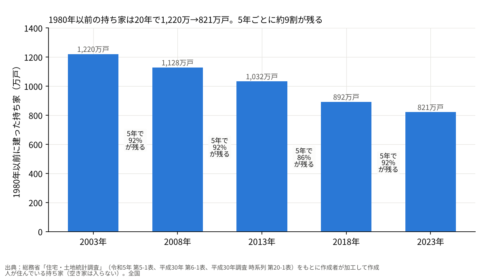
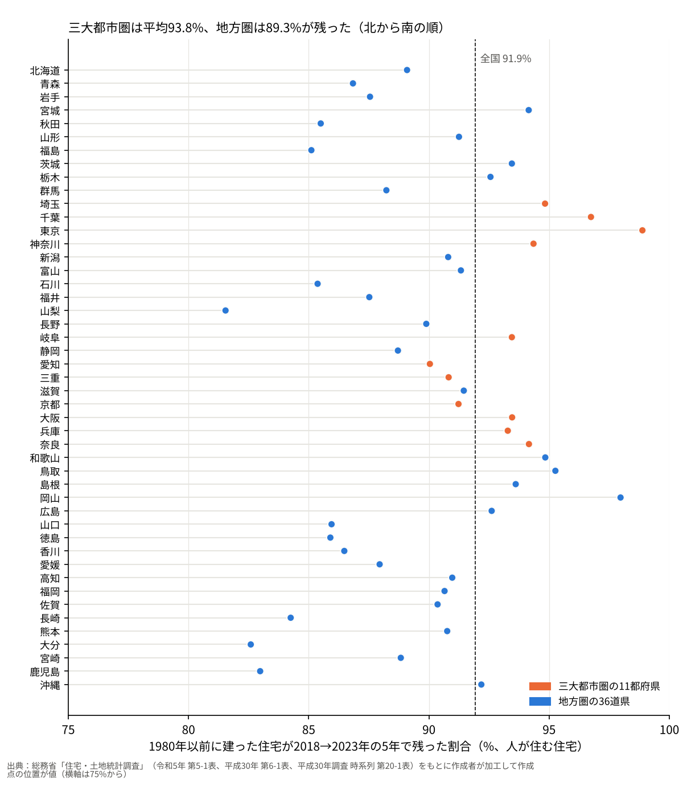
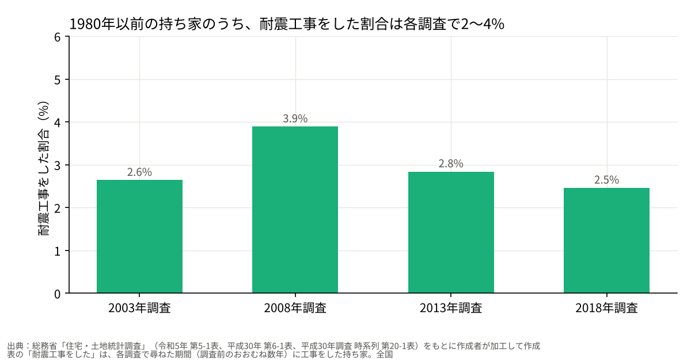
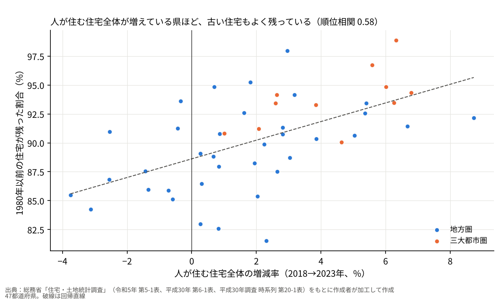

# F328 古い耐震基準の住宅は、どれだけのペースで減っているのか？ 人が住む1980年以前の住宅は5年で8%減、なお1,104万戸。減り方は地方圏の方が速い

## 結論（先に）

- 人が住む住宅のうち1980年以前に建ったもの（1981年の耐震基準の改正より前）は、2018年の1,201万戸から2023年の1,104万戸へ減りました。5年で残った割合は91.9%、住宅全体に占める割合は22.4%から19.8%になりました。
- 1980年以前の持ち家は、2003年の1,220万戸から2023年の821万戸へ減りました。5年ごとに残る割合は、86〜92%で推移しています。同じ割合で減り続けると仮定すると、半分になるまでに約40年かかる計算です（予測ではありません）。
- 5年で残った割合は、三大都市圏の平均93.8%に対し、地方圏の平均89.3%でした。事前の仮説（大都市の方が建て替えで速く減る）とは逆で、地方圏の方が速く減っていました。
- 1980年以前の持ち家のうち、各調査で尋ねた期間に耐震工事をした割合は2.5〜3.9%でした。
- 結果を見てから足した問いでは、人が住む住宅全体が増えている県ほど、古い住宅もよく残っていました（順位相関0.58）。「減った」には、取り壊しだけでなく、人が住まなくなった（空き家になった）分も入っていると考えられます（推測）。

## 問い

1981年6月に建築基準法の耐震の基準が改められました。それより前の基準で建てられた住宅（ここでは1980年以前に建った住宅）は、人が住む住宅の中にどれだけ残り、5年でどれだけ減っているのか。減り方は大都市圏と地方圏で違うのか。耐震の改修工事はどれくらい行われているのか。住宅・建設・損害保険の実務の人、自治体の住宅・防災の担当に向けて確かめます。どの住宅を改修すべきか、制度や保険料をどうすべきかは扱いません。地域の順位も作りません。

## データ（出典）

- 総務省「住宅・土地統計調査」令和5年 第5-1表、平成30年 第6-1表（建築の時期別住宅数、全国・都道府県）
- 同 平成30年調査 時系列 第20-1表（持ち家の建築の時期・耐震改修工事の状況、全国、2003〜2018年）
- Excel 3ファイル（0.6MB）を `data/raw/` に同梱（取得日・URL は `data/raw/SOURCES.md`）。
- 住宅数は人が住んでいる住宅（居住世帯のある住宅）です。空き家は入りません。

## 事前の計画

[PLAN.md](PLAN.md)（2026-11-16 07:31、都道府県別の集計の前に作成）。全国の値は表の形を確かめるときに見ていたため、H1 は参考扱いです。

| 仮説 | 内容（外れの基準） | 結果 | 判定 |
|---|---|---|---|
| H1（参考） | 全国の1980年以前の持ち家の5年後に残る割合が90%以上 | 92.1% | 支持（参考） |
| H2 | 5年後に残る割合が、三大都市圏の平均で地方圏の平均より低い | 93.8% 対 89.3% | 外れ |
| H3 | 2023年の1980年以前の割合が、地方圏の平均で三大都市圏の平均より3ポイント以上高い | 23.5% 対 20.0% | 支持 |
| H4 | 耐震工事をした割合が2003〜2018年のどの調査でも5%未満 | 2.5〜3.9% | 支持 |

## やったこと

1980年以前に建った住宅の数を、2018年と2023年（都道府県）、2003〜2023年（全国の持ち家）で並べ、5年後に残る割合を出しました。同じ時期に建った住宅のまとまりが時間とともにどれだけ残るかを見る、生存分析の考え方です（`src/03_analysis.py`）。県は北から南の順に並べ、順位は作っていません。

## 分かったこと

### 図1：1980年以前の持ち家は20年で3分の2に



- 1980年以前の持ち家は、2003年1,220万、2008年1,128万、2013年1,032万、2018年892万、2023年821万戸でした。
- 5年ごとに残る割合は、2008年92.4%、2013年91.5%、2018年86.4%、2023年92.1%でした。

### 図2：残る割合は、地方圏の方が低い



- 5年で残った割合の県の範囲は81.5〜98.9%で、三大都市圏の平均93.8%、地方圏の平均89.3%でした。
- 2023年に住宅全体に占める1980年以前の割合は、県の範囲が15.6〜32.2%で、地方圏の平均23.5%、三大都市圏の平均20.0%でした。

### 図3：耐震工事をした割合は2〜4%



- 1980年以前の持ち家のうち耐震工事をした割合は、2003年2.6%、2008年3.9%、2013年2.8%、2018年2.5%でした。
- 表の「耐震工事をした」は、各調査で尋ねた期間（調査前のおおむね数年）に工事をしたものです。それ以前の工事や、耐震診断の結果は分かりません。

## 問い直し（結果を見てから足した）

地方圏の方が古い住宅が速く減っていたので、「古い住宅がよく残る県は、人が住む住宅全体が増えている県か」を足しました。



- 人が住む住宅全体の増減率（2018→2023年）と、古い住宅が残った割合の順位相関は0.58でした。住宅全体が1ポイント多く増えた県ほど、残る割合は0.8ポイント高くなります。
- 住宅全体が減った10県の残る割合の平均は87.7%、増えた37都道府県は91.1%でした。
- 人が住む住宅の数で数えているため、古い住宅に住む人がいなくなる（空き家になる）ことでも数は減ります。地方圏で速く減るのは、取り壊しより人が住まなくなることの影響が大きい可能性があります（推測。この表では分けられません）。

## 頑健性

| 変えたこと | 三大都市圏の平均 | 地方圏の平均 | 全国 | H2 |
|---|---|---|---|---|
| 主の設定（人が住む住宅すべて） | 93.8% | 89.3% | 91.9% | 外れ |
| 持ち家だけ | 93.6% | 90.2% | 92.1% | 外れ |
| 建築の時期「不詳」を配る | 91.3% | 87.9% | 89.7% | 外れ |
| 1950年以前だけ | 84.5% | 82.6% | 83.1% | 外れ |
| 1951〜1970年だけ | 86.9% | 83.6% | 85.1% | 外れ |
| 1971〜1980年だけ | 98.2% | 94.1% | 96.5% | 外れ |
| 大都市圏を東京圏（4都県）にする | 96.2% | 89.3% | 91.9% | 外れ |

どの設定でも、三大都市圏の方がよく残っていました。古い時期ほど速く減っています（1950年以前は5年で約17%減）。

## 言えないこと

- 人が住む住宅だけを数えているため、「減った」には取り壊しと、人が住まなくなった（空き家になった）分の両方が入ります。分けられません。
- 1980年以前の住宅でも、耐震性があるかどうかは分かりません。1981年以降の住宅が十分かどうかも扱っていません。
- 標本調査で、県の値には標本のぶれがあります。
- 建築の時期は回答によるもので、「不詳」の数は調査ごとに違います（2018年471万戸、2023年362万戸）。
- 半分になるまでの年数は、同じ割合が続くと仮定した計算で、予測ではありません。

## 仕事で使うなら

- 古い耐震基準の住宅の数を引くときは、「人が住む住宅」の数か、空き家を含む数かを確かめると、減り方を読み違えにくくなります。
- 地域で比べるときは、古い住宅の割合（地方圏で高い）と減る速さ（地方圏で速い）を分けて示すと、状況が伝わりやすくなります。

## 計画からの変更

- 問い直しとして、住宅全体の増減との関係と、同じ割合が続くと仮定した半分になるまでの年数を足しました。
- 図2は、横軸を75%から始めるため、棒ではなく点で示しました。

## 再現のしかた

```sh
pip install -r requirements.txt
sh src/run_all.sh        # オフラインで 02→03→04（約2秒）
python3 src/01_fetch.py  # （任意）元データを取り直す
```

| ファイル | 中身 |
|---|---|
| `src/02_build.py` | Excel → `data/pref_period.csv`、`data/owned_retrofit.csv` |
| `src/03_analysis.py` | 残る割合・耐震工事・頑健性・問い直し → `results/` |
| `src/04_figures.py` | 図4枚 → `figures/` |
| `results/main.json` | 本文の数字の元 |

`results/repro_check.txt`：別の場所で生成物を消して流し直し、すべての生成物がバイト単位で一致しました。

## レビューで直したこと

独立レビューで数字の照合・再実行・図を確かめ、直すところはなかった。

## 出典

- 総務省統計局「住宅・土地統計調査」令和5年 第5-1表、平成30年 第6-1表、平成30年調査 時系列 第20-1表（e-Stat）：https://www.e-stat.go.jp/stat-search/file-download?statInfId=000040209849&fileKind=0 ほか（`data/raw/SOURCES.md`）

（いずれも総務省「住宅・土地統計調査」をもとに作成者が加工して作成）
