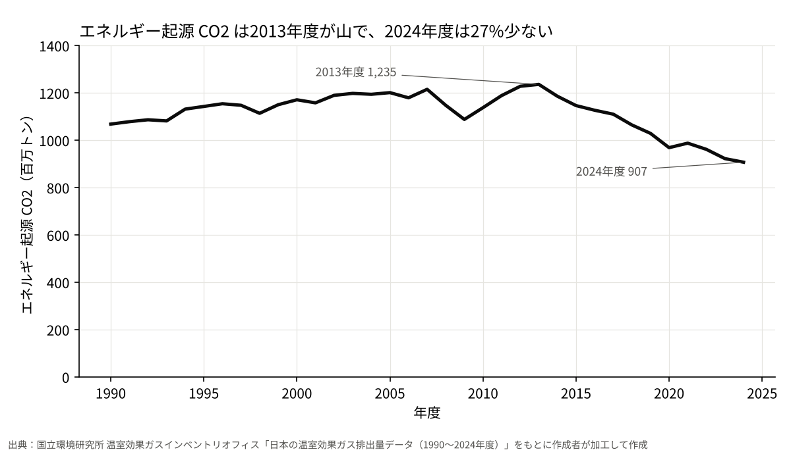
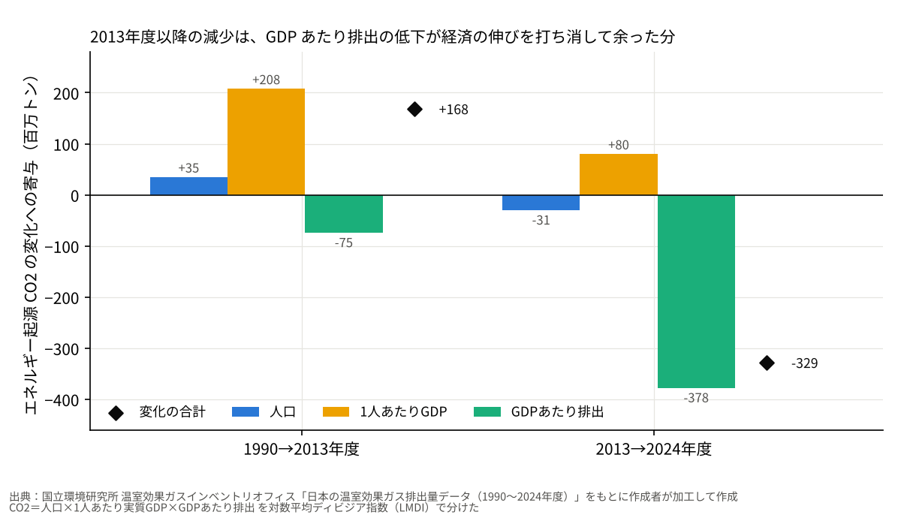
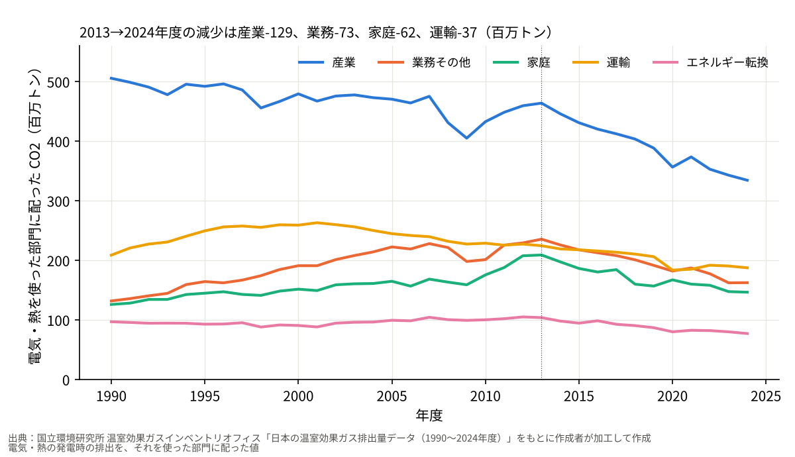
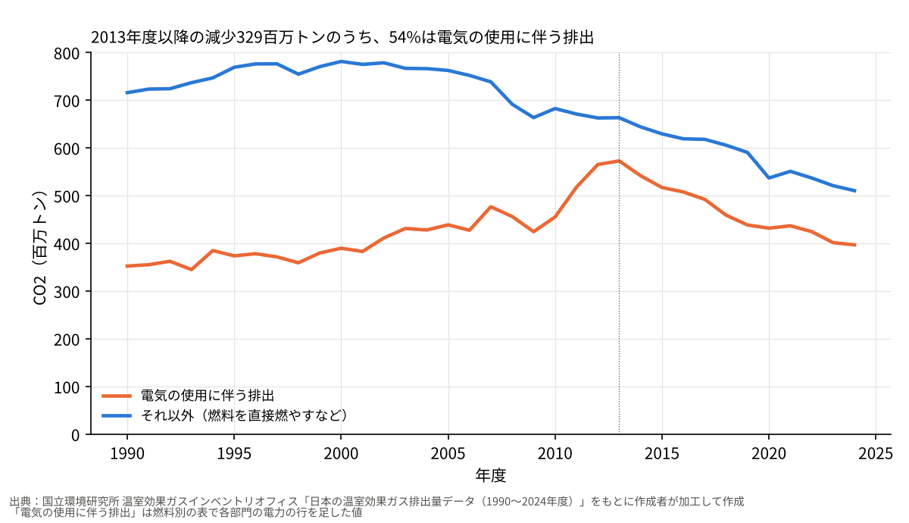

# F329 日本の CO2 排出が減ったのは、何のおかげか？ 2013→2024年度の減少329百万トンは、GDP あたり排出の低下（−378）が経済の伸び（+80）を上回った分。半分は電気の使用に伴う排出

## 結論（先に）

- エネルギー起源 CO2 は2013年度の1,235百万トンが山で、2024年度は907百万トン（−26.6%）でした。1990年度（1,068百万トン）より15.1%少ない水準です。
- 茅恒等式（CO2＝人口×1人あたり GDP×GDP あたり排出）で2013→2024年度の変化（−329百万トン）を分けると、GDP あたり排出の低下が −378、1人あたり GDP の伸びが +80、人口の減少が −31 でした。減少の115%は GDP あたり排出の低下によるもので、経済の伸びを打ち消して余りました。
- 人口の減少の寄与は9.3%でした。事前の基準（10%未満）はぎりぎり満たしましたが、分け方や対象を変えると10%前後になります。
- 部門別（電気・熱を使った部門に配った値）の減少は、産業 −129、業務その他 −73、家庭 −62.5、運輸 −37、エネルギー転換 −27 百万トンでした。
- 結果を見てから足した問いでは、減少の54%（−176百万トン）が電気の使用に伴う排出でした。燃料別では石油が −180 百万トン（−35%）と最も大きく減りました。

## 問い

日本のエネルギー起源 CO2 は、2013年度ごろを境に減っています。減ったのは、人口が減ったからか、経済が伸びなかったからか、それとも同じ経済の大きさあたりの排出が下がったからか。部門で見るとどこが減ったのか。企業の環境・エネルギーの担当、自治体の計画の担当、気候の記事を読む人に向けて確かめます。目標をどうすべきか、政策の良し悪しは扱いません。

関連する記事：183（日本の排出量の減少は、どの部門がけん引したか）。183 は同じデータで部門別の寄与を出しています。この記事は人口・1人あたり GDP・GDP あたり排出の3要因に分けることが主で、部門の図（図3）は183と重なる補足です。

## データ（出典）

- 国立環境研究所 温室効果ガスインベントリオフィス「日本の温室効果ガス排出量データ（1990〜2024年度）」。Excel 1ファイル（1.4MB）を `data/raw/` に同梱（取得日・URL は `data/raw/SOURCES.md`）。
- 使った表：エネルギー起源・非エネルギー起源 CO2、温室効果ガスの合計、電気・熱配分後の部門別 CO2、燃料別 CO2、人口、実質 GDP（支出側、十億円）。部門の合計はエネルギー起源 CO2 と一致しました。
- 一次エネルギー供給（総合エネルギー統計）は、資源エネルギー庁のサイトに自動で取りに行けなかったため使っていません。そのため「エネルギーの使い方の効率」と「エネルギーの炭素の少なさ」は分けず、まとめて「GDP あたり排出」として扱いました。

## 事前の計画

[PLAN.md](PLAN.md)（2026-11-16 07:36、要因の分解を計算する前に作成）。推移の大きさは先に見ていたため、H1 は参考扱いです。

| 仮説 | 内容（外れの基準） | 結果 | 判定 |
|---|---|---|---|
| H1（参考） | 山は2010〜2015年度で、2024年度は山より20%以上少ない | 山は2013年度、−26.6% | 支持（参考） |
| H2 | 2013→2024年度の減少への GDP あたり排出の寄与が100%超 | 115.1% | 支持 |
| H3 | 人口の減少の寄与が10%未満 | 9.3% | 支持（頑健性では10%前後） |
| H4 | 減少量が最も大きい部門は産業 | 産業 −129百万トン | 支持 |

## やったこと

CO2 を「人口×1人あたり実質 GDP×GDP あたり排出」の3つに分け、対数平均ディビジア指数（LMDI。要因の寄与の合計が変化に一致する分け方）で、1990→2013年度と2013→2024年度の変化を分けました（`src/03_analysis.py`）。

## 分かったこと

### 図1：2013年度が山



- エネルギー起源 CO2 は1990年度1,068、2013年度1,235、2024年度907百万トンでした。

### 図2：減少は GDP あたり排出の低下による



- 1990→2013年度（+168）は、1人あたり GDP の伸び +208、人口の増加 +35、GDP あたり排出の低下 −75 でした。
- 2013→2024年度（−329）は、GDP あたり排出 −378、1人あたり GDP +80、人口 −31 でした。
- この間、人口は −2.8%、実質 GDP は +4.8%、GDP あたり排出は −30.0% 変わりました。

### 図3：どの部門も減り、量では産業が最大



- 2013→2024年度の変化率は、産業 −27.9%、業務その他 −31.0%、家庭 −29.9%、運輸 −16.5%、エネルギー転換 −25.8% でした。

## 問い直し（結果を見てから足した）

「GDP あたり排出」の低下の中身を少しでも分けるため、減った分のうち電気の使用に伴う排出がどれだけか、燃料では何が減ったかを足しました。



- 電気の使用に伴う排出は、2013年度572百万トンから2024年度397百万トンへ176百万トン減り、エネルギー起源 CO2 の減少の54%にあたりました。
- 燃料別（配分前）では、石油 −180（−35.4%）、石炭 −85（−17.9%）、ガス −64（−25.4%）百万トンでした。
- 電気の使用に伴う排出の減少が、電源の変化によるのか、電気の使用量の減少によるのかは、この表だけでは分けられません。

## 頑健性

| 変えたこと | 変化 | 人口 | 1人あたりGDP | GDPあたり排出 | GDPあたり排出の割合 | 人口の割合 | H2 | H3 |
|---|---|---|---|---|---|---|---|---|
| 主の設定（2013→2024年度、エネルギー起源） | −328.7 | −30.6 | +80.1 | −378.3 | 115.1% | 9.3% | 支持 | 支持 |
| 2013→2019年度 | −207.0 | −7.6 | +45.3 | −244.6 | 118.2% | 3.7% | 支持 | 支持 |
| CO2 の合計（非エネルギー起源を含む） | −340.9 | −32.6 | +85.5 | −393.7 | 115.5% | 9.6% | 支持 | 支持 |
| 温室効果ガスの合計 | −347.1 | −34.9 | +91.4 | −403.7 | 116.3% | 10.0% | 支持 | 外れ |
| 順番を決めた単純な分け方 | −328.8 | −35.0 | +94.0 | −387.7 | 117.9% | 10.7% | 支持 | 外れ |

（単位：百万トン）。GDP あたり排出の低下が減少の115〜118%を占めるという結論は、どの設定でも変わりませんでした。人口の寄与は3.7〜10.7%で、10%の基準をまたぐことがあります。

## 言えないこと

- GDP あたり排出の低下が、省エネによるのか、電源の変化（原子力の再稼働や再生可能エネルギー）によるのか、産業の構成の変化によるのかは、この分解では分けられません。
- 排出が減ったことが政策のおかげかどうか（因果）は言えません。
- 生産の海外移転などで国外に移った排出は入りません。
- インベントリの数字は毎年見直されることがあります。
- 実質 GDP は年度の値で、基準の改定で過去の値が変わることがあります。

## 仕事で使うなら

- 「排出が減った」を説明するときは、人口・経済の大きさ・GDP あたり排出の3つに分けて示すと、経済が伸びた中で減ったのかどうかが伝わります。
- 部門の値は「電気・熱を使った部門に配った値」か「配る前の値」かで大きく違うため、どちらかを明記して使うのが安全です。

## 計画からの変更

- 総合エネルギー統計が取得できなかったため、計画の段階で3要因の分解にしています（PLAN.md に記載）。
- 問い直しとして、電気の使用に伴う排出と燃料別の変化を足しました。

## 再現のしかた

```sh
pip install -r requirements.txt
sh src/run_all.sh        # オフラインで 02→03→04（約2秒）
python3 src/01_fetch.py  # （任意）元データを取り直す
```

| ファイル | 中身 |
|---|---|
| `src/02_build.py` | Excel → `data/series.csv` |
| `src/03_analysis.py` | 分解・部門・頑健性・問い直し → `results/` |
| `src/04_figures.py` | 図4枚 → `figures/` |
| `results/main.json` | 本文の数字の元 |

`results/repro_check.txt`：別の場所で生成物を消して流し直し、すべての生成物がバイト単位で一致しました。

## レビューで直したこと

| # | 指摘 | 直し方 |
|---|---|---|
| 1 | 図2の変化の合計のラベル（−329）が図の右端で切れていた | 04_figures.py で横軸の範囲を広げて作り直した |
| 2 | 既存記事 183（部門別の寄与、同じデータ）との関係が書かれていない | 「関連する記事」として違いを書いた |

## 出典

- 国立環境研究所 温室効果ガスインベントリオフィス「日本の温室効果ガス排出量データ（1990〜2024年度）」：https://www.nies.go.jp/gio/archive/ghgdata/index.html

（いずれも国立環境研究所「日本の温室効果ガス排出量データ」をもとに作成者が加工して作成）
