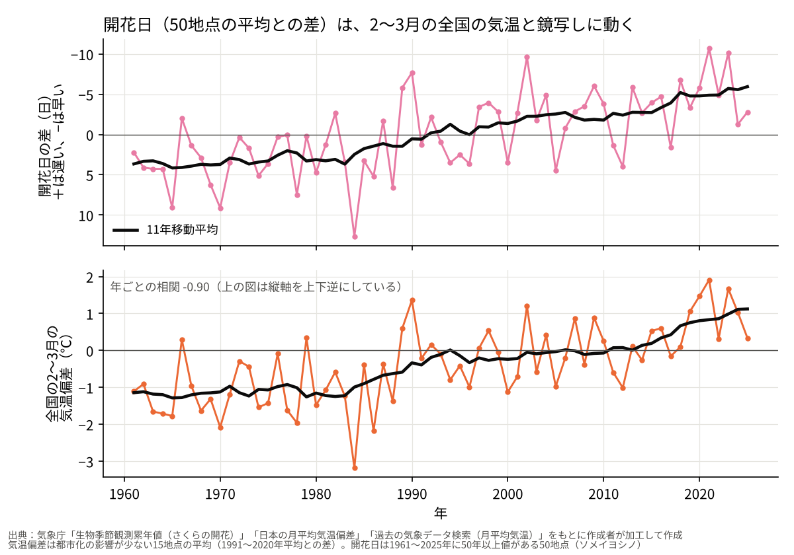
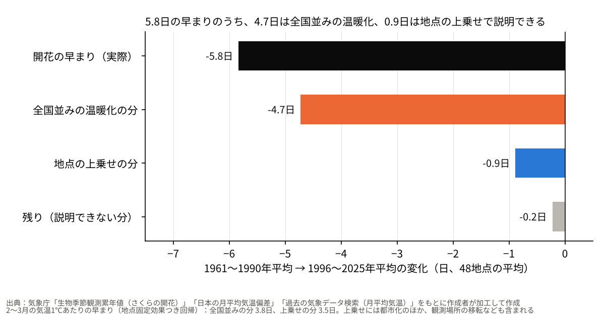
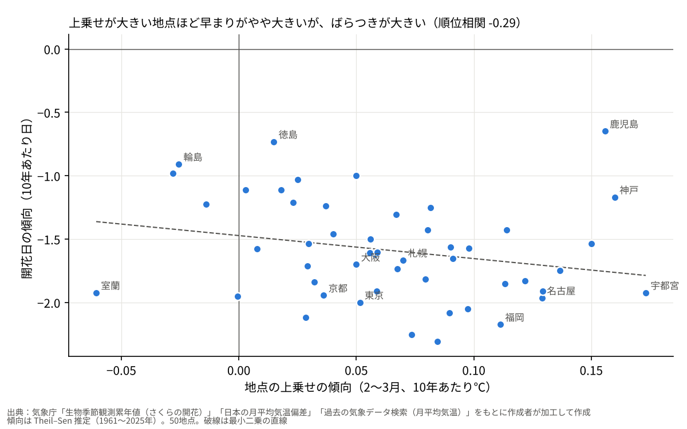
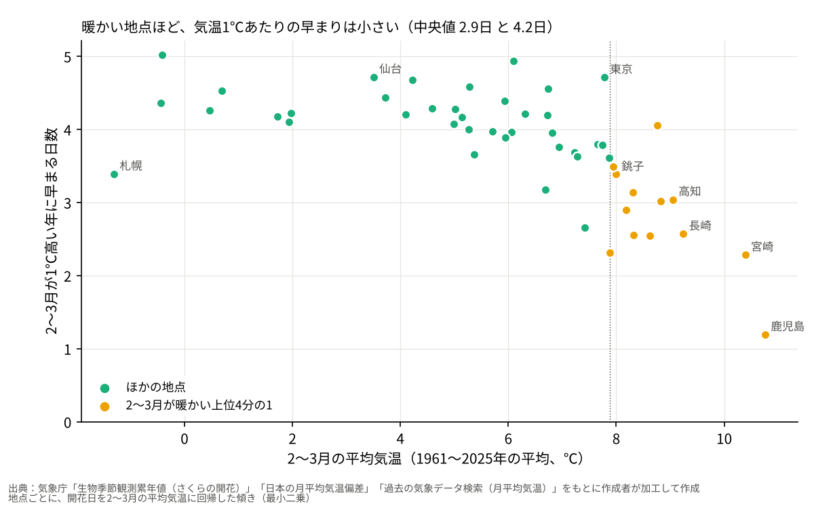

# F330 桜の開花は、どれだけ早くなったのか？ 30年で5.8日早まり、うち4.7日は日本全体の温暖化、0.9日は地点ごとの上乗せ（都市化など）で説明できる

## 結論（先に）

- さくら（ソメイヨシノ）の開花日は、1961〜1990年の平均から1996〜2025年の平均へ、48地点の平均で5.8日早まりました（中央値も5.8日）。48地点すべてで早まっています。1961〜2025年の傾向は、50地点の中央値で10年あたり1.6日でした。
- 開花の時期は、2〜3月の気温とよく連動します。全国の開花日（地点の平均との差）と、全国の2〜3月の気温偏差の年ごとの相関は −0.90 でした。
- 地点の2〜3月の気温を「日本全体（都市化の影響が少ない15地点）と同じだけの変化」と「その地点だけの上乗せ」に分けると、1℃あたりの早まりはどちらも同じくらい（全国並みの分 3.8日、上乗せの分 3.5日）でした。
- 5.8日の早まりのうち、4.7日は全国並みの温暖化（2〜3月で +1.24℃）、0.9日（15%）は地点の上乗せ（平均 +0.25℃）で説明でき、残りは0.2日でした。上乗せは都市化のほか、観測場所の移転なども含みます。
- 2〜3月がもともと暖かい地点（九州・四国・太平洋岸など）では、気温1℃あたりの早まりが小さく（中央値2.9日、ほかの地点4.2日）、鹿児島は上乗せが大きいのに開花は1.6日しか早まっていませんでした。

## 問い

さくらの開花は、どれだけ早くなったのか。そのうち、日本全体の温暖化で説明できる分と、その地点だけ余分に暖かくなった分（都市化などによる上乗せ）は、それぞれどれくらいか。花見や観光の時期を考える自治体・観光の担当、季節の記事を書く人、気候の変化に関心がある人に向けて確かめます。

同じ累年値を使った既存の分析（076 のもとのリポジトリ）で、開花が10年あたり約1日早まったこと、気温1℃で約4日早まることは示されています。この記事は、地点の気温を「全国並み」と「上乗せ」に分ける点を新しくしました。

## データ（出典）

- 気象庁「生物季節観測累年値」さくらの開花（地点×年、1953年〜）
- 気象庁「日本の月平均気温偏差」（1991〜2020年平均との差、都市化の影響が少ない15地点の平均）
- 気象庁「過去の気象データ検索」さくらの観測地点の月平均気温（年ごとの表）
- いずれも `data/raw/` に同梱（合計 8.3MB、取得日・URL は `data/raw/SOURCES.md`）。
- ソメイヨシノ以外（rm が6・7の値）と、2〜5月以外の日付は除きました。対象は、1961〜2025年に開花と気温の両方がそろう年が50年以上ある50地点です（北海道は札幌・函館・室蘭など、南は鹿児島まで）。

## 事前の計画

[PLAN.md](PLAN.md)（2026-11-16 07:43、地点の気温を取る前・傾向や回帰を計算する前に作成）。既存の分析の結果を読んでいたため、H1・H2 は参考扱いです。

| 仮説 | 内容（外れの基準） | 結果 | 判定 |
|---|---|---|---|
| H1（参考） | 地点の中央値で4日以上早まった | 5.8日 | 支持（参考） |
| H2（参考） | 全国並み・上乗せの係数がどちらも −3〜−5日/℃ | −3.8日、−3.5日 | 支持（参考） |
| H3 | 早まりのうち上乗せで説明される分が20%以上 | 15% | 外れ |
| H4 | 上乗せの傾向と開花の傾向の順位相関が −0.3 より強い | −0.29 | 外れ（ぎりぎり。頑健性で −0.18〜−0.44） |
| H5 | 暖かい地点（上位4分の1）の1℃あたりの早まりが小さい | 2.9日（ほか4.2日） | 支持 |

## やったこと

1. 地点ごとに、2〜3月の平均気温 T から全国の2〜3月の偏差 N を引いた残りを「上乗せ」U とし、地点の平均を引きました（T の年ごとの動き＝N の動き＋U の動き）。
2. 開花日（1月1日からの日数。うるう年はそろえた）を N と U に回帰しました（地点固定効果つき、年でクラスター頑健標準誤差）。
3. 地点ごとの、1961〜1990年平均 → 1996〜2025年平均の変化を、「N の変化×係数」「U の変化×係数」「残り」に分けました。
4. 地点ごとの傾向（Theil–Sen、10年あたり）を、開花日と U について求め、地点間で比べました。

## 分かったこと

### 図1：開花日は2〜3月の気温と鏡写し



- 全国の2〜3月の気温偏差は、1961〜2025年に10年あたり0.35℃上がりました。地点の2〜3月の気温は中央値で10年あたり0.42℃上がっています。
- 開花日（地点の平均との差）と全国の気温偏差の年ごとの相関は −0.90 です。

### 図2：早まりの8割は全国並みの温暖化の分



- 1℃あたりの早まりは、全国並みの分 3.8日（標準誤差0.23）、上乗せの分 3.5日（0.40）で、ほぼ同じでした。
- 1961〜1990年 → 1996〜2025年の早まり 5.8日の内訳は、全国並み 4.7日、上乗せ 0.9日（15%）、残り 0.2日。
- 上乗せは48地点のうち45地点（94%）でプラスで、平均 +0.25℃（最大 +0.70℃）でした。

### 図3：上乗せが大きい地点ほど早まりがやや大きいが、はっきりしない



- 上乗せの傾向と開花の傾向の順位相関は −0.29 で、事前の基準（−0.3 より強い）にわずかに届きませんでした。
- 東京は10年あたり2.0日早まり（50地点の中央値1.6日）、上乗せは10年あたり0.05℃で真ん中あたりです。

## 問い直し（結果を見てから足した）

図3で、上乗せが大きいのに早まりが小さい地点（鹿児島など）が目立ったため、「もともと暖かい地点では、気温が上がっても開花が早まりにくいのではないか」を H5 の地点別の傾きで詳しく見ました。



- 2〜3月の平均気温が高い地点ほど、1℃あたりの早まりが小さくなっていました。上位4分の1（7.9℃以上）の中央値は2.9日、ほかの地点は4.2日です。
- 鹿児島は2〜3月の上乗せが +0.55℃と大きいのに、開花は1.6日しか早まっておらず、全国一律の係数で見込むより5.1日遅い結果でした。
- ソメイヨシノは冬にいったん十分な寒さにあたることで目覚めるとされ、暖かい地点では冬の暖かさが開花を遅らせる向きにも働くと考えられます（推測。この分析では確かめていません）。

## 頑健性

| 変えたこと | 地点数 | 全国並み（日/℃） | 上乗せ（日/℃） | 早まり（日） | 上乗せの分（日） | 上乗せの割合 | 順位相関 |
|---|---|---|---|---|---|---|---|
| 基本（2〜3月、50年以上、1961〜2025年） | 50 | −3.81 | −3.52 | −5.83 | −0.88 | 15.1% | −0.29 |
| 気温を3月だけ | 50 | −3.37 | −2.79 | −5.83 | −0.89 | 15.3% | −0.38 |
| 気温を1〜3月 | 50 | −3.84 | −3.31 | −5.83 | −0.73 | 12.4% | −0.18 |
| 40年以上の地点 | 73 | −3.78 | −3.41 | −5.83 | −0.86 | 14.7% | −0.44 |
| 60年以上の地点 | 47 | −3.84 | −3.46 | −5.88 | −0.89 | 15.0% | −0.18 |
| 1961〜2020年（45年以上） | 71 | −3.81 | −3.59 | −5.24 | −0.85 | 16.1% | −0.44 |
| 年トレンドを入れた回帰 | 50 | −3.77 | −3.50 | — | — | — | — |

- 上乗せの割合は12〜16%で、20%の基準を超える設定はありませんでした（H3 は外れのまま）。
- 順位相関は −0.18〜−0.44 で、設定によって基準をまたぎます（H4 ははっきりしない）。
- 年トレンドを入れても、気温の係数はほとんど変わらず、年トレンド自体は10年あたり −0.04日（標準誤差0.16）でした。開花の早まりは、気温の上昇でほぼ説明できます。
- 早まりと分け方は、両方の期間に20年以上の値がある48地点（60年以上では47地点）で計算しています。1961〜2020年の行の「後の期間」は1996〜2020年です。

## 言えないこと

- 上乗せ U は、都市化だけでなく、観測場所の移転、測器の変更、周りの土地の変化も含みます。「都市化の分」と言い切ることはできません。
- 「全国並み」の基準にした15地点にも、わずかに都市化の影響が含まれる可能性があります。
- さくらの観測は標本木の植え替えでも変わります。
- 気温が開花を決めるという因果は生物学の知見に頼っており、この分析では確かめていません。
- 観測地点は気象台などの場所で、町全体や名所の開花を代表するものではありません。

## 仕事で使うなら

- 「開花が早まった」の大部分は、日本全体の温暖化で説明できます。地点ごとの差を都市化だけで説明するのは控えめにするのが安全です。
- 暖かい地域では、気温が上がっても開花が早まりにくい傾向があります。地域ごとの見込みには、地点別の傾きを使う方が実態に近くなります。

## 計画からの変更

- 江差は気温の表が取れず、対象から外れました。
- 問い直しとして、H5 の結果を地点別に詳しく見ました（図4、鹿児島の残り）。

## 再現のしかた

```sh
pip install -r requirements.txt
sh src/run_all.sh        # オフラインで 02→03→04（約5秒）
python3 src/01_fetch.py  # （任意）元データを取り直す（約3分、1秒ずつ間をあける）
```

| ファイル | 中身 |
|---|---|
| `src/02_build.py` | さくら・地点の気温・全国の偏差 → `data/panel.csv` |
| `src/03_analysis.py` | 回帰・分け方・地点の傾向・頑健性 → `results/` |
| `src/04_figures.py` | 図4枚 → `figures/` |
| `results/main.json` | 本文の数字の元 |

`results/repro_check.txt`：別の場所で生成物を消して流し直し、すべての生成物がバイト単位で一致しました。

## レビューで直したこと

独立レビューで数字の照合・再実行・図を確かめ、直すところはなかった。

## 出典

- 気象庁「生物季節観測累年値」：https://www.data.jma.go.jp/sakura/data/ruinenchi/004.csv
- 気象庁「日本の月平均気温偏差」：https://www.data.jma.go.jp/cpdinfo/temp/list/csv/mon_jpn.csv
- 気象庁「過去の気象データ検索」：https://www.data.jma.go.jp/stats/etrn/

（いずれも気象庁のデータをもとに作成者が加工して作成）
