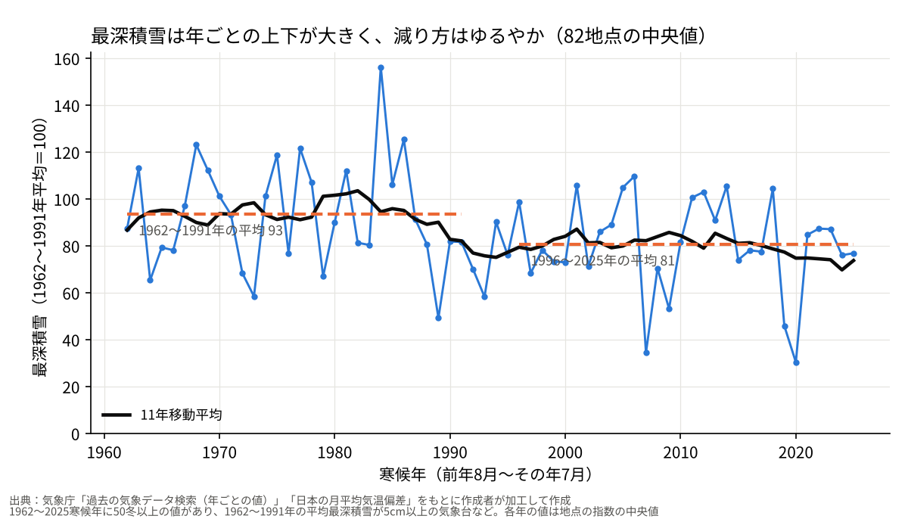
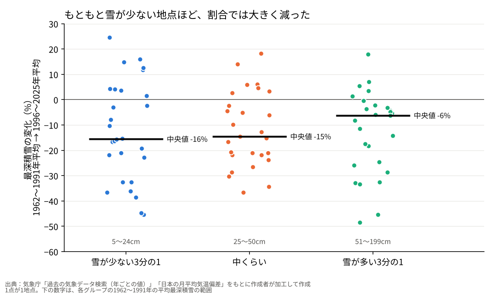
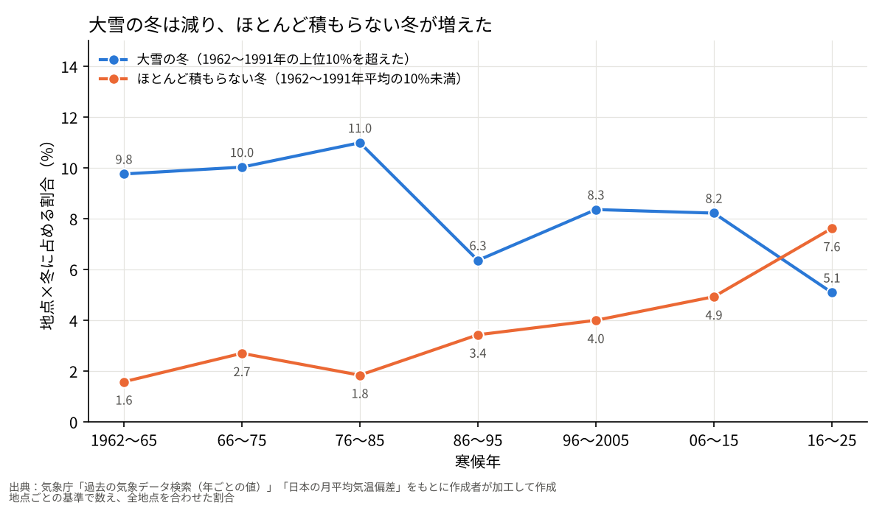
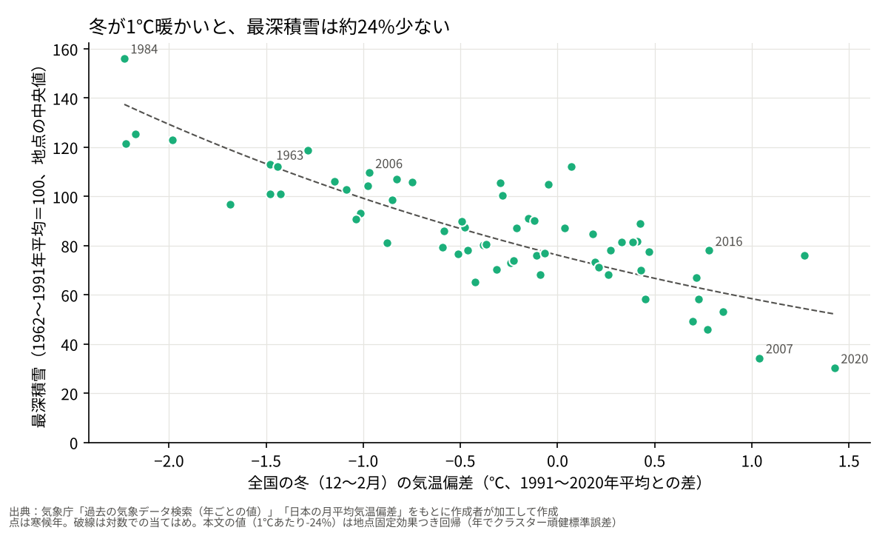

# F331 雪は本当に減ったのか？ 最深積雪は30年で12%減と思ったより小さく、はっきり減った地点は4分の1。増えたのは「ほとんど積もらない冬」で、2.2%から5.5%へ

## 結論（先に）

- 気象台など82地点の最深積雪（1冬でいちばん深く積もった深さ）は、1962〜1991寒候年の平均から1996〜2025寒候年の平均へ、地点の中央値で12%減りました。82地点のうち61地点（74%）で減っています。
- ただし年ごとの上下が大きく、減る傾向が統計的にはっきりしている（Mann–Kendall 検定で p<0.05）地点は22地点（27%）でした。はっきり増えた地点も2地点あります。
- もともと雪が少ない地点ほど、割合では大きく減りました（雪が少ない3分の1：−16%、多い3分の1：−6%）。
- 極端な大雪の冬（その地点の1962〜1991年の上位10%を超えた冬）の割合は、9.8% → 7.2% に下がりました。
- 一方で、ほとんど積もらない冬（1962〜1991年平均の10%未満）の割合は 2.2% → 5.5% に上がり、2016〜2025年は7.6%でした。
- 全国の冬（12〜2月）の気温が1℃高い年は、最深積雪が約24%少なくなっていました。

## 問い

日本の雪（降雪量、最深積雪）は本当に減ったのか。減ったならどの程度で、もともと雪の多い地点と少ない地点で違うのか。「雪は減ったのに大雪は増えた」と言われることもありますが、極端な大雪の冬は減ったのか。雪国の自治体の除雪・防災の担当、スキー場や冬の観光の担当、冬の暮らしに関心がある人に向けて確かめます。

## データ（出典）

- 気象庁「過去の気象データ検索」年ごとの値（気象台・測候所など地点番号 47xxx の157地点）。雪は寒候年（前年8月〜その年7月）の「降雪の深さの合計」と「最深積雪」。
- 気象庁「日本の月平均気温偏差」から冬（前年12月〜2月）の気温偏差。
- いずれも `data/raw/` に同梱（1.8MB、取得日・URL は `data/raw/SOURCES.md`）。
- 対象は、1962〜2025寒候年に最深積雪の値が50冬以上あり、1962〜1991年の平均最深積雪が5cm以上の82地点です。

## 事前の計画

[PLAN.md](PLAN.md)（2026-11-16 07:52、地点のデータを取る前に作成）。

| 仮説 | 内容（外れの基準） | 結果 | 判定 |
|---|---|---|---|
| H1 | 最深積雪が地点の中央値で20%以上減った | −12% | 外れ |
| H2 | はっきり減った（p<0.05）地点が半分以上 | 27% | 外れ |
| H3 | 雪が少ない地点の方が減り方（%）が大きい | 少ない3分の1 −16%、多い3分の1 −6% | 支持（頑健性で1つ逆） |
| H4 | 大雪の冬の割合が下がった | 9.8% → 7.2% | 支持 |
| H5 | 冬の気温1℃で最深積雪が15%以上少ない | −24% | 支持 |

## やったこと

1. 地点ごとに、最深積雪の傾向（Theil–Sen）と Mann–Kendall 検定（年と値の Kendall の順位相関）を計算しました。
2. 1962〜1991寒候年の平均 → 1996〜2025寒候年の平均の変化率を、地点ごとに計算しました。
3. 1962〜1991年の平均最深積雪で地点を3つに分け、変化率を比べました。
4. 地点ごとに、1962〜1991年の最深積雪の上位10%の値を超えた冬を「大雪の冬」とし、その割合を10年ごとに数えました。
5. 最深積雪（1991〜2020年平均に対する比の対数）を全国の冬の気温偏差に回帰しました（地点固定効果、年でクラスター頑健標準誤差）。

## 分かったこと

### 図1：減り方はゆるやかで、年ごとの上下が大きい



- 地点ごとに1962〜1991年平均を100とした指数の中央値は、1962〜1991年の平均で93、1996〜2025年の平均で81でした（中央値の平均なので100になりません）。
- 1984寒候年（156）のような大雪の年もあれば、2007・2020寒候年（30台）のような雪の少ない年もあります。

### 図2：もともと雪が少ない地点ほど、割合では大きく減った



- 1962〜1991年の平均最深積雪が5〜24cmの地点は中央値 −16%、25〜50cmは −15%、51〜199cmは −6% でした。
- 地点ごとの差は大きく、北陸の平野部（高田 −33%、富山 −33%、福井 −33%、金沢 −49%）で大きく減った一方、北海道の太平洋側（帯広 +18%、根室 +18%、苫小牧 +14%）では増えていました。

### 図3：大雪の冬は減り、ほとんど積もらない冬が増えた



- 大雪の冬の割合は、1962〜1991年 9.8% → 1996〜2025年 7.2%。10年ごとでは1976〜1985年の11.0%から、2016〜2025年は5.1%でした。

## 問い直し（結果を見てから足した）

平均の減り方が小さかったため、「平均よりも、雪がほとんど積もらない冬が増えたのではないか」を足して調べました（図3のオレンジ）。

- 1962〜1991年平均の10%にも届かなかった冬の割合は、1962〜1991年 2.2% → 1996〜2025年 5.5% と2.5倍になりました。
- 10年ごとでは、1962〜1965年1.6%、1986〜1995年3.4%、2016〜2025年7.6%と、ほぼ一方向に増えています。
- 「雪の量がならして少し減った」よりも、「雪がほとんどない冬が増えた」方が、変化をよく表しています。

### 図4：冬が暖かい年は雪が少ない



- 全国の冬の気温偏差1℃あたり、最深積雪は −24%（対数での係数 −0.27、標準誤差0.03）でした。
- 全国の冬の気温偏差は、1962〜2025年に10年あたり0.21℃上がっています。

## 頑健性

| 変えたこと | 地点数 | 変化（中央値） | はっきり減った地点 | 少ない3分の1 | 多い3分の1 | 大雪の冬（前→後） | 1℃あたり |
|---|---|---|---|---|---|---|---|
| 基本（最深積雪、50冬以上、平均5cm以上） | 82 | −12.1% | 26.8% | −15.6% | −6.2% | 9.8% → 7.2% | −23.8% |
| 降雪の深さの合計 | 88 | −21.9% | 45.5% | −32.3% | −8.2% | 9.8% → 8.2% | −32.5% |
| 40冬以上の地点 | 86 | −12.1% | 26.7% | −16.0% | −7.2% | 9.9% → 7.2% | −24.2% |
| 55冬以上の地点 | 81 | −12.8% | 27.2% | −15.8% | −6.2% | 9.8% → 7.2% | −23.9% |
| 平均2cm以上の地点 | 93 | −15.2% | 26.9% | −32.6% | −8.3% | 9.7% → 6.9% | −25.1% |
| 平均20cm以上の地点 | 58 | −9.1% | 27.6% | −7.0% | −9.8% | 9.8% → 6.6% | −20.5% |
| 期間を1962〜1981年 → 2006〜2025年 | 82 | −14.1% | 26.8% | −17.3% | −11.4% | （同じ） | （同じ） |
| 大雪の基準を上位5% | 82 | （同じ） | （同じ） | （同じ） | （同じ） | 6.3% → 4.4% | （同じ） |

- 変化の中央値は −9〜−22%で、20%を超えたのは降雪の深さの合計だけでした（H1 は外れのまま）。
- はっきり減った地点の割合は27〜46%で、どの設定でも半分に届きませんでした（H2 は外れのまま）。
- 雪の多さ別の差（H3）は、平均20cm以上の地点に絞ると逆になりました（少ない −7.0%、多い −9.8%）。雪がごく少ない地点を含めると差が大きく出る、という面があります。
- 大雪の冬の割合が下がること（H4）と、冬の気温との関係（H5）は、どの設定でも同じ向きでした。

## 言えないこと

- 降雪の深さは、観測方法の変更（目視から積雪計による計算へ）で値の性質が変わった地点があります。そのため最深積雪を主に使いました。
- 地点は気象台などの場所で、山間部やスキー場の雪を代表するものではありません。
- 地点の移転や、周りの都市化の影響を受けます。
- 減った理由（温暖化か、冬の季節風の変化か）は、冬の気温との関係以上には分けられません。
- 1つの冬の大雪（災害）の起こりやすさは予測していません。

## 仕事で使うなら

- 「雪が減った」は地点によって大きく違い、増えた地点もあります。自分の地域の地点の値で確かめるのが安全です。
- 平均だけでなく、「ほとんど積もらない冬」や「大雪の冬」の割合も合わせて示すと、変化が伝わりやすくなります。

## 計画からの変更

- 問い直しとして、ほとんど積もらない冬の割合を足しました。
- 雪の多さ別の比較では、計画どおり3つに分けましたが、図2に各グループの平均最深積雪の範囲を書き足しました。

## 再現のしかた

```sh
pip install -r requirements.txt
sh src/run_all.sh        # オフラインで 02→03→04（約5秒）
python3 src/01_fetch.py  # （任意）元データを取り直す（約4分、1秒ずつ間をあける）
```

| ファイル | 中身 |
|---|---|
| `src/02_build.py` | 年ごとの値の HTML・気温偏差 → `data/panel.csv` |
| `src/03_analysis.py` | 傾向・期間比較・大雪・回帰・頑健性 → `results/` |
| `src/04_figures.py` | 図4枚 → `figures/` |
| `results/main.json` | 本文の数字の元 |

`results/repro_check.txt`：別の場所で生成物を消して流し直し、すべての生成物がバイト単位で一致しました。

## レビューで直したこと

独立レビューで数字の照合・再実行・図を確かめ、直すところはなかった。

## 出典

- 気象庁「過去の気象データ検索」：https://www.data.jma.go.jp/stats/etrn/
- 気象庁「日本の月平均気温偏差」：https://www.data.jma.go.jp/cpdinfo/temp/list/csv/mon_jpn.csv

（いずれも気象庁のデータをもとに作成者が加工して作成）
