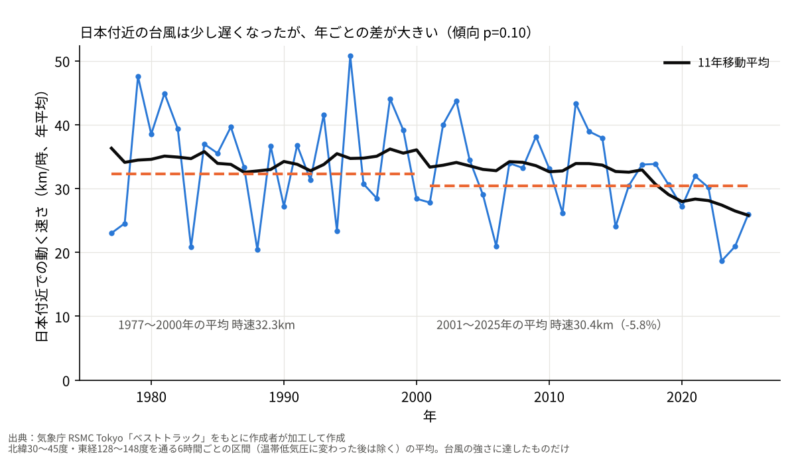
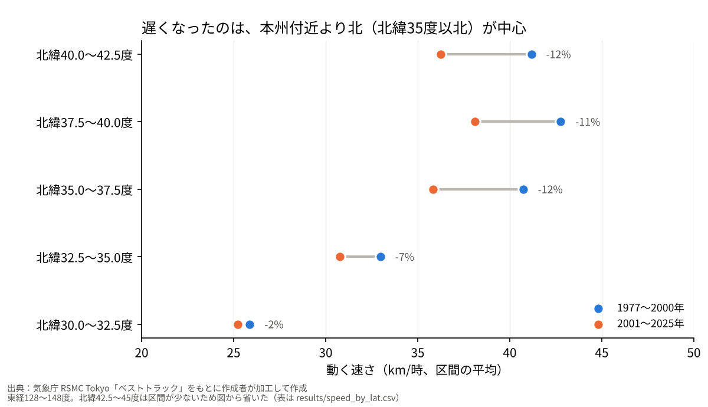
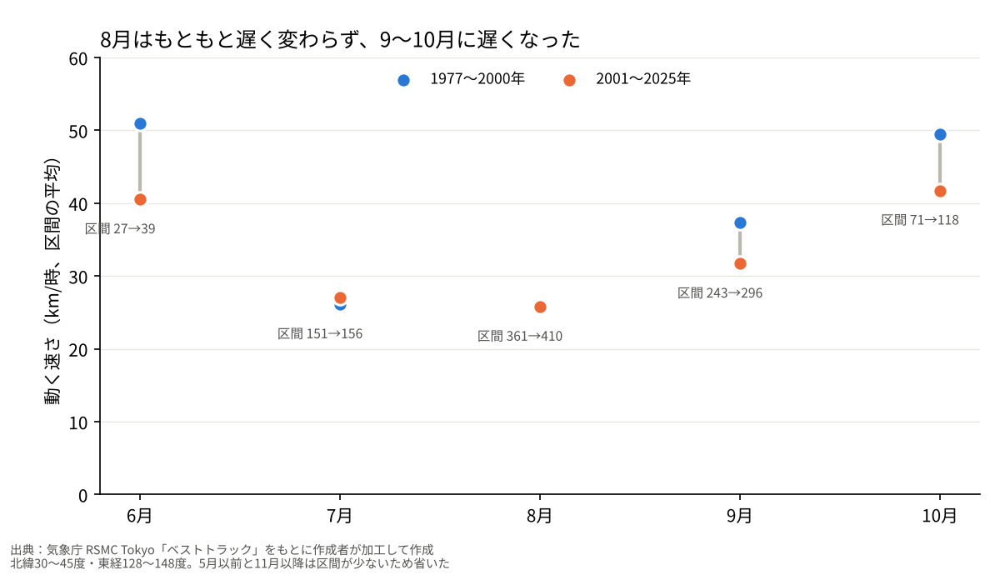
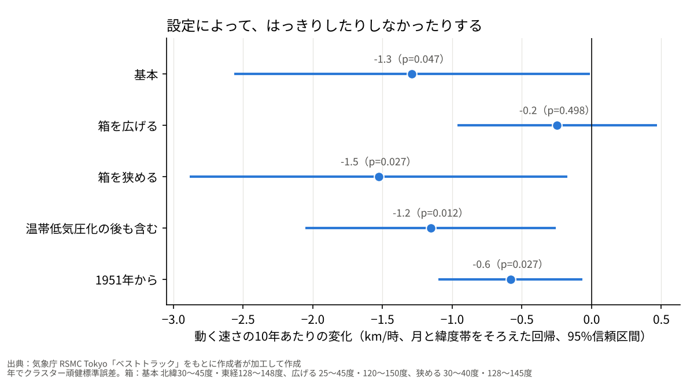

# F332 日本に近づく台風は、遅くなったのか？ 日本付近での速さは時速32.3kmから30.4kmへ6%遅く、北緯35度より北では11%。ただし範囲の取り方で、はっきりしなくなる

## 結論（先に）

- 日本付近（北緯30〜45度・東経128〜148度）を通る台風の動く速さは、1977〜2000年の平均 時速32.3km から、2001〜2025年の平均 時速30.4km へ、5.8%遅くなりました（中央値では29.7km → 26.6km、−10.1%）。
- 年平均の傾向は10年あたり −1.3km/時でしたが、年ごとの差が大きく、統計的にははっきりしません（HAC 標準誤差で p=0.10）。月と緯度帯をそろえた回帰では10年あたり −1.3km/時（p=0.047）で、ぎりぎりはっきりしました。
- 遅くなったのは、北緯35度より北が中心でした（時速41.4km → 36.9km、−10.8%、p=0.036）。北緯30〜35度では −3.6%（p=0.20）でした。
- 月別では、9月（37.4 → 31.7km/時）と10月（49.4 → 41.7km/時）に遅くなり、もともと遅い8月（25.8km/時）は変わっていません。
- 台風1つあたりが日本付近にいた時間は、30.7時間 → 32.6時間と、2時間ほどしか延びていません。
- 範囲を北緯25〜45度・東経120〜150度に広げると、速さの変化は +1.2%（p=0.50）で、遅くなったとは言えなくなります。

## 問い

一覧の問いは「日本に近づく台風は、強くなったのか？」でしたが、既存の分析（070 のもとのリポジトリ Y2）で、日本に最も近づいたときの中心気圧の推移がすでに示されているため、切り口を変えました。

日本付近を通る台風の動く速さは遅くなったのか。日本付近にとどまる時間は長くなったのか。台風の動きが遅いと、同じ地域に雨や風が長く続きます。防災・保険・物流の担当、台風の記事を読む人に向けて確かめます。保険料や備えについての助言はしません。

## データ（出典）

- 気象庁 RSMC Tokyo「ベストトラック」（bst_all.zip、1951年〜。6時間ごとなどの中心位置・中心気圧・階級）。`data/raw/` に同梱（0.7MB、取得日・URL は `data/raw/SOURCES.md`）。
- 一生のうちに「台風」（最大風速34ノット以上）の強さに達したものだけを使いました。
- 観測の間隔が時代で違う（近年は3時間ごと・1時間ごとの位置もある）ため、0・6・12・18時の位置だけを使いました。

## 事前の計画

[PLAN.md](PLAN.md)（2026-11-16 08:01、ベストトラックの数字を集計する前に作成）。

| 仮説 | 内容（外れの基準） | 結果 | 判定 |
|---|---|---|---|
| H1 | 1977〜2000年 → 2001〜2025年で10%以上遅くなった | −5.8% | 外れ |
| H2 | 年の傾向が HAC で p<0.05 のマイナス | −1.28km/時/10年、p=0.10 | 外れ |
| H3 | 月と緯度帯をそろえた回帰でも p<0.05 のマイナス | −1.29km/時/10年、p=0.047 | 支持（ぎりぎり。範囲を広げると外れ） |
| H4 | 日本付近にいた時間が+6時間以上 | +1.8時間 | 外れ |

## やったこと

1. 続く2つの位置（6時間あけ）の大円距離を6で割り、動く速さ（km/時）としました。
2. 2点の中間の位置が日本付近の箱に入る区間を使い、温帯低気圧に変わった後（階級6）は除きました。
3. 年平均の速さの傾向（OLS・HAC 標準誤差、Theil–Sen）と、区間ごとの回帰（月と緯度帯5度ごとの固定効果、年でクラスター頑健標準誤差）を求めました。
4. 台風1つあたりの、日本付近にいた時間（区間の数×6時間）を期間で比べました。

## 分かったこと

### 図1：少し遅くなったが、年ごとの差が大きい



- 対象は1977〜2025年の359個の台風、1,898区間です。日本付近を通った台風は年7.0個（1977〜2000年）→ 7.6個（2001〜2025年）でした。
- 年平均の速さは時速19〜51kmと、年ごとの差がとても大きく、11年移動平均は2015年ごろから下がっています。

### 図2：遅くなったのは北緯35度より北



- 北緯35〜42.5度の各帯で −11〜−12%、北緯32.5〜35度で −7%、北緯30〜32.5度で −2% でした。
- 北緯35度以北をまとめると 41.4 → 36.9km/時（月と緯度帯をそろえた回帰で10年あたり −2.3km/時、p=0.036）、北緯30〜35度は 28.6 → 27.6km/時（−0.9km/時、p=0.20）です。

### 図3：9〜10月に遅くなった



- 8月は 25.8 → 25.8km/時、7月は 26.1 → 27.0km/時でほぼ変わらず、9月は 37.4 → 31.7、10月は 49.4 → 41.7km/時でした。
- 区間の月の構成（8〜9月の割合 69.8% → 68.4%）はほとんど変わっていないため、季節の構成の変化で遅く見えているわけではありません。

## 問い直し（結果を見てから足した）

「遅くなった」のは、とても遅い（ほとんど止まっているような）台風が増えたからか、全体が少しずつ遅くなったからかを確かめました。

- 時速15km未満の区間の割合は、18.2% → 16.5% と、むしろ少し減っていました。
- 遅くなったのは、もともと速く動く北の地域・秋の台風が、前より遅くなった分でした。とても遅い台風が増えたわけではありません。

## 頑健性



| 変えたこと | 区間 | 速さ（前→後、km/時） | 変化 | 年の傾向（10年あたり、p） | 月・緯度帯をそろえた回帰（10年あたり、p） | いた時間（前→後） |
|---|---|---|---|---|---|---|
| 基本 | 1,898 | 32.3 → 30.4 | −5.8% | −1.28（0.10） | −1.29（0.047） | 30.7 → 32.6時間 |
| 箱を広げる（北緯25〜45度・東経120〜150度） | 5,955 | 24.5 → 24.7 | +1.2% | −0.21（0.66） | −0.25（0.50） | 60.3 → 60.8時間 |
| 箱を狭める（北緯30〜40度・東経128〜145度） | 1,533 | 31.9 → 29.7 | −6.8% | −1.81（0.033） | −1.53（0.027） | 26.7 → 29.3時間 |
| 温帯低気圧化の後も含める | 2,893 | 34.1 → 32.4 | −4.8% | −1.04（0.21） | −1.16（0.012） | 37.4 → 41.4時間 |
| 1951年から（1951〜1988年 → 1989〜2025年） | 3,046 | 31.8 → 31.3 | −1.7% | −0.56（0.14） | −0.58（0.027） | 31.7 → 32.1時間 |
| 速さの中央値 | 1,898 | 29.7 → 26.6 | −10.1% | −1.45（0.054） | （基本と同じ） | （基本と同じ） |

- 遅くなる向きは、範囲を広げた場合を除いて同じでした。範囲を広げると、もともと遅い北緯25〜30度の区間が多く入り、変化がほぼ消えます。
- 年平均の傾向は、箱を狭めた場合だけ p<0.05 でした。結論は「北の地域では遅くなった向きがあるが、日本付近全体で遅くなったとまでは言い切れない」です。

## 言えないこと

- 遅くなった理由（上空の風の変化など）は、この分析では分けられません。
- ベストトラックの位置の精度は時代で違います（とくに1977年より前）。
- 動く速さと雨の量・被害の関係は扱っていません。
- 日本付近を通る台風は年7個前後と少なく、年ごとのばらつきが大きいため、10年程度の変化は偶然でも起こり得ます。
- 温帯低気圧に変わったと判断する時期の基準が時代で変わっていれば、結果に影響します。

## 仕事で使うなら

- 「台風が遅くなった」と言うときは、どの範囲・どの季節の話かを明記するのが安全です。日本付近全体ではわずかな変化で、北の地域・秋に限ると変化が大きく見えます。
- 年ごとの差がとても大きいので、1〜2年の値で傾向を判断しないことが大切です。

## 計画からの変更

- 一覧の問い（強さ）から、動く速さに切り口を変えました（既存の分析と重ならないようにするため。PLAN.md に記載）。
- 問い直しとして、緯度帯別・月別の比較と、とても遅い区間の割合を足しました。

## 再現のしかた

```sh
pip install -r requirements.txt
sh src/run_all.sh        # オフラインで 02→03→04（約4秒）
python3 src/01_fetch.py  # （任意）元データを取り直す
```

| ファイル | 中身 |
|---|---|
| `src/02_build.py` | ベストトラック → 6時間ごとの区間 `data/segments.csv` |
| `src/03_analysis.py` | 速さの比較・傾向・回帰・頑健性 → `results/` |
| `src/04_figures.py` | 図4枚 → `figures/` |
| `results/main.json` | 本文の数字の元 |

`results/repro_check.txt`：別の場所で生成物を消して流し直し、すべての生成物がバイト単位で一致しました。

- 大きなデータのファイル（`data/segments.csv`）は、GitHub の1ファイルの上限に合わせて `.part000` などに分けて置いています。`run_all.sh` が最初に `src/00_join_parts.py` でつなぎ直し、sha256 で元と同じことを確かめます。

## レビューで直したこと

| # | 指摘 | 直し方 |
|---|---|---|
| 1 | 図4の p 値（基本0.048、1951年から0.028）が本文（0.047、0.027）と合わない。robustness.csv を4桁に丸めたあと図でもう一度丸めていた | 03_analysis.py で robustness.csv を6桁で書くようにし、図を作り直した |

## 出典

- 気象庁 RSMC Tokyo「ベストトラック」：https://www.jma.go.jp/jma/jma-eng/jma-center/rsmc-hp-pub-eg/Besttracks/bst_all.zip

（気象庁のデータをもとに作成者が加工して作成）
