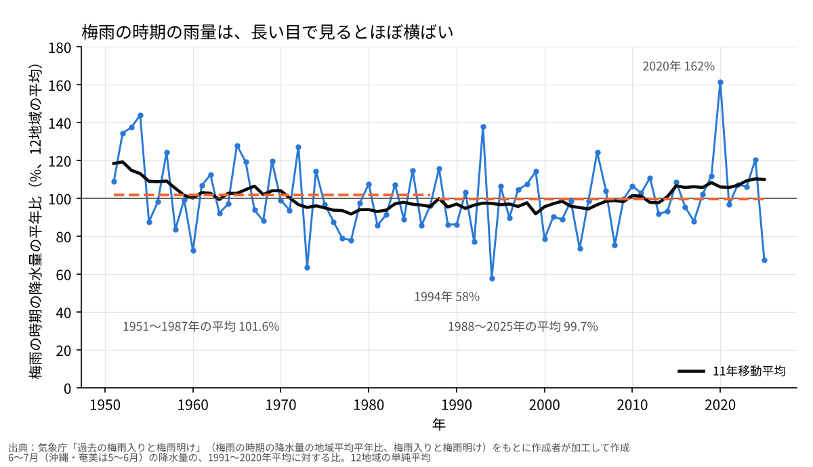
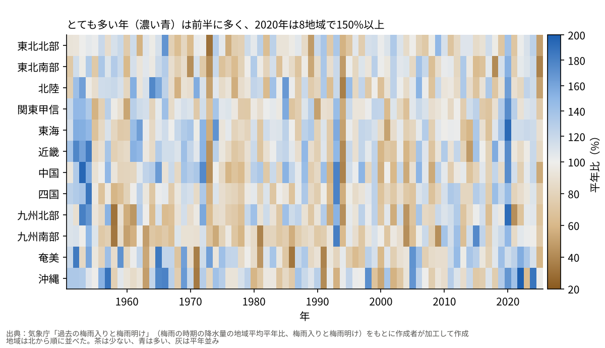
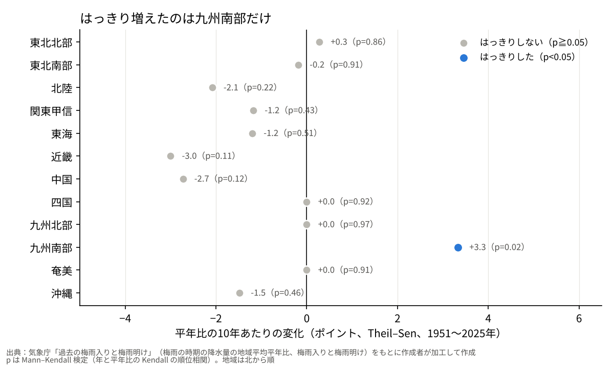
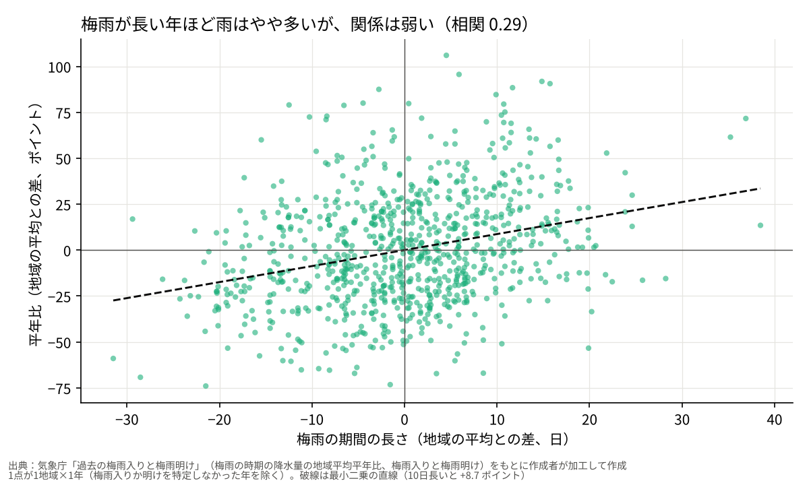

# F333 梅雨の雨は、多くなったのか？ 6〜7月の雨量は12地域平均で平年比102%から100%とほぼ同じ。増えたと言えるのは九州南部だけで、とても多い年はむしろ減った

## 結論（先に）

- 梅雨の時期（6〜7月、沖縄・奄美は5〜6月）の降水量の平年比は、12地域の平均で、1951〜1987年が101.6%、1988〜2025年が99.7%でした。長い目で見ると、ほぼ横ばいです。
- 12地域のうち、増える傾向が統計的にはっきりしている（Mann–Kendall 検定で p<0.05）のは九州南部だけ（10年あたり +3.3ポイント）でした。
- 平年比150%以上のとても多い年（地域×年）の割合は、8.8% → 5.3% と、むしろ下がりました。50%以下のとても少ない年は 3.8% → 4.2% でほぼ同じです。
- 年ごとの振れ幅（標準偏差）は、地域の平均で 30.5 → 30.2 ポイントと変わらず、後半の方が大きいのは12地域のうち4地域でした。
- 12地域平均で最も多かったのは2020年（162%、8地域で150%以上）、最も少なかったのは1994年（58%）で、2025年（67%）は3番目に少ない年でした。
- 梅雨の期間が長い年ほど雨はやや多い（相関 0.29、10日長いと +8.7ポイント）ものの、関係は弱いものでした。

## 問い

一覧の問いは「梅雨の雨は、強くなったのか？（梅雨期間の長さと雨量・強い雨の日数の推移）」でした。強い雨の日数には地点の日ごとの降水量が要りますが、気象庁のサイトから自動で取るには地点×年×月のページを数千回取りに行く必要があるため、使いませんでした。

そこで、気象庁が公表している「梅雨の時期の降水量の地域平均平年比」（12地域、1951年〜）を使い、梅雨の時期の雨は多くなったのか、とても多い年・少ない年は増えたのか、梅雨の期間が長い年ほど雨は多いのかを確かめました。梅雨入り・明けの日付の傾向は既存の分析（219）で扱われているため、日付は期間の長さとしてだけ使っています。

自治体の防災・河川の担当、農業・建設・物流で梅雨の雨を気にする人、季節の記事を書く人に向けています。

## データ（出典）

- 気象庁「過去の梅雨入りと梅雨明け」：梅雨の時期の降水量の地域平均平年比（tsuyu_prec.csv）、梅雨入りと梅雨明け（tsuyu_iriake.csv、確定値）
- `data/raw/` に同梱（14KB、取得日・URL は `data/raw/SOURCES.md`）。
- 平年比は、1991〜2020年の平均を100とした値です。各地域の気象台などの観測値の比を平均したものです。

## 事前の計画

[PLAN.md](PLAN.md)（2026-11-16 08:09、表を集計する前に作成）。

| 仮説 | 内容（外れの基準） | 結果 | 判定 |
|---|---|---|---|
| H1 | 12地域平均の平年比が、後半の方が5ポイント以上高い | −2.0ポイント | 外れ |
| H2 | p<0.05 の増加の地域が3つ以上 | 1地域（九州南部） | 外れ |
| H3 | とても多い年（150%以上）の割合が後半の方が高い | 8.8% → 5.3% | 外れ |
| H4 | 振れ幅が8地域以上で後半の方が大きい | 4地域 | 外れ |
| H5 | 期間の長さと雨量の相関が0.3以上 | 0.29 | 外れ（ぎりぎり） |

5つの仮説はすべて外れました。「梅雨の雨は増えている」という見方は、この表からは支持されませんでした。

## やったこと

1. 平年比を地域×年の表にし、前半（1951〜1987年）と後半（1988〜2025年）の平均・標準偏差を比べました。
2. 地域ごとに Mann–Kendall 検定（年と平年比の Kendall の順位相関）と Theil–Sen の傾きを求めました。
3. 平年比150%以上・50%以下の地域×年の割合を、期間で比べました。
4. 梅雨の期間の長さ（梅雨明け−梅雨入り）と平年比の相関を、地域ごとの平均を引いた値で求めました。

## 分かったこと

### 図1：12地域平均はほぼ横ばい



- 1950年代前半は多い年が続き（1952〜1954年は134〜144%）、11年移動平均は1970年代後半に90%台前半まで下がったあと、2010年代後半から100%を少し上回っています。

### 図2：とても多い年は前半に多く、2020年が際立つ



- 地域は北から順に並べています。2020年は東北南部・北陸・関東甲信・東海・近畿・中国・九州北部・沖縄の8地域で150%以上でした（九州北部192%、東海193%など）。

### 図3：はっきり増えたのは九州南部だけ



- 10年あたりの変化は −3.0（近畿）〜 +3.3（九州南部）ポイントで、九州南部以外はどれもはっきりしません。
- 12地域をそれぞれ5%の基準で検定すると、本当は変化がなくても平均0.6地域ほどは「はっきりした」と出ます。九州南部（p=0.02）の1地域だけでは、偶然の可能性を消せません。

### 図4：梅雨が長い年ほど雨はやや多い



- 梅雨入りか梅雨明けを特定しなかった年（地域×年で28、うち26は1988年以降）は除いています。

## 問い直し（結果を見てから足した）

とても多い年の割合が下がっていたため、「広い範囲で同時に雨が多い梅雨」は減ったのかを見ました。4地域以上で150%以上だった年を数えました。

- 1951〜1987年：1953・1954年（5地域）、1965・1972年（4地域）の4回。
- 1988〜2025年：1993年（5地域）、2020年（8地域）の2回。
- 回数は前半の方が多いものの、2020年は8地域と、75年間でいちばん広い範囲でした。回数が少ないため、増えた・減ったとは言えません。

## 頑健性

| 変えたこと | 平均（前→後） | p<0.05 の増加 | とても多い年（前→後） | とても少ない年（前→後） | 振れ幅が増えた地域 | 長さとの相関 |
|---|---|---|---|---|---|---|
| 基本（12地域、1951〜1987年 → 1988〜2025年、150%・50%） | 101.6 → 99.7 | 1/12 | 8.8% → 5.3% | 3.8% → 4.2% | 4/12 | 0.29 |
| 30年ずつ（1951〜1980年 → 1996〜2025年） | 103.0 → 100.6 | 1/12 | 10.0% → 5.3% | 3.9% → 2.5% | 2/12 | 0.29 |
| 沖縄・奄美を除く10地域 | 100.2 → 98.6 | 1/10 | 7.6% → 4.5% | 3.2% → 4.5% | 3/10 | 0.30 |
| 基準を140%・60% | （同じ） | （同じ） | 12.4% → 9.0% | 7.7% → 8.6% | （同じ） | （同じ） |
| 基準を160%・40% | （同じ） | （同じ） | 5.4% → 3.5% | 1.6% → 1.1% | （同じ） | （同じ） |
| 地域の中央値で | 100.3 → 98.6 | （同じ） | （同じ） | （同じ） | （同じ） | （同じ） |

- 平均が増えたという結果になる設定はなく、とても多い年の割合はどの基準でも下がりました。
- 長さとの相関は、沖縄・奄美を除くと0.30でちょうど基準に届きます。弱い関係である点は変わりません。

## 言えないこと

- 強い雨（1時間・1日の大雨）が増えたかどうかは、この表（2か月の合計）からは言えません。2か月の合計が変わらなくても、降り方が変わっている可能性はあります。
- 平年比は6〜7月（沖縄・奄美は5〜6月）の合計で、梅雨入り前・明け後の雨も含みます。
- 地域平均は気象台などの地点の平均で、山間部などは代表しません。
- 雨の多さと被害の関係は扱っていません。
- 1950年代前半の多雨の年が、前半の平均を押し上げています（30年ずつで比べても向きは同じでした）。
- とても多い年の割合（8.8% → 5.3%）の差は検定していません。同じ年の地域どうしは似た雨になりやすく（2020年は8地域）、地域×年の数ほど独立した観測は多くないため、「減った」は向きとして読むのが安全です。

## 仕事で使うなら

- 「梅雨の雨が増えた」と言うときは、2か月の合計なのか、強い雨の回数なのかを分けて考えるのが安全です。合計では、ほぼ横ばいでした。
- 2020年のように広い範囲で多い年もあれば、1994年・2025年のように少ない年もあり、年ごとの差の方がはるかに大きいことを前提にするのが現実的です。

## 計画からの変更

- 一覧の問い（強い雨の日数）は、データの取得の負担が大きいため、2か月の雨量と振れ幅・極端な年の問いに直しました（PLAN.md に記載）。
- 問い直しとして、広い範囲で同時に多かった年を数えました。

## 再現のしかた

```sh
pip install -r requirements.txt
sh src/run_all.sh        # オフラインで 02→03→04（約3秒）
python3 src/01_fetch.py  # （任意）元データを取り直す
```

| ファイル | 中身 |
|---|---|
| `src/02_build.py` | CSV 2つ → `data/panel.csv`（地域×年） |
| `src/03_analysis.py` | 期間比較・傾向・極端な年・相関・頑健性 → `results/` |
| `src/04_figures.py` | 図4枚 → `figures/` |
| `results/main.json` | 本文の数字の元 |

`results/repro_check.txt`：別の場所で生成物を消して流し直し、すべての生成物がバイト単位で一致しました。

## レビューで直したこと

| # | 指摘 | 直し方 |
|---|---|---|
| 1 | 九州南部だけ p<0.05 を「増えたと言える」としているが、12地域を別々に検定すると1地域前後は偶然でも出る | README の図3の節と note に注記を追加 |
| 2 | とても多い年の割合の低下（8.8%→5.3%）は未検定で、同じ年の地域どうしが似るため数ほど独立でない | 言えないことに1点追加（README・note） |

## 出典

- 気象庁「過去の梅雨入りと梅雨明け」：https://www.data.jma.go.jp/cpd/baiu/index.html

（気象庁のデータをもとに作成者が加工して作成）
