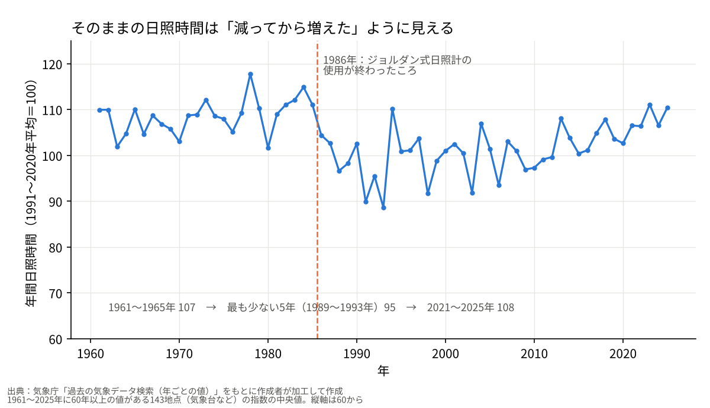
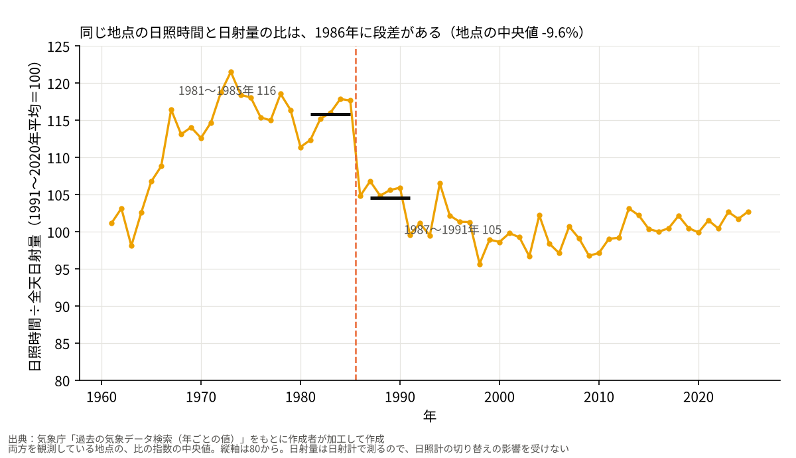
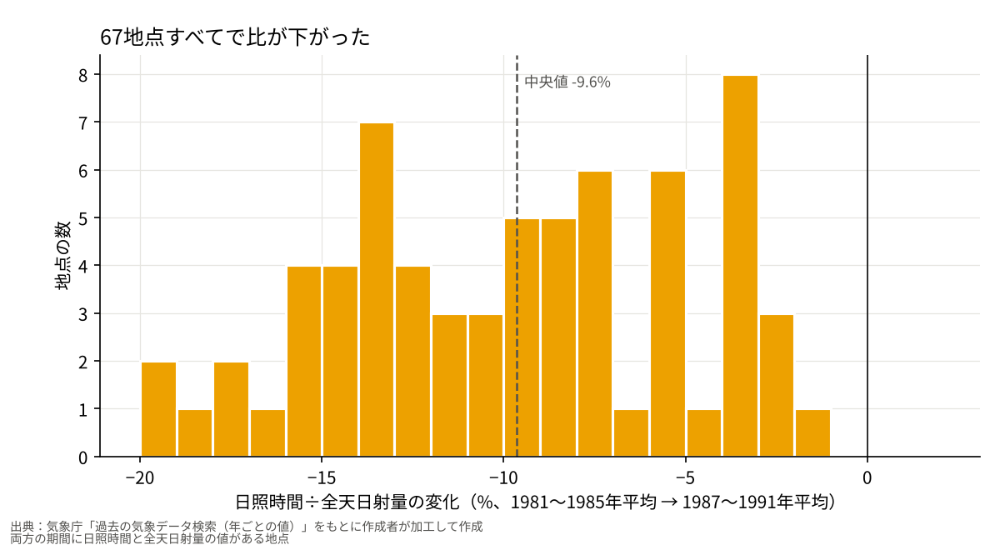
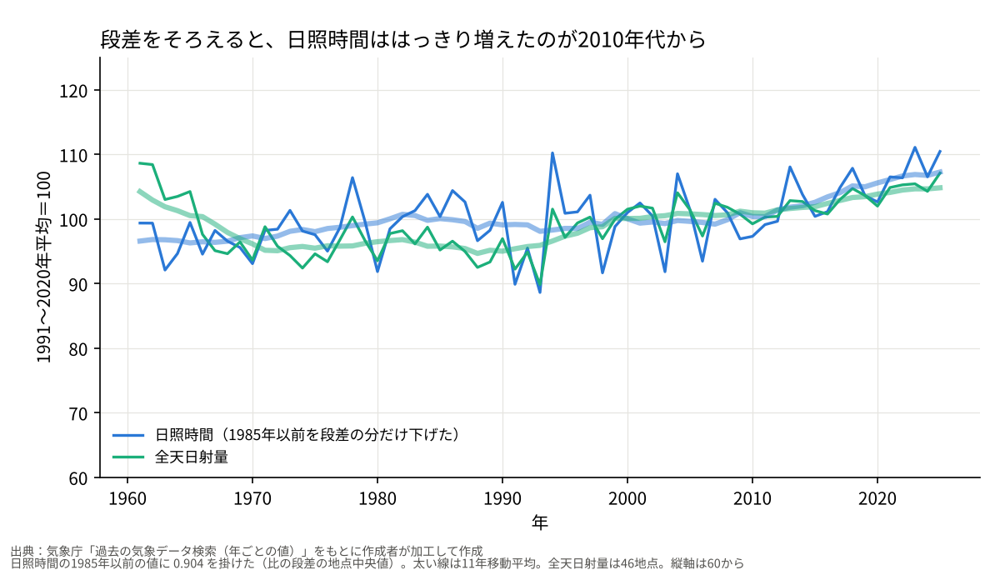

# F334 日照時間は、なぜ増えたのか？ 「1980年代までに減り、その後増えた」の大部分は1986年ごろの日照計の切り替えとみられる段差。そろえると、はっきり増えたのは2010年代から

## 結論（先に）

- 気象台など143地点の年間日照時間（1991〜2020年平均＝100とした指数の中央値）は、そのまま並べると、1961〜1965年の107から、1989〜1993年の95に減り、2021〜2025年は108に戻っています。「減ってから増えた」ように見えます。
- ところが、同じ地点で日射計で測る全天日射量と比べると、日照時間÷全天日射量の比が、1985年から1986年にかけて段差のように下がっていました（1981〜1985年平均 → 1987〜1991年平均で、67地点の中央値 −9.6%、67地点すべてで低下）。気象庁がジョルダン式日照計を使っていたのは1986年ごろまでで、時期が合います。
- この段差の分（×0.904）だけ1985年以前の日照時間をそろえると、1961〜1965年は97、1989〜1993年は95、2021〜2025年は108でした。1960〜80年代の「減少」はほとんど消え、はっきり増えたのは2010年代からです（1961〜2009年平均98.7 → 2010〜2025年平均104.3）。
- 全天日射量は、1960年代前半の106から1970年ごろに96前後まで下がり、1990年代から上がって2021〜2025年は105でした（1966〜1990年平均95.8 → 1996〜2025年平均101.8）。日射量の方には「減ってから増えた」形が残ります。
- 事前に置いた「折れ目は1980〜1995年」「日照時間と日射量の相関0.7以上」は外れました。段差をそろえると、相関は0.30から0.61に上がりました。

## 問い

日本の日照時間は、1960〜80年代に減り、その後に増えたと言われます。本当にそうか。変わり目はいつか。その変化は、日照計の切り替えによる見かけのものではないか。別の測り方（全天日射量）でも同じように見えるのか。太陽光発電・農業・観光で日照を気にする人、気候の記事を読む人に向けて確かめます。

## データ（出典）

- 気象庁「過去の気象データ検索」年ごとの値（気象台・測候所など地点番号 47xxx の157地点）：年間日照時間、全天日射量（日合計の年平均）。
- `data/raw/` に同梱（1.8MB、取得日・URL は `data/raw/SOURCES.md`）。F331 と同じ日に同じ手順で取ったページを使っています。
- 日照時間は1961〜2025年に60年以上の値がある143地点、全天日射量は50年以上の値がある46地点。

## 事前の計画

[PLAN.md](PLAN.md)（2026-11-16 08:12、傾向を計算する前に作成）。

| 仮説 | 内容（外れの基準） | 結果 | 判定 |
|---|---|---|---|
| H1 | 日照時間は折れ目の前に減り、後に増えた | 折れ目2006年、前 −2.7%/10年、後 +5.5%/10年 | 支持（ただし段差による見かけ。下の問い直し） |
| H2 | 折れ目は1980〜1995年 | 2006年 | 外れ |
| H3 | 全天日射量も折れ目の前に減り、後に増えた | 前 +0.2%/10年、後 +3.3%/10年 | 外れ |
| H4 | 日照時間と全天日射量の年ごとの相関が0.7以上 | 0.30 | 外れ |
| H5 | 日照時間÷全天日射量の比が1986年の前後で3%以上変わる | −9.6% | 支持 |

## やったこと

1. 地点ごとに1991〜2020年平均を100とした指数にし、年ごとに地点の中央値をとりました。
2. 2本の直線をつないだ折れ線を当てはめ、折れ目の年を1970〜2010年で探しました（残差の二乗和が最小の年）。
3. 両方を観測している地点で、日照時間÷全天日射量の比を、1981〜1985年平均と1987〜1991年平均で比べました。

## 分かったこと

### 図1：そのままの日照時間は「減ってから増えた」ように見える



- 1985年までは100を超える年が多く、1986年以降は100前後に下がっています。

### 図2：日照時間と日射量の比に、1986年の段差



- 比の指数は1981〜1985年平均116、1987〜1991年平均105でした。1985年（118）から1986年（105）への下がり方が、ほかの年の動きと比べて目立って大きい段差です。

### 図4：地点ごとに見ても、すべての地点で下がった



- 67地点の比の変化は −20%〜−1%で、上がった地点はありませんでした。地点ごとの差は大きく、日照計の切り替えの時期や周りの環境の違いによると考えられます（推測）。

## 問い直し（結果を見てから足した）

段差が見つかったため、「段差をそろえると、日照時間はどう変わって見えるか」を足しました。



- 1985年以前の日照時間に0.904（比の段差の地点中央値）を掛けてそろえました。
- そろえた日照時間は、1961〜1965年97、1989〜1993年95、2021〜2025年108。折れ目は2010年、前は10年あたり +0.6%、後は +5.9% でした。
- 段差を表す変数を入れた折れ線でも、段差は −11.9ポイント、折れ目は2010年、後の傾きは10年あたり +5.6% でした。
- 全天日射量の折れ線は、折れ目が探した範囲の端（1970年）になり、はっきりした折れ目は決まりませんでした。期間の平均で見ると、1966〜1990年95.8、1996〜2025年101.8です。
- 日照時間と全天日射量の相関は、そろえると0.30から0.61に上がりました。

## 頑健性

| 変えたこと | 日照の地点 | 折れ目 | 前（%/10年） | 後（%/10年） | 日射：前 | 日射：後 | 相関 |
|---|---|---|---|---|---|---|---|
| 基本（日照60年以上、中央値、1970〜2010年で探す） | 143 | 2006 | −2.7 | +5.5 | +0.2 | +3.3 | 0.30 |
| 日照50年以上の地点 | 154 | 2009 | −2.5 | +7.0 | +0.5 | +4.0 | 0.29 |
| 平均で | 143 | 2009 | −2.8 | +7.4 | +0.5 | +3.9 | 0.21 |
| 折れ目を1975〜2005年で探す | 143 | 2005 | −2.8 | +5.0 | +0.1 | +3.1 | 0.30 |
| 1985〜1988年を除く | 143 | 2006 | −2.7 | +5.5 | +0.3 | +3.3 | 0.30 |

- 段差をそろえない限り、どの設定でも折れ目は2005〜2009年で、1980〜1995年にはなりませんでした。段差の前後の年を除くだけでは、段差の影響は消えません（段差の前と後で水準が違うため）。

## 言えないこと

- 比の段差が日照計の切り替えによると考えるのは、時期が合うことと、全地点で同じ向きであることからの推測です。地点ごとの切り替えの年は確かめていません。
- 比は1961〜1973年にも大きく上がっています（図2、指数で約101 → 約121）。理由は分かりません。全天日射量の側の計器や校正の変化でも起こり得るため、日射量に残る「1960年代から減って、その後増えた」形も、そのまま本当の変化とは言い切れません（推測）。
- 比には1990年から1991年にかけても小さな下がりがあり、理由は分かりません。全天日射量の計器の更新や校正の変更の影響も入り得ます。
- 変化の理由（大気の汚れの変化、雲の量の変化）は、この分析では分けられません。
- 地点の移転や、周りの建物の影響を受けます。
- 太陽光発電の量や農作物への影響は扱っていません。

## 仕事で使うなら

- 日照時間の長い期間の推移を使うときは、1986年ごろの段差に注意が要ります。そのまま比べると、昔の日照時間を多く見積もることになります。
- 日射量のデータがあれば、日照時間と並べて確かめると、観測の方法による見かけの変化に気づきやすくなります。

## 計画からの変更

- 計画の分析（そのままの日照時間の折れ線）では、段差が折れ目を引っ張っていたため、段差をそろえた分析を問い直しとして足しました。

## 再現のしかた

```sh
pip install -r requirements.txt
sh src/run_all.sh        # オフラインで 02→03→04（約4秒）
python3 src/01_fetch.py  # （任意）元データを取り直す（約4分、1秒ずつ間をあける）
```

| ファイル | 中身 |
|---|---|
| `src/02_build.py` | 年ごとの値の HTML → `data/panel.csv` |
| `src/03_analysis.py` | 指数・折れ線・比の段差・そろえた系列・頑健性 → `results/` |
| `src/04_figures.py` | 図4枚 → `figures/` |
| `results/main.json` | 本文の数字の元 |

`results/repro_check.txt`：別の場所で生成物を消して流し直し、すべての生成物がバイト単位で一致しました。

## レビューで直したこと

| # | 指摘 | 直し方 |
|---|---|---|
| 1 | 題名が「日照計の切り替えによる段差」と原因を言い切っているが、本文では推測としている | 「切り替えとみられる段差」に直し、README・note・status をそろえた |
| 2 | 日照時間÷日射量の比が1961〜1973年にも約20%上がっていることに触れていない | 日射量の側の均質性も確かめていない点を言えないことに追加（README・note） |

## 出典

- 気象庁「過去の気象データ検索」：https://www.data.jma.go.jp/stats/etrn/
- ジョルダン式日照計の使用時期：気象庁 名古屋地方気象台「ジョルダン式日照計」https://www.data.jma.go.jp/nagoya/100years/100img/html/jordan_sunshinemeter.html

（気象庁のデータをもとに作成者が加工して作成）
