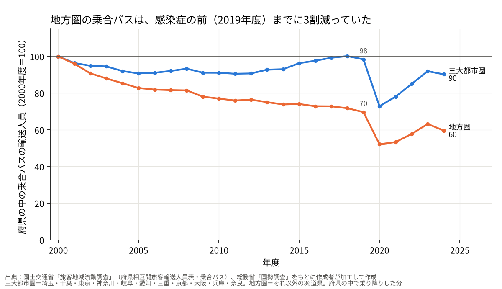
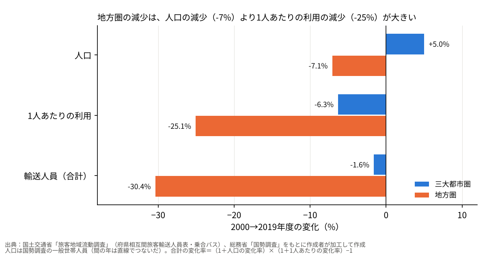
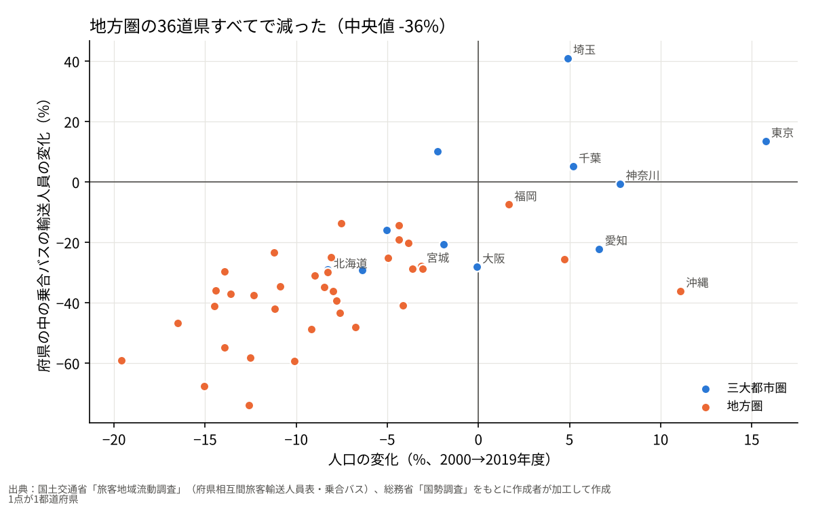
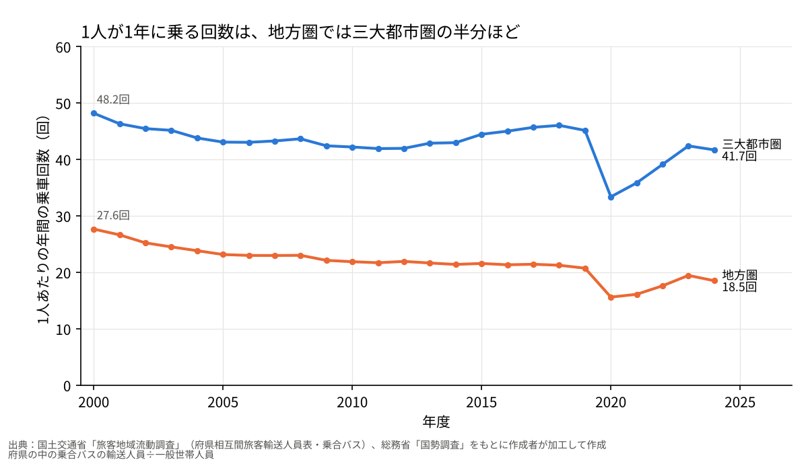

# F335 地方のバスの利用は、どこまで減ったのか？ 地方圏の乗合バスは2000→2019年度で30%減、人口の減少で説明できるのは2割。2024年度は2019年度の86%にとどまる

## 結論（先に）

- 府県の中で乗り降りした乗合バスの輸送人員は、地方圏（三大都市圏以外の36道県）で、2000年度から感染症の前の2019年度までに30.4%減りました。36道県すべてで減り、道県の中央値は −36% です。
- 三大都市圏は同じ期間に −1.6% で、ほぼ横ばいでした（2000年代に減り、2010年代に戻した）。
- 地方圏の減少（−30.4%）を分けると、人口の変化が −7.1%、1人あたりの利用の変化が −25.1% で、人口で説明できるのは減少の約2割（対数で20%）でした。1人が1年に乗る回数は、27.6回から20.7回に減っています。
- 感染症の時期（2020年度）には、地方圏・三大都市圏とも2019年度より約25%落ち込みました。2024年度は、地方圏が2019年度の85.6%、三大都市圏が91.7%まで戻っています。
- 減り方は2000年代の方が大きく（地方圏 2000→2009年度 −21.9%）、2010年代は −9.6% でした。

## 問い

都道府県の中の乗合バスの利用は、2000年度からどれだけ減ったのか。三大都市圏と地方圏で違うか。人口の減少で説明できるのはどれくらいで、1人あたりの利用はどれだけ減ったのか。感染症の時期の落ち込みは、どこまで戻ったのか。自治体の交通の担当、バス事業者、地域の暮らしを考える人に向けて確かめます。路線の維持や運賃についての助言はしません。

一覧のデータ（自動車輸送統計の地方運輸局別の値）は10地域の粒度しかなく、長い期間を同じ定義でそろえにくいため、都道府県の値がある旅客地域流動調査を使いました。

## データ（出典）

- 国土交通省「旅客地域流動調査」府県相互間旅客輸送人員表（乗合バス、2000〜2024年度、e-Stat）。府県の中の移動（表の対角）を使いました。
- 総務省「国勢調査」都道府県の一般世帯人員（2000〜2025年、間の年は直線でつないだ）。
- `data/raw/` に同梱（18MB、取得日・URL・statInfId は `data/raw/SOURCES.md`）。

## 事前の計画

[PLAN.md](PLAN.md)（2026-11-16 08:22、バスの表を集計する前に作成）。

| 仮説 | 内容（外れの基準） | 結果 | 判定 |
|---|---|---|---|
| H1 | 地方圏は2000→2019年度で20%以上減った | −30.4% | 支持 |
| H2 | 三大都市圏は増えたか、減っても5%未満 | −1.6% | 支持 |
| H3 | 地方圏の減少のうち、人口で説明できる分は半分未満 | 20% | 支持 |
| H4 | 2024年度は2019年度の90%に届かない（両方とも） | 地方圏 85.6%、三大都市圏 91.7% | 外れ（三大都市圏は90%を超えた） |

## やったこと

1. 各年度の表から、発と着が同じ府県の乗合バスの輸送人員（千人）を取り出しました。
2. 三大都市圏（埼玉・千葉・東京・神奈川・岐阜・愛知・三重・京都・大阪・兵庫・奈良）と地方圏に分けて合計しました。
3. 変化を「人口の変化」と「1人あたりの利用の変化」に分けました（合計の変化率＝（1＋人口の変化率）×（1＋1人あたりの変化率）−1。人口で説明できる割合は対数の比）。

## 分かったこと

### 図1：地方圏は2019年度までに3割減っていた



- 全国（47都道府県の合計）は、2000年度47.2億人、2019年度41.4億人、2024年度37.3億人でした。
- 2000年度＝100とすると、2024年度は三大都市圏90、地方圏60です。

### 図2：人口より、1人あたりの利用の減少が大きい



- 三大都市圏は人口が +5.0% 増え、1人あたりの利用が −6.3% 減って、合計は −1.6% でした。

### 図3：地方圏の36道県すべてで減った



- 増えたのは埼玉（+41%）・東京（+14%）・京都（+10%）・千葉（+5%）の4都府県だけでした。
- 地方圏では、人口が減った道県ほどバスの利用の減り方も大きい向きがありました。

### 図4：1人が1年に乗る回数



- 1人あたりの年間の乗車回数は、三大都市圏 48.2回 → 45.1回（2019年度）→ 41.7回（2024年度）、地方圏 27.6回 → 20.7回 → 18.5回でした。

## 問い直し（結果を見てから足した）

人口で説明できる分が小さかったため、「人口が大きく減った道県ほど、1人あたりの利用も大きく減ったのか」を地方圏の36道県で見ました。

- 1人あたりの利用は、36道県すべてで減っていました。
- 人口の変化と1人あたりの利用の変化の順位相関は +0.37 で、人口が減った道県ほど1人あたりの利用も減る向きがありました（人口の減少が、利用する人の数だけでなく、1人あたりの乗る回数の減少とも重なっている）。
- これが、便が減って使いにくくなったためか、車を使う人が増えたためかは、この表では分けられません。

## 頑健性

| 変えたこと | 地方圏の変化 | うち人口で説明 | 地方圏の1人あたり | 三大都市圏の変化 | 2024年度（地方圏／三大都市圏、2019年度＝100） |
|---|---|---|---|---|---|
| 基本（府県の中の移動、一般世帯人員、2000→2019年度） | −30.4% | 20% | −25.1% | −1.6% | 85.6／91.7 |
| 府県から出る合計（府県の外へ行く分も含む） | −29.6% | 21% | −24.3% | −0.8% | 85.2／91.3 |
| 2000→2009年度 | −21.9% | 10% | −20.1% | −8.9% | （同じ） |
| 2010→2019年度 | −9.6% | 46% | −5.3% | +8.0% | （同じ） |
| 東京都・大阪府を除く | −30.4% | 20% | −25.1% | −2.8% | 85.6／92.6 |
| 人口を総人口で | −30.4% | 18% | −25.7% | −1.6% | 85.6／91.7 |

- 地方圏で、人口で説明できる分が半分を下回る（H3）のは、2010→2019年度（46%）を含め、どの設定でも同じでした。ただし2010年代に限ると、人口の減少の比重がかなり大きくなっています。
- 三大都市圏の2024年度の戻りは、どの設定でも90%を超えていました（H4 は外れのまま）。

## 言えないこと

- 旅客地域流動調査の自動車の値は、ほかの統計からの推計を含み、年度によって集計の方法が変わっている可能性があります（2000年代と2010年代に分けて確かめました）。
- 路線の数や便数（供給）は見ていないので、利用が減った理由が「乗る人が減った」のか「便が減った」のかは分けられません。
- 市町村の中の違い（中心部と周辺部）は見えません。
- 乗る人の内訳（通学・通勤・高齢者など）は分かりません。
- 一般世帯人員は施設に住む人を含まないため、総人口とは少し違います（総人口でも確かめました）。

## 仕事で使うなら

- 地方のバスの利用の減少は、人口の減少だけでは説明できず、1人あたりの利用の減少が大きな部分を占めます。人口の見通しだけで利用を見込むと、減り方を小さく見積もるおそれがあります。
- 2020年度以降の戻りを見るときは、2019年度との比較に加え、それ以前から続く減少の傾向と並べて見ると、感染症の影響と長い傾向を分けやすくなります。

## 計画からの変更

- 問い直しとして、地方圏の道県ごとの人口の変化と1人あたりの利用の変化の関係を足しました。

## 再現のしかた

```sh
pip install -r requirements.txt
sh src/run_all.sh        # オフラインで 02→03→04（約10秒）
python3 src/01_fetch.py  # （任意）元データを取り直す（約1分、1秒ずつ間をあける）
```

| ファイル | 中身 |
|---|---|
| `src/02_build.py` | 乗合バスの表・国勢調査 → `data/panel.csv` |
| `src/03_analysis.py` | 地域別の推移・分け方・府県ごと・頑健性 → `results/` |
| `src/04_figures.py` | 図4枚 → `figures/` |
| `results/main.json` | 本文の数字の元 |

`results/repro_check.txt`：別の場所で生成物を消して流し直し、すべての生成物がバイト単位で一致しました。

- 大きなデータのファイル（`data/raw/census_2025_t12-2_members_000040506466.xlsx`）は、GitHub の1ファイルの上限に合わせて `.part000` などに分けて置いています。`run_all.sh` が最初に `src/00_join_parts.py` でつなぎ直し、sha256 で元と同じことを確かめます。

## レビューで直したこと

独立レビューで数字の照合・再実行・図を確かめ、直すところはなかった。

## 出典

- 国土交通省「旅客地域流動調査」（e-Stat）：https://www.e-stat.go.jp/stat-search/files?query=%E5%BA%9C%E7%9C%8C%E7%9B%B8%E4%BA%92%E9%96%93%E6%97%85%E5%AE%A2%E8%BC%B8%E9%80%81%E4%BA%BA%E5%93%A1%E8%A1%A8&layout=dataset
- 総務省「国勢調査」（e-Stat）：https://www.e-stat.go.jp/stat-search/files?toukei=00200521

（いずれも各統計をもとに作成者が加工して作成）
