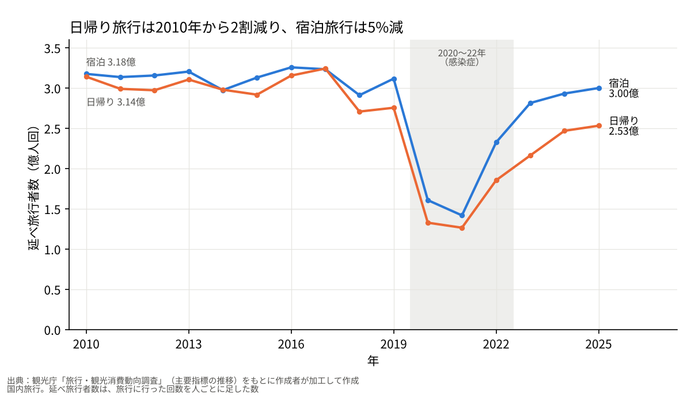
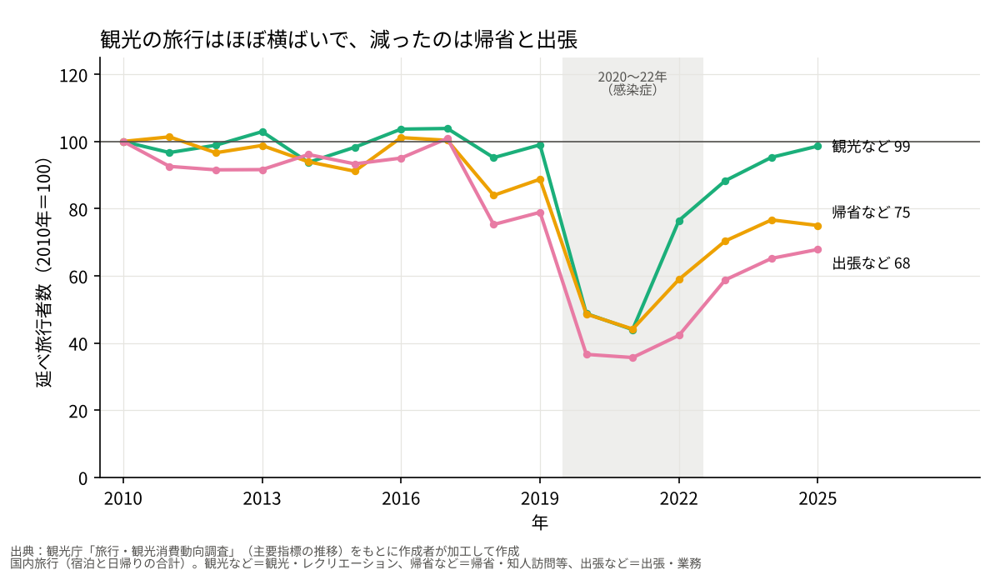
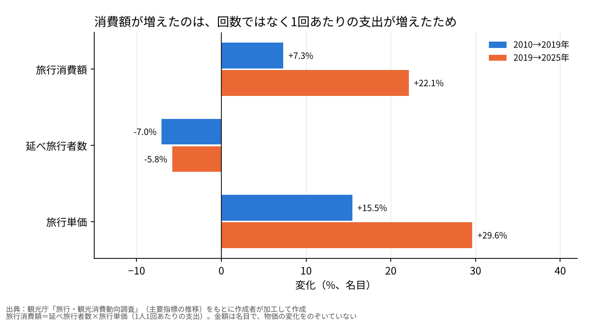
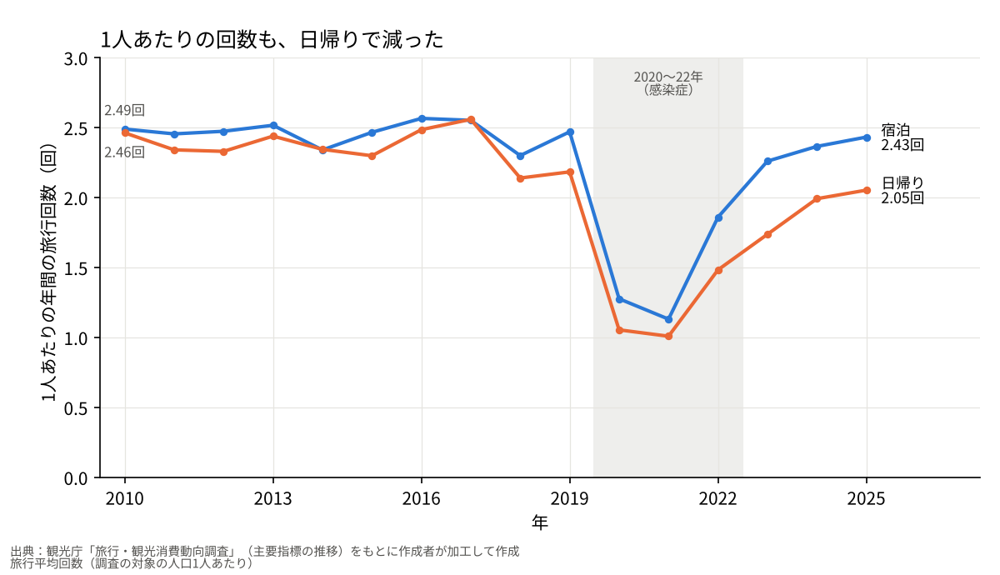

# F336 日本人の国内旅行は、減っているのか？ 延べ旅行者数は2019年から6%減ったが、観光はほぼ横ばい。減ったのは帰省と出張で、消費額の22%増は単価の上昇による

## 結論（先に）

- 日本人の国内旅行の延べ旅行者数（行った回数の合計）は、2019年の5.87億人回から2025年の5.53億人回へ5.8%減りました。2010年（6.32億人回）からは12.4%減です。
- 目的別に2019→2025年を見ると、観光・レクリエーションは −0.4% でほぼ横ばい、帰省・知人訪問等は −15.5%、出張・業務は −14.0% でした。減った分のほとんどは、観光以外の旅行です。
- 旅行消費額（名目）は、2019年の21.9兆円から2025年の26.8兆円へ22.1%増えました。延べ旅行者数が −5.8%、旅行単価（1人1回あたりの支出）が +29.6% で、増えた分はすべて単価の上昇によるものです（対数で単価の寄与130%）。
- 宿泊・日帰りで見ると、2010→2025年の延べ旅行者数は、宿泊旅行 −5.5%、日帰り旅行 −19.4% で、日帰りの減り方が大きいものでした。
- 2017年から2018年にかけて、延べ旅行者数が1年で13%（帰省 −16%、出張 −25%）下がっています。2010→2019年の減少（−7.0%）はこの1年の落ち込みでほぼ説明でき、理由（調査の方法の変化などを含む）は確かめられていません。

## 問い

日本人の国内旅行は、減っているのか。延べ旅行者数と旅行消費額はどう変わったか。消費額の変化は回数と単価のどちらによるか。宿泊・日帰り、目的（観光・帰省・出張）で違うか。観光地の自治体・観光事業者、旅行の記事を書く人に向けて確かめます。どこへ行くべきか、価格の助言はしません。

## データ（出典）

- 観光庁「旅行・観光消費動向調査」主要指標の推移表（年の値）。`data/raw/` に同梱（取得日・URL は `data/raw/SOURCES.md`）。
- 表の注記に従い、2010年以降を使いました（2009年以前は調査拡充前）。2020〜2022年は感染症の影響が大きいため、比較は2010→2019年と2019→2025年で行いました。
- 金額は名目で、物価の変化はのぞいていません。

## 事前の計画

[PLAN.md](PLAN.md)（2026-11-16 08:27、推移表の数字を集計する前に作成）。一覧の切り口にある「年齢別」は、時間内に検証できないため計画の段階で外しました。

| 仮説 | 内容（外れの基準） | 結果 | 判定 |
|---|---|---|---|
| H1 | 延べ旅行者数は2025年の方が2019年より少ない | −5.8% | 支持 |
| H2 | 2010→2019年の延べ旅行者数の変化は ±5% 以内 | −7.0% | 外れ（2011・2012年を基準にすると −4.2%） |
| H3 | 2019→2025年の消費額の変化への単価の寄与が100%超 | 130% | 支持 |
| H4 | 2010→2025年で、日帰りの減り方が宿泊より大きい | 日帰り −19.4%、宿泊 −5.5% | 支持 |
| H5 | 2019→2025年に最も減った目的は出張・業務 | 帰省 −15.5%、出張 −14.0% | 外れ（帰省がわずかに大きい） |

## やったこと

1. 旅行消費額＝延べ旅行者数×旅行単価、延べ旅行者数＝（延べ旅行者数÷旅行平均回数）×旅行平均回数 と書き、対数で寄与を分けました（延べ旅行者数÷平均回数は、調査が対象とする人口にあたります）。
2. 全体・宿泊・日帰り、目的別（観光・帰省・出張）に同じことをしました。

## 分かったこと

### 図1：日帰り旅行の減り方が大きい



- 宿泊旅行は2010年3.18億 → 2019年3.12億 → 2025年3.00億人回、日帰り旅行は3.14億 → 2.75億 → 2.53億人回でした。

### 図2：観光はほぼ横ばいで、減ったのは帰省と出張



- 2010年＝100とすると、2025年は観光99、帰省75、出張68です。
- 2010→2025年で、観光は −1.4%、帰省は −25.0%、出張は −32.2% でした。宿泊の観光旅行に限ると、2010→2025年で +7.2% と増えています。

### 図3：消費額の増加は、単価の上昇による



- 2010→2019年は、消費額 +7.3%（延べ旅行者数 −7.0%、単価 +15.5%）、2019→2025年は、消費額 +22.1%（延べ旅行者数 −5.8%、単価 +29.6%）でした。
- 目的別の消費額（2019→2025年）は、観光 +35.6%、帰省 −0.0%、出張 −1.3% で、消費額の増加はほぼ観光によるものです。

### 図4：1人あたりの回数も、日帰りで減った



- 1人あたりの年間の旅行回数は、宿泊が2010年2.49回 → 2025年2.43回、日帰りが2.46回 → 2.05回でした。
- 2019→2025年の宿泊旅行の延べ旅行者数の減少（−3.7%）のうち、人口の減少（−2.3%）で説明できるのは約6割で、1人あたりの回数の減少（−1.5%）より大きい部分でした。

## 問い直し（結果を見てから足した）

全体の減少が目的によって大きく違うのではないかと考え、目的別の延べ旅行者数と、宿泊・日帰りと目的を組み合わせた変化を見ました（図2）。

- 2010→2025年の目的×宿泊・日帰りの変化は、宿泊の観光 +7.2%、日帰りの観光 −8.5%、宿泊の帰省 −19.1%、日帰りの帰省 −35.4%、宿泊の出張 −21.4%、日帰りの出張 −42.6% でした。
- 「国内旅行が減った」の中身は、主に日帰りの帰省・出張が減ったことでした。観光で泊まる旅行は、むしろ増えています。
- 出張・帰省が減った理由（オンラインの会議、家族のかたちの変化など）は、この表では分けられません（推測の域を出ません）。

## 頑健性

| 比べた年 | 消費額 | 延べ旅行者数 | 単価 | 単価の寄与 | 宿泊：延べ旅行者数 | 宿泊：1人あたり回数 | 日帰り：1人あたり回数 |
|---|---|---|---|---|---|---|---|
| 2010→2019（基本） | +7.3% | −7.0% | +15.5% | 203% | −1.9% | −0.8% | −11.3% |
| 2011→2019 | +11.1% | −4.2% | +15.9% | 140% | −0.6% | +0.6% | −6.7% |
| 2012→2019 | +12.9% | −4.2% | +17.9% | 135% | −1.2% | −0.2% | −6.3% |
| 2019→2025（基本） | +22.1% | −5.8% | +29.6% | 130% | −3.7% | −1.5% | −6.0% |
| 2018→2025 | +30.8% | −1.5% | +32.8% | 106% | +3.1% | +5.7% | −4.1% |
| 2019→2024 | +14.7% | −8.0% | +24.7% | 161% | −5.9% | −4.2% | −8.8% |
| 2018→2024 | +22.8% | −3.9% | +27.8% | 119% | +0.7% | +2.8% | −6.9% |

- 単価の寄与が100%を超える（H3）のは、どの組み合わせでも同じでした。
- 延べ旅行者数の減り方は、比べる年で −1.5%〜−8.0% と動きます。2018年を基準にすると、宿泊旅行は増えています。2018年の落ち込みの影響が大きいことに注意が要ります。
- 日帰りの1人あたりの回数は、どの組み合わせでも減っていました。

## 言えないこと

- 金額は名目で、物価の上昇と「良い旅行をするようになった」分は分けられません。
- 2017→2018年の大きな落ち込みの理由は確かめていません。この前後をまたぐ比較（2010→2019年など）は、慎重に読む必要があります。
- 調査は標本調査で、年ごとの誤差があります。
- 年齢別・地域別の違いは見ていません。
- 訪日外国人の旅行は含みません。

## 仕事で使うなら

- 「国内旅行が減った」と言うときは、目的別に分けると、観光は横ばいで、減ったのは帰省・出張だと分かります。観光の需要を見るときは、観光・レクリエーションの値を使う方が実態に近くなります。
- 消費額の伸びは単価によるもので、回数は増えていません。消費額だけで「旅行が増えた」と読まないことが大切です。

## 計画からの変更

- 年齢別は計画の段階で外しました（PLAN.md に記載）。
- 問い直しとして、目的×宿泊・日帰りの変化を足しました。2017→2018年の落ち込みに気づいたため、「言えないこと」に加えました。

## 再現のしかた

```sh
pip install -r requirements.txt
sh src/run_all.sh        # オフラインで 02→03→04（約3秒）
python3 src/01_fetch.py  # （任意）元データを取り直す
```

| ファイル | 中身 |
|---|---|
| `src/02_build.py` | 推移表 → `data/series.csv`（縦長） |
| `src/03_analysis.py` | 消費額・延べ旅行者数の分け方、頑健性 → `results/` |
| `src/04_figures.py` | 図4枚 → `figures/` |
| `results/main.json` | 本文の数字の元 |

`results/repro_check.txt`：別の場所で生成物を消して流し直し、すべての生成物がバイト単位で一致しました。

## レビューで直したこと

| # | 指摘 | 直し方 |
|---|---|---|
| 1 | 図1の2010年の値のラベル（宿泊3.18億・日帰り3.14億）が重なって読めない | 04_figures.py でラベルの位置をずらし、種類の名前を付けた |

## 出典

- 観光庁「旅行・観光消費動向調査」：https://www.mlit.go.jp/kankocho/tokei_hakusyo/shohidoko.html

（観光庁「旅行・観光消費動向調査」をもとに作成者が加工して作成）
