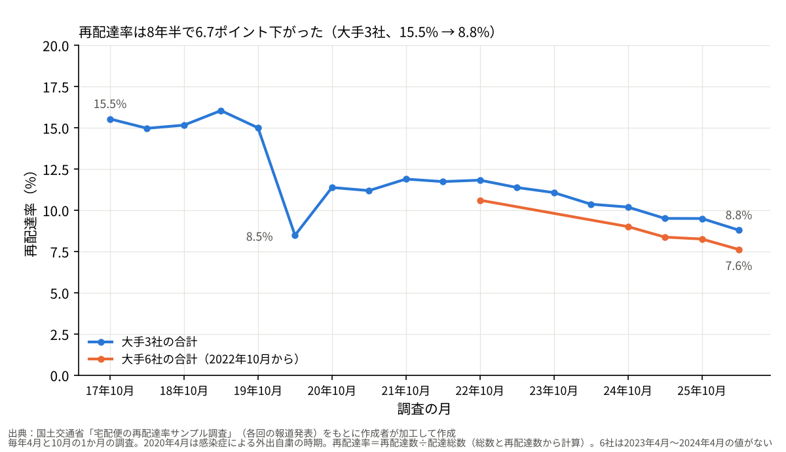
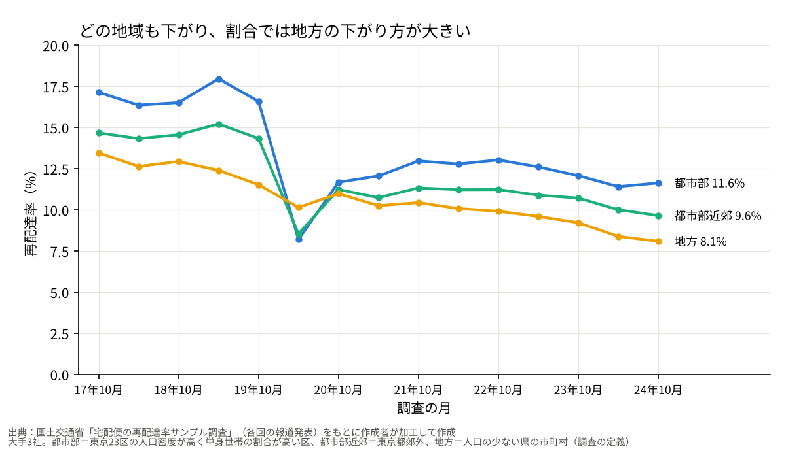
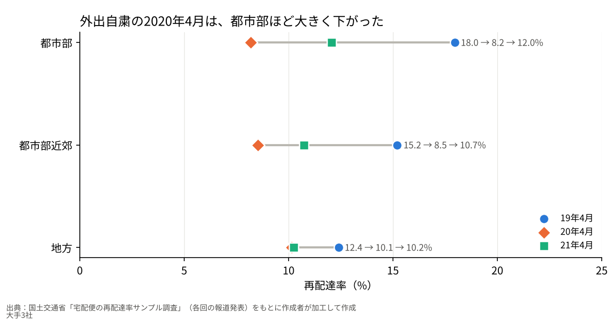

# F338 宅配便の再配達は、減ったのか？ 大手3社の再配達率は2017年10月の15.5%から2026年4月の8.8%へ。割合では地方の方が大きく下がり、外出自粛の2020年4月は都市部で半分以下に

## 結論（先に）

- 大手3社の宅配便の再配達率（再配達数÷配達総数）は、調査が始まった2017年10月の15.5%から、2026年4月の8.8%へ、6.7ポイント（割合で43%）下がりました。2020年4月を除いた傾きは、1年あたり −0.78ポイントです。
- 2025年4月期の発表から加わった大手6社の合計（2022年10月と2024年10月の値もさかのぼって載っている）では、2026年4月は7.6%でした。6社の合計は3社の合計より、両方がある5回とも1.1〜1.2ポイント低くなっています。
- 地域別（大手3社、2017年10月→2024年10月）では、都市部 17.1% → 11.6%（−32%）、都市部近郊 14.7% → 9.6%（−34%）、地方 13.5% → 8.1%（−40%）で、割合では地方の下がり方が大きいものでした。
- 外出自粛の時期の2020年4月は、都市部が18.0%（2019年4月）から8.2%へ大きく下がった一方、地方は12.4%から10.1%への低下にとどまり、この回だけは地方の方が高くなりました。翌2021年4月には、都市部は12.0%まで戻っています。
- 4月と10月の差ははっきりしません（同じ年の10月−4月の平均 −0.08ポイント、7組のうち10月が高いのは3組）。

## 問い

宅配便の再配達率は、2017年10月から2026年4月までにどれだけ下がったのか。都市部・都市部近郊・地方で違うか。4月と10月で違うか。置き配などの「多様な受取方法」の影響は、この調査からどこまで確かめられるか。宅配・通販の事業者、物流の担当、自治体の担当、宅配を受け取る人に向けて確かめます。受け取り方の助言はしません。

## データ（出典）

- 国土交通省「宅配便の再配達率サンプル調査」各回の報道発表の PDF（2018年4月期〜2026年4月期）。表は pdftotext で文字にして取り出しました。
- 調査は毎年4月と10月の1か月間。都市部（東京23区のうち人口密度が高く単身世帯の割合が高い区）、都市部近郊（東京都郊外の市町村）、地方（人口の少ない県の市町村）の営業所の値です。
- `data/raw/` に同梱（取得日・URL・注意は `data/raw/SOURCES.md`）。

## 事前の計画

[PLAN.md](PLAN.md)（2026-11-16 08:34。表を取り出す作業の確かめで各回の再配達率の一覧を先に見ているため、仮説はすべて参考扱い）。

| 仮説（参考） | 内容（外れの基準） | 結果 | 判定 |
|---|---|---|---|
| H1 | 3社の総計が5ポイント以上下がった | −6.7ポイント | 支持（参考） |
| H2 | 都市部はどの回も地方より高い | 2020年4月は地方が高い | 外れ |
| H3 | 割合での下がり方は地方の方が大きい | 地方 −40%、都市部 −32% | 支持（参考） |
| H4 | 10月の方が4月より高い | 平均 −0.08ポイント | 外れ |

## やったこと

1. 各回の発表の表から、地域ごとの配達総数・再配達数・再配達率を取り出しました。同じ時期の値が複数の回に載っているときは、その時期の回の値を使いました。
2. 再配達率は、配達総数と再配達数から計算し直しました（公表の率との差は、下の1件を除いて0.06ポイント以内）。
3. 3社の総計の下がり方（はじめと終わりの差、Theil–Sen の傾き）、地域別の変化、4月と10月の差を求めました。

## 分かったこと

### 図1：8年半で6.7ポイント下がった



- 感染症の前（2017年10月〜2019年10月）の5回の平均は15.3%で、ほぼ横ばいでした。2020年4月に8.5%まで下がり、2020年10月に11.4%に戻ったあと、ゆっくり下がり続けています。

### 図2：どの地域も下がり、割合では地方が大きい



- 下がった幅（ポイント）は、都市部 −5.5、都市部近郊 −5.0、地方 −5.4 でほぼ同じで、もともと低い地方の方が割合では大きく下がりました。
- 大手6社の合計（2026年4月）は、都市部 8.5%、都市部近郊 7.2%、地方 6.0% でした。

## 問い直し（結果を見てから足した）

2020年4月の急な低下が目立ったため、地域ごとに2019年4月・2020年4月・2021年4月を並べました。



- 都市部は 18.0% → 8.2% → 12.0%、都市部近郊は 15.2% → 8.5% → 10.7%、地方は 12.4% → 10.1% → 10.2% でした。
- 家にいる人が増えると、都市部の再配達率は半分以下になりました。再配達は「届けたときに家にいるかどうか」に強く左右されることが、この1回から読み取れます。
- 2021年4月以降も、都市部・都市部近郊は2019年以前の水準に戻っていません。在宅勤務の広がりや受け取り方の変化が考えられますが、この調査では分けられません（推測）。

## 頑健性

| 変えたこと | 結果 |
|---|---|
| 2020年4月を含めた傾き | 1年あたり −0.77ポイント（除いたとき −0.78） |
| 終わりを2024年10月にした傾き | 1年あたり −0.77ポイント |
| 6社の系列（2022年10月 → 2026年4月） | 10.6% → 7.6%（−3.0ポイント）。同じ期間の3社は 11.8% → 8.8%（−3.0ポイント） |
| 公表の率と計算した率 | 差は0.06ポイント以内（2025年4月期の3社の総計で、後の回に載った再配達数が違う1件を除く） |

- どの設定でも、1年あたり約0.8ポイントずつ下がっています。6社と3社では水準が約1.2ポイント違いますが、下がり方は同じでした。

## 言えないこと

- サンプル調査で、3地域の一部の営業所の値です。全国の再配達率そのものではありません。
- 置き配・宅配ボックスなどの多様な受取方法の利用率は2025年2月からしか測られておらず（25.6% → 2026年4月 31.0%）、再配達率の低下への寄与は分けられません。
- 調査に答える事業者が3社から6社に増え、値の水準が変わっています。
- 個々の事業者の値は公表されていません。
- 1か月の値なので、その月の天候や曜日の並びの影響を受けます。

## 仕事で使うなら

- 再配達率を比べるときは、3社の合計か6社の合計かをそろえるのが大切です。水準が約1.2ポイント違います。
- 置き配などの効果を確かめるには、受取方法の利用率と再配達率を、同じ地域・同じ時期で並べて追う必要があります。この調査では2025年2月以降の利用率しかないため、今後の回を待つ必要があります。

## 計画からの変更

- 問い直しとして、2019〜2021年の4月を地域別に並べました。

## 再現のしかた

```sh
pip install -r requirements.txt   # ほかに pdftotext（poppler-utils）が必要
sh src/run_all.sh        # オフラインで 02→03→04（約3秒）
python3 src/01_fetch.py  # （任意）元データを取り直す
```

| ファイル | 中身 |
|---|---|
| `src/02_build.py` | 報道発表の PDF → `data/all_rows.csv`（全行）・`data/series.csv`（時期ごとに1つ） |
| `src/03_analysis.py` | 下がり方・地域・季節・3社と6社 → `results/` |
| `src/04_figures.py` | 図3枚 → `figures/` |
| `results/main.json` | 本文の数字の元 |

`results/repro_check.txt`：別の場所で生成物を消して流し直し、すべての生成物がバイト単位で一致しました。

## レビューで直したこと

| # | 指摘 | 直し方 |
|---|---|---|
| 1 | 「2025年4月から加わった大手6社」と書く一方、図1と頑健性では6社の値が2022年10月からあり、読み手が混乱する | 2025年4月期の発表で2022年10月・2024年10月の値もさかのぼって載ったことを README・note に補足 |

## 出典

- 国土交通省「宅配便の再配達率サンプル調査について」：https://www.mlit.go.jp/seisakutokatsu/freight/re_delivery_research.html

（国土交通省「宅配便の再配達率サンプル調査」をもとに作成者が加工して作成）
