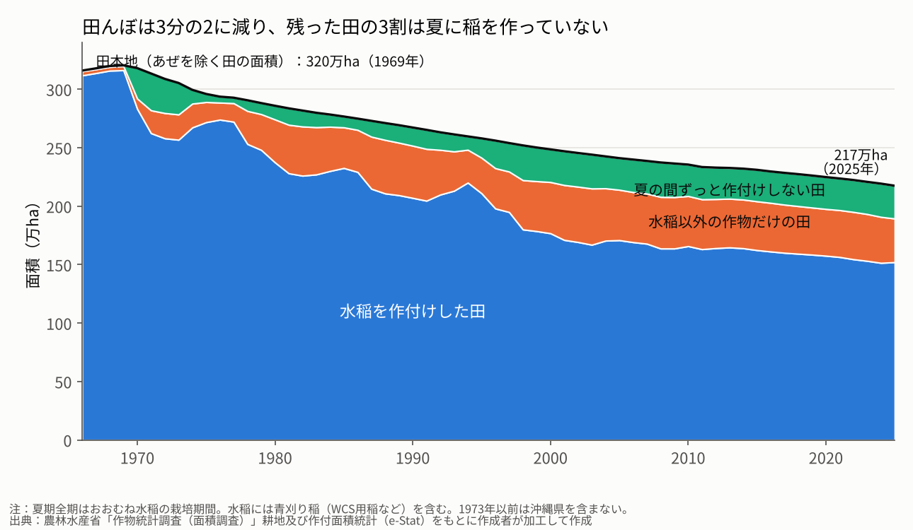
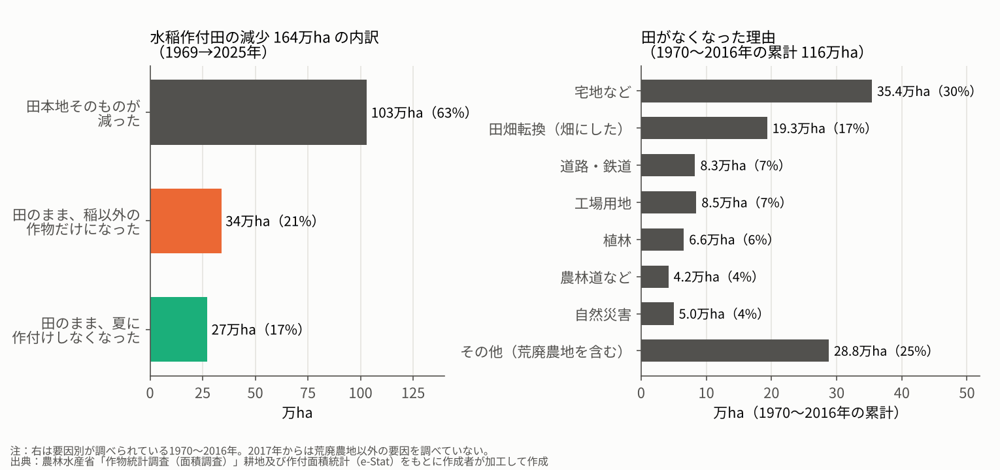
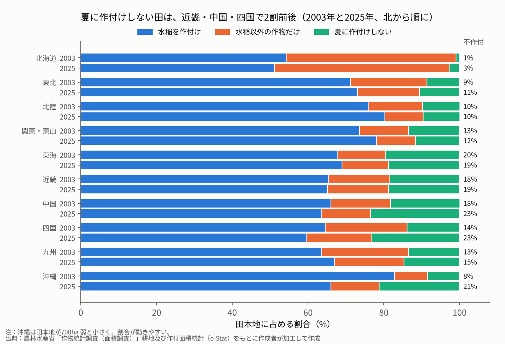
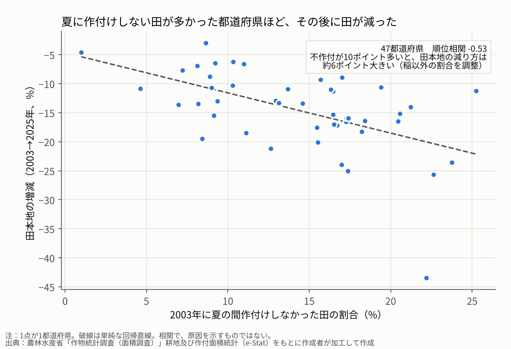

# F339 米の作付けが減った田んぼは、何に変わったのか？ 減った164万haの63%は田んぼそのものがなくなった分で、ほかの作物への転作は21%、夏に何も作らない田が17%

水稲（田んぼで作る稲）を作付けした田は、1969年の316万haから2025年の152万haへ、164万ha（52%）減りました。この減った分が「何に変わったのか」を、農林水産省の「夏期における田本地の利用状況」で分けました。田本地は、あぜ（けい畔）を除いた田の面積です。

政策や価格についての助言はしません。

## 結論（先に）

1. **減った分のいちばん大きな行き先は「田んぼでなくなったこと」です。** 1969→2025年の減少164万haのうち、田本地の減少が103万ha（63%）、田のまま稲以外の作物だけになった分が34万ha（21%）、夏に何も作らなくなった分が27万ha（17%）です。
2. **田がなくなった理由は宅地などが最大で、畑への転換は17%でした。** 1970〜2016年の田のかい廃（耕地でなくなった面積）116万haのうち、宅地など30%、その他（荒廃農地を含む）25%、田畑転換17%でした。
3. **2025年の田本地217万haのうち、夏に稲を作っているのは70%です。** 稲以外の作物だけが17%、夏の間ずっと作付けしない田が13%です。
4. **夏に作付けしない田の割合には地域差があります。** 2025年は北海道3%、東北11%、北陸10%に対し、近畿19%、中国23%、四国23%でした。稲以外の作物だけの田は北海道が46%で突出しています。
5. **問い直し：2003年に不作付の割合が高かった都道府県ほど、2003→2025年に田本地が大きく減っていました**（順位相関 −0.53）。ただし相関で、不作付が田の減少の原因だとは言えません。



## 問い

「米の生産を減らす政策で、田んぼは麦・大豆・飼料用米などに転作された」という説明をよく聞きます。農林水産省の水田活用の直接支払交付金も、田んぼで主食用米以外の作物を作ることへの支払いです（[令和6年度の支払実績](https://www.maff.go.jp/j/seisaku_tokatu/antei/r6_jisseki1.html)）。

では、稲が減った面積のうち、どれだけが本当に別の作物に変わったのでしょうか。

知りたい人：農業・食品の仕事で作付けの動きを追う人、地域の土地利用を調べる人、統計の読み方を学ぶ人です。

## データ（出典）

- 夏期における田本地の利用状況：全国は1966〜2025年、地域・都道府県は2003・2004年と2024・2025年（田本地、水稲作付田、水稲以外の作物のみの作付田、夏期全期不作付地）
- 田の拡張・かい廃面積（1956〜2025年、要因別は2016年まで）、田の作付延べ面積（作物類別、1967〜2024年）、本地・けい畔別耕地面積（照合用）
- 水稲の主食用作付面積、［参考］飼料用米・WCS用稲（2008〜2025年）

いずれも農林水産省「作物統計調査」で、2026-11-16 に e-Stat から取得（URL は data/raw/SOURCES.md）。夏期全期は、おおむね水稲の栽培期間です。水稲作付田には青刈り稲（WCS用稲＝稲を実ごと発酵させた牛のえさ、など）が含まれます。

## 事前の計画

集計の前に [PLAN.md](PLAN.md) を書きました。全国の夏期の表は形を確かめるときに全行を見ていたので、H1 は事前の仮説ではなく確かめの計算として扱う、と計画に書いています。

| 仮説 | 外れの基準 | 結果 | 判定 |
|---|---|---|---|
| H1：1969→2025年の水稲作付田の減少の半分以上は田本地の減少 | 50%未満 | 62.7% | 支持（事前ではない） |
| H2：田のかい廃のうち田畑転換は3割未満 | 30%以上 | 16.6%（1970〜2016年） | 支持 |
| H3：2024年の水稲（子実用）のうち主食用以外が10%以上 | 10%未満 | 7.4% | 外れ |
| H4：不作付の割合は中国・四国が東北より高く、稲以外の割合は北海道が最大 | どちらかが逆 | 中国23.5%・四国23.0% ＞ 東北10.6%、北海道46.0%が最大 | 支持 |

H3 は、「水稲（子実用）」に飼料用米が入っていない（青刈りとして除かれる）ことを取り違えていました。青刈りを含む水稲作付田を分母にすると、2024年の主食用以外は16.8%でした。

## やったこと

- 分解：水稲作付田の減少 ＝ 田本地の減少 ＋ 稲以外のみの増加 ＋ 不作付の増加（＋表の丸めの残り）。results/decomposition.csv
- 田がなくなった理由：田のかい廃の累計を要因別に（1970〜2016年。2017年からは荒廃農地だけ）。results/abandon_by_period.csv
- 田の作物（延べ面積）、稲の中身（作付田 − 主食用 − 飼料用米 − WCS用稲 ＝ その他。測り方が違う数字の差なので目安）、地域と都道府県の割合。results/ の各 CSV

## 分かったこと

### 1. 田んぼは3分の2に減り、残った田の3割は夏に稲を作っていない

- 田本地は1969年の320万haから2025年の217万haへ32%減りました（図1）。
- 稲の田は1969年の98.7%から2025年は69.9%に。稲以外だけが17.2%、夏期全期不作付地が12.9%です。
- 不作付地の最大は1971年（32万ha）で、生産調整（米の作付けを減らす取り組み）の始まりと重なります。1998〜2025年の不作付の割合は11.2〜13.0%です。

### 2. 減った164万haの内訳と、田がなくなった理由（図2）



- 1969→2025年の水稲作付田の減少164万haのうち、田本地の減少が103万ha（62.7%）、稲以外のみの増加が34万ha（20.6%）、不作付の増加が27万ha（16.6%）でした。
- 1970〜2016年の田のかい廃116万haのうち、人為かい廃（転用や荒廃）が78.9%、田畑転換が16.6%、自然災害が4.3%でした。
- 荒廃農地（荒れて耕地から外れた田）は、かい廃の24.5%（1997〜2016年）から34.9%（2017〜2025年）に上がりました。
- 田の作付延べ面積（冬の麦も数える）では、1969→2016年に飼肥料作物 +11.7万ha、豆類 +10.3万ha、野菜 +3.8万ha、麦類 −7.0万haでした。

### 3. 地域による違い（図3）



- 2025年の不作付の割合は、近畿・中国・四国の合計21.5%、北海道・東北・北陸の合計8.8%でした（都道府県の中央値 21.9% と 11.1%、Mann–Whitney 検定 p=0.0003）。
- 2003→2025年に中国（18.3→23.5%）と四国（13.8→23.0%）は上がり、北陸・関東・東山・東海は横ばいか低下です。
- 北海道は稲以外の作物だけの田が46.0%で、ほかの地域（10〜18%）より高いです。

### 4. 稲の中身

- 2024年の水稲作付田151.4万haのうち、主食用125.9万ha、飼料用米9.9万ha、WCS用稲5.6万ha、その他（加工用など）約10.0万haでした。飼料用米は2022年の14.2万haが最大です。

## 問い直し（結果を見てから足した）

**Q1：夏に作付けしない田が多かった都道府県ほど、その後に田がなくなったのか？**（図4）



- 2003年の不作付の割合と、2003→2025年の田本地の増減の順位相関は −0.53（p=0.0001、47都道府県）でした。
- 稲以外の割合を調整した回帰では、不作付が10ポイント高いと田本地の減り方が約6ポイント大きい関係でした（傾き −0.61、95%区間はブートストラップで −1.12〜−0.20）。
- 年や県を替えても同じ向きです。山がちで区画が小さいなど、両方に効く共通の事情があるかもしれません（推測）。

**Q2：2025年に主食用米が増えた分は、田んぼのどこから来たのか？**

- 2024→2025年に主食用は10.8万ha増えましたが、水稲作付田は0.6万ha増だけです。増えた分の94%は、稲の田の中で飼料用米（−5.3万ha）・WCS用稲（−0.8万ha）・その他（−4.2万ha）から移った分と計算されます。

## 頑健性

| 確かめたこと | 結果 | 結論は変わったか |
|---|---|---|
| 始まりを1975年に | 減少120万haのうち田本地 65.6%、稲以外 16.8%、不作付 17.5% | 変わらない |
| 始まりを2003年に | 稲の減少14.9万haに対し、田本地は26.6万ha減、稲以外は10.8万ha減、不作付は0.9万ha減 | 2003年からは田本地の減少が稲の減少を上回る |
| 終わりを2024年に | 田本地 61.4%、稲以外 21.8%、不作付 16.8% | 変わらない |
| 田本地を別の表で照合 | 差は最大1,000ha、分解は同じ | 変わらない |
| 稲を水稲（子実用）で測る | 減少175万haのうち田本地 58.9%、稲以外 19.4%、不作付 15.6%、残り（青刈りなど）6.1% | 変わらない |
| 田の増減の照合 | 1970〜2025年の拡張 − かい廃 ＝ −114.3万ha、田の面積の差（けい畔を含む）−114.1万ha | ほぼ一致 |
| 地域を都道府県で | 不作付の中央値：近畿・中国・四国 21.9%、北海道・東北・北陸 11.1% | 変わらない |
| Q1：年・県を替える | 2004年から −0.57、2024年まで −0.54、北海道・沖縄除く −0.56、東京・大阪・神奈川除く −0.50 | 変わらない |

## 言えないこと

1. 田本地から外れた土地の今の姿は、2017年からは荒廃農地以外の要因が調べられていないため分かりません。
2. 夏の「稲以外の作物だけ」の田の中身（大豆・飼料作物・野菜・そばの割合）は、夏期の表には出ていません。作付延べ面積は冬の作物も数えるので、そのまま足し引きできません。
3. 不作付地が「荒れている」のか「翌年に作る予定で休ませている」のかは区別できません。
4. 生産調整などの政策の効果は推定していません。時期が重なることを示しただけです。
5. 稲の中身の「その他」は、測り方の違う数字の差で、目安です。
6. 問い直しQ1は相関で、不作付が田の減少を招いたとは言えません。

## 仕事で使うなら

- 「米の作付けが減った分」を国内の別の作物の量の見込みに使うときは、減った面積の6割は田んぼそのものがなくなった分だという点を前提に置けます。
- 地域の農地の話では、田本地・稲・稲以外・不作付の4つを同じ表に並べると前提がそろいます。

## 計画からの変更

- H3 は、「水稲（子実用）」が飼料用米を含むと取り違えて書いていました。判定は計画どおり「外れ」とし、夏期の水稲作付田を分母にした値（16.8%）を並べました。
- 田のかい廃の要因（H2）は、2017年から田畑転換を調べていないため、1970〜2016年で判定しました。
- PLAN の「2021〜2025年の田畑転換の行を見た」は誤りで、見ていたのは荒廃農地の列でした。
- 問い直しは2つ（Q1・Q2）足しました。

## 再現のしかた

```sh
pip install -r requirements.txt
sh src/run_all.sh     # 02_build → 03_analysis → 03b_requestion → 04_figures（オフライン）
python3 src/01_fetch.py   # 元データを取り直すときだけ（ネットにつなぐ）
```

| ファイル | 中身 |
|---|---|
| src/01_fetch.py | 元の Excel の取得（data/raw/SOURCES.md） |
| src/02_build.py | data/*.csv を作る |
| src/03_analysis.py・03b_requestion.py | 主の分析と問い直し（results/main.json、requestion.json） |
| src/04_figures.py | 図4枚 |

所要は CPU 1つで約4秒、乱数の種は 20261116。results/repro_check.txt：2026-11-16 再実行で22ファイル一致。


## 関連する記事

- 112「米の作付面積は1969年から55%減った」：稲の面積の減り方と地域差を見た記事。本記事は、減った面積が田のまま別の作物・不作付になったのか、田そのものがなくなったのかに分けた点が違います。

## レビューで直したこと

| # | 指摘 | 直し方 |
|---|---|---|
| 1 | 既存の記事112（米の作付面積の減少と地域差）と問いが近いのに、関連の記載がなかった | 「関連する記事」の節を足し、違いを1文で書いた |

## 出典

- 農林水産省「作物統計調査（面積調査）」耕地及び作付面積統計（[e-Stat](https://www.e-stat.go.jp/stat-search/files?page=1&toukei=00500215&tstat=000001013427)、[結果の概要](https://www.maff.go.jp/j/tokei/kouhyou/sakumotu/menseki/gaiyou/index.html)）
- 農林水産省「作物統計調査（作況調査）」水稲 収穫量累年統計、［参考］飼料用米・WCS用稲
- 農林水産省「令和6年度 経営所得安定対策等の支払実績」（[リンク](https://www.maff.go.jp/j/seisaku_tokatu/antei/r6_jisseki1.html)、問いの背景として参照）

（いずれも農林水産省「作物統計調査」をもとに作成者が加工して作成）
