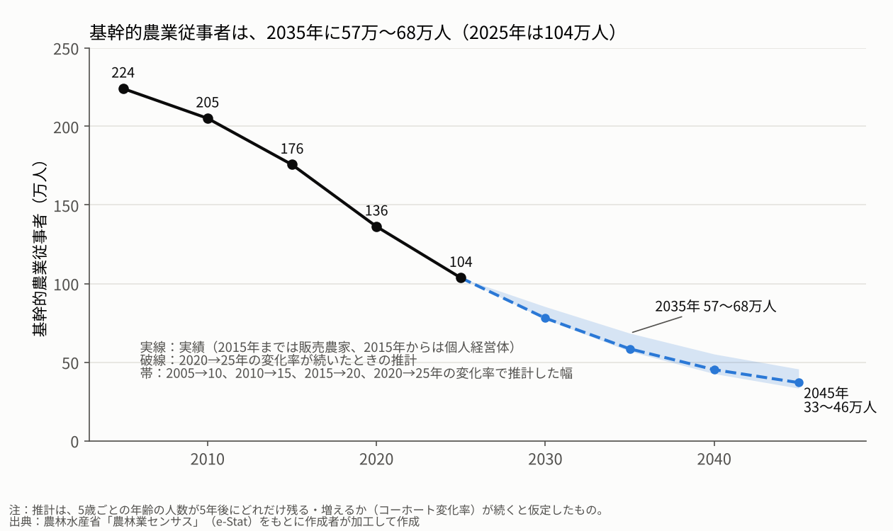
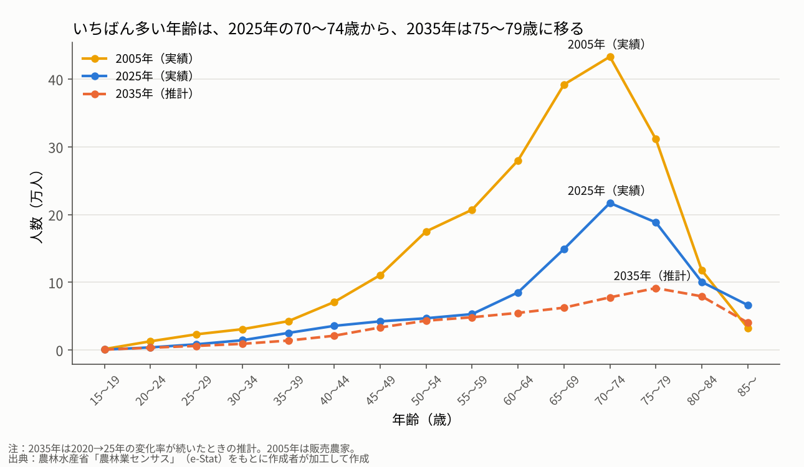
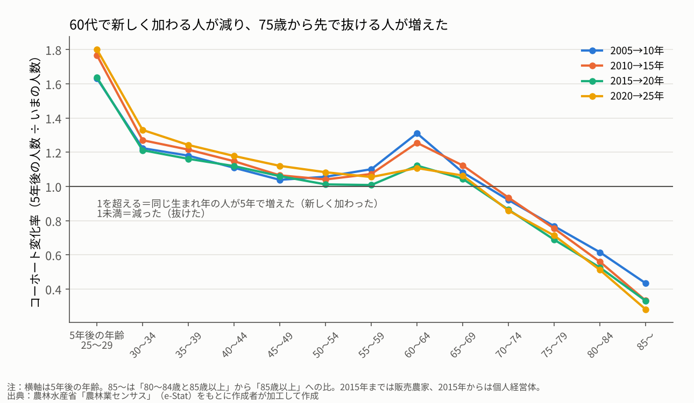
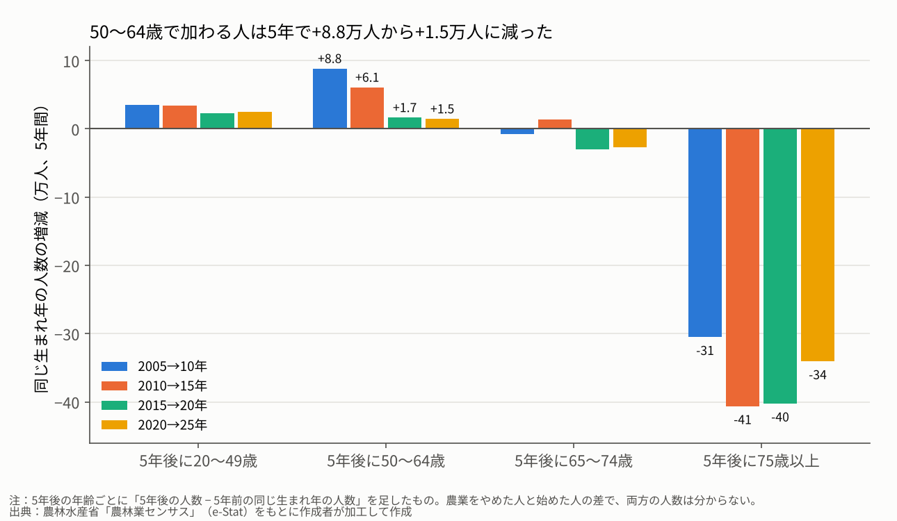

# F340 農業で働く人の高齢化は、この先どう進むのか？ 2035年は57万〜68万人、65歳以上の割合は2025年の70%が山で60〜66%に下がる

基幹的農業従事者（自営農業を主な仕事としている人）は、2025年に104万人で、65歳以上が70%です。この先の人数と年齢構成を、5歳ごとの年齢の人数が5年後にどれだけ残るか・増えるか（コーホート変化率）を使って推計し、過去の実績で答え合わせもしました。政策や経営についての助言はしません。

## 結論（先に）

1. **人数は減り続ける見込みです。** 過去4つの期間の変化率のどれを使っても、2035年は57万〜68万人、2045年は33万〜46万人でした（2025年は104万人）。
2. **高齢化の割合は、2025年あたりが山です。** 65歳以上の割合は2025年の69.6%から、2035年は60〜66%に下がる推計です。いちばん人数の多い年齢層（2025年は70〜74歳）が、75歳を過ぎて大きく抜けていくためです。人数が減るなかでの割合の低下で、若い人が増えるわけではありません。
3. **答え合わせでは、1期先の誤差は −0.5%と +7.2%でした。** 2015→20年の変化率で2025年を推計すると実績との差は −0.5%でしたが、2010→15年の変化率で2020年を推計すると +7.2%の過大でした。減り方は期間ごとに速くなってきたため、古い変化率ほど多めに出ます。
4. **問い直し：50〜64歳で新しく加わる人が減りました。** 同じ生まれ年の人数は、2005→10年には50〜64歳で8.8万人増えていましたが、2020→25年は1.5万人の増加にとどまりました。



## 問い

基幹的農業従事者は、2000年の240万人から2025年の104万人へ、25年で半分以下になりました（[令和7年度 食料・農業・農村白書](https://www.maff.go.jp/j/wpaper/w_maff/r7/pdf/1-2-02.pdf)）。白書は2025年の65歳以上を69.6%、49歳以下を12.6%としています。「この先も減り、高齢化が進む」とよく言われますが、どのくらいの速さで、年齢構成はどう変わるのでしょうか。

知りたい人：農業・食品・資材の仕事で国内の担い手の数の見通しを使う人、地域の農業の計画を読む人、人口推計の方法を学ぶ人です。

## データ（出典）

- 農林水産省「農林業センサス」累年統計 表5-11 年齢別基幹的農業従事者数：2005・2010・2015年は販売農家、2015・2020年は個人経営体。5歳階級、男女、地域・都道府県
- 「2025年農林業センサス」表2-54(1)ア：2025年と2020年（個人経営体）

2026-11-16 に e-Stat から取得しました（URL は data/raw/SOURCES.md）。2015年は販売農家（175.4万人）と個人経営体（175.7万人）の両方があり、差は0.2%です。2015年までの変化率は販売農家、2015年からは個人経営体で計算しました。2020年は2つの表で同じ値（136.3万人）でした。

## 事前の計画

集計の前に [PLAN.md](PLAN.md) を書きました（2025年・2020年の全国の年齢別の行は、形を確かめるときに見ています）。

| 仮説 | 外れの基準 | 結果 | 判定 |
|---|---|---|---|
| H1：1期先の誤差は2020年・2025年とも ±5%以内 | どちらかが5%超 | 2020年 +7.15%、2025年 −0.51% | 外れ |
| H2：2035年は4つの変化率のどれでも50万〜70万人 | 範囲の外 | 56.9万〜68.4万人 | 支持 |
| H3：2035年の65歳以上の割合はどれでも65%以上 | 65%未満がある | 60.1〜65.7% | 外れ |
| H4：2035年の49歳以下の割合は2025年（12.6%）より高い（主の推計） | 下がる | 14.9% | 支持（ただし2005→10年の率では11.5%） |

## やったこと

- コーホート変化率：a〜a+4歳の人数に対する5年後の a+5〜a+9歳の人数の比。85歳以上は「80〜84歳＋85歳以上」からの比。15〜19歳は横ばい
- 2025年を出発点に、4つの期間（2005→10、2010→15、2015→20、2020→25年）の変化率で2045年まで推計。主の推計は直近の2020→25年
- 答え合わせ：2015年から2020年、2020年から2025年を1期先で推計し、実績と比べる
- 平均年齢は各階級の中央（85歳以上は87.5歳）で近似。2025年の近似は68.1歳で、公表値（67.7歳）より0.4歳高く出ます

## 分かったこと

### 1. 2035年は57万〜68万人（図1）

- 主の推計（2020→25年の率）は2030年78.0万人、2035年58.5万人、2045年37.0万人です。
- 4つの率の幅は、2035年が56.9万〜68.4万人、2045年が33.4万〜45.6万人でした。いちばん多く出るのは減り方の遅かった2005→10年の率です。

### 2. いちばん多い年齢層が75歳を過ぎていく（図2）



- 2025年にいちばん多いのは70〜74歳（21.7万人）です。2035年の推計では75〜79歳（9.1万人）が山になります。
- 65歳以上の割合は2035年に60.1%（主の推計）です。平均年齢は2025年の68.1歳から66.7歳に下がります（近似）。
- 49歳以下は2025年の13.0万人から2035年は8.7万人に減りますが、総数より減り方が小さいため、割合は12.6%から14.9%に上がります。

### 3. 変化率の形と、答え合わせ（図3）



- 60〜64歳になるときの変化率は、2005→10年の1.31から2020→25年の1.11に下がりました。勤めを終えて農業を主にする人が加わる分が小さくなったと読めます（推測）。
- 85歳以上への率は0.43から0.28に下がり、高い年齢で抜ける人の割合が上がりました。
- 1期先の誤差は、2020年が +7.2%、2025年が −0.5%でした。2025年を古い率で推計すると、2010→15年の率で +6.5%、2005→10年の率で +9.5%です。直近の率でも、1期先で±7%程度は外れうると見ておくのが無難です。

## 問い直し（結果を見てから足した）

**Q：減った人数は、どの年齢での出入りから来ているのか？**（図4）



- 5年後の年齢ごとに「5年後の人数 − 5年前の同じ生まれ年の人数」を足しました。2020→25年の純減32.7万人のうち、5年後に75歳以上の層で −34.1万人、65〜74歳で −2.7万人、50〜64歳で +1.5万人、20〜49歳で +2.5万人でした。
- 50〜64歳での増加は、2005→10年の +8.8万人、2010→15年の +6.1万人から、2015→20年 +1.7万人、2020→25年 +1.5万人に縮みました。
- 60〜64歳の率を1.0（加わる人なし）にしても、2035年の推計は58.5万人から57.3万人に下がるだけでした。逆に2005→10年の1.31に戻しても60.6万人です。2035年の人数を左右するのは、主に75歳以上で抜けていく分です。

## 頑健性

| 確かめたこと | 2035年の人数 | 65歳以上 | 結論は変わったか |
|---|---|---|---|
| 主の推計（2020→25年の率） | 58.5万人 | 60.1% | — |
| 男女別に推計して足す | 59.1万人 | 60.3% | 変わらない |
| 10地域別に推計して足す | 58.8万人 | 59.8% | 変わらない |
| 4期間の平均の率 | 62.0万人 | 63.2% | 変わらない |
| 2015年を販売農家で接続した2015→20年の率 | 56.6万人 | 63.7% | 変わらない |
| 平均年齢で85歳以上を90歳に | 平均年齢66.9歳（主は66.7歳） | — | 変わらない |

## 言えないこと

1. 法人などに雇われて農業で働く人は基幹的農業従事者に入りません。働く人全体の見通しではありません。
2. 変化率が続く保証はありません。価格・政策・天候などの影響は入れていません。
3. 出入りは差し引きで、やめた人と始めた人それぞれの人数は分かりません。
4. 人数が減っても、規模の拡大などで生産量がどうなるかは分かりません。
5. 2015年の前後で集計の単位（販売農家→個人経営体）が変わっています。差は0.2%ですが、完全に同じ集団ではありません。

## 仕事で使うなら

- 国内の担い手の数を前提に置くときは、1本の数字ではなく、変化率の期間を変えた幅（2035年に57万〜68万人）で置けます。
- 「高齢化率」は2025年あたりが山で、この先は人数の減少が中心になる、という読み方ができます。

## 計画からの変更

- 計画どおりに進めました。H1・H3 は外れとして記録しています。
- 問い直し（出入りの分解と60代の率の感度）を足しました。

## 再現のしかた

```sh
pip install -r requirements.txt
sh src/run_all.sh     # 02_build → 03_analysis → 03b_requestion → 04_figures（オフライン）
python3 src/01_fetch.py   # 元データを取り直すときだけ
```

| ファイル | 中身 |
|---|---|
| src/core.py | データの読み込み、変化率、推計、指標 |
| src/02_build.py | Excel から data/core_workers_by_age.csv（照合は data/check_totals.csv） |
| src/03_analysis.py・03b_requestion.py | 推計・答え合わせ・頑健性（results/main.json）と問い直し（results/requestion.json） |
| src/04_figures.py | 図4枚 |

所要は CPU 1つで約3秒（乱数は使っていません）。results/repro_check.txt：2026-11-16 再実行で17ファイル一致。


## 関連する記事

- 151「農業経営体は5年で何割減ったか」：2020→25年の経営体数の減少を都道府県別に見た記事。本記事は、基幹的農業従事者の年齢構成をコーホート変化率で2045年まで推計し、過去の実績で答え合わせした点が違います。

## レビューで直したこと

| # | 指摘 | 直し方 |
|---|---|---|
| 1 | 既存の記事151（農業経営体の5年の減少）と題材が近いのに、関連の記載がなかった | 「関連する記事」の節を足し、違いを1文で書いた |

## 出典

- 農林水産省「農林業センサス」累年統計、「2025年農林業センサス」（[e-Stat](https://www.e-stat.go.jp/stat-search/files?page=1&toukei=00500209)）
- 農林水産省「令和7年度 食料・農業・農村白書」（[第2章 第2節](https://www.maff.go.jp/j/wpaper/w_maff/r7/pdf/1-2-02.pdf)、問いの背景として参照）

（いずれも農林水産省「農林業センサス」をもとに作成者が加工して作成）
