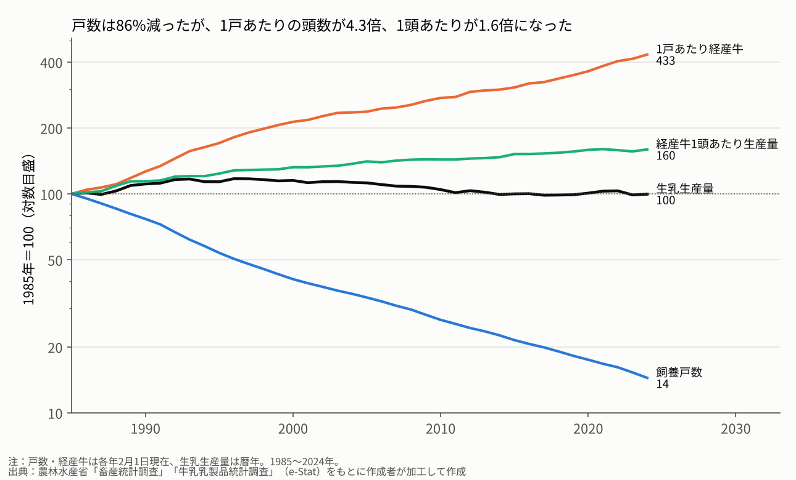
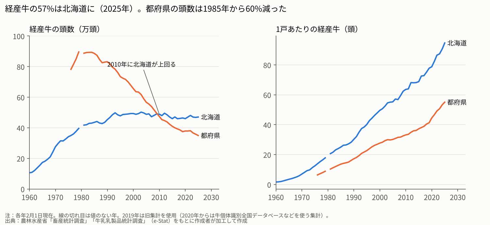
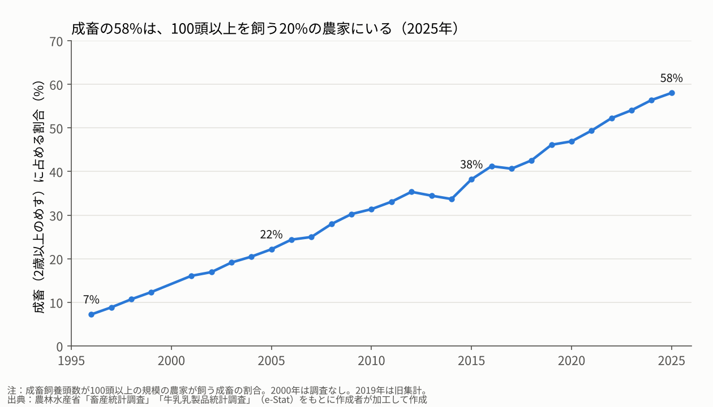
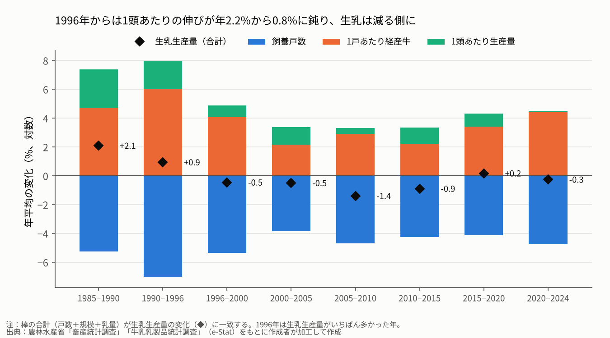

# F341 酪農家が減っても、牛乳はなぜあまり減らないのか？ 戸数は86%減ったが、1戸あたりの牛が4.3倍、1頭あたりの量が1.6倍になり、生乳は1985年並み

乳用牛を飼う農家（飼養戸数）は、1985年の8.2万戸から2024年の1.2万戸へ86%減りました。それでも生乳（しぼったままの牛乳）の生産量は、1985年の738万トンに対して2024年は736万トンと、ほぼ同じです。戸数の減少を何が埋めたのかを、3つのかけ算に分けて確かめました。価格や政策についての助言はしません。

## 結論（先に）

1. **戸数の減少を埋めたのは、主に1戸あたりの頭数の増加です。** 生乳 ＝ 戸数 × 1戸あたり経産牛 × 1頭あたり生産量 と分けると、1985→2024年に戸数は86%減、1戸あたりの経産牛は16.0頭から69.4頭（4.3倍）、1頭あたりの生産量は5,583kgから8,905kg（1.6倍）でした。埋め合わせた分の76%が規模、24%が1頭あたりの伸びです（対数で計算）。
2. **牛の数は、戸数ほどは減っていません。** 1985→2025年に経産牛（子を産んだことのあるめす牛）は38%減で、戸数の減少（86%）の半分以下です。
3. **牛は北海道に集まりました。** 経産牛に占める北海道の割合は1985年の33%から2025年の57%になりました。北海道の経産牛は8%増え、都府県は60%減っています。
4. **大きな農家に集まりました。** 成畜（2歳以上のめす）のうち100頭以上を飼う農家にいる割合は、1996年の7%から2025年は58%です。その農家は全体の約20%です。
5. **問い直し：1996年の山からは、生乳は年0.6%ずつ減る側に変わりました。** 1頭あたりの伸びが年2.2%から0.8%に鈍ったことが大きく、2020〜24年は年0.1%でした。



## 問い

酪農家の数は年に数%ずつ減り続けています。農林水産省の資料でも「戸数は減少し、1戸あたりの頭数と1頭あたりの乳量が増えている」と説明されています（[畜産をめぐる情勢（酪農・牛乳乳製品関係抜粋）、2016年](https://www.maff.go.jp/j/chikusan/gyunyu/attach/pdf/hokyu_01-5.pdf)）。では、規模の拡大と1頭あたりの伸びは、それぞれどれだけ埋めたのでしょうか。それは今も同じように続いているのでしょうか。

知りたい人：乳業・食品・飼料の仕事で国内の生乳の量の動きを読む人、農業の構造の変化を学ぶ人です。

## データ（出典）

- 農林水産省「畜産統計調査」長期累年：乳用牛の飼養戸数・頭数（全国・北海道・都府県、1960〜2025年、各年2月1日現在）、成畜頭数規模別の戸数・頭数（全国）
- 農林水産省「牛乳乳製品統計調査」長期累年：生乳生産量（全国、1985〜2024年、暦年）

2026-11-16 に e-Stat から取得しました（URL は data/raw/SOURCES.md）。2020年から畜産統計は牛個体識別全国データベースなどを使う集計に変わり、2019年は旧・新の両方があります（2019年の段差は戸数 −0.7%、経産牛 +0.2%）。

## 事前の計画

集計の前に [PLAN.md](PLAN.md) を書きました。1985年と2024年の生乳生産量がほぼ同じことは、形を確かめるときに見て知っていました。

| 仮説 | 外れの基準 | 結果 | 判定 |
|---|---|---|---|
| H1：戸数の減少を埋めたのは、乳量より規模の方が大きい | 乳量の寄与の方が大きい | 規模 +1.465、乳量 +0.467（対数） | 支持 |
| H2：経産牛の減少率は戸数の減少率の半分以下 | 半分を超える | −38.0% と −86.3%（比 0.44） | 支持 |
| H3：経産牛の北海道の割合が2025年に55%超 | 55%以下 | 57.4% | 支持 |
| H4：2025年の成畜の100頭以上の割合が50%超 | 50%以下 | 58.0% | 支持（計画のあと、列の位置を確かめるときに2025年の値を見た） |

## やったこと

- 分解：生乳 P ＝ 戸数 F × 1戸あたり経産牛 C/F × 1頭あたり生産量 P/C。1985→2024年の対数の差で分ける（3つの和が生乳の変化に一致）
- 経産牛は2月1日現在、生乳は暦年。頑健性で時点のずれを確かめた
- 地域は、生乳の地域別の長い系列がないので、頭数と戸数で見た
- 規模は、成畜飼養頭数規模別の成畜頭数から100頭以上の割合を出した

## 分かったこと

### 1. 規模が4.3倍、1頭あたりが1.6倍（図1）

- 対数で見ると、戸数 −1.935 を、規模 +1.465 と1頭あたり +0.467 でほぼ埋め、生乳は −0.003（−0.3%）でした。
- 戸数の減り方は年 −5.8%（1985〜2000年）、−4.2%（2000〜15年）、−4.4%（2015〜25年）です。

### 2. 北海道と都府県（図2）



- 1985→2025年に、北海道は戸数 −71%、経産牛 +8%。都府県は戸数 −90%、経産牛 −60%でした。
- 経産牛の数は2010年に北海道が都府県を上回りました。1戸あたりの経産牛は、北海道が25.0頭から94.7頭、都府県が13.6頭から55.1頭です。

### 3. 100頭以上の農家に58%（図3）



- 成畜のうち100頭以上の規模の農家にいる割合は、1996年7.2%、2005年22.2%、2015年38.2%、2025年58.0%でした。
- 2025年に100頭以上を飼う農家は2,159戸で、成畜を飼う農家の19.5%です。

## 問い直し（結果を見てから足した）

**Q：全体ではほぼ埋め合わせたのに、1996年の山（866万トン）からはなぜ減ったのか？**（図4）



- 年平均で見ると、1985〜96年は戸数 −6.2%、規模 +5.4%、1頭あたり +2.2%で、生乳は +1.5%でした。
- 1996〜2024年は戸数 −4.5%、規模 +3.1%、1頭あたり +0.8%で、生乳は −0.6%です。戸数の減り方はむしろゆるやかになりましたが、規模と1頭あたりの伸びがそれ以上に鈍りました。
- 2020〜24年の1頭あたりの伸びは年 +0.1%とほぼ止まり、規模の伸び（+4.4%）だけで戸数の減少（−4.8%）を埋めていました。
- 生乳が4.2%減った2022→23年は、1頭あたりが −1.3%、規模が +2.5%（通常より小さい）でした。理由はこの統計では分かりません。

## 頑健性

| 確かめたこと | 規模の寄与の割合 | 結論は変わったか |
|---|---|---|
| 主（1985→2024年、経産牛） | 75.8% | — |
| 始まりを1990年に | 78.6% | 変わらない |
| 始まりを2000年に | 79.1% | 変わらない |
| 経産牛ではなく搾乳牛で | 77.1% | 変わらない |
| 頭数をその年と翌年の2月の平均に（1985→2023年） | 75.9% | 変わらない |
| 終わりを2023年に | 76.1% | 変わらない |
| 2019年の集計の段差 | 戸数 −0.7%、経産牛 +0.2%、搾乳牛 −1.7% | 分解への影響は小さい |

## 言えないこと

1. 1頭あたりの生産量が伸びた理由（品種、えさ、飼い方）と、近年鈍った理由は、この統計では分けられません。
2. 戸数が減った理由（やめた理由）は分かりません。
3. 北海道・都府県の生乳生産量の長い系列は使っていません。地域の比較は頭数で行いました。
4. 生乳の用途（飲む牛乳か乳製品か）の変化は扱っていません。
5. 経産牛は2月1日の時点の数で、1年を通した平均の頭数ではありません。

## 仕事で使うなら

- 国内の生乳の量を読むときは、戸数よりも「1戸あたりの頭数」と「1頭あたりの量」の伸びを見ると、変化の向きが分かりやすくなります。
- 近年は1頭あたりの伸びがほぼ止まっているので、規模の拡大のペースが量を左右している、という読み方ができます。

## 計画からの変更

- H4 は計画のあと、規模別の表の列の位置を確かめるときに2025年の値を見ました。判定は計画の基準どおりです。
- 頑健性「2019年の扱い」は、分解の端の年が2019年を含まないため、段差の大きさを示す形に変えました。
- 問い直し（期間ごとの分解）を足しました。

## 再現のしかた

```sh
pip install -r requirements.txt
sh src/run_all.sh     # 02_build → 03_analysis → 03b_requestion → 04_figures（オフライン）
python3 src/01_fetch.py   # 元データを取り直すときだけ
```

| ファイル | 中身 |
|---|---|
| src/02_build.py | Excel から data/*.csv |
| src/03_analysis.py | 分解・地域・規模（results/main.json ほか） |
| src/03b_requestion.py | 期間ごとの分解（results/requestion.json） |
| src/04_figures.py | 図4枚 |

所要は CPU 1つで約2秒（乱数は使っていません）。results/repro_check.txt：2026-11-16 再実行で15ファイル一致。


## 関連する記事

- 208「飲む牛乳の生産は減り、何が増えたのか」：生乳の用途と牛乳等の品目を見た記事。本記事は、生乳の量を戸数・規模・1頭あたりの量のかけ算に分けた点が違います。
- 220「養豚と採卵鶏の大規模化は、どれだけ進んだか」：豚と鶏の規模の集中を見た記事。本記事は乳用牛で、規模の拡大が生産量の維持にどれだけ効いたかを分けました。

## レビューで直したこと

| # | 指摘 | 直し方 |
|---|---|---|
| 1 | 既存の記事208（飲む牛乳と生乳の用途）・220（養豚・採卵鶏の大規模化）と題材が近いのに、関連の記載がなかった | 「関連する記事」の節を足し、違いを1文ずつ書いた |

## 出典

- 農林水産省「畜産統計調査」長期累年、「牛乳乳製品統計調査」長期累年（[e-Stat](https://www.e-stat.go.jp/stat-search/files?page=1&toukei=00500222)）
- 農林水産省「畜産をめぐる情勢（酪農・牛乳乳製品関係抜粋）」2016年（[PDF](https://www.maff.go.jp/j/chikusan/gyunyu/attach/pdf/hokyu_01-5.pdf)、問いの背景として参照）

（いずれも農林水産省「畜産統計調査」「牛乳乳製品統計調査」をもとに作成者が加工して作成）
