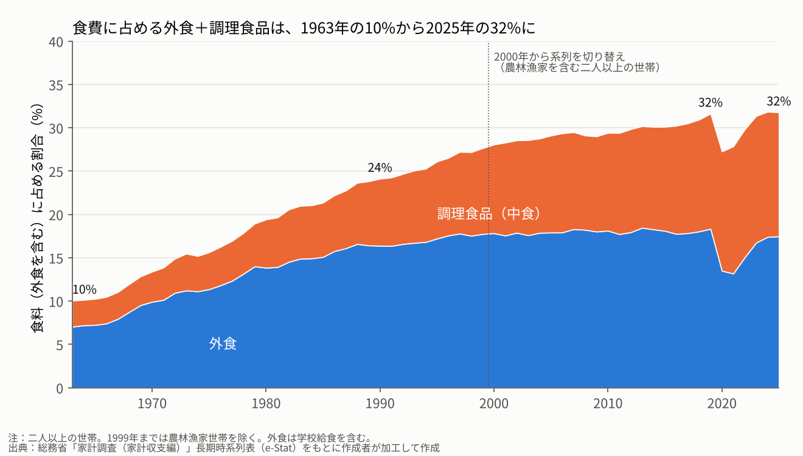
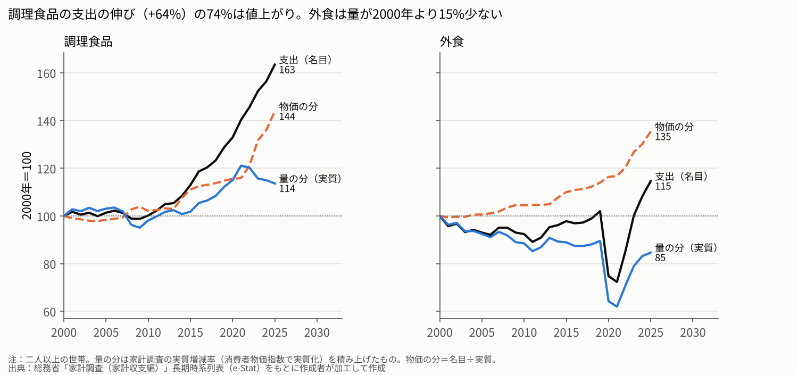
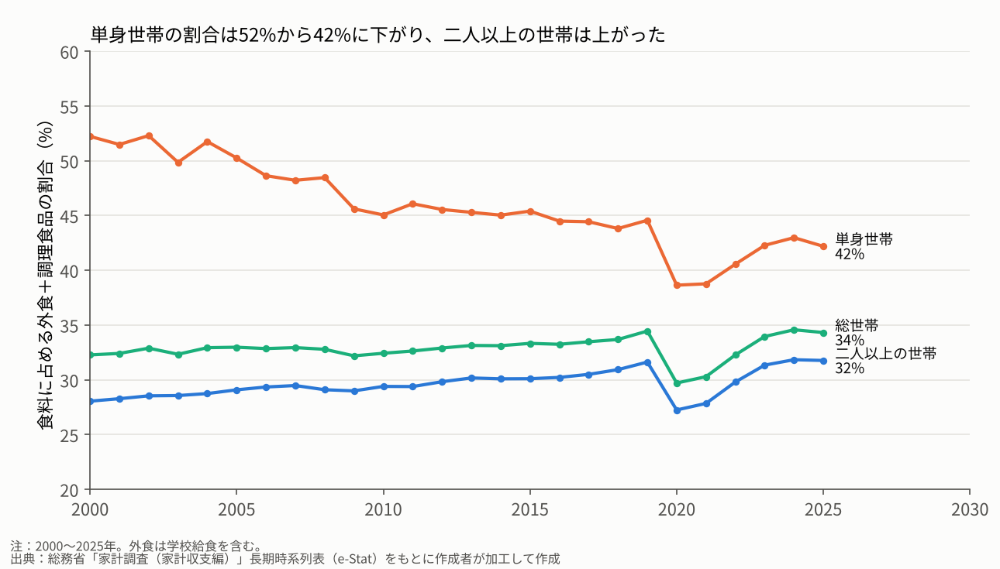
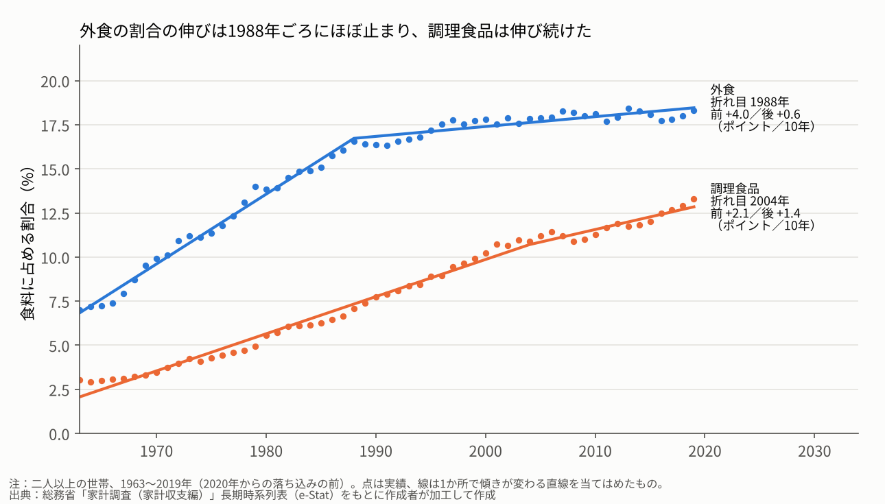

# F342 家計の食費のうち、外食・中食（調理食品）の割合はどこまで増えたのか？ 1963年の10%から2025年の32%へ。外食は1988年ごろに頭打ちで、伸びたのは調理食品

二人以上の世帯の食費（外食を含む）に占める外食と調理食品（弁当・総菜・冷凍調理食品など。いわゆる中食）の割合を、家計調査の1963〜2025年の系列で追いました。あわせて、金額の伸びを値上がりの分と量の分に分け、単身世帯とも比べました。価格や経営についての助言はしません。

（この番号はもとは「家計の預金」の問いでしたが、既存の記事と同じ切り口になるため予備の問いに替えました）

## 結論（先に）

1. **割合は3倍になりました。** 外食＋調理食品の割合は、1963年10.0%、1990年24.1%、2000年28.1%、2025年31.8%です。
2. **外食の割合は1988年ごろからほぼ横ばいです。** 1963〜2019年に折れ線を当てはめると、外食の割合の伸びは1988年を境に10年あたり +4.0ポイントから +0.6ポイントに落ちました。調理食品は10年あたり +1.4〜2.1ポイントで伸び続け、2000年の10.2%から2025年は14.3%です。
3. **2000年からの調理食品の支出の伸び（+64%）の74%は値上がりの分です。** 量（実質）は +14%でした。外食は2025年の世帯あたりの量が2000年より15%少なく、2019年と比べても5%少ない水準です。ただし世帯の人数が3.31人から2.87人に減っているため、1人あたりの量にすると2000年から −2.4%で、ほぼ横ばいです。
4. **単身世帯の割合は下がりました。** 単身世帯の外食＋調理食品の割合は2000年の52.2%から2025年は42.2%です。外食が40.5%から24.8%に下がり、調理食品は11.7%から17.4%に上がりました。



## 問い

「食の外部化が進んだ」「中食が伸びた」とよく言われます。家計調査では、外食と調理食品が別に集計されています。食費のうち、この2つの割合はどこまで増えたのでしょうか。金額が増えたのは値上がりのせいか、買う量が増えたのか。世帯の形でどれだけ違うのでしょうか。

知りたい人：食品・外食・小売の仕事で家計の食の支出の動きを読む人、家計の統計の読み方を学ぶ人です。

## データ（出典）

- 総務省「家計調査（家計収支編）」長期時系列表：二人以上の世帯（農林漁家世帯を除く）の品目別年間支出 1963〜2007年
- 同：二人以上の世帯の品目別年間支出（小分類まで）と実質増減率 2000〜2025年、総世帯・単身世帯の品目別年間支出 2000〜2025年

2026-11-16 に e-Stat から取得しました（URL は data/raw/SOURCES.md）。1999年までは農林漁家世帯を除く系列、2000年からは農林漁家を含む系列を使いました。重なる2000〜2007年の割合の差は最大0.19ポイントでした。

## 事前の計画

集計の前に [PLAN.md](PLAN.md) を書きました。形を確かめるときに、二人以上の世帯の2000〜2024年の食料・外食・調理食品の金額と、外食の2020〜2025年の実質増減率を見ていたため、H3 は事前の仮説ではないと計画に書いています。

| 仮説 | 外れの基準 | 結果 | 判定 |
|---|---|---|---|
| H1：2000→2025年の調理食品の伸びの半分以上は値上がり | 半分未満 | 74.0%（対数） | 支持 |
| H2：2025年の単身世帯の割合は45%以上 | 45%未満 | 42.2% | 外れ |
| H3：2025年の外食の実質は2019年より低い | 2019年以上 | 2019年＝100で94.6 | 支持（事前ではない） |
| H4：1963〜2007年で外食の割合の最高は2000年より前 | 2000年以降 | 2007年（18.3%） | 外れ（ただし1988年からはほぼ横ばい） |

## やったこと

- 割合：外食（学校給食を含む）と調理食品の、食料（外食を含む）に対する割合
- 伸びの分け方：名目の指数と、実質増減率を積み上げた実質の指数から、物価の分＝名目÷実質を出した（2000〜2025年）
- 世帯の形：単身・二人以上・総世帯の割合を比べた

## 分かったこと

### 1. 10%から32%へ（図1）

- 外食は1963年7.0%、1990年16.4%、2000年17.8%、2019年18.3%、2025年17.5%です。
- 調理食品は1963年3.0%、1990年7.7%、2000年10.2%、2025年14.3%で、ずっと伸びています。
- 2020年は外食が13.5%に落ち、合計も27.2%に下がりましたが、2024年に31.8%まで戻りました。

### 2. 値上がりの分と量の分（図2）



- 2000→2025年に、調理食品の支出は +63.5%、物価の分 +43.9%、量の分 +13.6%でした。
- 外食の支出は +14.6%でしたが、物価の分が +35.4%で、量の分は −15.4%です。食料全体でも量の分は −18.8%でした。
- これは世帯あたりの量です。世帯の人数が3.31人から2.87人に減ったので、1人あたりでは外食 −2.4%、調理食品 +31.0%になります（レビューで追加）。
- 外食の量は2019年＝100で、2020年71.8、2021年69.2のあと戻り、2025年は94.6です。

### 3. 世帯の形（図3）



- 2025年の割合は、単身世帯42.2%、総世帯34.3%、二人以上の世帯31.8%です。
- 単身世帯だけが2000年から下がっています。

## 問い直し（結果を見てから足した）

**Q1：外食の割合の伸びは、いつ止まったのか？**（図4）



- 1963〜2019年の割合に、1か所で傾きが変わる直線を当てはめ、折れ目の年を探しました。外食は1988年（前 +4.0／後 +0.6 ポイント／10年）、調理食品は2004年（前 +2.1／後 +1.4）でした。
- 期間を1963〜2007年や1970〜2019年に変えても、外食の折れ目は1986〜89年でした。

**Q2：単身世帯の割合が下がったのと並んで、何が動いたか？**

- 単身世帯の平均年齢は2000年の50.8歳から2025年は58.6歳に、働く人の割合（有業者比率）は0.64から0.56になりました。
- 2000〜2019年の割合と平均年齢の相関は −0.96でした。どちらも時間とともに動いているので、年齢が上がったことが原因だとは言えません（年齢別の内訳がないため推測にとどまります）。

## 頑健性

| 確かめたこと | 結果 | 結論は変わったか |
|---|---|---|
| 2000〜2007年の2つの系列の差 | 割合の差は最大0.19ポイント | 変わらない |
| 学校給食を除いた外食 | 1963年6.1%、2000年16.4%、2025年16.8% | 変わらない（横ばい） |
| 総世帯で | 2000年32.3%、2019年34.5%、2025年34.3% | 変わらない |
| 1人あたり | 調理食品の支出は世帯あたり +63.5%、1人あたり +88.5% | 伸びはむしろ大きい |
| 1人あたりの量（実質、レビューで追加） | 世帯人員3.31→2.87人。外食 −2.4%、調理食品 +31.0%（2000→2025年） | 外食の量の減少は、主に世帯が小さくなった分 |
| 2018年の家計簿の変更 | 2017→18年 +0.43ポイント（2001〜17年の平均は +0.14） | 小さな段差の可能性 |
| 折れ目の期間を変える | 外食 1986〜89年 | 変わらない |

## 言えないこと

1. 調理食品には冷凍調理食品なども含まれ、「中食」と完全には一致しません。
2. 会社の経費での外食や、世帯の外の人の分は入りません。
3. 単身世帯の増加が、国全体の食の外部化にどれだけ効いたかは、ここでは分けていません。
4. 単身世帯の割合が下がった理由（年齢・働き方・物価）は分けられていません。
5. 実質化は消費者物価指数による家計調査の計算で、品目の中身の変化は区別できません。

## 仕事で使うなら

- 「中食が伸びた」と言うときは、金額の伸びの7割強が値上がりの分であることを添えると、量の動きと混ざりません。
- 外食の割合は1980年代の終わりからほぼ横ばいで、伸びているのは調理食品だ、という前提で数字を読めます。

## 計画からの変更

- H4 は外れでしたが、問い直しで「伸びが止まった年」を調べました。
- 1人あたりの確かめは、割合ではなく金額の伸びで行いました（計画どおり）。

## 再現のしかた

```sh
pip install -r requirements.txt
sh src/run_all.sh     # 02_build → 03_analysis → 03b_requestion → 04_figures（オフライン）
python3 src/01_fetch.py   # 元データを取り直すときだけ
```

| ファイル | 中身 |
|---|---|
| src/02_build.py | CSV（cp932）と Excel から data/food_spending.csv |
| src/03_analysis.py | 割合・伸びの分解・世帯の形（results/main.json ほか） |
| src/03b_requestion.py | 折れ目と単身世帯（results/requestion.json） |
| src/04_figures.py | 図4枚 |

所要は CPU 1つで約2秒（乱数は使っていません）。results/repro_check.txt：2026-11-16 再実行で13ファイル一致。


## レビューで直したこと

| # | 指摘 | 直し方 |
|---|---|---|
| 1 | 外食の「量が2000年より15%少ない」は世帯あたりの値で、世帯人員が3.31→2.87人に減った分を含む。1人あたりではほぼ横ばいで、読み方が変わる | 03_analysis.py に1人あたりの実質の変化（外食 −2.4%、調理食品 +31.0%）を足し、結論3・本文・頑健性の表・note に書き添えた |

## 出典

- 総務省統計局「家計調査（家計収支編）」長期時系列表（[e-Stat](https://www.e-stat.go.jp/stat-search/files?page=1&toukei=00200561&tstat=000000330001)、[時系列データの案内](https://www.stat.go.jp/data/kakei/longtime/index.html)）

（いずれも総務省「家計調査」をもとに作成者が加工して作成）
