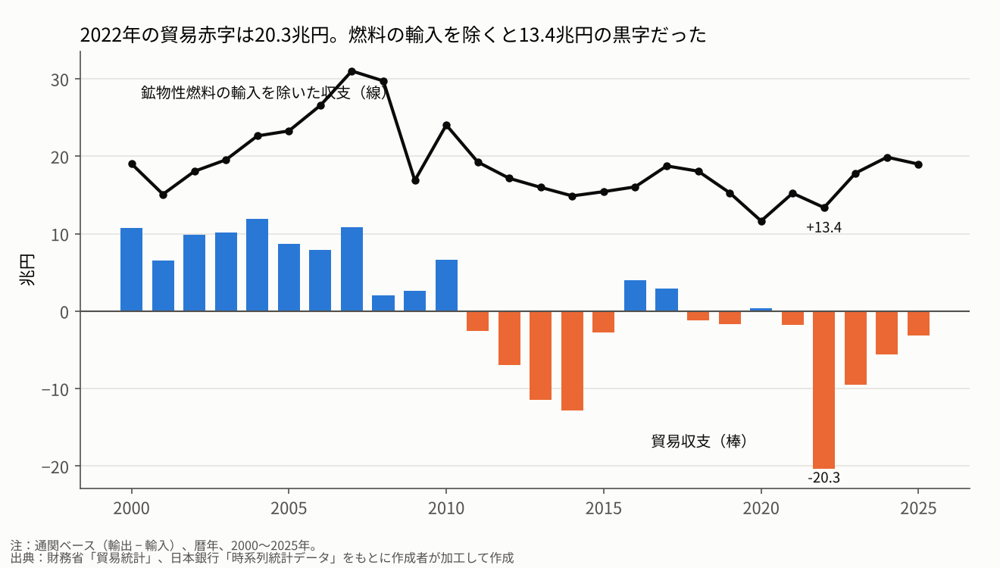
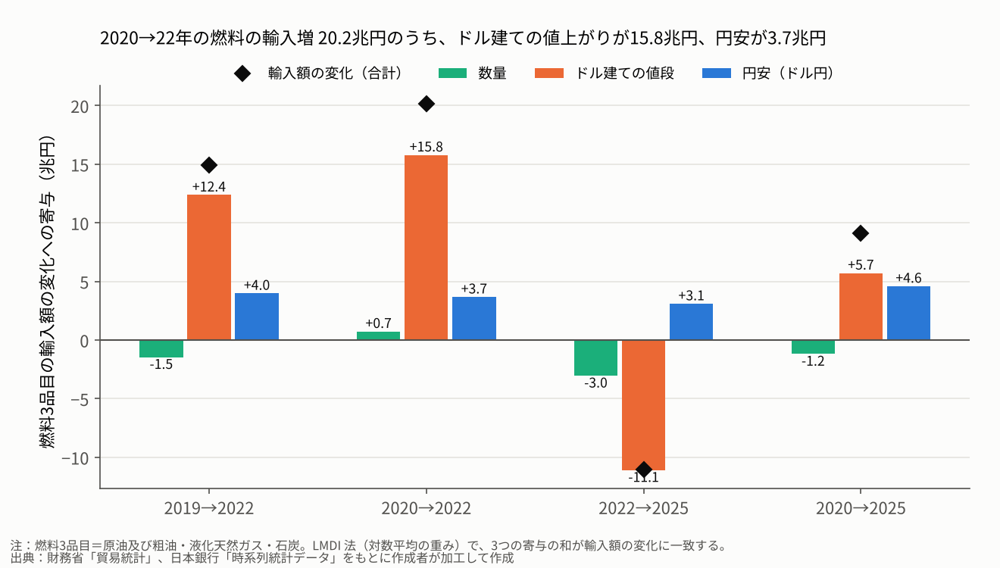
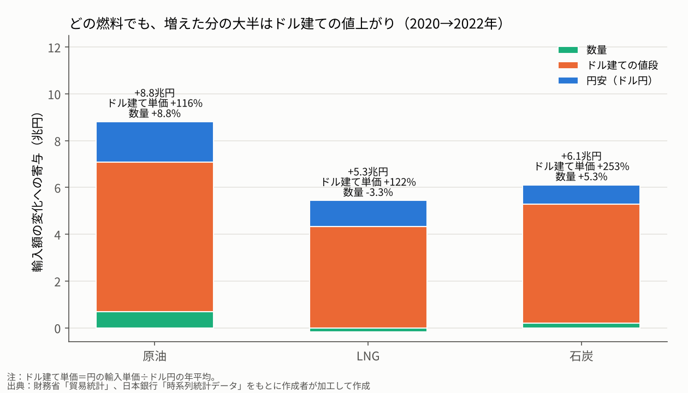
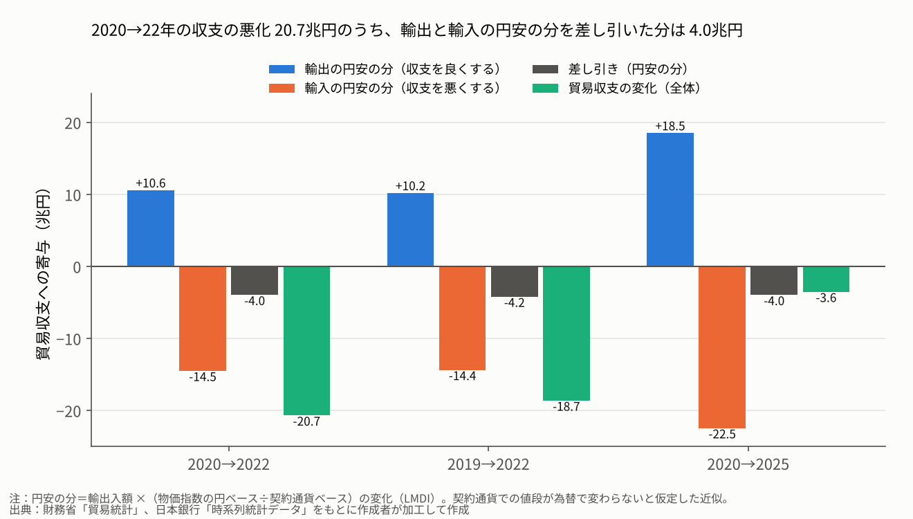

# F343 貿易赤字は、円安とエネルギー価格のどちらのせいか？ 2020→22年の燃料の輸入増20.2兆円のうち、ドル建ての値上がりが15.8兆円、円安は3.7兆円

日本の貿易収支は2022年に20.3兆円の赤字になりました。燃料（原油・LNG・石炭）の輸入額の増え方を「量」「ドル建ての値段」「ドル円」に分け、輸出と輸入の円安の分も差し引きました。為替や価格についての助言はしません。

## 結論（先に）

1. **燃料の輸入増の8割近くは、ドル建ての値上がりです。** 2020→22年に燃料3品目（原油・LNG・石炭）の輸入額は20.2兆円増えました。うちドル建ての値上がりが15.8兆円（78%）、円安（ドル円）が3.7兆円（18%）、数量が0.7兆円（4%）です。
2. **2022年の赤字は、燃料を除けば黒字でした。** 2022年の貿易収支は −20.3兆円でしたが、鉱物性燃料の輸入を除くと +13.4兆円でした。
3. **ただし輸入の増加全体（50.5兆円）のうち、燃料は44.5%です。** 燃料以外の輸入も28.1兆円増えていて、その中にも円安の換算の分（約11.2兆円の目安）が入っています。
4. **問い直し：輸出と輸入の円安の分を差し引くと、収支への影響は約 −4.0兆円でした。** 2020→22年の悪化20.7兆円の約2割で、残りには燃料などのドル建ての値上がりが大きく入っていると考えられます（推測。円安の分は強い仮定のもとの近似で、残りには燃料以外の数量や値段の変化も入ります）。
5. **2025年の燃料の輸入額は、2020年の2.0倍です。** 2022→25年にドル建ての値段は下がりました（−11.1兆円の寄与）が、円安の分（+3.1兆円）は増えています。



## 問い

「貿易赤字は円安のせい」「資源高のせい」という説明が並びます。輸入の中でいちばん値段が動くのは鉱物性燃料です。燃料の輸入額の変化を「買った量」「ドル建ての値段」「ドル円」に分けると、どれがどれだけ効いたのでしょうか。

知りたい人：輸入の原材料や燃料を扱う仕事の人、貿易統計や為替のニュースを読む人です。輸出側の円安の効果は既存の記事（F282「円安で輸出が増えた」は、数量と価格に分けるとどうか）で扱いました。

## データ（出典）

- 財務省「貿易統計」輸出入額の推移（世界、年別）：輸出入の総額、輸入の主要商品別の金額と数量（原油 KL、LNG・石炭 トン）、1988〜2025年
- 日本銀行「時系列統計データ」：ドル円（東京市場17時、月中平均を年で平均）、輸入物価指数・輸出物価指数の円ベースと契約通貨ベース（2020年=100）

2026-11-16 に取得しました（URL は data/raw/SOURCES.md）。

## 事前の計画

集計の前に [PLAN.md](PLAN.md) を書きました。燃料の輸入額（2020年約11.3兆円、2022年約33.7兆円）は列の位置を確かめるときに見ています。

| 仮説 | 外れの基準 | 結果 | 判定 |
|---|---|---|---|
| H1：燃料3品目の増加で、ドル建ての値上がりの分が円安の分より大きい | 円安の分の方が大きい | 15.8兆円 ＞ 3.7兆円 | 支持 |
| H2：燃料3品目の数量はどれも±5%以内 | 5%を超える | 原油 +8.8%、LNG −3.3%、石炭 +5.3% | 外れ |
| H3：燃料の増加が輸入の増加の半分以上 | 半分未満 | 44.5% | 外れ |
| H4：2025年の燃料の輸入額は2020年の1.5倍以上 | 1.5倍未満 | 1.97倍 | 支持 |

## やったこと

- 貿易収支の変化 ＝ 輸出の変化 − 燃料の輸入の変化 − 燃料以外の輸入の変化
- 燃料3品目：輸入額 ＝ 数量 × ドル建て単価 × ドル円。対数の差を、金額の対数平均の重みで配る（LMDI 法。3つの寄与の和が輸入額の変化に一致）。ドル建て単価は円の単価をドル円で割った近似
- 燃料以外の輸入と輸出の円安の分：輸出入額 ×（物価指数の円ベース÷契約通貨ベース）の変化を LMDI で計算

## 分かったこと

### 1. 燃料を除けば黒字（図1）

- 貿易収支は2020年 +0.4兆円、2022年 −20.3兆円、2025年 −3.2兆円です。
- 燃料の輸入を除いた収支は、2020年 +11.6兆円、2022年 +13.4兆円、2025年 +19.0兆円でした。

### 2. 燃料の輸入増の分け方（図2）



- 2020→22年：ドル建て +15.8、円安 +3.7、数量 +0.7（兆円）。2019→22年でも、ドル建て +12.4、円安 +4.0、数量 −1.5 で、ドル建ての値上がりが中心です。
- 2022→25年：ドル建て −11.1、円安 +3.1、数量 −3.0 で、輸入額は11.1兆円減りました。
- 2020→25年：ドル建て +5.7、円安 +4.6、数量 −1.2 で、円安の分がドル建てに近い大きさになっています。ドル円は2020年の106.8円から2025年の149.6円です。

### 3. 品目ごと（図3）



- 2020→22年のドル建て単価は、原油 +116%、LNG +122%、石炭 +253%でした。どの品目でも増加の大半はドル建ての値上がりです。

## 問い直し（結果を見てから足した）

**Q：燃料以外の輸入にも円安の分が出た。輸出の円安の分を差し引くと、円安は貿易収支をどれだけ動かしたのか？**（図4）



- 2020→22年に、輸出の円安の分は +10.6兆円、輸入の円安の分は −14.5兆円で、差し引き −4.0兆円でした。収支の悪化20.7兆円の約2割です。
- 2019→22年でも −4.2兆円、2020→25年でも −4.0兆円でした。
- 輸入の方が輸出より大きく、円安の換算の分は収支を少し悪くする向きでした。ただし、契約通貨での値段が為替で変わらないという強い仮定の上の近似です。

## 頑健性

| 確かめたこと | 2020→22年の燃料3品目（兆円） | 結論は変わったか |
|---|---|---|
| 主（LMDI） | ドル建て15.8、円安3.7、数量0.7 | — |
| 逐次の分解（数量→値段→為替） | 値段14.2、為替5.6、数量0.4 | 変わらない |
| 逐次の分解（為替→値段→数量） | 値段16.8、為替2.2、数量1.2 | 変わらない |
| 逐次の分解（値段→為替→数量） | 値段13.6、為替5.3、数量1.2 | 変わらない |
| 為替を輸入物価指数の比で | 値段16.6、為替2.8、数量0.7 | 変わらない |
| 基準を2019年に | ドル建て12.4、円安4.0、数量 −1.5 | 変わらない |
| 品目ごと | 原油・LNG・石炭のどれでもドル建てが最大 | 変わらない |

## 言えないこと

1. ドル建て単価は、円の単価をドル円の年平均で割った近似です。契約がすべてドル建てとは限りません（推測）。
2. 円安の分の差し引きは、契約通貨での値段が為替に反応しないという強い仮定の上の計算です。
3. 為替や資源価格がなぜ動いたかは扱っていません。
4. 2020年はコロナで資源価格が低かった年で、基準の年の選び方で大きさが変わります（2019年基準も示しました）。
5. 輸出の数量への円安の効果は扱っていません（F282 を参照）。

## 仕事で使うなら

- 燃料の輸入額の動きを読むときは、数量・ドル建ての値段・ドル円の3つに分けると、どれが動いたかが分かります。2020→22年はドル建ての値段、2022→25年は円安の分が目立ちました。
- 「円安で貿易赤字」という言い方は、輸出の円安の分と差し引いて大きさを見ると、数字の前提がそろいます。

## 計画からの変更

- 輸出の円安の分を計算するため、日本銀行の輸出物価指数（円ベース・契約通貨ベース）を取得データに足しました（問い直しのため）。
- 比べる期間に2021→22年と2022→25年を足しました。

## 再現のしかた

```sh
pip install -r requirements.txt
sh src/run_all.sh     # 02_build → 03_analysis → 03b_requestion → 04_figures（オフライン）
python3 src/01_fetch.py   # 元データを取り直すときだけ
```

| ファイル | 中身 |
|---|---|
| src/02_build.py | CSV・JSON から data/*.csv |
| src/03_analysis.py | 収支の分解と燃料の LMDI（results/main.json ほか） |
| src/03b_requestion.py | 輸出入の円安の分の差し引き（results/requestion.json） |
| src/04_figures.py | 図4枚 |

所要は CPU 1つで約2秒（乱数は使っていません）。results/repro_check.txt：2026-11-16 再実行で13ファイル一致。


## レビューで直したこと

| # | 指摘 | 直し方 |
|---|---|---|
| 1 | 結論4の「残りは主に燃料などのドル建ての値上がり」は、残りに燃料以外の数量・値段の変化も入るので言い過ぎ | 「大きく入っていると考えられます（推測…）」に弱め、残りの中身を書き添えた |

## 出典

- 財務省「貿易統計」輸出入額の推移（[税関ホームページ](https://www.customs.go.jp/toukei/suii/html/time.htm)）
- 日本銀行「時系列統計データ検索サイト」（[API](https://www.stat-search.boj.or.jp/)）：外国為替市況、企業物価指数

（いずれも財務省「貿易統計」、日本銀行「時系列統計データ」をもとに作成者が加工して作成）
