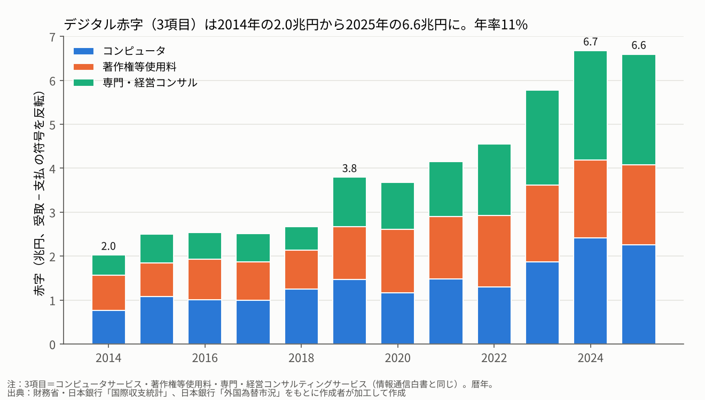
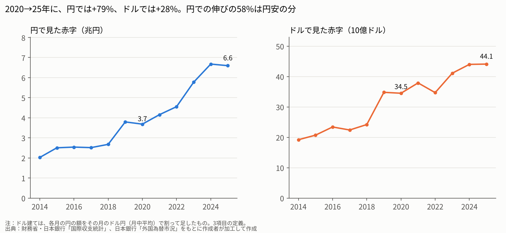
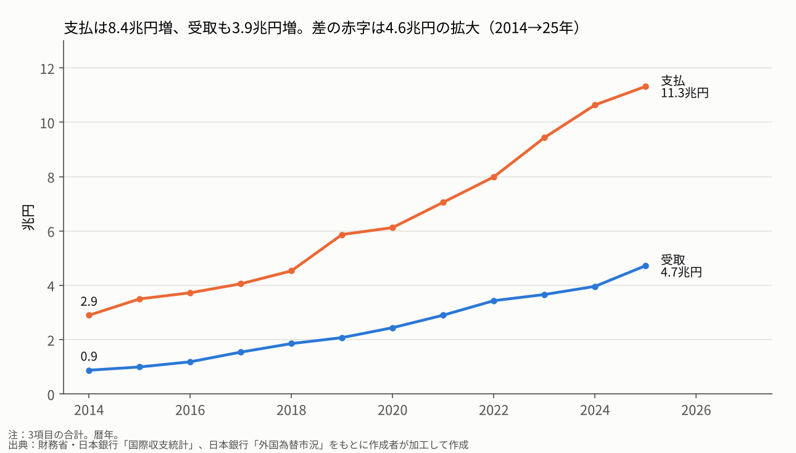
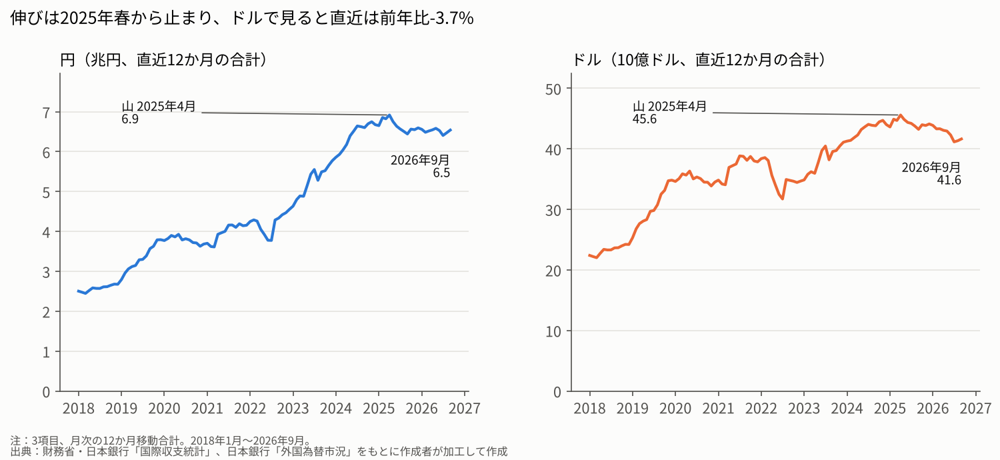

# F344 「デジタル赤字」は、どれくらいの速さで増えているのか？ 年率11%で2.0兆円から6.6兆円に。ただし2020年からの伸びの6割は円安で、2025年春からは横ばい

国際収支のサービス収支のうち、コンピュータサービス・著作権等使用料・専門・経営コンサルティングサービスの3項目の赤字（いわゆるデジタル赤字）が、どれくらいの速さで増えているのかを、日本銀行が公開する国際収支統計の月次で確かめました。円とドルの両方で見て、受取と支払、相手の地域も見ました。投資・為替・政策についての助言はしません。

## 結論（先に）

1. **2014→2025年に年率11.3%で増えました。** 3項目の赤字は2014年の2.0兆円から、2024年6.7兆円、2025年6.6兆円です。対数の回帰の傾きでも年11.8%でした。
2. **2020年からの円での伸びの約6割は円安です。** 2020→25年に赤字は円で +79%、ドルで +28%でした。円での伸び（対数）のうち58%がドル円の変化（106.8円→149.6円）にあたります。2014→25年で見ると29%です。
3. **支払が増え、受取も増えました。** 2014→25年に支払は2.9兆円から11.3兆円（+8.4兆円）、受取は0.9兆円から4.7兆円（+3.9兆円）で、差の赤字は4.6兆円広がりました。
4. **問い直し：伸びは2025年春から止まっています。** 12か月の合計は2025年4月の6.9兆円（456億ドル）が山で、2026年9月は6.5兆円（416億ドル）です。ドルで見ると前年より3.7%少なくなっています。



## 問い

総務省の情報通信白書（令和7年版）は、3項目の合計が2024年に約6.7兆円の赤字で、前年より約0.9兆円増えたとし、クラウドサービスや海外へのインターネット広告の支払いの増加を背景に挙げています（[白書の該当ページ](https://www.soumu.go.jp/johotsusintokei/whitepaper/ja/r07/html/nd113220.html)）。この赤字は、どれくらいの速さで増えているのでしょうか。円安で膨らんだ分はどれだけか。今も増え続けているのでしょうか。

知りたい人：IT・広告・ソフトウェアを海外から買う仕事の人、国際収支のニュースを読む人です。

## データ（出典）

- 財務省・日本銀行「国際収支統計」：サービス収支の項目別、月次（受取・支払・ネット、億円、1996年1月〜2026年9月。コンピュータサービス・情報サービス・専門・経営コンサルティングサービスは2014年から）。地域別、四半期（2014年〜）
- 日本銀行「外国為替市況」：ドル円（東京市場17時、月中平均）

どちらも日本銀行の時系列統計データの API から2026-11-16 に取得しました（URL は data/raw/SOURCES.md）。

## 事前の計画

集計の前に [PLAN.md](PLAN.md) を書きました。白書の要約と、月次・四半期の最後の数期の値は見ていました。

| 仮説 | 外れの基準 | 結果 | 判定 |
|---|---|---|---|
| H1：2014→2025年に年率10%以上 | 10%未満 | 11.3% | 支持 |
| H2：2020→25年の円での伸びの3分の1以上が円安 | 3分の1未満 | 57.9% | 支持 |
| H3：支払の増加が赤字の拡大の1.5倍以上 | 1.5倍未満 | 1.84倍 | 支持 |
| H4：通信・コンピュータ・情報と知的財産権等使用料の支払の50%以上が米国向け（2025年） | 50%未満 | 45.3% | 外れ |

## やったこと

- 3項目（白書と同じ定義）の受取・支払・ネットを、月次を足して暦年にした
- ドル建ては、各月の円の額をその月のドル円で割って足した。円での伸び（対数）を、ドルでの伸びとドル円の変化に分けた
- 地域は四半期の表を年にした。地域別の表は知的財産権等使用料（産業財産権を含む）と通信・コンピュータ・情報サービスの合計で、3項目とは範囲が違う

## 分かったこと

### 1. 項目別（図1）

- 2014→25年に、コンピュータは0.76→2.26兆円、著作権等使用料は0.80→1.81兆円、専門・経営コンサルは0.46→2.52兆円の赤字です。専門・経営コンサルの伸びが最も大きくなっています。
- 2018→19年に2.7兆円から3.8兆円へ大きく増えました（3項目とも増加）。

### 2. 円とドル（図2）



- ドルで見た赤字は、2014年192億ドル、2020年345億ドル、2025年441億ドルです。2024→25年はほぼ同じ（440→441億ドル）でした。

### 3. 受取と支払（図3）



- 受取も2014年の5倍に増えています。赤字は支払の増加の約半分にとどまりました。

### 4. 相手の地域

- 支払に占める米国の割合は、2014年52.7%、2019年36.8%、2025年45.3%でした。EU は18.5%から24.7%に上がっています。
- 地域別の範囲（知的財産権等使用料を含む）では、米国との収支は2025年に +0.22兆円の受取超です。自動車などの産業財産権の受取が大きいためと考えられます（推測）。

## 問い直し（結果を見てから足した）

**Q：伸びは止まったのか？ ドルで見るとどうか？**（図4）



- 12か月の移動合計は、円・ドルとも2025年4月が山（6.92兆円、456億ドル）でした。
- 2026年9月までの12か月は6.54兆円（前年同期比 +1.5%）、416億ドル（−3.7%）です。2026年1〜9月の合計は前年同期を1.1%下回りました。
- 2024→25年の変化を項目で見ると、コンピュータの赤字が0.16兆円縮み、著作権等使用料（+0.05兆円）と専門・経営コンサル（+0.03兆円）は広がりました。

## 頑健性

| 確かめたこと | 年率（2014→2025年） | 結論は変わったか |
|---|---|---|
| 主（3項目、両端の比） | 11.3% | — |
| 対数の回帰の傾き | 11.8% | 変わらない |
| 5項目（通信・情報を足す） | 10.9% | 変わらない |
| 3項目＋研究開発サービス | 9.6% | 10%をわずかに下回る |
| 2014→2024年 | 12.7% | 変わらない |
| 2019→2025年 | 9.7% | 伸びは鈍る |
| 地域別の合計と月次の合計（2025年の支払） | 9.8兆円と9.8兆円 | 一致 |

## 言えないこと

1. 国際収支の項目には、デジタル以外の取引も入ります（著作権等使用料には映画・音楽なども含まれます）。
2. 企業グループの中での支払（海外の子会社などとのやりとり）は分けられません。
3. 地域別は3項目と範囲が違い、相手の国は取引の相手の所在地で、サービスを作った国とは限りません。
4. 伸びが止まった理由（為替、価格、利用の変化）は分けられていません。
5. 赤字が良いか悪いかは扱っていません。

## 仕事で使うなら

- 「デジタル赤字が増えた」という数字を使うときは、円とドルの両方を並べると、円安の分が混ざっていないかが分かります。
- 年の合計だけでなく、12か月の移動合計を見ると、直近の向きが早めに分かります。

## 計画からの変更

- 地域別は四半期の表が知的財産権等使用料（産業財産権を含む）の合計しかないため、H4 は3項目とは範囲の違う数字で判定しました。
- 問い直し（12か月の移動合計）を足しました。

## 再現のしかた

```sh
pip install -r requirements.txt
sh src/run_all.sh     # 02_build → 03_analysis → 03b_requestion → 04_figures（オフライン）
python3 src/01_fetch.py   # 元データを取り直すときだけ
```

| ファイル | 中身 |
|---|---|
| src/02_build.py | JSON から data/*.csv |
| src/03_analysis.py | 年の集計・伸び率・円安の分・受取と支払・地域（results/main.json ほか） |
| src/03b_requestion.py | 12か月の移動合計（results/requestion.json） |
| src/04_figures.py | 図4枚 |

所要は CPU 1つで約2秒（乱数は使っていません）。results/repro_check.txt：2026-11-16 再実行で16ファイル一致。


## レビューで直したこと

独立レビューで数字の照合・再実行・図を確かめ、直すところはなかった。

## 出典

- 財務省・日本銀行「国際収支統計」、日本銀行「外国為替市況」（[日本銀行 時系列統計データ検索サイト](https://www.stat-search.boj.or.jp/)）
- 総務省「令和7年版 情報通信白書」デジタル関連項目のサービス収支の動向（[リンク](https://www.soumu.go.jp/johotsusintokei/whitepaper/ja/r07/html/nd113220.html)、問いの背景として参照）

（いずれも財務省・日本銀行「国際収支統計」などをもとに作成者が加工して作成）
