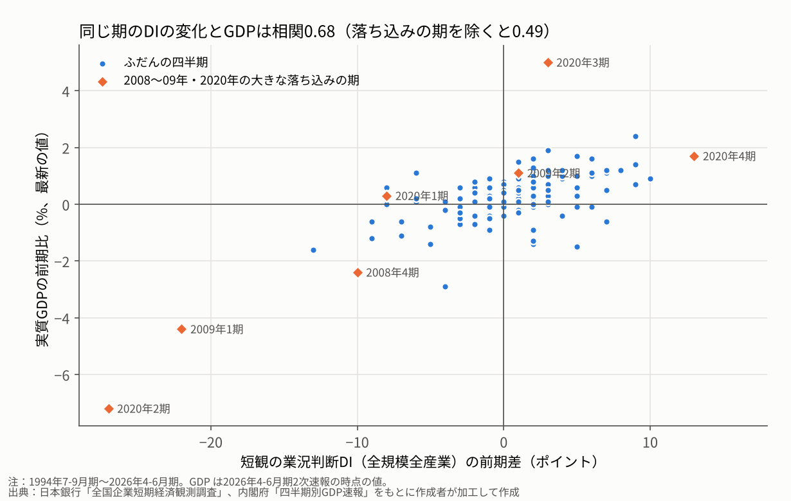
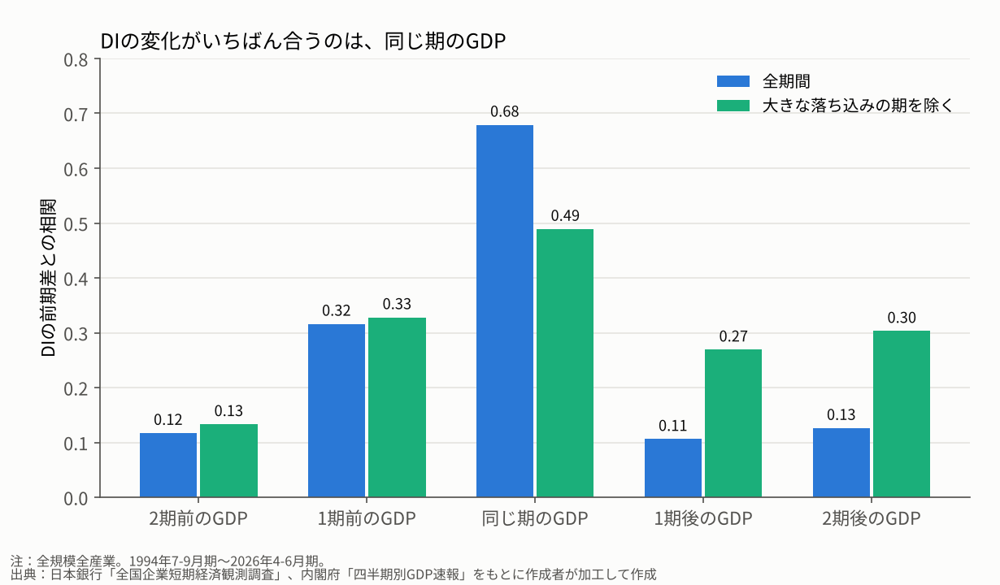
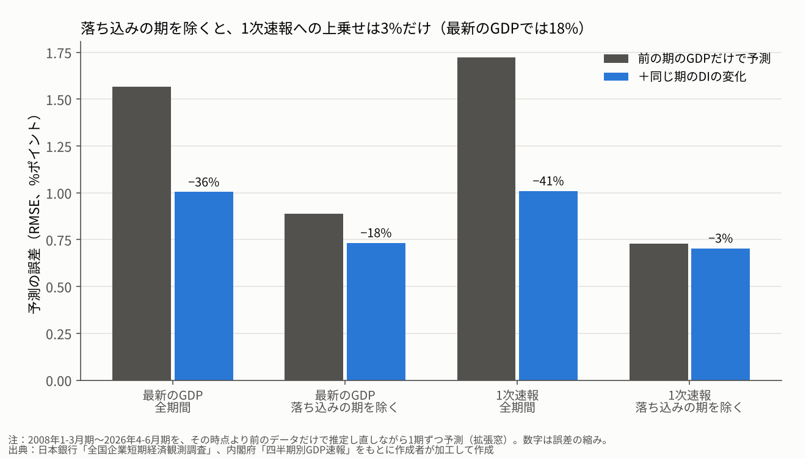
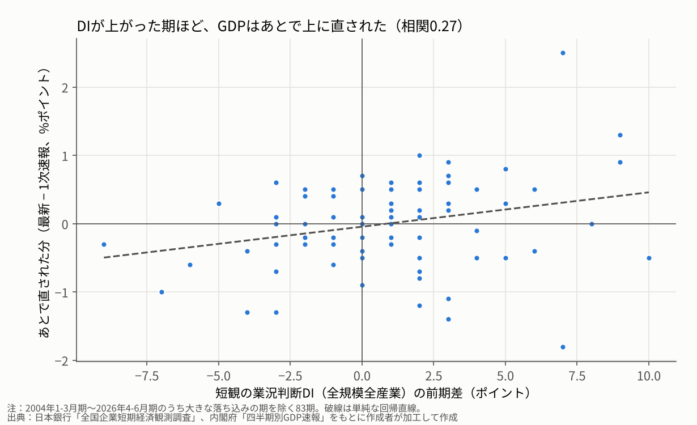

# F345 日銀短観の業況判断DIは、GDP の動きを先に教えてくれるか？ 先ではなく「同じ期」を早く教える。予測の誤差は35%縮むが、大きな落ち込みの期を除くと17%、そのときの1次速報には3%

日銀短観の業況判断DI（「良い」と答えた企業の割合 − 「悪い」の割合）は、四半期の終わりの直後に公表され、同じ期の GDP の1次速報より1か月半ほど早く出ます。DI の変化で GDP の前期比をどこまで言い当てられるかを、1994〜2026年の最新の GDP と、2004〜2026年の各期の1次速報で確かめました。投資や経営についての助言はしません。

## 結論（先に）

1. **DI が教えてくれるのは「先の期」ではなく「同じ期」です。** DI（全規模全産業）の前期差と GDP の前期比の相関は、同じ期で0.68、1期後の GDP とは0.11でした。
2. **同じ期の DI の変化を足すと、予測の誤差は35%縮みます。** 前の期の GDP だけで予測するより、RMSE（誤差の大きさ）が1.47から0.95%ポイントになりました（2005〜2026年、拡張窓。差の検定は p=0.07 で、5%の基準ではぎりぎり届きません）。マイナス成長だった27期のうち、言い当てた期は3期から11期に増えました。
3. **ただし大きな落ち込みの期が効いています。** 2008〜09年と2020年の7期を除くと、改善は17%でした。
4. **1次速報を目標にすると、落ち込みの期を除いた改善は3%だけでした**（最新の GDP では18%）。
5. **問い直し：DI が上がった期ほど、GDP はあとで上に直されていました**（落ち込みの期を除いた相関0.27）。DI は1次速報より、直されたあとの GDP に近い動きをしています。



## 問い

短観は「景気の先行き」を知る手がかりとしてよく使われます。では、GDP の成長率をどれだけ先に教えてくれるのでしょうか。既存の看板記事のうち、036 は短観の「先行き」の予測が DI の実績にどれだけ当たるかを、F18・F90 は月次の多くの統計で GDP を推定する方法を扱いました。この記事は、短観の DI だけで GDP の成長率をどれだけ言い当てられるか、そして1次速報と最新の値で答えが変わるかに絞ります。

知りたい人：景気の判断に短観を使う仕事の人、経済統計の読み方を学ぶ人です。

## データ（出典）

- 日本銀行「全国企業短期経済観測調査」：業況判断DI（実績）、全規模・大企業 × 全産業・製造業・非製造業（日本銀行 API）
- 内閣府「四半期別GDP速報」：実質季節調整系列の前期比。2026年4-6月期2次速報（最新）と、2004年1-3月期〜2026年4-6月期の各期の1次速報（90回分の CSV）

2026-11-16 に取得しました（URL は data/raw/SOURCES.md）。

## 事前の計画

集計の前に [PLAN.md](PLAN.md) を書きました。

| 仮説 | 外れの基準 | 結果 | 判定 |
|---|---|---|---|
| H1：相関は同じ期がいちばん大きい | 1期後の方が大きい | 同じ期0.68、1期後0.11 | 支持 |
| H2：DI を足すと RMSE が10%以上小さい | 10%未満 | 35.3% | 支持 |
| H3：落ち込みの期を除くと改善は半分以下 | 半分を超えて残る | 35.3% → 16.8% | 支持 |
| H4：1次速報でも改善の幅は同じくらい（差5ポイント以内） | 5ポイントを超えて違う | 全期間で41.4%と35.9%、落ち込みを除くと3.3%と17.5% | 外れ |

## やったこと

- ずらし相関：ΔDI（DI の前期差）と、−2〜+2期ずらした GDP の前期比の相関
- 予測：①前の期の GDP だけ（AR(1)）②それに同じ期の ΔDI を足した回帰。2005年1-3月期から、その時点より前のデータだけで推定し直して1期ずつ予測（拡張窓）。差の検定は Diebold–Mariano（ラグ1）
- 1次速報：推定も予測も1次速報の値だけで行った（2004年からの値で推定、2008年から予測）

## 分かったこと

### 1. 同じ期とよく合う（図1・図2）



- 相関は、2期前の GDP と0.12、1期前0.32、同じ期0.68、1期後0.11、2期後0.13でした。落ち込みの期を除くと同じ期0.49、1期後0.27です。
- 全期間の回帰では、ΔDI が1ポイント上がると GDP の前期比が0.17ポイント高い関係でした。

### 2. 予測の誤差（図3）



- 2005〜2026年の86期で、RMSE は1.47から0.95（−35.3%、DM 検定 p=0.07）。落ち込みの期を除く79期では0.84から0.70（−16.8%、p=0.02）でした。
- 2008〜2026年に限ると、最新の GDP では −35.9%（除くと −17.5%）、1次速報では −41.4%（除くと −3.3%、p=0.77）でした。

## 問い直し（結果を見てから足した）

**Q：DI は「あとで直された分」（最新 − 1次速報）と関係があるのか？**（図4）



- 落ち込みの期を除く83期で、ΔDI と改定の相関は0.27でした。1次速報の値をそろえた回帰でも、ΔDI の係数は0.08（p<0.001）です。
- ΔDI との相関は、1次速報が0.39、最新の値が0.54でした。DI は、あとで直されたあとの GDP に近い動きをしています。
- 改定の平均の大きさ（絶対値）は0.49%ポイントで、DI で説明できるのはその一部です。

## 頑健性

| 確かめたこと | RMSE の縮み（2005〜2026年、最新の GDP） | 結論は変わったか |
|---|---|---|
| 主（全規模全産業の ΔDI） | 35.3% | — |
| 大企業製造業 | 25.0% | 変わらない |
| 全規模製造業／全規模非製造業 | 28.1%／33.0% | 変わらない |
| 大企業非製造業／大企業全産業 | 28.8%／30.7% | 変わらない |
| ΔDI ではなく DI の水準 | 0.3% | 水準では効かない |
| 予測の始まりを2010年に | 37.0%（落ち込みを除くと17.9%） | 変わらない |
| マイナス成長を当てた数 | 27期のうち3期 → 11期 | 改善 |

## 言えないこと

1. 短観の対象企業は数年ごとに見直され、DI に段差があります。
2. 最新の GDP は、当時の予測の担当者が使えた値とは違います（1次速報で一部を確かめました）。
3. 予測に役立つことと、景気を動かす原因であることは別です。
4. 大きな落ち込みの期を除く判断（7期）は1つの決め方です。
5. 月次の多くの統計を使う方法（F18・F90）と比べてはいません。

## 仕事で使うなら

- 短観の DI は「次の期の見通し」より「いま終わった期の GDP」を早めに知る材料として読むのが、データと合っています。
- 1次速報の当たりを良くする効果は、ふだんの期には小さい、という前提で使えます。

## 計画からの変更

- H4 の比べ方は、1次速報の予測が2008年からしかできないため、最新の GDP も2008年からにそろえて比べました。
- 問い直し（改定と DI）を足しました。

## 再現のしかた

```sh
pip install -r requirements.txt
sh src/run_all.sh     # 02_build → 03_analysis → 03b_requestion → 04_figures（オフライン）
python3 src/01_fetch.py   # 元データを取り直すときだけ（GDP の1次速報 90回分を取る）
```

| ファイル | 中身 |
|---|---|
| src/02_build.py | GDP の CSV（cp932）と短観の JSON から data/panel_quarterly.csv |
| src/03_analysis.py | ずらし相関・拡張窓の予測・頑健性（results/main.json ほか） |
| src/03b_requestion.py | 改定と DI（results/requestion.json） |
| src/04_figures.py | 図4枚 |

所要は CPU 1つで約5秒（乱数は使っていません）。results/repro_check.txt：2026-11-16 再実行で11ファイル一致。


## レビューで直したこと

| # | 指摘 | 直し方 |
|---|---|---|
| 1 | README の題名「1次速報では3%」が、1次速報の全期間（41%縮む）と取り違えやすい | 「落ち込みの期を除くと17%、そのときの1次速報には3%」に直した（note の題名は元から区別できていたので変更なし） |
| 2 | 結論2の35%の縮みは DM 検定 p=0.07 で、5%の基準に届かないことが結論の段に書かれていなかった | 結論2に p=0.07 を書き添えた |

## 出典

- 日本銀行「全国企業短期経済観測調査」（[時系列統計データ検索サイト](https://www.stat-search.boj.or.jp/)）
- 内閣府経済社会総合研究所「四半期別GDP速報」（[統計表一覧](https://www.esri.cao.go.jp/jp/sna/data/data_list/sokuhou/files/files_sokuhou.html)）

（いずれも日本銀行「全国企業短期経済観測調査」、内閣府「四半期別GDP速報」をもとに作成者が加工して作成）
