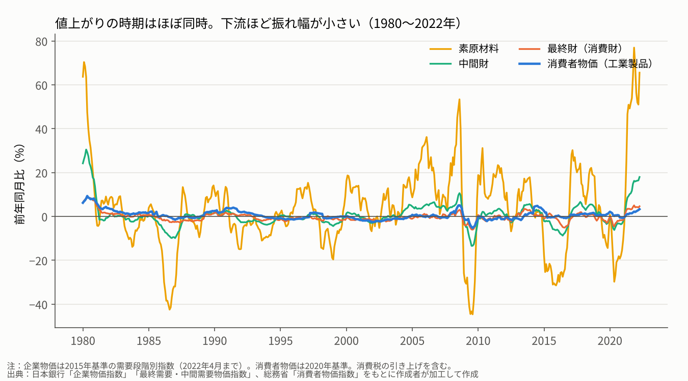
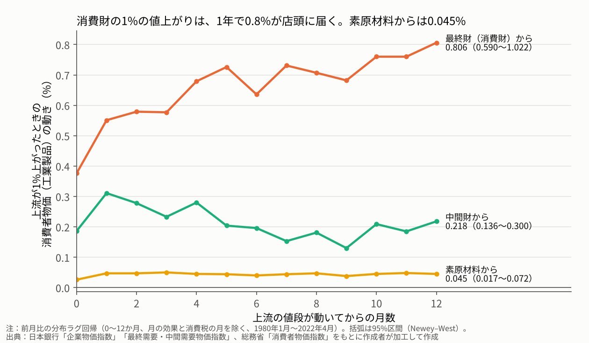
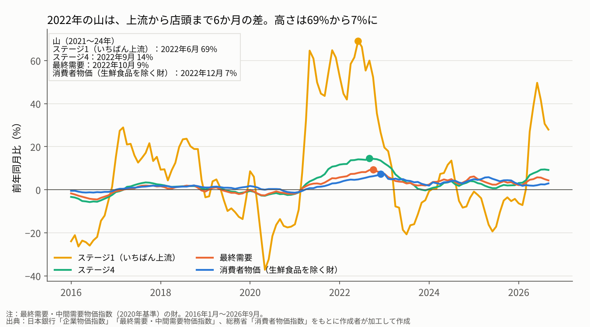
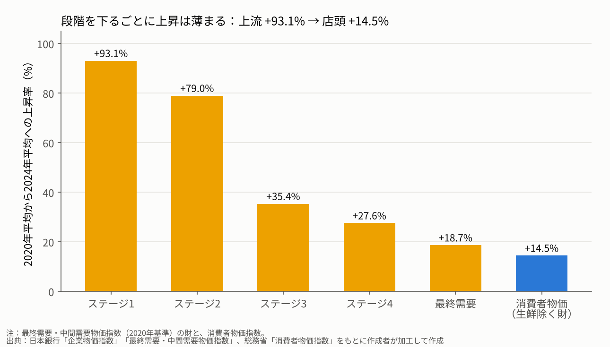

# F346 企業の仕入れ値の上がりは、どれだけ遅れて消費者物価に届くのか？ 遅れは数か月と短いが、届く量は段階ごとに薄まる。消費財の1%は1年で0.8%、原材料の1%は0.045%

原材料の値上がりは、中間の製品、最終の製品へと段階を踏んで店頭の値段に届くと説明されます。日本銀行の企業物価の段階別の指数（1980〜2022年）と最終需要・中間需要物価指数（2016〜2026年）、総務省の消費者物価指数で、時期の遅れと届く量を確かめました。価格や経営についての助言はしません。

## 結論（先に）

1. **時期の遅れは短いです。** 前年同月比のずらし相関が最大になるずれは、素原材料→中間財が1か月、中間財→最終財（消費財）が0か月、消費財→消費者物価（工業製品）が1か月でした（1980〜2022年）。
2. **届く量は段階ごとに薄まります。** 消費者物価（工業製品）の前月比を上流の値段に回帰すると、12か月の累積で、消費財の1%の値上がりに対して0.81%、中間財に対して0.22%、素原材料に対して0.045%でした。
3. **2022年の山は、上流から店頭まで6か月の差でした。** ステージ1（いちばん上流）の財の前年同月比は2022年6月に69%で山、消費者物価（生鮮食品を除く財）は2022年12月に7%で山でした。
4. **問い直し：2020→2024年の上昇は、上流の +93.1%から店頭の +14.5%に薄まりました。** 最終需要の財から消費者物価への伝わり方は、2016〜2020年の0.83に対し、2021〜2026年は1.09でした（区間は重なります）。



## 問い

上流の値上がりは、何か月遅れて、どれだけの大きさで消費者物価に届くのでしょうか。既存の看板記事 F102（円安が物価に効くのは円安が大きいときだけか）は為替から物価への伝わり方を扱いました。この記事は、企業物価の段階から消費者物価への伝わり方に絞ります。

知りたい人：原材料・製品の値段の動きを読む仕事の人、物価の統計の読み方を学ぶ人です。

## データ（出典）

- 日本銀行「企業物価指数（2015年基準）需要段階別・用途別指数」：素原材料・中間財・最終財（消費財）、1980年1月〜2022年4月（この基準で終わり）
- 日本銀行「最終需要・中間需要物価指数（2020年基準）」：ステージ1〜4・最終需要（除く輸出）の財、2015年1月〜2026年9月
- 総務省「消費者物価指数（2020年基準）財・サービス分類指数」：工業製品、生鮮食品を除く財など、全国、1970年1月〜2026年9月

2026-11-16 に取得しました（URL は data/raw/SOURCES.md）。

## 事前の計画

集計の前に [PLAN.md](PLAN.md) を書きました。

| 仮説 | 外れの基準 | 結果 | 判定 |
|---|---|---|---|
| H1：素原材料→中間財→消費財→CPI のずれの合計は6か月以上 | 6か月未満 | 1＋0＋1＝2か月 | 外れ |
| H2：消費財から CPI 工業製品への12か月の累積は0.5〜1.5 | 範囲の外 | 0.81 | 支持 |
| H3：素原材料から CPI 工業製品への12か月の累積は0.2未満 | 0.2以上 | 0.045 | 支持 |
| H4：2021〜23年の CPI 生鮮除く財の山は、ステージ1の山より6か月以上あと | 6か月未満 | 6か月（2022年6月→12月） | 支持 |

## やったこと

- ずらし相関：上流の前年同月比を0〜24か月ずらし、下流の前年同月比との相関が最大になるずれを出した
- 分布ラグ回帰：下流の前月比（対数）を、上流の前月比の0〜12か月前に回帰。月の効果と消費税の引き上げの月（1989年4月、1997年4月、2014年4月、2019年10月）をダミーで除いた。標準誤差は Newey–West（ラグ12）
- 2016〜2026年：ステージ別の財と CPI の、2021〜24年の前年同月比の山の時期と高さ

## 分かったこと

### 1. 時期の遅れは短い（図1）

- 相関の最大は、素原材料→中間財 0.88（1か月）、中間財→消費財 0.82（0か月）、消費財→CPI 工業製品 0.79（1か月）でした。
- 1980〜1999年に限ると、ずれは3・2・1か月で合計6か月、2000〜2022年は1・0・1か月でした。

### 2. 届く量は薄まる（図2）



- CPI 工業製品の12か月の累積は、消費財から0.81（95%区間0.59〜1.02）、中間財から0.22（0.14〜0.30）、素原材料から0.045（0.017〜0.072）でした。
- 同じ月のうちに、消費財の値上がりの0.38が届いています。
- 上流どうしでは、素原材料→中間財が0.25、中間財→消費財が0.34でした。3段の積（0.25×0.34×0.81≒0.07）は、素原材料からの直接の推定（0.045）と同じくらいの大きさです。

### 3. 2022年の山（図3）



- 前年同月比の山は、ステージ1 2022年6月（69%）、ステージ2〜4 2022年9月（64.7%・18.6%・14.5%）、最終需要 2022年10月（9%）、CPI 生鮮除く財 2022年12月（7%）でした。
- CPI 工業製品と食料工業製品の山は2023年8月で、最終需要の食料品の山は2024年12月と遅れていました。
- ずらし相関では、ステージ1→CPI 生鮮除く財が8か月、最終需要→CPI が3か月で最大でした。

## 問い直し（結果を見てから足した）

**Q：値上がりは段階を下るごとにどれだけ薄まり、最近は届き方が変わったのか？**（図4）



- 2020年平均から2024年平均への上昇は、ステージ1 +93.1%、ステージ2 +79.0%、ステージ3 +35.4%、ステージ4 +27.6%、最終需要 +18.7%、CPI 生鮮除く財 +14.5%でした。
- 最終需要の財→CPI 生鮮除く財の12か月の累積は、2016〜2020年0.83（0.57〜1.10）、2021〜2026年1.09（0.71〜1.47）です。最近の方が大きく出ましたが、区間が重なり、違うとは言い切れません。

## 頑健性

| 確かめたこと | 消費財→CPI 工業製品 | 素原材料→CPI 工業製品 | 結論は変わったか |
|---|---|---|---|
| 主（1980〜2022年、12か月） | 0.81 | 0.045 | — |
| 1980〜1999年 | 0.98 | 0.029 | 変わらない |
| 2000〜2022年 | 0.75 | 0.062 | 変わらない |
| 6か月 | 0.67 | 0.041 | 短いと小さめ |
| 18か月 | 0.94 | 0.043 | 変わらない |
| 消費税のダミーなし | 0.84 | 0.046 | 変わらない |
| CPI を生鮮食品を除く財に | 0.88 | 0.059 | 変わらない |

## 言えないこと

1. 企業物価と消費者物価は品目の範囲が違います（消費者物価には小売・流通の分が入ります）。
2. 伝わり方の大きさは、企業が値上げした結果で、なぜそうなったか（交渉、需要、コストの割合）は分かりません。
3. 2015年基準の需要段階別指数は2022年4月で終わり、その後は別の指数で見ました。同じ物差しではありません。
4. 薄まるのは、上流の値段が製品のコストの一部でしかないため、と考えるのが自然ですが、この記事では確かめていません（推測）。
5. 分布ラグ回帰は過去の平均の関係で、大きな値上がりの局面だけの関係ではありません。

## 仕事で使うなら

- 上流の値上がりを店頭の値段の見通しに使うときは、「何か月遅れるか」より「何割届くか」が大きく効く、という前提で数字を読めます。
- 最終財（消費財）の値段の動きは、1年でおよそ8割が消費者物価の工業製品に表れる、という目安があります（過去の平均）。

## 計画からの変更

- 2016〜2026年のずらし相関（ステージ1→CPI、最終需要→CPI）を足しました。
- 問い直し（段階ごとの上昇幅、期間を分けた伝わり方）を足しました。

## 再現のしかた

```sh
pip install -r requirements.txt
sh src/run_all.sh     # 02_build → 03_analysis → 03b_requestion → 04_figures（オフライン）
python3 src/01_fetch.py   # 元データを取り直すときだけ
```

| ファイル | 中身 |
|---|---|
| src/02_build.py | JSON・CSV から data/prices_monthly.csv |
| src/03_analysis.py | ずらし相関・分布ラグ回帰・山の時期（results/main.json ほか） |
| src/03b_requestion.py | 上昇幅と期間別の伝わり方（results/requestion.json） |
| src/04_figures.py | 図4枚 |

所要は CPU 1つで約4秒（乱数は使っていません）。results/repro_check.txt：2026-11-16 再実行で12ファイル一致。


## レビューで直したこと

| # | 指摘 | 直し方 |
|---|---|---|
| 1 | ステージ4の山の高さが本文・note は15%、図3は14%と食い違っていた（値は14.5%で丸め方の違い） | README と note を14.5%（ステージ2・3も小数1桁）に直し、図とそろえた |

## 出典

- 日本銀行「企業物価指数」「最終需要・中間需要物価指数」（[時系列統計データ検索サイト](https://www.stat-search.boj.or.jp/)）
- 総務省「消費者物価指数」2020年基準 財・サービス分類指数（[e-Stat](https://www.e-stat.go.jp/stat-search/files?page=1&toukei=00200573&tstat=000001150147)）

（いずれも日本銀行「企業物価指数」、総務省「消費者物価指数」などをもとに作成者が加工して作成）
