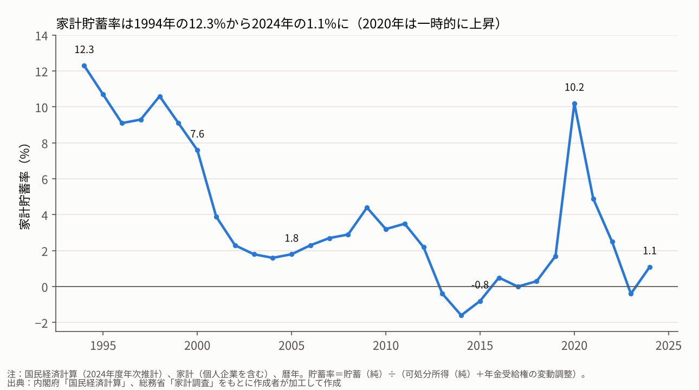
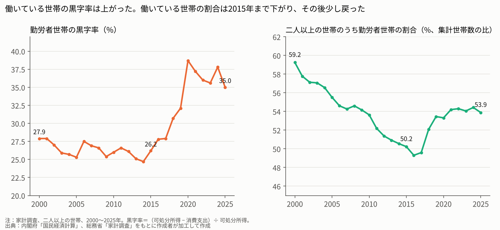
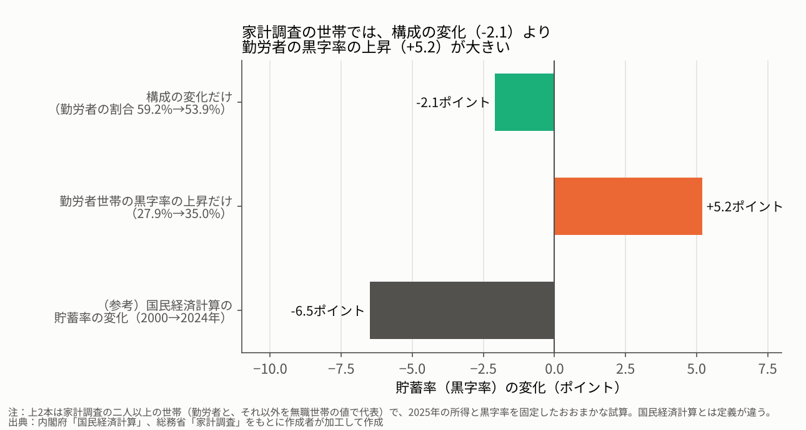
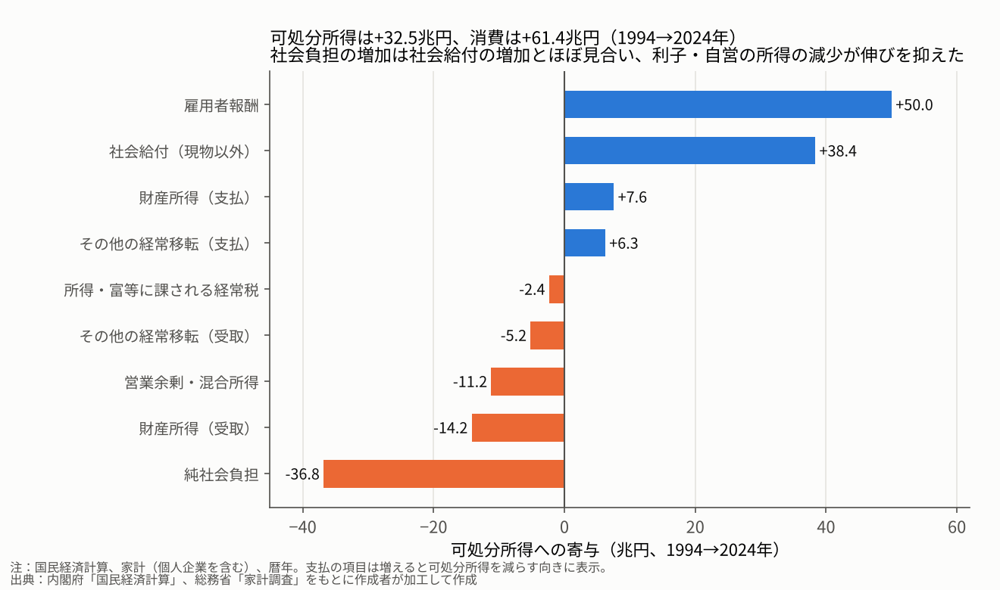

# F347 家計の貯蓄率が下がったのは、高齢化のせいか？ 働く世帯が減った効果は −2.1ポイントで、働く世帯の黒字率の上昇（+5.2）の方が大きい。GDP 統計では利子・自営の所得が減り、所得が消費ほど伸びなかった

国民経済計算（GDP 統計）の家計貯蓄率は、1994年の12.3%から2024年の1.1%まで下がりました。「高齢化で、貯蓄を取り崩して暮らす世帯が増えたから」とよく説明されます。家計調査で、働いている世帯とそれ以外の世帯の構成の変化がどれだけ効くかをおおまかに試算し、国民経済計算の所得の中身も分けました。貯蓄や資産運用についての助言はしません。

## 結論（先に）

1. **国民経済計算の家計貯蓄率は30年で11.2ポイント下がりました。** 1994年12.3%、2000年7.6%、2005年1.8%、2015年 −0.8%、2024年1.1%です（2020年は一時的に10.2%）。
2. **家計調査では、働いている世帯の黒字率はむしろ上がりました。** 二人以上の世帯のうち勤労者世帯の黒字率は、2000年27.9%、2015年26.2%、2025年35.0%です。
3. **構成の変化だけの効果は −2.1ポイントでした。** 勤労者世帯の割合（集計世帯数の比）は2000年59.2%から2025年53.9%に下がりました。2025年の所得と黒字率を固定して構成だけを入れ替えると、合わせた黒字率は2.1ポイント下がります。一方、勤労者世帯の黒字率の上昇だけで +5.2ポイントでした。
4. **問い直し：国民経済計算では、1994→2024年に消費が61.4兆円増えたのに、可処分所得は32.5兆円しか増えませんでした。** 雇用者報酬（+50.0兆円）と社会給付（+38.4兆円）は増えましたが、社会保険料などの純社会負担（−36.8兆円）、利子などの財産所得の受取の減少（−14.2兆円）、自営業などの混合所得の減少（−25.5兆円）が伸びを抑えました。純社会負担の増加は社会給付の増加とほぼ見合う大きさで、差し引きで所得を抑えたのは主に財産所得と混合所得の減少です。



## 問い

家計貯蓄率の低下は、高齢化（貯蓄を取り崩す世帯の増加）でどこまで説明できるのでしょうか。働いている世帯の貯蓄の割合は上がっている、とも言われます。家計調査と国民経済計算の両方から確かめます。

知りたい人：家計の統計や景気のニュースを読む人、金融・保険の仕事で家計の動きを追う人です。

## データ（出典）

- 内閣府「国民経済計算 2024年度年次推計」：家計（個人企業を含む）の所得支出勘定（暦年、1994〜2024年）
- 総務省「家計調査」長期時系列表2：二人以上の世帯・勤労者世帯の年平均（2000〜2025年）
- 総務省「家計調査」2019年・2025年 第3-2表：世帯主の年齢階級別（二人以上・勤労者・無職）

2026-11-16 に取得しました（URL は data/raw/SOURCES.md）。

## 事前の計画

集計の前に [PLAN.md](PLAN.md) を書きました。国民経済計算の貯蓄率の両端の年と、家計調査の2025年の黒字率は、列の位置を確かめるときに見ています。

| 仮説 | 外れの基準 | 結果 | 判定 |
|---|---|---|---|
| H1：勤労者世帯の黒字率は2025年の方が2000年より高い | 低いか同じ | 27.9% → 35.0% | 支持 |
| H2：勤労者世帯の割合は2000→2025年に5ポイント以上下がった | 5ポイント未満 | −5.4ポイント | 支持 |
| H3：構成だけを変えると合わせた黒字率は3ポイント以上下がる | 3ポイント未満 | −2.1ポイント | 外れ |
| H4：国民経済計算の貯蓄率は1994→2024年に8ポイント以上下がった | 8ポイント未満 | −11.2ポイント | 支持（事前ではない） |

## やったこと

- 構成：二人以上の世帯のうち勤労者世帯の割合を、集計世帯数の比で近似（抽出率の調整がないおおまかな値）
- 試算：合わせた黒字率 ＝ Σ（割合 × 可処分所得 × 黒字率）÷ Σ（割合 × 可処分所得）。勤労者世帯と、それ以外の世帯（無職世帯の値で代表）の2つに分け、所得と黒字率を2025年に固定して、割合だけを2000年と2025年で入れ替えた
- 国民経済計算：可処分所得（純）の変化を、受取と支払の項目に分けた

## 分かったこと

### 1. 働いている世帯の黒字率と割合（図2）



- 勤労者世帯の黒字率は2000〜2015年に25〜28%で横ばい、2019年32.1%、2020年38.7%、2025年35.0%です。
- 勤労者世帯の割合は2015年の50.2%まで下がり、その後2019年53.5%、2025年53.9%と少し戻りました。二人以上の世帯の世帯主の平均年齢は52.8歳から60.7歳に上がっています。
- 2025年の黒字率は、勤労者世帯35.0%、無職世帯 −16.4%でした。無職世帯は年齢が低いほど取り崩しが大きく、60〜64歳 −63.6%、75〜79歳 −14.8%です。

### 2. 構成の変化と黒字率の上昇（図3）



- 構成だけを変えた試算は −2.1ポイント（23.3% → 21.2%）でした。勤労者世帯の黒字率の上昇（27.9% → 35.0%）だけの効果は +5.2ポイントです。
- 家計調査の二人以上の世帯の範囲では、構成の変化より黒字率の上昇の方が大きく、国民経済計算の低下（2000→2024年 −6.5ポイント）と向きが合いません。

## 問い直し（結果を見てから足した）

**Q：国民経済計算では、なぜ所得より消費が伸びたのか？**（図4）



- 1994→2024年に、可処分所得（純）は +32.5兆円、消費は +61.4兆円でした（伸び率で +9.3%と +23.3%）。
- 所得の受取では雇用者報酬 +50.0兆円、社会給付 +38.4兆円が増え、財産所得の受取（主に利子）−14.2兆円、営業余剰・混合所得 −11.2兆円（うち自営業などの混合所得 −25.5兆円、持ち家の帰属家賃などの営業余剰 +14.4兆円）が減りました。
- 支払では純社会負担（社会保険料など）が36.8兆円増え、所得を押し下げました。2000→2024年でも、所得 +26.4兆円に対し消費 +44.3兆円、純社会負担の増加は29.9兆円でした。
- 自営業の減少や利子の低下は、家計調査の二人以上の勤労者・無職世帯の黒字率には表れにくい項目です。両者の向きが違う理由の一部と考えられます（推測）。

## 頑健性

| 確かめたこと | 構成だけの変化 | 結論は変わったか |
|---|---|---|
| 主（2025年の所得・黒字率、それ以外＝無職の値） | −2.1ポイント | — |
| それ以外のうち自営などの分を黒字率0%に | −1.9ポイント | 変わらない |
| 2019年の所得・黒字率で | −2.0ポイント | 変わらない |
| 2019年の値で、自営などを0%に | −1.8ポイント | 変わらない |
| 国民経済計算の調整貯蓄率 | 1994年10.7% → 2024年0.9% | 同じ向き |

## 言えないこと

1. 家計調査は二人以上の世帯の数字で、単身世帯や個人企業の分は入りません。国民経済計算の貯蓄率とは定義が違います。
2. 勤労者でも無職でもない世帯（自営業など）を無職世帯の値で代表させるのは、おおまかな近似です。
3. 集計世帯数の比は、世帯の数の割合のおおまかな目安です。
4. 年齢別の黒字率は2019年・2025年だけで、長い期間の年齢構成の変化は試算していません。
5. 社会負担や利子の動きが良いか悪いかは扱いません。

## 仕事で使うなら

- 「高齢化で貯蓄率が下がった」という説明を使うときは、家計調査の働く世帯では黒字率が上がっていること、国民経済計算では利子・自営の所得の減少が大きいこと（社会負担の増加は社会給付の増加とほぼ見合う）を並べると、前提がそろいます。
- 貯蓄率の数字は、国民経済計算と家計調査で定義が違うので、どちらの数字かを明記します。

## 計画からの変更

- 問い直し（国民経済計算の可処分所得の項目別の変化）を足しました。そのため、国民経済計算の第1次・第2次の所得の勘定も読み込みました。

## 再現のしかた

```sh
pip install -r requirements.txt
sh src/run_all.sh     # 02_build → 03_analysis → 03b_requestion → 04_figures（オフライン）
python3 src/01_fetch.py   # 元データを取り直すときだけ
```

| ファイル | 中身 |
|---|---|
| src/02_build.py | Excel から data/*.csv |
| src/03_analysis.py | 貯蓄率・黒字率・構成の試算（results/main.json ほか） |
| src/03b_requestion.py | 可処分所得の項目別の変化（results/requestion.json） |
| src/04_figures.py | 図4枚 |

所要は CPU 1つで約2秒（乱数は使っていません）。results/repro_check.txt：2026-11-16 再実行で15ファイル一致。


## 関連する記事

- 399「世帯の貯蓄は、年齢でどう積み上がっているのか」：全国家計構造調査で貯蓄の残高を年齢別に見た記事。本記事は、貯蓄率（流れ）の低下を、家計調査の構成と国民経済計算の所得の項目に分けた点が違います。

## レビューで直したこと

| # | 指摘 | 直し方 |
|---|---|---|
| 1 | 題名・note の太字が「国民経済計算の低下は社会負担の増加が大きい」としていたが、純社会負担の増加（36.8兆円）は社会給付の増加（38.4兆円）とほぼ見合い、差し引きで所得を抑えたのは主に財産所得と混合所得の減少 | 題名（README・note・status）、結論4、note の太字と図4の節、「仕事で使うなら」、図4の題を直した。md のファイル名は問いの部分が同じなので変更なし |
| 2 | 既存の記事399（年齢別の貯蓄残高）と題材が近い | 「関連する記事」の節を足し、違いを1文で書いた |

## 出典

- 内閣府経済社会総合研究所「国民経済計算 2024年度年次推計」（[統計表](https://www.esri.cao.go.jp/jp/sna/data/data_list/kakuhou/files/2024/2024_kaku_top.html)）
- 総務省統計局「家計調査（家計収支編）」（[e-Stat](https://www.e-stat.go.jp/stat-search/files?page=1&toukei=00200561&tstat=000000330001)）

（いずれも内閣府「国民経済計算」、総務省「家計調査」をもとに作成者が加工して作成）
