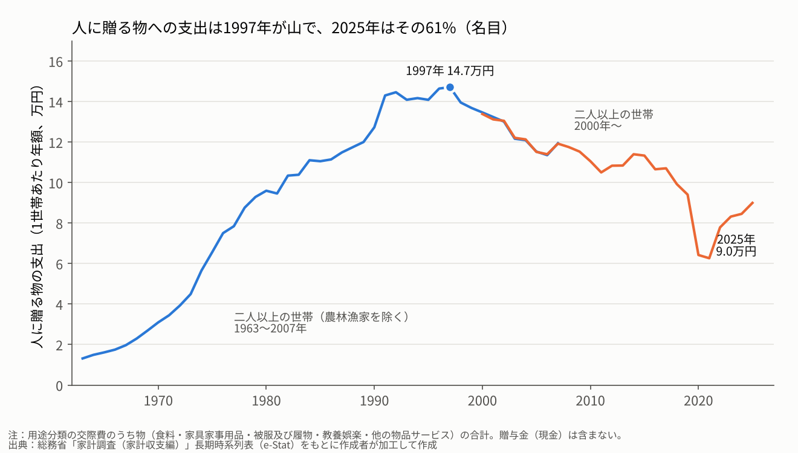
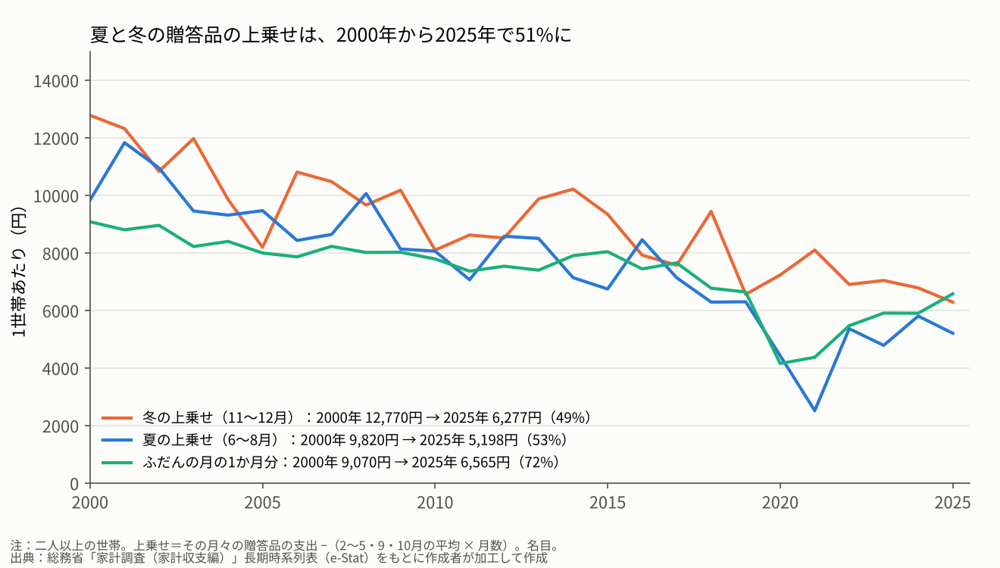
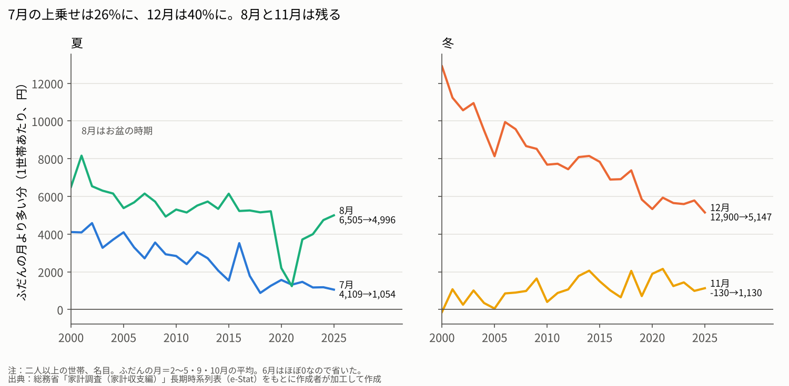
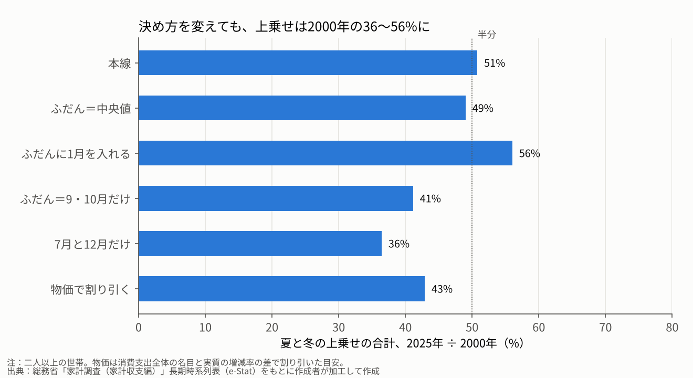

# F348 お中元・お歳暮の支出は、どれだけ減ったのか？ 夏と冬の贈答品の上乗せは2000年から2025年で51%に。7月は4分の1、12月は4割に減り、お盆の8月と11月は残った

（この番号は、もとは別の問いでしたが、予備の問いに替えました。）

家計調査の用途分類（人に贈る物を自分の家で使う物と分けた集計）で、二人以上の世帯が夏と冬に贈答品へ「ふだんの月より多く使う分」が、2000年から2025年でどれだけ減ったか、どの月が減ったかを確かめました。買い方や売り方についての助言はしません。

## 結論（先に）
- 二人以上の世帯が人に贈る物（用途分類の交際費のうち物）に使う額は、1997年の年14.7万円が山。2025年は9.0万円で、山の61%です（名目）。
- 夏（6〜8月）と冬（11〜12月）に「ふだんの月より多く使う分」（上乗せ）は、2000年の22,590円から2025年の11,475円へ、51%になりました。物価で割り引くと43%です。
- 上乗せは、ふだんの月の贈り物（72%に）より速く減りました。季節の贈答という習慣のほうが、贈り物全体より速く縮んでいます。
- いちばん減ったのは7月（お中元の時期）で、4,109円から1,054円へ26%になりました。12月（お歳暮の時期）は12,900円から5,147円へ40%です。一方、お盆の8月は77%が残り、11月はほぼ0から1,130円に増えました。
- 1世帯の人数が減った分を除いて1人あたりにしても、上乗せは59%に減っています。人数の減りだけでは説明できません。

## 問い
「お中元離れ」「お歳暮をやめた」という話はよく聞きます。ただ、家計の支出として、どれくらいの大きさで、いつの時期が減ったのかは、売り場の数字からは分かりにくいものです。贈答品を扱う小売・百貨店・食品メーカーの企画や売り場の担当、季節の売り上げの見通しを立てる人が、家計の側から見た大きさを知るための記事です。

## データ（出典）
- 総務省「家計調査（家計収支編）」長期時系列表 表2 用途分類（月）、二人以上の世帯、2000年1月〜2026年9月。
- 同 表20-1-b 用途分類（年）、二人以上の世帯（農林漁家世帯を除く）、1963〜2007年。
- 用途分類では、人に贈るために買った物は「交際費」の中の食料・家具家事用品・被服及び履物・教養娯楽・他の物品サービスに入ります。品目分類では贈った品も品目のまま（ビールはビール）に入るので、贈答の分を取り出すには用途分類を使います。この5つの合計を「贈答品」と呼びます。現金の贈与金は含めません。

## 事前の計画
[PLAN.md](PLAN.md)（2026-11-16 07:52、集計の前に作成）。ふだんの月＝2〜5・9・10月の平均。上乗せ＝夏・冬の月の支出 − ふだんの月 × 月数。

| 仮説 | 外れの基準 | 結果 | 判定 |
|---|---|---|---|
| H1 上乗せは2000→2025年で半分以下に | 2025年が2000年の50%より大きい | 50.8% | 外れ（ぎりぎり。頑健性の6通りのうち4通りでは50%以下） |
| H2 お中元の方が速く減った | 夏の比が冬の比以上 | 夏53%、冬49% | 外れ（両端の年の比では。年ごとの傾きでは夏 −3.6%/年、冬 −2.3%/年で夏が速い） |
| H3 上乗せはふだんの月より速く減った | 上乗せの比がふだんの比以下 | 51%対72% | 支持 |
| H4 1世帯の人数の減りでは説明できない | 1人あたりの減り方が、1世帯あたりの半分以下 | 1世帯あたり −49%、1人あたり −41% | 支持 |

## やったこと
1. 月の表から、交際費の内訳を年月ごとに取り出しました（02_build.py）。
2. 年ごとに、ふだんの月の平均、夏・冬の上乗せ、年の合計を出し、2000年と2025年を比べました。1人あたり、年ごとの傾き（対数）も出しました（03_analysis.py）。
3. 1963〜2007年の年の表で、贈答品の年額がいつ山だったかを見ました。2000〜2007年の重なりで、二つの表の差は最大0.9%でした。
4. 結果を見てから、上乗せを月ごとに分けました（03b_requestion.py）。

## 分かったこと

### 1. 贈る物への支出は1997年が山（図1）

1963年の年1.3万円から増え続け、1997年に14.7万円で山になりました。その後は下がり続け、2020〜21年に6万円台まで落ちました。2025年は9.0万円に戻りましたが、山の61%です（名目）。

### 2. 夏と冬の上乗せは半分に（図2）

冬の上乗せは12,770円から6,277円（49%）、夏は9,820円から5,198円（53%）、ふだんの月は9,070円から6,565円（72%）でした。年の贈答品の中で、夏・冬の上乗せが占める割合は17%から13%に下がりました。

## 問い直し（結果を見てから足した）

### 7月と12月が減り、8月と11月は残った（図3）

7月だけ・12月だけに絞ると、上乗せの減り方がずっと大きくなりました（頑健性の表）。そこで月ごとに分けました。
- 7月：4,109円 → 1,054円（26%）。8月：6,505円 → 4,996円（77%）。6月は2000年も2025年もほぼ0で、お中元が6月へ早まった形は見えません。
- 12月：12,900円 → 5,147円（40%）。11月：−130円 → 1,130円。冬の上乗せのうち11月の分は、2000〜04年の平均4%から2021〜25年の平均20%に増えました。
- 8月はお盆の時期で、帰省の手みやげやお供えも入ると考えられます（推測。家計調査は贈る理由を分けていません）。8月が残ったことと、2020年の夏の上乗せが2017〜19年平均の67%に落ちたこと（帰省が減った年）は、この見方と矛盾しません。
- 上乗せのうち食べ物（交際費の食料）の割合は、2000〜04年平均93%から2021〜25年平均83%へ下がりました。

つまり「夏の贈答」のうち、お中元にあたる7月は4分の1に縮み、お盆にあたる8月はあまり減っていません。冬はお歳暮にあたる12月が4割に縮み、一部は11月に移った形です。

## 頑健性


| 確かめ方 | 上乗せ合計 2025/2000 | 夏 | 冬 | ふだんの月 |
|---|---|---|---|---|
| 本線（ふだん＝2〜5・9・10月の平均） | 51% | 53% | 49% | 72% |
| ふだん＝同じ月の中央値 | 49% | 51% | 48% | 73% |
| ふだんに1月を入れる | 56% | 61% | 53% | 69% |
| ふだん＝9・10月だけ | 41% | 40% | 42% | 80% |
| 夏＝7月、冬＝12月だけ | 36% | 26% | 40% | 72% |
| 物価で割り引く（2025年の物価の目安は2000年の118） | 43% | 45% | 42% | 61% |
| 2020・2021年を除いた年ごとの傾き | −2.6%/年（本線 −2.8%/年） | | | |
| 2018年の家計簿の様式変更 | 2018年の前年比 +6.7%は、ほかの年の動きの1.1標準偏差で、目立つ段差ではない | | | |

どの決め方でも、上乗せは2000年の36〜56%で、ふだんの月より速く減っています。

## 言えないこと
- お中元・お歳暮そのものではなく、「夏・冬に増える贈答品の支出」を見ています。8月にはお盆の手みやげ、12月には年末のあいさつの品なども入ります。
- 会社が経費で贈る分は家計調査に入りません。百貨店やギフト業界の売り上げとは別もので、売り上げの増減はこの記事からは言えません。
- 二人以上の世帯だけで、単身世帯の分は入りません。単身世帯が増えた分、世の中全体の贈答の額はこれと別の動きをすることがあります。
- ネット通販で直接送った品や、カタログギフト・ギフト券が、どの項目に記入されているかは世帯の記入のしかたによります。ギフト券が「他の物品サービス」以外に入っていれば、物の贈答の減りを大きく見ている可能性があります。
- 1人あたりにしても減っていることは分かるが、高齢の世帯が増えた・やりとりの相手が減ったなど、何が減らしたのかは分けていません。

## 仕事で使うなら
- 夏の贈答の需要を考えるとき、7月と8月を分けて見ると、家計の側では7月の上乗せが大きく縮み、8月はあまり縮んでいない、という前提で数字を読めます。
- 冬は12月の山が低くなり、11月にも分かれています。月ごとの数字は results/requestion_month_excess.csv にあります。

## 計画からの変更
- 問い直し（月ごとの分解、食べ物の割合、2020年の動き）は結果を見てから足しました。計画にはありません。
- H2 は両端の年の比で判定する計画どおりに「外れ」としました。年ごとの傾きでは夏が速いことも書き添えました。
- 長い表（1963〜2007年）は全国と人口5万以上の市の2つの区分が並んでいたので、全国だけを使いました。

## 再現のしかた
```
sh src/run_all.sh        # オフライン。所要約3秒
python3 src/01_fetch.py  # 元データを取り直すときだけ（ネットを使う）
```

| ファイル | 中身 |
|---|---|
| src/02_build.py | data/raw から data/gift_monthly.csv・gift_annual_long.csv・price_annual.csv を作る |
| src/03_analysis.py | 上乗せ、仮説の判定、頑健性 → results/main.json・season_by_year.csv・robustness.csv・long_annual.csv・overlap_check.csv |
| src/03b_requestion.py | 問い直し → results/requestion.json・requestion_month_excess.csv・requestion_food_share.csv |
| src/04_figures.py | 図4枚 |

repro_check：/tmp/rep_F348_r1 に写して流し、15ファイル（results 8、figures 4、data の CSV 3）がすべて cmp で一致しました（results/repro_check.txt）。乱数は使っていません。


## レビューで直したこと

| # | 指摘 | 直し方 |
|---|---|---|
| 1 | README が「だ・である」調で、指示書のです・ます調になっていなかった | README の本文をです・ます調に直した（数字は変更なし） |
| 2 | README の冒頭に作業用のローカルのパス（REPLACED.md の場所）と予備に替える前の問いが書かれていた | 公開に向かないので、予備の問いに替えたことだけを書き、記事の要約の1段落を足した |

## 出典
- 総務省統計局「家計調査（家計収支編）」長期時系列表 表2 用途分類（月）：https://www.e-stat.go.jp/stat-search/file-download?statInfId=000040270657&fileKind=4
- 同 表20-1-b 用途分類（年、1963〜2007年）：https://www.e-stat.go.jp/stat-search/file-download?statInfId=000040270669&fileKind=4

（いずれも 総務省「家計調査（家計収支編）」をもとに作成者が加工して作成）
